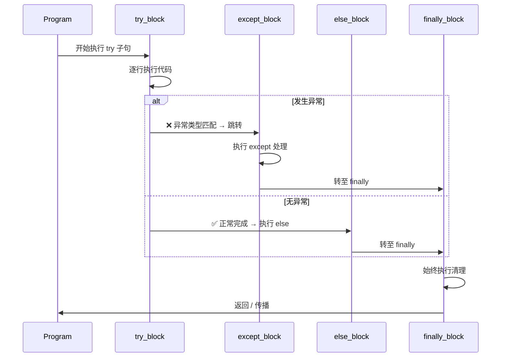
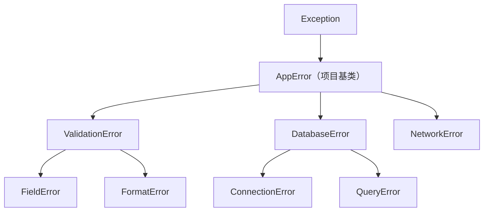

# Day 017 — 异常处理

> 程序总会出错 —— 优雅地处理它们，而非崩溃。

---

## 目录

- [概念与定义](#概念与定义)
- [异常处理结构](#异常处理结构)
- [执行流详解](#执行流详解)
- [异常链与 raise from](#异常链与-raise-from)
- [自定义异常](#自定义异常)
- [断言与防御式编程](#断言与防御式编程)
- [最佳实践](#最佳实践)
- [API 速查表](#api-速查表)
- [常见陷阱](#常见陷阱)
- [思考题](#思考题)

---

## 概念与定义

### 什么是异常？

**异常（Exception）** 是程序执行过程中发生的错误事件，它会中断正常的指令流。Python 使用 **异常对象** 来表示错误，每个异常都是 `BaseException` 或其子类的实例。

```
正常执行流:  A → B → C → D (完成)
异常中断:    A → B → 💥 抛出异常 → 寻找处理器
```

### 异常的核心哲学

| 原则 | 说明 |
|------|------|
| **EAFP** | Easier to Ask for Forgiveness than Permission<br>先做，出错再处理 — Python 首选风格 |
| **LBYL** | Look Before You Leap<br>先检查再做 — 传统风格 |
| **渐进式** | 从宽到窄捕获，从不裸 `except:` |
| **精确性** | 捕获你能处理的异常，其它让它传播 |

**EAFP vs LBYL 对比：**

```python
# LBYL — 先检查
if os.path.exists(path):
    with open(path) as f:
        data = f.read()

# EAFP — 先做，再处理
try:
    with open(path) as f:
        data = f.read()
except FileNotFoundError:
    data = ""
```

### 内置异常层次结构（部分）

```
BaseException
 ├── SystemExit           — sys.exit()
 ├── KeyboardInterrupt    — Ctrl+C
 └── Exception             — 所有常规异常的基类
      ├── StopIteration    — 迭代结束
      ├── ArithmeticError
      │    ├── ZeroDivisionError
      │    └── OverflowError
      ├── LookupError
      │    ├── IndexError
      │    ├── KeyError
      │    └── ...
      ├── OSError
      │    ├── FileNotFoundError
      │    ├── PermissionError
      │    └── ...
      ├── ValueError       — 值不合法
      ├── TypeError        — 类型不匹配
      ├── RuntimeError     — 通用运行时错误
      └── ...
```

---

## 异常处理结构

### 1. `try/except` — 最简形式

```python
try:
    result = 10 / 0
except ZeroDivisionError:
    print("不能除以零！")
```

### 2. `try/except/else` — 无异常时执行

```python
try:
    result = 10 / 2
except ZeroDivisionError:
    print("除零错误")
else:
    print(f"结果是: {result}")  # 仅无异常时执行
```

### 3. `try/except/finally` — 始终执行清理

```python
f = None
try:
    f = open("data.txt")
    data = f.read()
except FileNotFoundError:
    print("文件不存在")
finally:
    if f:
        f.close()  # 无论是否异常都会执行
```

### 4. `try/except/else/finally` — 完整结构

```python
try:
    risky_operation()
except ValueError:
    handle_value_error()
except TypeError as e:
    handle_type_error(e)
else:
    no_exception_happened()
finally:
    always_run_this()
```

### 5. 捕获多个异常

```python
# 元组方式
try:
    value = int(input())
    result = 100 / value
except (ValueError, ZeroDivisionError) as e:
    print(f"输入错误: {e}")

# 分层捕获
try:
    data = {"key": "value"}
    print(data["missing"])
    print(10 / 0)       # 这行不会执行
except KeyError:
    print("键不存在")
except ZeroDivisionError:
    print("除零错误")
```

---

## 执行流详解

### 完整执行时序图



### 详细执行规则矩阵

| 场景 | try | except | else | finally | 异常传播 |
|------|-----|--------|------|---------|----------|
| 无异常 | ✅ 执行 | ❌ 跳过 | ✅ 执行 | ✅ 执行 | ❌ 无 |
| 异常匹配 | ❌ 中断 | ✅ 执行 | ❌ 跳过 | ✅ 执行 | ❌ 停止 |
| 异常不匹配 | ❌ 中断 | ❌ 跳过 | ❌ 跳过 | ✅ 执行后传播 | ✅ 继续向上 |
| return 在 try 中 | ⚡ 暂缓 | — | — | ⚡ 仍执行 | ❌ 无 |
| 异常在 except 中 | — | ❌ 中断 | — | ✅ 执行后传播 | ✅ 新异常 |
| continue/break | ⚡ 暂缓 | — | — | ⚡ 仍执行 | ❌ 无 |
| except 中 raise | — | ❌ 中断 | — | ✅ 执行后传播 | ✅ 新异常 |

> **关键洞察**：`finally` 总会执行，即使 `try` 或 `except` 中有 `return`、`break`、`continue`。它会在这些语句 **生效前** 执行。

### 深入执行细节

#### 场景 1：try 中无异常
```
try 块 → 正常完成 → else 块 → finally 块 → 继续
```

#### 场景 2：try 中有匹配的异常
```
try 块 → 异常抛出 → except 块（匹配） → finally 块 → 继续
```

#### 场景 3：try 中有不匹配的异常
```
try 块 → 异常抛出 → 查找 except（不匹配） → finally 块 → 向上传播
```

#### 场景 4：try 中有 return
```python
def func():
    try:
        return "try"  # ① 暂缓 return
    finally:
        print("finally")  # ② 先执行 finally
    # ③ 然后 return 生效
```

#### 场景 5：多重嵌套异常处理
```python
try:
    try:
        raise ValueError("内层")
    except ValueError:
        print("内层处理")
        raise  # 重抛
except ValueError:
    print("外层处理")  # 外层也能捕获到
```

### 经典案例分析

```python
# Case A: finally 的 return 覆盖异常
>>> def test():
...     try:
...         raise ValueError("原始错误")
...     finally:
...         return 42
>>> test()
42  # ← 异常被覆盖！ValueError 消失了

# Case B: finally 先于 return 执行
>>> def test2():
...     try:
...         return "try"
...     finally:
...         print("清理中...")
>>> print(test2())
清理中...  # ← finally 先执行
try       # ← 然后 return 生效
```

### 异常传播链

```
函数 A → 函数 B → 函数 C → 💥 raise ValueError
   ↓          ↓          ↓
   ← 不处理 ← 不处理 ← 抛出异常
   ↓
   捕获处理 → 程序继续
```

---

## 异常链与 raise from

### 1. 简单的 `raise`

```python
def divide(a, b):
    if b == 0:
        raise ValueError("除数不能为零")  # 主动抛出
    return a / b

try:
    divide(10, 0)
except ValueError as e:
    print(e)
```

### 2. 重抛异常（保留原异常）

```python
try:
    process_data(data)
except ValueError:
    print("记录日志...")
    raise  # 保留完整的 traceback，继续向上传播
```

### 3. `raise ... from` — 异常链

```python
def load_config(path):
    try:
        with open(path) as f:
            return json.load(f)
    except FileNotFoundError as e:
        raise ConfigError("配置文件缺失") from e
```

这会在异常链中建立因果关系：

```
ConfigError: 配置文件缺失
    └─ 由 FileNotFoundError 引发（显式链接）
```

### 4. `raise ... from None` — 抑制异常链

```python
def api_call():
    try:
        return requests.get("https://api.example.com")
    except ConnectionError:
        raise APIError("服务不可达") from None
    # 隐藏底层 ConnectionError 细节
```

---

## 自定义异常

### 定义方式

```python
class MyAppError(Exception):
    """应用异常的基类"""
    pass

class ValidationError(MyAppError):
    """验证错误"""
    def __init__(self, field: str, message: str):
        self.field = field
        self.message = message
        super().__init__(f"[{field}] {message}")

class DatabaseError(MyAppError):
    """数据库错误"""
    pass
```

### 最佳实践

1. **继承自 `Exception`**，而非 `BaseException`
2. **建立层次结构**：项目基类 → 具体子类
3. **添加有用信息**：字段名、错误码、上下文
4. **保持 `__str__` 可读**：`super().__init__(message)` 即可
5. **不处理内部细节**：让上层决定如何展示



---

## 断言与防御式编程

### `assert` 语句

```python
def withdraw(balance: float, amount: float) -> float:
    assert amount > 0, "取款金额必须为正数"
    assert balance >= amount, "余额不足"
    return balance - amount
```

### 何时使用断言

| 场景 | 用断言 | 用异常 |
|------|--------|--------|
| 内部不变量 | ✅ 永远为真的事 | ❌ |
| 前置条件（开发期） | ✅ 检查参数约定 | ❌ |
| 后置条件（开发期） | ✅ 验证返回值 | ❌ |
| 用户输入 | ❌ | ✅ 用 ValueError |
| 外部数据 | ❌ | ✅ 用适当异常 |
| 可恢复错误 | ❌ | ✅ |

> **关键规则**：断言在 `-O`（优化模式）下会被禁用。**不要用断言做输入验证！**

### 防御式编程策略

```python
def safe_divide(a, b):
    """防御式除法"""
    # 类型守卫
    if not isinstance(a, (int, float)):
        raise TypeError(f"a 必须是数字，收到 {type(a).__name__}")
    if not isinstance(b, (int, float)):
        raise TypeError(f"b 必须是数字，收到 {type(b).__name__}")
    # 值守卫
    if b == 0:
        raise ValueError("不能除以零")
    return a / b
```

---

## 最佳实践

### 1. 捕获具体异常

```python
# ❌ 不好的：捕获所有
try:
    data = json.loads(text)
except:  # 连 KeyboardInterrupt 都捕获了！
    pass

# ✅ 好的：精确捕获
try:
    data = json.loads(text)
except json.JSONDecodeError:
    data = {}
```

### 2. 保持异常处理区域最小

```python
# ❌ 不好的：整个函数都包在 try 里
try:
    data = load_data()
    result = process(data)  # 这里出 bug 也吞了
    save_result(result)
except Exception:
    pass

# ✅ 好的：只包裹可能出错的这行
try:
    data = load_data()
except FileNotFoundError:
    data = fallback_data()
result = process(data)
save_result(result)
```

### 3. 使用 `with` 语句管理资源

```python
# ❌ 不好的：手动 finally
f = None
try:
    f = open("file.txt")
    ...
finally:
    if f:
        f.close()

# ✅ 好的：上下文管理器
with open("file.txt") as f:
    ...  # 自动关闭，无需 finally
```

### 4. 异常的层级与传播

```python
def low_level():
    raise PermissionError("无权限")

def mid_level():
    try:
        low_level()
    except PermissionError as e:
        raise AppPermissionError("操作被拒绝") from e

def high_level():
    try:
        mid_level()
    except AppPermissionError as e:
        logger.error(f"应用权限错误: {e}")
        raise  # 或返回错误响应
```

### 5. 记录异常

```python
import logging

logger = logging.getLogger(__name__)

try:
    connect_to_db()
except ConnectionError as e:
    logger.error("数据库连接失败: %s", e, exc_info=True)
    # exc_info=True 会记录完整 traceback
```

---

## API 速查表

| 构造 | 用途 | 示例 |
|------|------|------|
| `raise` | 抛出异常 | `raise ValueError("msg")` |
| `raise` (裸) | 重抛当前异常 | `except: raise` |
| `raise X from Y` | 异常链 | `raise AppErr from original` |
| `raise X from None` | 抑制异常链 | `raise AppErr from None` |
| `assert cond, msg` | 断言 | `assert x > 0, "正数要求"` |
| `try/except` | 捕获异常 | `try: ... except X: ...` |
| `try/except/else` | 无异常回调 | `try: ... except: ... else: ...` |
| `try/finally` | 清理 | `try: ... finally: ...` |
| `try/except/finally` | 完整处理 | 组合所有 |
| `except X as e` | 绑定异常实例 | `except ValueError as e:` |
| `except (X, Y)` | 捕获多个类型 | `except (ValueError, TypeError):` |
| `sys.exc_info()` | 获取当前异常信息 | `exc_type, exc_val, exc_tb` |
| `traceback.format_exc()` | 获取格式化的 traceback | `import traceback` |

### 常用内置异常

| 异常 | 触发场景 |
|------|----------|
| `ValueError` | 参数值不合法 |
| `TypeError` | 操作/函数应用于不适当类型的对象 |
| `IndexError` | 序列索引超出范围 |
| `KeyError` | 字典键不存在 |
| `FileNotFoundError` | 文件或目录不存在 |
| `ZeroDivisionError` | 除数为零 |
| `AttributeError` | 属性引用或赋值失败 |
| `ImportError` | 导入模块失败 |
| `RuntimeError` | 通用运行时错误 |
| `StopIteration` | 迭代器无更多元素 |

---

## 常见陷阱

### 陷阱 1：裸 `except` 捕获了不该捕获的

```python
try:
    while True:
        ...
except:  # ← 连 Ctrl+C 都捕获了！
    pass
# ❌ 程序无法通过 Ctrl+C 退出！

# ✅ 正确方式
except Exception:
    pass
```

### 陷阱 2：空 `except` 吞没异常

```python
try:
    result = unstable_api()
except Exception:
    pass  # ← 静默吞掉！出了 bug 完全不知道
# 如果 unstable_api() 返回 None，下一行报 AttributeError

# ✅ 至少记录或处理
```

### 陷阱 3：异常处理范围过大

```python
try:
    import os
    filename = user_input
    with open(filename) as f:  # NameError: user_input 未定义
        data = f.read()
except FileNotFoundError:
    data = ""  # 捕获不到 NameError，程序崩溃
```

### 陷阱 4：`finally` 中的 `return` 覆盖异常

```python
def bad():
    try:
        raise ValueError("错误")
    finally:
        return 42  # ← 覆盖了 ValueError！

print(bad())  # 输出 42，没有异常！
```

### 陷阱 5：混淆 `raise` 和 `raise from`

```python
# 产生误导链
try:
    json.loads(data)
except ValueError as e:
    raise ValueError("解析失败")  # ← 新的异常，丢失上下文

# ✅ 保留因果关系
except ValueError as e:
    raise ValueError("解析失败") from e
```

---

## 思考题

1. `try/except/finally` 三段中，`finally` 在什么时候 **不会** 执行？（提示：和 `os._exit()` 有关）

**参考答案**

`finally` 几乎总会执行，但有几个例外——核心是**进程被立即终止、根本没机会走清理流程**时：

- `os._exit(n)`：直接在 C 层面终止进程，**不执行 finally、不调用 atexit、不刷新 stdio 缓冲**。这是最典型的答案。
- 进程被操作系统强杀（如 Linux 的 `kill -9` / SIGKILL）、解释器致命崩溃、断电。
- `try` 块里陷入死循环或死锁，永远走不到 finally。

对比：`sys.exit()` 只是抛出 `SystemExit` 异常，**finally 仍会执行**（异常传播路径上会经过 finally）。

```python
import os

def demo():
    try:
        print("进入 try", flush=True)   # flush 确保立即输出
        os._exit(0)                      # 立即终止进程，跳过一切清理
    finally:
        print("finally 不会执行")

demo()
```

预期输出：只有 `进入 try`，finally 里的那句不会打印。

⚠️ 注意：`os._exit()` 连 stdout 缓冲都不刷新——若去掉 `flush=True`，连"进入 try"都可能丢失（实测无输出）。所以它只用于 fork 后的子进程等极少数场景，正常退出请用 `sys.exit()`。

2. 以下代码输出什么？为什么？
```python
def test():
    try:
        return 1
    finally:
        return 2
```

**参考答案**

调用 `test()` 返回 **2**。

原因：`try` 里执行 `return 1` 时，返回值 1 只是被"暂存"，函数并未真正返回；按照规则，**finally 会在 return 生效前先执行**。而 finally 里又有 `return 2`，它直接取代了暂存的返回值，于是函数最终返回 2，try 里的 1 被丢弃。

```python
def test():
    try:
        return 1
    finally:
        return 2

print(test())   # 2
```

预期输出：`2`。

⚠️ 注意：这是反面写法。finally 里 return 不仅覆盖正常返回值，还会**吞掉异常**——即使 try 里 raise 了错误，也会被 finally 的 return 抹掉，让 bug 无声消失。finally 应只做清理（关文件、释放锁），不要写 return/break/continue。

3. 设计一个 `RetryError` 自定义异常和一个 `retry()` 装饰器，使得函数在抛出 `RetryableError` 时重试最多 3 次，否则抛出 `RetryError`。

**参考答案**

先定义两个异常：`RetryableError` 表示"可重试的临时故障"，`RetryError` 表示"重试耗尽"。装饰器只捕获 `RetryableError` 并重试，最多尝试 3 次；仍失败就抛 `RetryError`（用 `from` 链接最后一次原因）。其它异常不捕获，直接向上抛出。

```python
import functools
import time

class RetryableError(Exception):
    """可重试的临时性错误（如网络抖动）"""

class RetryError(Exception):
    """重试次数耗尽后抛出"""

def retry(max_attempts=3, delay=0.0):
    def decorator(func):
        @functools.wraps(func)
        def wrapper(*args, **kwargs):
            last_exc = None
            for attempt in range(1, max_attempts + 1):
                try:
                    return func(*args, **kwargs)
                except RetryableError as e:
                    last_exc = e
                    if attempt < max_attempts:
                        time.sleep(delay)   # 可选：退避等待
            raise RetryError(f"{func.__name__} 重试 {max_attempts} 次仍失败") from last_exc
        return wrapper
    return decorator

# 演示：前两次失败，第三次成功
calls = {"n": 0}

@retry(max_attempts=3)
def flaky():
    calls["n"] += 1
    if calls["n"] < 3:
        raise RetryableError("临时故障")
    return "成功"

print(flaky())        # 成功
print(calls["n"])     # 3

# 演示：一直失败 → 重试耗尽抛 RetryError
@retry(max_attempts=3)
def always_fail():
    raise RetryableError("永远故障")

try:
    always_fail()
except RetryError as e:
    print("捕获:", e)
    print("原因:", type(e.__cause__).__name__)
```

预期输出：

```text
成功
3
捕获: always_fail 重试 3 次仍失败
原因: RetryableError
```

`flaky` 第三次成功，共调用 3 次；`always_fail` 三次都失败，抛出 `RetryError`，其 `__cause__` 是最后一次的 `RetryableError`。

💡 提示：这里"最多 3 次"指含首次在内共尝试 3 次；`functools.wraps` 保留原函数的名字和文档；装饰器原理详见 Day 023-024。`delay` 可设成正数实现退避，避免疯狂重试。

4. 阅读 `contextlib.suppress` 文档，它和 `try/except: pass` 有什么区别？哪个性能更好？

**参考答案**

`contextlib.suppress(*exceptions)` 是一个上下文管理器，作用等价于"try/except 指定异常: pass"，但更简洁、意图更明确。它的 `__exit__` 在遇到指定类型的异常时返回 True（表示"已处理"），从而吞掉异常。

区别：

- **写法**：`with suppress(FileNotFoundError): ...` 一行表明"忽略这类错误"，比 try/except/pass 更声明式。
- **灵活性**：suppress 只能"忽略"，不能在捕获时记日志或做别的处理；需要处理逻辑时仍用 try/except。
- **必须指定异常**：suppress 要传异常类型，不会裸吞所有异常（这点比裸 except 安全）。

性能：两者差异极小。无异常时，try/except 几乎零开销（CPython 3.11+ 是"零成本异常"），而 suppress 多了 `__enter__`/`__exit__` 两次方法调用，略慢一点点；有异常被吞时两者相近。**结论：优先按可读性选择，性能不是决定因素**，常规代码里 try/except 略快。

```python
from contextlib import suppress
import os

# 两种写法等价：删除文件，不存在就算了
with suppress(FileNotFoundError):
    os.remove("不存在的文件.txt")

# 等价于：
try:
    os.remove("不存在的文件.txt")
except FileNotFoundError:
    pass

print("两种写法都安全跳过")
```

预期输出：`两种写法都安全跳过`。文件不存在时两种写法都静默跳过，不报错。

5. 不使用 `try/except`，有哪些方式可以检查一个对象是否可调用、可迭代、或包含某个属性？

**参考答案**

不用自己写 try/except，可以用这些内置工具做"先检查"（LBYL）：

- **可调用**：`callable(obj)` 返回布尔；或 `isinstance(obj, collections.abc.Callable)`。
- **可迭代**：`isinstance(obj, collections.abc.Iterable)`（检查是否有 `__iter__`）；或 `hasattr(obj, "__iter__")`。
- **含某属性**：`hasattr(obj, "name")` 返回布尔；`getattr(obj, "name", 默认值)` 取不到时返回默认值而不报错。

```python
from collections.abc import Iterable, Callable

def f():
    pass

nums = [1, 2, 3]

print(callable(f))                 # True：可调用
print(callable(nums))              # False
print(isinstance(nums, Iterable))  # True：可迭代
print(isinstance(f, Callable))     # True
print(hasattr(nums, "append"))     # True：有 append 属性
print(hasattr(nums, "fly"))        # False
print(getattr(nums, "fly", None))  # None：取不到属性给默认值，不报错
```

预期输出：七行依次为 `True`、`False`、`True`、`True`、`True`、`False`、`None`。

⚠️ 注意：`hasattr`/`getattr` 内部其实仍靠异常机制实现，只是把 try/except 封装好了，你不必自己写。另外只实现了 `__getitem__`（旧式序列协议）的对象也能迭代，但 `isinstance(x, Iterable)` 可能判为 False，必要时再查 `__getitem__`。

6. 以下代码哪里有问题？
```python
def fetch_data():
    try:
        return http_get("https://api.example.com")
    except ConnectionError:
        return None
    except TimeoutError:
        return None
    except Exception:
        return None
```

**参考答案**

主要有两个问题：

1. **三个 except 分支完全冗余**：`ConnectionError`、`TimeoutError` 都是 `Exception` 的子类，最后那个 `except Exception: return None` 已经把它们全覆盖了，前两个分支毫无意义，合并成一个即可。
2. **静默吞掉所有异常并返回 None**：这是更严重的设计问题。调用方无法区分"真的没数据"和"请求失败"；网络错误、甚至代码 bug（如 NameError、TypeError）都被一律抹成 None，出错时无从排查。这违背了"精确捕获、不要静默吞异常"的原则。

用桩函数运行可看到三分支等价（可运行）：

```python
# 用桩函数模拟 http_get，便于运行
def http_get(url):
    raise ConnectionError("模拟断网")

def fetch_data_bad():
    try:
        return http_get("https://api.example.com")
    except ConnectionError:
        return None
    except TimeoutError:
        return None
    except Exception:
        return None

print(fetch_data_bad())   # None —— 三个分支其实做的是同一件事
```

预期输出：`None`。

改进方向：只捕获**预期内**的网络异常（合并为 `except (ConnectionError, TimeoutError)`），记录日志后再决定返回 None 还是抛出领域异常；其它异常不要捕获，让它向上暴露。例如：

```python
import logging
logger = logging.getLogger(__name__)

def fetch_data():
    try:
        return http_get("https://api.example.com")
    except (ConnectionError, TimeoutError) as e:
        logger.warning("网络请求失败: %s", e)
        return None        # 明确：仅网络问题才返回 None
    # 其它异常（如编程错误）不捕获，让它向上抛出
```

💡 提示：若用的是 requests 库，它的 `requests.exceptions.ConnectionError` 与内置 `ConnectionError` 不是同一个类，捕获时要对准库自己的异常类型。

7. 在异步代码中（`async/await`），异常处理机制是否有不同？捕获一个 `asyncio.CancelledError` 的行为是什么？

**参考答案**

异步代码里 `try/except/else/finally` 的机制**基本相同**：可以在 try 里 `await`，捕获被等待协程抛出的异常，异常沿 await 链向上传播；资源管理用 `async with`、异步迭代用 `async for`。

关键不同在 **`asyncio.CancelledError`**：

- 从 Python 3.8 起，它继承自 **`BaseException`** 而非 `Exception`。所以 `except Exception` **捕获不到它**——这是刻意设计，保证取消信号能穿透常规异常处理，让任务真正被取消。
- 当 `task.cancel()` 被调用，任务会在下一个 `await` 处收到 `CancelledError`。如果你捕获了它，**应当重新 `raise`**（或做完清理再 raise）；若吞掉不抛，取消就失效了，任务会继续跑。

```python
import asyncio

# CancelledError 在 3.8+ 继承自 BaseException，而非 Exception
print(issubclass(asyncio.CancelledError, Exception))      # False
print(issubclass(asyncio.CancelledError, BaseException))  # True

async def worker():
    try:
        await asyncio.sleep(10)
    except asyncio.CancelledError:
        print("被取消，先清理")
        raise            # 必须重抛，否则取消失效
    finally:
        print("finally 总会执行")

async def main():
    task = asyncio.create_task(worker())
    await asyncio.sleep(0.1)   # 让 worker 跑起来
    task.cancel()
    try:
        await task
    except asyncio.CancelledError:
        print("main 确认任务已取消")

asyncio.run(main())
```

预期输出：

```text
False
True
被取消，先清理
finally 总会执行
main 确认任务已取消
```

worker 被取消后先清理、重抛，finally 照常执行，main 端确认取消。

⚠️ 注意：Python 3.7 及更早 `CancelledError` 还是 `Exception` 的子类，会被 `except Exception` 误捕；3.8+ 改为 `BaseException` 正是为了修复这个坑。异步细节见 Day 056-057。

---

> **下一课：[Day 018 —— 推导式](../day-018-推导式/)**
