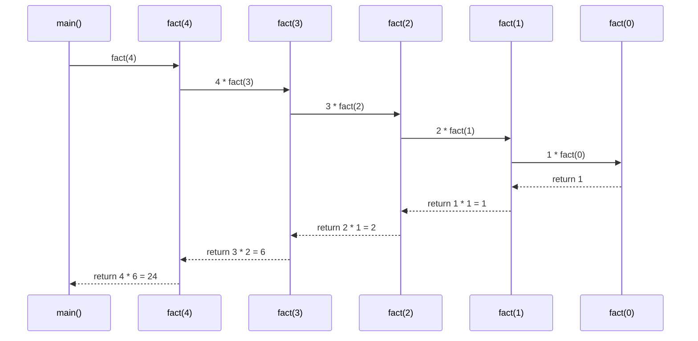
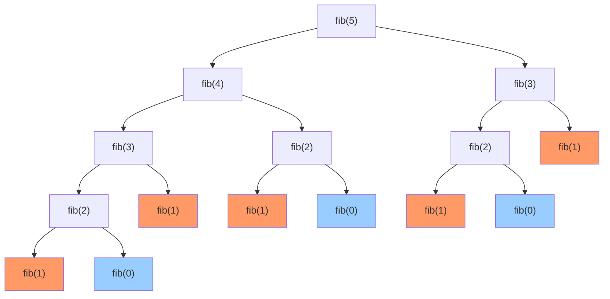

# Day 020 — 递归 (Recursion)

## 概述

**递归（Recursion）** 是一种在函数定义中**调用自身**的编程技术。它通过将大问题分解成结构相同的子问题，使得代码简洁优雅，特别适合处理具有自相似结构的数据（如树、图、嵌套列表等）。

递归的核心哲学：**"To understand recursion, you must first understand recursion."** 🌀

## 📚 递归定义与数学基础

### 数学定义

递归函数通常定义为：

```
f(0) = base_case       ← 基线条件
f(n) = f(n-1) + ...    ← 递归关系
```

### 数学归纳法关联

递归与**数学归纳法**有着深厚的联系：

| 数学归纳法 | 递归实现 |
|-----------|---------|
| 基础情况：证明 P(0) 成立 | 基线条件：处理最简单的情况 |
| 归纳步骤：假设 P(k) 成立，证明 P(k+1) 成立 | 递归步骤：假设规模更小的问题已解决 |
| 结论：P(n) 对所有 n 成立 | 结果：递归函数对所有输入产生正确结果 |

> **理解**：数学归纳法是从小到大证明，递归是从大到小求解——但底层结构完全对应。
>
> **举例**：证明 `1 + 2 + ⋯ + n = n(n+1)/2`
> - 基础情况：n=1 时，左边=1，右边=1(2)/2=1 ✅
> - 归纳步骤：假设 n=k 成立，证明 n=k+1 也成立
> - 递归实现：`def sum_n(n): return 0 if n==0 else n + sum_n(n-1)`
> - **两者完美对应**：基线条件 = 基础情况，递归关系 = 归纳步骤

### 递推关系与闭式解

著名递推关系及其闭式解：

| 递推关系 | 通项公式 | 示例 |
|---------|---------|------|
| T(n) = T(n-1) + 1 | T(n) = n | 线性递归 |
| T(n) = T(n-1) + T(n-2) | 斐波那契数 | 分治递归 |
| T(n) = 2T(n/2) + n | T(n) = n log n | 归并排序 |
| T(n) = 2T(n-1) + 1 | T(n) = 2ⁿ - 1 | 汉诺塔 |

## 🏗️ 调用栈与栈帧模型

### 调用栈（Call Stack）

当程序调用一个函数时，系统会：

1. **压栈**：将当前函数的上下文（局部变量、返回地址等）推入**调用栈**
2. **跳转**：控制权转移到被调函数
3. **执行**：被调函数运行
4. **返回**：被调函数结束后，从栈顶弹出上下文
5. **恢复**：恢复调用者的执行

递归的特殊之处在于——同一个函数被多次压栈，每次压栈的是不同的调用实例。

### 栈帧结构

每个栈帧包含：

```
┌────────────────────────┐
│     返回地址            │  ← 函数结束后回到哪里
├────────────────────────┤
│     局部变量            │  ← n, result 等
├────────────────────────┤
│     参数值              │  ← 调用时传入的值
├────────────────────────┤
│     临时变量            │  ← 编译器优化用
└────────────────────────┘
```

### Python 深递归的 CPython 实现细节

Python 的调用栈由 C 栈实现，每个 PyFrameObject 代表一个栈帧：

```c
// CPython 内部结构（简化）
typedef struct _frame {
    PyObject_VAR_HEAD
    struct _frame *f_back;      // 指向上一个栈帧
    PyCodeObject *f_code;       // 指向代码对象
    PyObject *f_locals;         // 局部变量字典
    PyObject **f_valuestack;    // 值栈底
    Py_ssize_t f_stackdepth;    // 当前栈深度
    int f_lineno;               // 当前行号
} PyFrameObject;
```

每次递归调用：
1. 分配新的 `PyFrameObject`（堆分配，约 512-1024 字节）
2. 通过 `f_back` 指针形成链表
3. Python 的 `sys.getrecursionlimit()` 检查的是框架对象的数量，而非 C 栈大小
4. **默认 1000 是保守值**，CPython 2.7.9 后默认为 1000
5. 可通过 `sys.setrecursionlimit()` 调整，但增大后 C 栈溢出可能导致段错误而非优雅的异常

### recursion tree (递归树) 模型

以 `fib(5)` 为例，递归调用形成一棵树：

```
                    fib(5)
                   /      \
              fib(4)      fib(3)
             /     \      /    \
        fib(3)   fib(2) fib(2) fib(1)
        /    \    /  \   /  \
    fib(2) fib(1) 1  1  1   1
    /   \
   1    1
```

每个节点代表一次函数调用，树的高度代表递归深度。

### Python 递归深度限制

```python
import sys
print(sys.getrecursionlimit())  # 默认 1000
sys.setrecursionlimit(3000)     # 可调大，但小心栈溢出
```

> **为什么有上限？** 每个 Python 函数调用消耗约 1KB 栈空间。1000 层 ≈ 1MB，再大可能导致段错误（Segmentation Fault）。

## 🎯 基线条件与递归条件

每个正确的递归函数必须包含两个部分：

### ⚓ 基线条件 (Base Case)
- 递归的**终止条件**
- 不调用自身，直接返回结果
- 通常是最简单的情况（n=0, n=1, 空列表等）

### 🔁 递归条件 (Recursive Case)
- 函数调用自身
- 每次调用**必须向基线条件逼近**
- 问题规模不断缩小

```python
def countdown(n):
    # 基线条件
    if n <= 0:
        return
    print(n)
    # 递归条件（向基线逼近：n → n-1）
    countdown(n - 1)
```

### 常见错误

```python
# ❌ 缺失基线条件 → RecursionError
def infinite(n):
    return infinite(n + 1)

# ❌ 不向基线逼近 → 也是无限递归
def bad_fact(n):
    if n == 0:
        return 1
    return n * bad_fact(n)  # 没有减小 n
```

## ⚡ 递归 vs 迭代性能对比

| 维度 | 递归 | 迭代 |
|------|------|------|
| **代码简洁性** | ⭐⭐⭐ (数学公式直译) | ⭐⭐ (需要额外变量) |
| **可读性** | 嵌套结构清晰 | 循环直观 |
| **栈空间** | O(n) 额外栈空间 | O(1) 额外空间 |
| **时间复杂度** | 有时有重复计算 | 通常可控 |
| **适用场景** | 树、分治、回溯 | 线性遍历、累加 |
| **极限规模** | 受栈深度限制 (1000) | 无理论限制 |

### 典型对比：斐波那契

```
递归: fib(40) ≈ 0.8s, 3.3 亿次调用
迭代: fib(40) ≈ 0.00001s, 39 次循环
优化后: fib(40) ≈ 0.00005s, 40 次调用 (memoization)
```

## 🌀 尾递归（Tail Recursion）

### 定义

**尾递归**是指递归调用是函数的**最后一个操作**，并且函数的返回值直接就是递归调用的返回值。

```python
# 非尾递归 — 需要保存 n，返回后再乘
def factorial(n):
    if n == 0:
        return 1
    return n * factorial(n - 1)  # 最后操作是乘，不是递归

# 尾递归形式 — 不需要保存额外状态
def factorial_tail(n, acc=1):
    if n == 0:
        return acc
    return factorial_tail(n - 1, n * acc)  # 最后操作就是递归
```

### Python 为什么不支持尾递归优化？

**Python 的设计哲学决定了它不支持尾递归优化（TCO，Tail Call Optimization）：**

1. **栈帧调试信息**：Python 的栈帧包含丰富的调试信息（文件名、行号、局部变量等）。TCO 会丢弃当前栈帧，使调试变得困难。

2. **装饰器兼容性**：尾递归优化会与装饰器、上下文管理器产生复杂的交互。

3. **`sys.settrace()`**：Python 的追踪钩子依赖栈帧引用。

4. **Guido 的立场**：Python 之父 Guido van Rossum 曾明确表示不打算支持 TCO，原因是：
   - TCO 会掩盖栈溢出错误，使调试更困难
   - 鼓励人们使用迭代（更 Pythonic 的方式）

### 尾递归与迭代的转换

尾递归形式可以机械地转换为迭代：

```python
# 尾递归版本
def fact_tail(n, acc=1):
    if n == 0:
        return acc
    return fact_tail(n - 1, n * acc)

# 等价迭代版本
def fact_iter(n):
    acc = 1
    while n > 0:
        acc = n * acc
        n -= 1
    return acc
```

**转换规则**：
- 递归参数 → 循环变量
- 累加器 → 循环中的累加操作
- 基线条件 → 循环终止条件
- 递归调用 → `continue`（回到循环开始）

### 模拟尾递归（手动实现 Trampoline）

虽然 Python 不支持 TCO，但可以使用 **蹦床函数 (Trampoline)** 手动模拟：

```python
def trampoline(f):
    """将尾递归函数转换为迭代执行"""
    def wrapped(*args, **kwargs):
        result = f(*args, **kwargs)
        while callable(result):
            result = result()
        return result
    return wrapped

def fact_trampoline(n, acc=1):
    if n == 0:
        return acc
    # 返回一个 lambda 而非调用自身
    return lambda: fact_trampoline(n - 1, n * acc)

fact_trampoline = trampoline(fact_trampoline)
print(fact_trampoline(10000))  # ✅ 不会栈溢出！
```

> **注意**：Trampoline 本质上是把递归转换成了迭代，虽然保持了递归的代码形式。

> **结论**：在 Python 中不要依赖尾递归优化。如果递归深度可能超过 1000，请使用迭代或蹦床函数。

## 🚨 常见递归陷阱与调试技巧

### 陷阱 1️⃣ 栈溢出 (Stack Overflow)

```python
# 深度 1001 → RecursionError
recurse(1000)  # 刚好在边界
recurse(1001)  # 💥 RecursionError: maximum recursion depth exceeded
```

**解决**：增大递归限制或改用迭代。

### 陷阱 2️⃣ 重复计算 (Redundant Computation)

```python
# fib(5) 计算 fib(3) 两次，fib(2) 三次...
def fib(n):
    if n <= 1:
        return n
    return fib(n-1) + fib(n-2)

# fib(40) 需要约 3.3 亿次调用！
```

**解决**：使用记忆化（Memoization）。

### 陷阱 3️⃣ 可变默认参数共享

```python
# ❌ 共享同一个列表！
def traverse(node, visited=[]):
    visited.append(node)
    for child in node.children:
        traverse(child, visited)

# ✅ 使用 None 并创建新列表
def traverse(node, visited=None):
    if visited is None:
        visited = []
    visited.append(node)
    ...
```

### 调试技巧

**技巧 1：打印调用深度（调用树可视化）**

```python
def factorial(n, depth=0):
    prefix = "  " * depth
    print(f"{prefix}factorial({n}) called")
    if n == 0:
        print(f"{prefix}→ return 1")
        return 1
    result = n * factorial(n - 1, depth + 1)
    print(f"{prefix}→ return {result}")
    return result

# 输出：
# factorial(3) called
#   factorial(2) called
#     factorial(1) called
#       factorial(0) called
#       → return 1
#     → return 1
#   → return 2
# → return 6
```

**技巧 2：使用 `sys.setrecursionlimit` 安全地增加深度**

```python
import sys

# 检查当前限制
print(sys.getrecursionlimit())  # 默认 1000

# 安全增加（不要超过系统栈大小）
sys.setrecursionlimit(10_000)

# ⚠️ 增大限制不是银弹：
# - 超过了系统 C 栈限制会导致 Segfault（段错误）
# - 更深的递归 = 更大的内存消耗
# - 更好的做法：改成迭代
```

**技巧 3：装饰器辅助调试**

```python
def trace_calls(func):
    """装饰器：追踪递归调用次数和参数"""
    def wrapper(*args, **kwargs):
        wrapper.call_count += 1
        return func(*args, **kwargs)
    wrapper.call_count = 0
    return wrapper

@trace_calls
def fib(n):
    if n <= 1:
        return n
    return fib(n-1) + fib(n-2)

fib(10)
print(f"fib(10) 被调用了 {fib.call_count} 次")
# 输出: fib(10) 被调用了 177 次
```

**技巧 4：memoization 优化（性能提升 10⁵ 倍）**

```python
from functools import lru_cache

# 基础版：O(2ⁿ) — fib(40) ≈ 3.3 亿次调用
def fib_naive(n):
    if n <= 1: return n
    return fib_naive(n-1) + fib_naive(n-2)

# 记忆化版：O(n) — fib(40) 仅 41 次调用
@lru_cache(maxsize=None)
def fib_memo(n):
    if n <= 1: return n
    return fib_memo(n-1) + fib_memo(n-2)

# 手动实现 memoization（理解原理）
def make_memoized(func):
    cache = {}
    def memoized(*args):
        if args not in cache:
            cache[args] = func(*args)
        return cache[args]
    return memoized

@make_memoized
def fib_manual(n):
    if n <= 1: return n
    return fib_manual(n-1) + fib_manual(n-2)
```

> **lru_cache VS 手动 memoization**：
> - `@lru_cache` 是生产推荐（线程安全、有缓存上限）
> - 手动实现更易理解原理，适合需求特殊的缓存策略
> - 两者都使用 `dict` 做缓存，时间复杂度 O(1) 查找

## 🎨 Mermaid 图解

### 递归调用栈流程（factorial(4)）



> **优化前 vs 优化后对比**：朴素递归 vs 记忆化递归

```mermaid
flowchart TD
    subgraph 朴素递归[朴素递归 - O(2ⁿ)]
        A1[fib5] --> B1[fib4]
        A1 --> C1[fib3]
        B1 --> D1[fib3]
        B1 --> E1[fib2]
        C1 --> F1[fib2]
        C1 --> G1[fib1]
        D1 --> H1[fib2]
        D1 --> I1[fib1]
        E1 --> J1[fib1]
        E1 --> K1[fib0]
    end

    subgraph 记忆化递归[记忆化递归 - O(n)]
        A2[fib5] --> B2[fib4]
        A2 --> C2[fib3]
        B2 --> D2[fib3]
        B2 --> E2[fib2]
        D2 -.->|缓存命中| C2
        E2 -.->|缓存命中| F2[fib1]
        E2 -.->|缓存命中| G2[fib0]
    end

    朴素递归 -->|冗余计算| 记忆化递归
```

### 递归树（斐波那契 fib(5)）



## 📝 思考题

1. 为什么 Python 的递归深度默认只有 1000？如何安全地增加？

**参考答案**

Python 的每一次函数调用都会在**调用栈**上压入一个栈帧（保存局部变量、返回地址等），在 CPython 中每帧大约消耗 1KB 级别的 C 栈空间，而操作系统给线程的 C 栈是有限的（通常几 MB）。如果不设上限，无限递归或过深递归会直接把 C 栈撑爆，导致**段错误（Segmentation Fault）**——进程被操作系统强杀，连 Python 异常和 traceback 都来不及打印，非常难调试。

因此 CPython 用 `sys.getrecursionlimit()`（默认 1000）作为一道"保险丝"：在真正撑爆 C 栈之前，先抛出一个可捕获的 `RecursionError`，把"硬崩溃"变成"软报错"。1000 是一个保守的经验值，兼顾安全与绝大多数正常需求。

安全增加的方法：

```python
import sys

print(sys.getrecursionlimit())   # 默认 1000
sys.setrecursionlimit(2000)      # 适度调大

def depth(n):
    # 基线条件：n==0 时不再递归
    return 0 if n == 0 else 1 + depth(n - 1)

print(depth(1500))               # 1500：调大后可超过原默认上限
```

预期输出：

```text
1000
1500
```

⚠️ 注意：`setrecursionlimit` 只放宽 Python 层的计数上限，并不能扩大真实的 C 栈。设得过大（如几万）仍可能段错误。更稳妥的做法是把深递归改写成**迭代**，或用显式栈 / 蹦床函数。

2. 哪些问题天然适合用递归解决？哪些问题绝不能用递归？

**参考答案**

**天然适合递归的问题**，共同特征是"结构自相似"——大问题能拆成结构相同、规模更小的子问题：

- 树 / 图的遍历：目录树、DOM 树、二叉树的前中后序遍历、图的深度优先搜索（DFS）。
- 嵌套数据处理：把任意嵌套的列表展开（flatten）、解析 JSON。
- 分治算法：归并排序、快速排序、二分查找。
- 回溯 / 搜索：全排列、N 皇后、迷宫求解、汉诺塔。
- 数学递推：阶乘、斐波那契等可直接由递推式翻译而来。

**不该用递归（或要格外小心）的问题**：

- 递归深度随数据规模线性增长且规模很大：如对上百万元素逐个递归求和、算很大的阶乘——很容易超过 1000 层而 `RecursionError`，应改用迭代。
- 存在大量重复子问题又不加记忆化：如朴素递归斐波那契，会指数级重复计算，必须配合缓存或改成迭代。
- 本质是简单循环的线性累加 / 遍历：用 `for` / `while` 更直观、更省内存，递归只是徒增栈开销。

💡 提示：判断口诀——"子问题结构和原问题一样、且深度可控（对数级或较小）"时优先递归；"深度 ∝ 很大的 n"时优先迭代。

3. 实现一个 `flatten()` 函数，将任意嵌套的列表展开成一维列表。

**参考答案**

```python
def flatten(nested):
    result = []
    for item in nested:
        if isinstance(item, list):      # 是列表 → 递归展开后合并
            result.extend(flatten(item))
        else:                           # 是普通元素 → 直接收集
            result.append(item)
    return result

data = [1, [2, [3, 4], 5], [6, 7], 8]
print(flatten(data))          # [1, 2, 3, 4, 5, 6, 7, 8]
print(flatten([[[[]]]]))      # []
print(flatten([]))            # []
```

预期输出：

```text
[1, 2, 3, 4, 5, 6, 7, 8]
[]
[]
```

思路：遍历每个元素，遇到列表就递归展开并用 `extend` 合并，遇到普通值就 `append`；基线条件是"元素不是列表"，此时不再递归。

⚠️ 注意：这里用 `isinstance(item, list)` 判断，因此字符串不会被误展开（字符串虽可迭代，但不是 list）。若还想展开元组，把判断改成 `isinstance(item, (list, tuple))` 即可。

4. 如何用递归实现二分查找？和迭代版本相比优劣如何？

**参考答案**

```python
def binary_search_recursive(arr, target, low=0, high=None):
    if high is None:
        high = len(arr) - 1
    if low > high:                      # 基线条件：区间为空，未找到
        return -1
    mid = (low + high) // 2
    if arr[mid] == target:
        return mid
    elif arr[mid] < target:             # 目标在右半区
        return binary_search_recursive(arr, target, mid + 1, high)
    else:                               # 目标在左半区
        return binary_search_recursive(arr, target, low, mid - 1)

def binary_search_iterative(arr, target):
    low, high = 0, len(arr) - 1
    while low <= high:
        mid = (low + high) // 2
        if arr[mid] == target:
            return mid
        elif arr[mid] < target:
            low = mid + 1
        else:
            high = mid - 1
    return -1

arr = [1, 3, 5, 7, 9, 11, 13]
print(binary_search_recursive(arr, 7))    # 3
print(binary_search_recursive(arr, 4))    # -1
print(binary_search_iterative(arr, 13))   # 6
```

预期输出：

```text
3
-1
6
```

前提：数组必须**有序**，每次比较中点把搜索区间缩小一半。

优劣对比：两者时间复杂度都是 O(log n)。递归版更贴近"分治"的数学定义、代码简洁，但每层有函数调用开销，且占用 O(log n) 的栈空间；迭代版用 `while` 循环，额外空间 O(1)、无调用开销，工程上通常更受青睐。好在二分查找深度只有 log n（百万元素也才约 20 层），远低于 1000 的递归上限，所以这里用递归是安全的——这点和"深度 ∝ n"的线性递归不同。

5. 斐波那契函数的原始递归版本时间复杂度是多少？如何优化？

**参考答案**

朴素递归 `fib(n) = fib(n-1) + fib(n-2)` 会形成一棵递归树，同一个子问题（如 `fib(3)`）被反复计算无数次。其调用次数满足 T(n)=T(n-1)+T(n-2)+O(1)，增长率约为 **O(φⁿ)（φ≈1.618，黄金比例）**，通常宽松地记作 **O(2ⁿ)**——指数级，n 稍大就慢得无法接受（如 fib(40) 约 3 亿次调用）。

优化核心是**消除重复计算**：

- 记忆化（自顶向下）：用字典或 `functools.lru_cache` 缓存算过的结果，降到 O(n) 时间、O(n) 空间。
- 迭代（自底向上）：从 fib(0)、fib(1) 往上推，只保留最近两个值，O(n) 时间、O(1) 空间，最省内存。

```python
from functools import lru_cache

@lru_cache(maxsize=None)        # 记忆化：把算过的结果缓存起来
def fib_memo(n):
    if n <= 1:
        return n
    return fib_memo(n - 1) + fib_memo(n - 2)

def fib_iter(n):                # 自底向上迭代：只保留最近两个值
    a, b = 0, 1
    for _ in range(n):
        a, b = b, a + b
    return a

print([fib_memo(i) for i in range(10)])   # [0, 1, 1, 2, 3, 5, 8, 13, 21, 34]
print(fib_iter(40))                        # 102334155
print(fib_memo(40))                        # 102334155
```

预期输出：

```text
[0, 1, 1, 2, 3, 5, 8, 13, 21, 34]
102334155
102334155
```

两种优化都能瞬间算出 fib(40)，而朴素递归要等很久。

6. 汉诺塔问题的步数为什么是 2ⁿ - 1？请用数学归纳法证明。

**参考答案**

设移动 n 个盘子所需的最少步数为 T(n)。汉诺塔的递归策略是：先把上面 n-1 个盘子借助目标柱移到辅助柱（T(n-1) 步），再把最大的盘子移到目标柱（1 步），最后把 n-1 个盘子从辅助柱移到目标柱（T(n-1) 步）。于是得到递推式：T(n) = 2·T(n-1) + 1，且 T(1) = 1。

**用数学归纳法证明 T(n) = 2ⁿ - 1：**

- 基础情况：n=1 时，T(1)=1，而 2¹-1=1，成立。
- 归纳假设：设 n=k 时成立，即 T(k)=2ᵏ-1。
- 归纳步骤：n=k+1 时，T(k+1)=2·T(k)+1=2·(2ᵏ-1)+1=2ᵏ⁺¹-2+1=2ᵏ⁺¹-1，恰好符合公式。
- 结论：由归纳法，对所有 n≥1 都有 T(n)=2ⁿ-1。

下面用代码按递推式实际计数，验证与公式一致：

```python
def hanoi_moves(n):
    if n == 0:
        return 0
    return 2 * hanoi_moves(n - 1) + 1     # 递推式 T(n)=2T(n-1)+1

for n in range(1, 6):
    print(n, hanoi_moves(n), 2**n - 1)     # 两列应完全相等
```

预期输出（第 2、3 列完全相等）：

```text
1 1 1
2 3 3
3 7 7
4 15 15
5 31 31
```

7. Python 不支持尾递归优化的根本原因有哪些？

**参考答案**

Python（CPython）刻意不做尾递归优化（TCO），根本原因来自设计哲学与实现约束：

1. **保留完整调用栈用于调试**：Python 的 traceback 依赖栈帧链。TCO 会复用 / 丢弃当前栈帧，出错时就看不到完整调用历史，调试体验大打折扣。Guido 认为"清晰的报错"比"省一点栈"更重要。
2. **栈帧携带丰富信息**：每个帧保存文件名、行号、局部变量等，`sys.settrace()`、调试器、性能分析器都依赖这条帧链；TCO 会破坏这些工具的工作基础。
3. **与装饰器 / 生成器 / 上下文管理器交互复杂**：这些特性都假设帧按调用顺序存在，尾调用复用帧会让语义难以保证。
4. **Guido 明确反对**：他在《Tail Recursion Elimination》一文中表示不打算支持 TCO，并鼓励用**迭代**这一更 Pythonic 的方式处理循环。

因此在 Python 里，深递归应改写成迭代、显式栈或蹦床函数，而不是指望尾递归被自动优化。

8. 编写一个装饰器来统计递归函数被调用的总次数。

**参考答案**

```python
import functools

def count_calls(func):
    @functools.wraps(func)          # 保留原函数的名字等元信息
    def wrapper(*args, **kwargs):
        wrapper.count += 1          # 每被调用一次就 +1
        return func(*args, **kwargs)
    wrapper.count = 0               # 计数器挂在 wrapper 上
    return wrapper

@count_calls
def fib(n):
    if n <= 1:
        return n
    return fib(n - 1) + fib(n - 2)  # 递归调用同样会被计数

print(fib(10))       # 55
print(fib.count)     # 177
```

预期输出：

```text
55
177
```

原理：装饰后全局名字 `fib` 指向的是 `wrapper`，所以函数体内部的每次递归调用其实都在调用 `wrapper`，计数器因此能统计到**全部**调用（含递归）。`fib(10)` 的结果是 55，总调用次数为 177。

⚠️ 注意：`count` 是累计值，跨多次调用会一直累加；若想重新统计，先执行 `fib.count = 0` 再调用。

## 🔗 延伸阅读

- [Recursion (Computer Science) — Wikipedia](https://en.wikipedia.org/wiki/Recursion_(computer_science))
- [The Recursive Book of Recursion — Al Sweigart](https://nostarch.com/recursive-book-recursion)
- [Python: Why is recursion depth limited? — Stack Overflow](https://stackoverflow.com/questions/3323001/what-is-the-maximum-recursion-depth-in-python-and-how-to-increase-it)
- [Tail Recursion Elimination — Guido van Rossum](http://neopythonic.blogspot.com/2009/04/tail-recursion-elimination.html)
