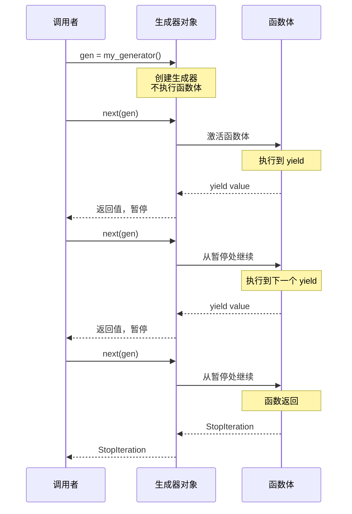
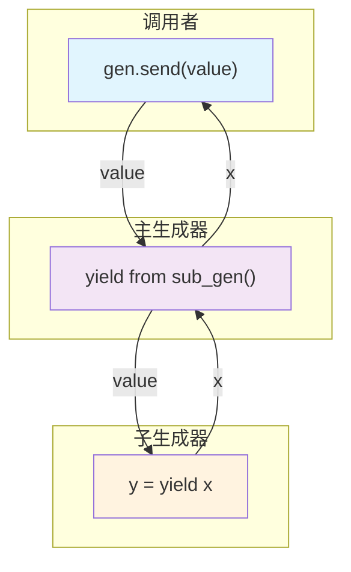

# Day 022 — 生成器 (Generator)

<!-- Updated 2026-06-15: Added yield from code examples and bidirectional communication explanation -->

## 概述

**生成器（Generator）** 是 Python 中最优雅的惰性求值工具。它结合了迭代器的所有优点（惰性、节省内存），同时用 `yield` 关键字提供了极其简洁的语法。

> **一句话理解**：生成器是"可以暂停执行的函数"，每次 yield 都会保存当前状态，下次调用时从暂停处继续执行。

## 📚 生成器函数 vs 生成器表达式

### 生成器函数

用 `def` 定义，用 `yield` 返回值：

```python
def count_up_to(n):
    """生成 0 到 n-1"""
    i = 0
    while i < n:
        yield i
        i += 1
```

调用生成器函数返回一个**生成器对象**（Generator Object），不会立即执行函数体。

### 生成器表达式

用圆括号的推导式语法：

```python
# 生成器表达式（惰性）
squares = (x**2 for x in range(10))

# 对比：列表推导式（立即求值）
squares_list = [x**2 for x in range(10)]
```

### 对比速查

| 特性 | 生成器函数 | 生成器表达式 | 列表推导式 |
|------|-----------|-------------|-----------|
| **语法** | `def f(): yield x` | `(x for x in it)` | `[x for x in it]` |
| **求值时机** | 惰性（调用时） | 惰性（迭代时） | 立即 |
| **内存** | O(1) | O(1) | O(n) |
| **可重用** | 每次调用创建新的 | 每次求值创建新的 | 可重复使用 |
| **复杂逻辑** | ✅ 支持 | ❌ 仅简单表达式 | ❌ 仅简单表达式 |
| **多次 yield** | ✅ 支持 | ❌ 仅一次 | ❌ 仅一次 |

## ⚙️ yield 关键字原理（状态机模型）

### yield 的底层机制

Python 的生成器实际上是**编译为状态机的函数**。当 Python 编译器遇到 `yield` 关键字时，它会：

1. 将函数编译为 **生成器代码对象**
2. 生成器对象包含：
   - **`gi_frame`** — 当前栈帧（冻结的执行状态）
   - **`gi_running`** — 是否正在执行
   - **`gi_code`** — 代码对象
   - **`gi_yieldfrom`** — 如果使用了 `yield from`

### 状态机模型

```python
def demo():
    print("开始")
    yield 1
    print("继续")
    yield 2
    print("结束")
```

编译后的逻辑等价于：

```
状态机：
  ┌─────────┐
  │ 状态 0  │ → print("开始"), yield 1, 切换到 状态 1
  ├─────────┤
  │ 状态 1  │ → print("继续"), yield 2, 切换到 状态 2
  ├─────────┤
  │ 状态 2  │ → print("结束"), 返回/StopIteration
  └─────────┘
```

### 执行流程图

```
调用 gen = demo()      → 创建生成器对象，不执行任何代码
next(gen)              → 执行到第一个 yield：
                            print("开始")
                            yield 1 → 返回值 1，暂停
next(gen)              → 从暂停处继续：
                            print("继续")
                            yield 2 → 返回值 2，暂停
next(gen)              → 从暂停处继续：
                            print("结束")
                            → 函数返回 → StopIteration
```

### 函数 vs 生成器的栈帧对比

```
普通函数调用：
┌────────────────────────────┐
│  栈帧创建                   │
│  执行全部代码                │
│  栈帧销毁                   │
└────────────────────────────┘

生成器调用：
┌────────────────────────────┐
│  栈帧创建（冻结）            │
│  ...                        │
│  ┌──────────────────────┐  │
│  │ yield → 返回值       │  │  ← 暂停，栈帧保持在堆上
│  │ ...                  │  │
│  │ 从上次暂停处继续     │  │  ← 恢复执行
│  │ yield → 返回值       │  │  ← 再次暂停
│  └──────────────────────┘  │
│  函数返回 → StopIteration  │
│  栈帧销毁                   │
└────────────────────────────┘
```

## 🔧 生成器状态与 send()/throw()/close()

### 生成器生命周期

```
    gen = func()          next(gen)        next(gen)      StopIteration
    ┌────────┐          ┌────────┐       ┌────────┐       ┌────────┐
    │创建    │─────────→│ 挂起   │──────→│ 挂起   │──────→│ 结束   │
    │(GEN_CREATED)│      │(SUSPENDED)│   │(SUSPENDED)│    │(CLOSED)│
    └────────┘          └────────┘       └────────┘       └────────┘
                              ↑               ↑
                         send(value)     send(value)
```

| 方法 | 作用 | 说明 |
|------|------|------|
| `next(gen)` | 推进到下一个 yield | 等价于 `gen.send(None)` |
| `gen.send(value)` | 推进到下一个 yield并传入值 | `value` 作为当前 yield 表达式的返回值 |
| `gen.throw(exc)` | 在暂停处抛出异常 | 异常由 yield 处的 try/except 捕获 |
| `gen.close()` | 停止生成器 | 在暂停处抛出 `GeneratorExit` |

### send() 的两种设计模式

```python
# 模式 1: 协程 — 两次 yield 之间传递值
def echo():
    while True:
        received = yield  # 只接收，不发送
        print(f"收到: {received}")

gen = echo()
next(gen)           # 启动到第一个 yield
gen.send("Hello")   # 发送值
gen.send("World")

# 模式 2: 累加器 — 每次发送值，yield 返回累计结果
def accumulator():
    total = 0
    while True:
        value = yield total  # 发送累计值，接收新值
        total += value

gen = accumulator()
next(gen)                # 启动，返回 total=0
print(gen.send(10))      # total=10 → yield 10
print(gen.send(20))      # total=30 → yield 30
```

### throw() 和 close()

```python
def safe_generator():
    try:
        while True:
            yield 1
    except GeneratorExit:
        print("正在关闭...")
        # 可以执行清理操作
    except ValueError:
        print("收到 ValueError")

gen = safe_generator()
next(gen)          # 1
gen.throw(ValueError)  # "收到 ValueError"，然后继续 yield 1
gen.close()        # "正在关闭..."，然后停止
```

## 🔄 生成器 vs 迭代器对比

| 特性 | 迭代器 | 生成器 |
|------|--------|--------|
| **实现方式** | 手动定义类，实现 `__iter__` 和 `__next__` | 使用 `yield` 关键字的函数或表达式 |
| **代码量** | 较多（完整类定义） | 极少（一个函数） |
| **状态管理** | 手动维护（self.index 等） | 自动维护（栈帧冻结） |
| **send/throw/close** | 不支持 | 支持 |
| **yield from** | 不支持 | 支持 |
| **可读性** | 一般 | 优秀 |

```python
# 迭代器方式（手动管理状态）
class CountUp:
    def __init__(self, n):
        self.n = n
        self.i = 0
    def __iter__(self):
        return self
    def __next__(self):
        if self.i >= self.n:
            raise StopIteration
        val = self.i
        self.i += 1
        return val

# 生成器方式（自动管理状态）
def count_up(n):
    i = 0
    while i < n:
        yield i
        i += 1
```

## 💡 yield from 语法

### 基本用法

`yield from` 将迭代/生成的操作委托给子生成器，简化生成器的嵌套使用。

```python
def chain(*iterables):
    """chain 的生成器实现"""
    for it in iterables:
        yield from it  # 委托给子迭代器

# 对比原始写法
def chain_manual(*iterables):
    for it in iterables:
        for item in it:  # 需要手动嵌套循环
            yield item
```

### flatten 嵌套列表

```python
def flatten(items):
    """递归展开嵌套列表"""
    for item in items:
        if isinstance(item, (list, tuple)):
            yield from flatten(item)  # 递归委托
        else:
            yield item

# 测试
nested = [1, [2, [3, 4]], 5]
print(list(flatten(nested)))  # [1, 2, 3, 4, 5]
```

### yield from 的双向通信

`yield from` 的独特之处在于，它会在调用者和子生成器之间建立**双向通道**：

```python
def sub_gen():
    """子生成器"""
    received = yield "子-准备就绪"
    print(f"子: 收到 {received}")
    result = yield "子-处理完成"
    print(f"子: 收到 {result}")
    return "子-最终结果"

def main_gen():
    """主生成器，通过 yield from 委托给子生成器"""
    result = yield from sub_gen()
    print(f"主: 子返回了 {result}")

gen = main_gen()
print(next(gen))         # 启动 → 进入 sub_gen → "子-准备就绪"
print(gen.send("数据1"))  # 发送 → sub_gen → "子-处理完成"
try:
    gen.send("数据2")     # 发送 → sub_gen 返回 → 主生成器结束
except StopIteration:
    print("完成")
```

## 🎨 Mermaid 图解

### 生成器执行流程



### yield from 双向通道



## 📝 思考题

1. 生成器函数和普通函数在字节码层面有什么区别？

**参考答案**

最本质的区别是：**生成器函数的代码对象带有 `CO_GENERATOR` 标志位（值 0x20 = 32）**，字节码里含有 `YIELD_VALUE`（3.11+ 还有 `RESUME`、`RETURN_GENERATOR` 等）；普通函数没有这个标志，也没有 `YIELD_VALUE`，以 `RETURN_VALUE` 结束。

这个标志带来了调用行为的差异：调用普通函数会立即创建栈帧、执行整个函数体并返回值；调用生成器函数**只创建一个生成器对象**（持有冻结的栈帧 `gi_frame`），并不执行函数体，直到 `next()` 才开始运行。

```python
def normal():
    return 1

def gen():
    yield 1

# 生成器函数的代码对象带 CO_GENERATOR 标志位（0x20 = 32）
print(normal.__code__.co_flags & 0x20)   # 0
print(gen.__code__.co_flags & 0x20)      # 32

print(normal())          # 普通函数：立即执行并返回值 1
g = gen()                # 生成器函数：只创建对象，不执行函数体
print(type(g))           # <class 'generator'>
print(g.gi_frame is not None)   # True：持有冻结的栈帧
```

预期输出：

```text
0
32
1
<class 'generator'>
True
```

一句话：普通函数"一次跑完"，生成器函数被编译成"可暂停的状态机"，栈帧保存在堆上，可反复挂起 / 恢复。

2. 什么时候应该用生成器表达式而不是列表推导式？

**参考答案**

**优先生成器表达式**的场景：

- 只需要**遍历一次**，尤其是直接喂给 `sum` / `any` / `all` / `max` / `min` / `''.join(...)` 这类聚合函数时，不必先物化成列表。
- 数据量大或无限，想**省内存**（O(1) 而非 O(n)）。
- 需要**短路求值**：`any` / `all` 一旦确定结果就停止，生成器不会计算剩余元素。

**用列表推导式**的场景：结果要多次复用、要索引 / 切片、要 `len()`、要排序或修改——这些都必须先物化成列表。

```python
# 生成器表达式直接喂给 sum：逐个计算，不建完整列表
total = sum(x * x for x in range(5))
print(total)   # 30

# 惰性：生成器表达式直到被迭代才计算
gen = (x * x for x in range(5))
print(next(gen))   # 0：只算第一个
```

预期输出：

```text
30
0
```

💡 提示：`sum([x*x for x in range(10**7)])` 会先建一个千万元素的列表（内存峰值高）；`sum(x*x for x in range(10**7))` 边算边加，几乎不占额外内存。凡是"只产出、喂给一个聚合"的场合，优先生成器表达式。

3. `yield` 和 `return` 在生成器函数中同时出现会发生什么？

**参考答案**

两者可以共存，各司其职：`yield` 负责"产出一个值并暂停"，`return` 负责"终止生成器"。执行到 `return` 时生成器立即结束，**返回值会被装进 `StopIteration` 异常的 `value` 属性**（裸 `return` 相当于 `return None`）。这个返回值能被 `yield from` 捕获。

```python
def gen():
    yield 1
    yield 2
    return "done"      # 返回值会装进 StopIteration.value

g = gen()
print(next(g))   # 1
print(next(g))   # 2
try:
    next(g)      # 触发 return → StopIteration
except StopIteration as e:
    print(e.value)   # done
```

预期输出：

```text
1
2
done
```

⚠️ 注意：普通 `for` 循环或 `next()` 拿不到这个返回值——它藏在 `StopIteration.value` 里；只有 `result = yield from gen()` 才能直接取得。另外 `return` 一旦执行，生成器就耗尽了，再 `next()` 只会抛 `StopIteration`。

4. 生成器在执行 `close()` 后还能继续使用吗？

**参考答案**

**不能。** `close()` 会在生成器的暂停处抛出 `GeneratorExit` 异常，给它一个执行清理代码（`finally` / `except GeneratorExit`）的机会，随后生成器**永久关闭**：栈帧被释放（`gi_frame` 变为 `None`），之后再 `next()` 或 `send()` 都只会抛 `StopIteration`，无法重启。

```python
def gen():
    try:
        yield 1
        yield 2
    finally:
        print("清理")

g = gen()
print(next(g))    # 1
g.close()         # 在暂停处抛 GeneratorExit → 执行 finally
print(g.gi_frame is None)   # True：栈帧已释放
try:
    next(g)       # 已关闭，无法继续
except StopIteration:
    print("StopIteration")
```

预期输出：

```text
1
清理
True
StopIteration
```

⚠️ 注意：如果生成器捕获 `GeneratorExit` 后又 `yield`（拒绝关闭），`close()` 会抛 `RuntimeError: generator ignored GeneratorExit`。正确做法是捕获后只做清理，然后让生成器自然结束。

5. `yield from` 和 `for item in sub:` 相比有什么优势？

**参考答案**

如果只是"逐个取值"，`yield from sub` 和 `for item in sub: yield item` 产出相同；但 `yield from` 在调用者与子生成器之间建立了**透明的双向通道**，这是 `for` 循环做不到的：

- **捕获子生成器的返回值**：`yield from` 表达式的值就是子生成器 `return` 的值。
- **转发 `send()`**：调用者发送的值会直达子生成器的 `yield` 表达式。
- **转发 `throw()` / `close()`**：异常和关闭信号直接传给子生成器处理。
- 代码更简洁，且委托在 C 层面完成，略快。

```python
def sub():
    yield 1
    yield 2
    return "子生成器的返回值"

def delegating():
    result = yield from sub()      # yield from 能拿到子生成器的 return 值
    print("yield from 捕获:", result)

def manual():
    for item in sub():             # for 循环拿不到 return 值
        yield item

print(list(delegating()))
print(list(manual()))
```

预期输出：

```text
yield from 捕获: 子生成器的返回值
[1, 2]
[1, 2]
```

可见 `delegating` 拿到了子生成器的返回值，而 `manual` 只能转发 1、2，对返回值一无所知。这正是协程委托必须用 `yield from` 的原因。

6. 如何实现一个可重复使用的生成器？

**参考答案**

先厘清两个概念：**生成器对象是一次性的**，耗尽后不能重来；但**生成器函数是可复用的"工厂"**，每次调用都产生一个全新生成器。所以"可重复使用"通常有三种做法：

1. **重新调用生成器函数**，拿到新对象。
2. **包成可迭代对象**：实现 `__iter__`，每次返回一个新生成器，于是该对象能被反复 `for`。
3. 数据量小时，干脆 `list(...)` **物化成列表 / 元组**。

```python
def count_up(n):           # 生成器函数：每次调用都产生全新生成器
    for i in range(n):
        yield i

g = count_up(3)
print(list(g))   # [0, 1, 2]
print(list(g))   # []：同一个生成器对象已耗尽

print(list(count_up(3)))   # 重新调用函数 → 新生成器 → [0, 1, 2]

class ReusableCount:       # 包成可迭代对象：每次 iter() 返回新生成器
    def __init__(self, n):
        self.n = n
    def __iter__(self):
        return count_up(self.n)

rc = ReusableCount(3)
print(list(rc))   # [0, 1, 2]
print(list(rc))   # [0, 1, 2]：可反复遍历
```

预期输出：

```text
[0, 1, 2]
[]
[0, 1, 2]
[0, 1, 2]
[0, 1, 2]
```

关键：不要试图"重置"已耗尽的生成器对象，而是每次遍历都创建一个新的。

7. 协程和生成器是什么关系？Python 中的 `async def` 和 `def` + `yield` 有什么联系？

**参考答案**

两者同源，都建立在"可暂停 / 可恢复的函数"这一核心机制上：

- **生成器**（PEP 255）最初只能"产出"值（`yield`）。PEP 342 增加了 `send()` / `throw()` / `close()`，让暂停时还能"接收"外部传入的值——生成器由此变成**基于生成器的协程**：既能产出又能消费，调用者与函数交替执行。早期 asyncio 正是用 `@asyncio.coroutine` + `yield from` 这么写的。
- **原生协程**（PEP 492，Python 3.5）用 `async def` + `await`。调用 `async def` 函数返回一个**协程对象**，由事件循环驱动，专门用于异步 I/O。`await` 在语义上与 `yield from` 高度相似——都是把控制权委托给子任务并暂停当前帧，等子任务完成再恢复。
- **联系与区别**：底层"栈帧挂起 / 恢复"的思想一致；但 `async def` 不再是生成器（函数体里没有 `yield`），它是专用、更清晰的异步抽象。基于生成器的协程已被淘汰（`@asyncio.coroutine` 在 3.11 移除），现代代码应统一用 `async` / `await`。

💡 提示：在 `async def` 里写 `yield`，会得到**异步生成器**（PEP 525），用 `async for` 消费——那又是另一个东西，别混淆。

8. 如果生成器函数中有多个 `yield` 语句，状态机会如何处理？

**参考答案**

每个 `yield` 都是状态机的一个**暂停点（状态）**。生成器的栈帧里保存着"当前执行到哪条指令"（即停在哪个 yield）以及所有局部变量。每次 `next()` 都从上次暂停处恢复，向下执行直到遇到**下一个** `yield`（或 `return`）再次暂停。于是多个 `yield` 按先后顺序被逐个经过，状态依次推进，局部变量全程保留。

```python
def demo():
    print("状态0：开始")
    yield 1
    print("状态1：继续")
    yield 2
    print("状态2：结束")

g = demo()
print(next(g))   # 打印 状态0，返回 1，暂停在第一个 yield
print(next(g))   # 打印 状态1，返回 2，暂停在第二个 yield
try:
    next(g)      # 打印 状态2，函数结束 → StopIteration
except StopIteration:
    print("迭代结束")
```

预期输出：

```text
状态0：开始
1
状态1：继续
2
状态2：结束
迭代结束
```

可以看到函数被两个 `yield` "切"成三段，每次 `next()` 恰好执行一段；这就是状态机沿 `yield` 线性推进的直观体现。

## 🔗 延伸阅读

- [PEP 255 — Simple Generators](https://peps.python.org/pep-0255/)
- [PEP 342 — Coroutines via Enhanced Generators](https://peps.python.org/pep-0342/)
- [PEP 380 — Syntax for Delegating to a Subgenerator](https://peps.python.org/pep-0380/)
- [Python docs: Generator Types](https://docs.python.org/3/library/stdtypes.html#generator-types)
- [Python docs: yield expression](https://docs.python.org/3/reference/expressions.html#yield-expressions)
