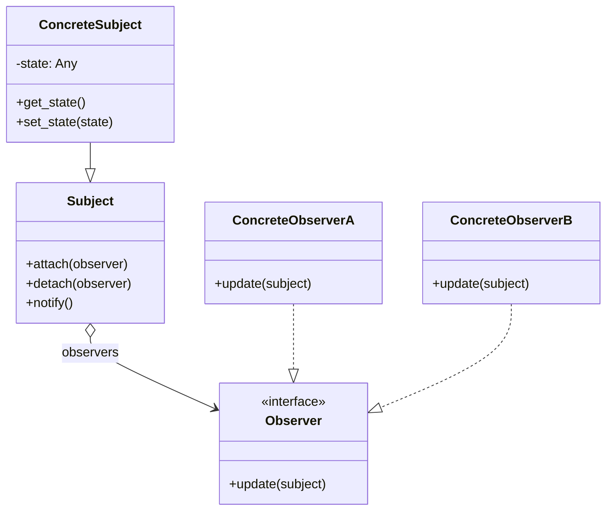
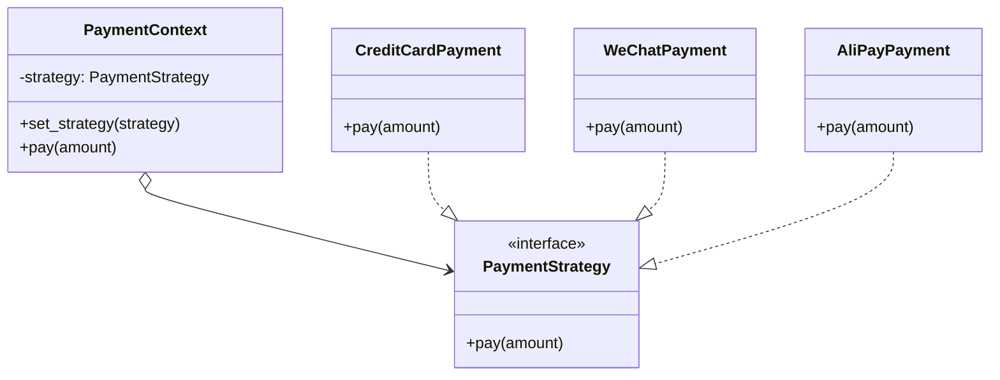
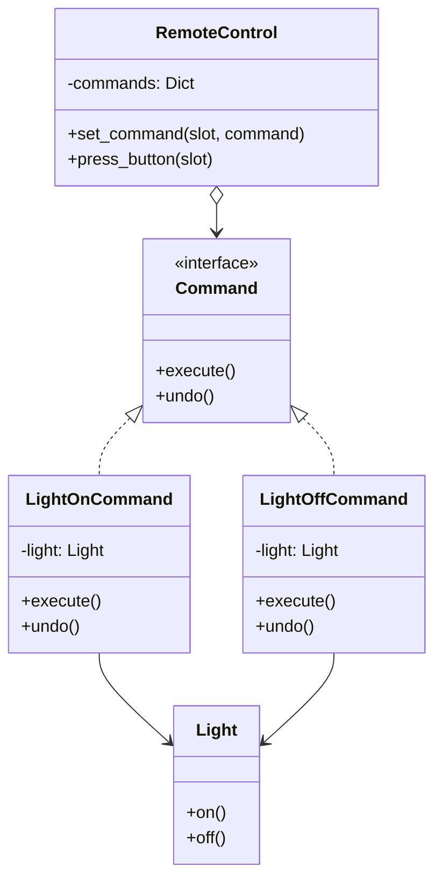

# Day 040 — 设计模式（行为型）

## 概述

行为型设计模式关注**对象之间的通信与职责分配**。与创建型模式（关注对象如何创建）和结构型模式（关注对象如何组合）不同，行为型模式解决了"谁做什么、如何协作"的问题。

> **核心思想**：将可变的行为从对象内部抽离出来，通过组合与委托实现灵活交互。

---

## 一、观察者模式（Observer Pattern）

### 1.1 概念

观察者模式定义了对象之间**一对多**的依赖关系，当一个对象（被观察者 / Subject）的状态发生变化时，所有依赖它的对象（观察者 / Observer）都会收到通知并自动更新。

```text
现实类比：微信公众号订阅
- 公众号（Subject）发布文章 → 所有订阅者（Observer）收到推送
- 订阅者可随时取消订阅
- 公众号不关心具体有多少订阅者
```

### 1.2 原理深入

观察者模式的底层机制是**事件驱动**的经典实现：

```
┌─────────────────────────────────────────┐
│            Subject（被观察者）             │
│  ┌──────────────────────────────────┐   │
│  │  observers: List[Observer]       │   │
│  │  ────────────────────────────    │   │
│  │  + attach(observer)             │   │
│  │  + detach(observer)             │   │
│  │  + notify(data)                 │   │
│  └──────────────────────────────────┘   │
│              │           │               │
│    ┌─────────┘    ┌──────┘               │
│    ▼              ▼                       │
│  Observer A    Observer B    Observer C   │
│  + update()    + update()    + update()   │
└─────────────────────────────────────────┘
```

**关键设计决策：**

| 机制 | 推模型（Push） | 拉模型（Pull） |
|------|---------------|---------------|
| 通知方式 | Subject 将完整数据推给 Observer | Observer 从 Subject 拉取需要的数据 |
| 优点 | Observer 无需关心数据来源 | 网络开销小，Observer 按需获取 |
| 缺点 | 可能推送不需要的数据 | Observer 需要知晓 Subject 的接口 |
| 适用 | 数据量小、结构稳定 | 数据量大、结构复杂 |

**Python 中的内置支持：**

- `property` descriptor 配合 `__setattr__` 可拦截属性变化
- `asyncio.Queue` 可实现异步观察者
- `signal` 模块可处理系统级事件

### 1.3 适用场景

| 场景 | 说明 |
|------|------|
| ✅ 事件分发系统 | UI 按钮点击、鼠标移动、键盘事件 |
| ✅ 跨系统消息通知 | 订单状态变化通知多个子系统 |
| ✅ 数据同步 | 一个数据源变化 → 多个视图更新 |
| ✅ 分布式事件 | 微服务间的 Pub/Sub 模式 |
| ❌ 观察者过多 | 大量 Observer 会导致通知性能下降 |
| ❌ 循环依赖 | A 观察 B，B 观察 A，可能死循环 |

### 1.4 类图



### 1.5 代码概要

详见 `code/01-observer-pattern.py`

---

## 二、策略模式（Strategy Pattern）

### 2.1 概念

策略模式定义一系列**可互换的算法**，并将每个算法封装在独立的类中，使它们可以在运行时相互替换。

```text
现实类比：导航 App 的路线规划
- 最短路线策略、最快路线策略、避开收费站策略
- 用户可在 App 中随时切换
- 路线规划器（Context）不关心具体算法细节
```

### 2.2 原理深入

策略模式的核心是**组合优于继承**——将算法族抽取为独立的策略接口，上下文（Context）通过委托调用策略：

```
┌───────────────────┐      ┌─────────────────────────┐
│    Context        │      │    Strategy（接口）       │
│  ─────────────    │      │  ──────────────          │
│  - strategy       │─────▶│  + execute(data)         │
│  + set_strategy() │      └─────────────────────────┘
│  + execute()      │                    │
└───────────────────┘         ┌───────────┼───────────┐
                              │           │           │
                              ▼           ▼           ▼
                    ┌───────────┐ ┌───────────┐ ┌───────────┐
                    │StrategyA  │ │StrategyB  │ │StrategyC  │
                    │execute()  │ │execute()  │ │execute()  │
                    └───────────┘ └───────────┘ └───────────┘
```

**策略模式与状态模式的对比：**

| 维度 | 策略模式 | 状态模式 |
|------|---------|---------|
| 目的 | 替换算法 | 改变行为（状态迁移） |
| 切换时机 | 由外部客户端控制 | 由内部状态对象控制 |
| 策略/状态数量 | 通常固定 | 可动态流转 |
| 上下文 | 策略与上下文状态无关 | 状态影响上下文行为 |

### 2.3 适用场景

| 场景 | 说明 |
|------|------|
| ✅ 多种相似算法 | 排序算法、压缩算法、加密算法 |
| ✅ 消除条件分支 | 替代大量 if/elif/else 或 switch |
| ✅ 运行时切换行为 | A/B 测试、功能开关 |
| ✅ 开闭原则 | 新增策略无需修改上下文 |
| ❌ 策略极少变化 | 只有两三个固定算法，过度设计 |
| ❌ 策略间有大量共享代码 | 应考虑模板方法模式 |

### 2.4 类图



### 2.5 代码概要

详见 `code/02-strategy-pattern.py`

---

## 三、命令模式（Command Pattern）

### 3.1 概念

命令模式将**请求封装为对象**，从而使你可以用不同的请求对客户进行参数化、对请求排队或记录请求日志，以及支持可撤销的操作。

```text
现实类比：餐厅点餐
- 顾客（Client）创建订单（Command）
- 服务员（Invoker）收集订单并排队
- 厨师（Receiver）根据订单执行烹饪
- 如需取消，可撤销订单
```

### 3.2 原理深入

命令模式引入**中间层**，将请求发送者与请求接收者解耦：

```
┌──────────┐      ┌─────────────┐      ┌───────────┐
│  Client  │─────▶│  Invoker    │─────▶│ Receiver  │
│          │      │  ─────────  │      │           │
│ create() │      │  execute()  │      │  action() │
└──────────┘      └─────────────┘      └───────────┘
       │                  ▲
       │                  │
       ▼                  │
  ┌───────────────────────┴──┐
  │     Command（接口）       │
  │  ──────────────           │
  │  + execute()              │
  │  + undo()        [可选]   │
  └──────────────────────────┘
              │
     ┌────────┼────────┐
     ▼        ▼        ▼
  ┌──────┐ ┌──────┐ ┌──────┐
  │CmdA  │ │CmdB  │ │CmdC  │
  │exec()│ │exec()│ │exec()│
  │undo()│ │undo()│ │undo()│
  └──────┘ └──────┘ └──────┘
```

**命令模式的四个角色：**

| 角色 | 职责 | Python 实现建议 |
|------|------|----------------|
| Command | 声明执行操作的接口 | `abc.ABC` 或 `typing.Protocol` |
| ConcreteCommand | 实现 execute，调用 Receiver | 普通类，持有 receiver 引用 |
| Invoker | 调用 Command 执行（可排队/记录） | 类内维护命令队列 |
| Receiver | 实际业务逻辑的执行者 | 普通类或函数 |

### 3.3 适用场景

| 场景 | 说明 |
|------|------|
| ✅ 撤销/重做 | 文本编辑器、图像编辑器的 Ctrl+Z |
| ✅ 操作队列 / 日志 | 异步任务队列、操作审计日志 |
| ✅ 事务性操作 | 数据库事务：全部成功或全部回滚 |
| ✅ 宏命令 | 组合多个命令为复合命令 |
| ✅ 远程调用 | RPC、命令模式天然支持序列化传输 |
| ❌ 简单操作 | 只有一个操作时过度设计 |
| ❌ 频繁变更命令签名 | 所有 ConcreteCommand 都要改 |

### 3.4 类图



### 3.5 代码概要

详见 `code/03-event-system.py`（实战：完整的基于命令模式的事件系统）

---

## 四、实战：事件系统

本节实现一个完整的**事件驱动的消息系统**，综合运用观察者模式、策略模式和命令模式：

- **观察者模式**：事件的发布与订阅
- **策略模式**：事件处理策略可插拔
- **命令模式**：事件排队、撤销、日志记录

详细代码见 `code/03-event-system.py`

---

## 五、思考题

1. **观察者模式的性能瓶颈**：如果有 10,000 个观察者同时监听一个 Subject，`notify()` 的性能会如何？如何优化？（提示：异步通知、批处理、分片）

**参考答案**

朴素的 `notify()` 是一个 `for` 循环挨个调用 `observer.update()`，复杂度 O(n)。10,000 个观察者意味着一次状态变更要同步执行一万次回调：

- **阻塞**：通知是同步的，Subject 必须等所有观察者处理完才能继续；只要有一个观察者慢（比如做了网络请求），整个通知就被拖住。
- **放大效应**：状态频繁变化时，通知次数 × 观察者数量会爆炸，CPU 和延迟都吃不消。
- **内存风险**：若用强引用持有观察者，它们无法被回收，容易泄漏。

优化方向：

- **异步通知**：把「发通知」和「处理」解耦——Subject 只把事件丢进队列（`queue.Queue` / `asyncio.Queue`）就返回，由后台线程或事件循环慢慢消费，Subject 不再被慢观察者阻塞。
- **批处理**：短时间内多次变化合并成一次通知（防抖/节流），或把多个事件打包批量下发，减少调用次数。
- **分片/分组**：按主题或哈希把观察者分到多个组，并行通知各组；或让观察者只订阅自己关心的事件类型，避免「全员广播」。
- **弱引用**：用 `weakref` 持有观察者，对象销毁后自动从列表移除，防泄漏。

💡 提示：观察者极多时，本质上已接近「消息中间件/发布订阅系统」，可考虑引入专门的消息队列（如 Redis Pub/Sub、Kafka），而不是在进程内硬扛一万次同步回调。

2. **策略模式与简单工厂的区别**：策略模式通过组合替换算法，简单工厂通过条件创建对象。什么时候两者结合使用？请给出一个例子。

**参考答案**

两者关注点不同、天然互补：**策略模式管「怎么用算法」**（上下文持有一个策略接口，运行时可替换），**简单工厂管「怎么造对象」**（根据参数决定 new 哪个具体类）。当「策略种类多、且需要根据配置/输入动态挑选」时，就把它们结合：**用工厂负责创建策略，用策略模式负责使用策略**。这样上下文既不写死具体策略，也不用自己写一堆 `if/elif` 去 new。

例子：订单折扣。工厂按名字造出折扣策略，订单只依赖策略接口：

```python
# 策略：可互换的算法
class DiscountStrategy:
    def apply(self, price):
        raise NotImplementedError

class NoDiscount(DiscountStrategy):
    def apply(self, price):
        return price

class PercentOff(DiscountStrategy):
    def __init__(self, percent):
        self.percent = percent
    def apply(self, price):
        return price * (1 - self.percent / 100)

class FixedOff(DiscountStrategy):
    def __init__(self, amount):
        self.amount = amount
    def apply(self, price):
        return max(0, price - self.amount)

# 简单工厂：根据名字创建策略对象（用字典代替 if/elif）
def make_strategy(name, **kw):
    table = {"none": NoDiscount, "percent": PercentOff, "fixed": FixedOff}
    return table[name](**kw)

# 上下文：只依赖策略接口，运行时可替换
class Order:
    def __init__(self, price, strategy):
        self.price = price
        self.strategy = strategy
    def total(self):
        return self.strategy.apply(self.price)

order = Order(100, make_strategy("percent", percent=20))
print(order.total())                                  # 打八折
order.strategy = make_strategy("fixed", amount=30)    # 运行时换成满减
print(order.total())
```

预期输出：

```
80.0
70
```

工厂把「选哪种折扣」的判断集中在一处，新增折扣只需加一个策略类并在表里登记；订单上下文完全不用改。这就是「工厂造策略 + 策略模式用策略」的典型协作。

3. **命令模式的持久化**：如何将命令序列化保存到数据库，实现操作日志和灾难恢复？（提示：JSON 序列化 + Command ID 注册表）

**参考答案**

命令模式把「请求」封装成对象，这让它特别适合持久化：只要把命令的**类型 + 参数**存下来，之后就能重建并重放。核心有两点：

1. **序列化**：命令对象本身（含接收者引用）不能直接存，要转成纯数据（如 JSON），只保留「类型名 + 可序列化的参数」。
2. **注册表**：维护一张「类型名 → 命令类」的映射。恢复时根据日志里的类型名查表找回对应的类，再用参数重建命令——这就是「Command ID 注册表」的作用。

下面用银行账户演示「执行 → 写日志 → 在新对象上重放恢复」（用 JSON 字符串模拟数据库）：

```python
import json

# 接收者：真正干活的对象
class Account:
    def __init__(self):
        self.balance = 0
    def deposit(self, amount):
        self.balance += amount
    def withdraw(self, amount):
        self.balance -= amount

# 命令注册表：类型名 → 类，反序列化时靠它找回类
REGISTRY = {}
def register(cls):
    REGISTRY[cls.__name__] = cls
    return cls

@register
class DepositCommand:
    def __init__(self, account, amount):
        self.account = account
        self.amount = amount
    def execute(self):
        self.account.deposit(self.amount)
    def undo(self):
        self.account.withdraw(self.amount)
    def to_dict(self):
        return {"type": "DepositCommand", "amount": self.amount}

@register
class WithdrawCommand:
    def __init__(self, account, amount):
        self.account = account
        self.amount = amount
    def execute(self):
        self.account.withdraw(self.amount)
    def undo(self):
        self.account.deposit(self.amount)
    def to_dict(self):
        return {"type": "WithdrawCommand", "amount": self.amount}

# 执行命令并把「纯数据」写入日志（模拟存数据库）
account = Account()
commands = [DepositCommand(account, 100), WithdrawCommand(account, 30)]
log = []
for cmd in commands:
    cmd.execute()
    log.append(cmd.to_dict())
json_log = json.dumps(log, ensure_ascii=False)
print("持久化日志:", json_log)
print("当前余额:", account.balance)

# 灾难恢复：换一个全新对象，从日志重建命令并重放
def replay(json_str, account):
    for item in json.loads(json_str):
        cls = REGISTRY[item["type"]]      # 用注册表找回命令类
        cmd = cls(account, item["amount"])
        cmd.execute()

restored = Account()
replay(json_log, restored)
print("恢复后余额:", restored.balance)
```

预期输出：

```
持久化日志: [{"type": "DepositCommand", "amount": 100}, {"type": "WithdrawCommand", "amount": 30}]
当前余额: 70
恢复后余额: 70
```

原账户执行后余额 70；崩溃后用全新的 `restored` 账户，仅凭 JSON 日志重放两条命令，余额同样恢复到 70。这就是「操作日志 + 灾难恢复」的原理（数据库 WAL、事件溯源 Event Sourcing 都是这个思路）。

⚠️ 注意：日志里只能存可序列化的参数，不能存接收者引用；重放要求命令是「确定性」的（同样参数产生同样效果），含随机数/当前时间的命令需把这些值也一并记录下来。

4. **三种模式如何协同**：在一个 GUI 框架中，用户点击按钮（命令模式）→ 触发事件（观察者模式）→ 根据当前模式执行不同逻辑（策略模式）。请画出这个流程的关系图。

**参考答案**

三种模式在这条链路上各司其职：**命令模式**把「点击」这个请求封装成对象（便于排队/撤销）；**观察者模式**负责把「点击发生了」广播给所有关心它的监听者；**策略模式**让监听者根据当前模式（如编辑模式/预览模式）选择不同处理算法。关系图如下：

```text
用户点击按钮
     │
     ▼
┌──────────────────┐   命令模式：把请求封装成对象
│  ClickCommand    │   （Invoker 调用 execute，可撤销/记录）
│  execute()       │
└────────┬─────────┘
         │ 执行后发布事件
         ▼
┌──────────────────┐   观察者模式：一对多通知
│  Subject/事件总线 │   notify("click", data)
│  observers: [...] │
└───┬─────┬─────┬──┘
    │     │     │  逐个通知（推/拉模型）
    ▼     ▼     ▼
 监听A  监听B  监听C        ← 各监听者内部持有「策略」
              │
              ▼
        ┌──────────────────┐   策略模式：按当前模式选算法
        │  Context         │
        │  strategy ───────┼──▶ EditStrategy.execute()   （编辑模式）
        │                  └──▶ PreviewStrategy.execute()（预览模式）
        └──────────────────┘
```

数据流向是「命令 → 事件 → 策略」：命令解耦了「按钮」和「具体动作」，观察者解耦了「事件源」和「多个响应者」，策略解耦了「响应者」和「具体算法」。三层各自独立变化——加一个新监听者不用改按钮，换一种处理算法不用改事件总线，这正是组合优于继承带来的灵活性。

💡 提示：实际框架里「命令」和「事件」常常合并——命令执行后顺手 `notify`；而策略往往就藏在某个监听者的 `update()` 里，根据上下文状态挑选。

5. **Python 中的一等函数**：Python 中函数是一等公民，可以用函数替代策略模式中的策略类和观察者模式中的回调函数。这种方式的优缺点是什么？

**参考答案**

「一等公民」指函数可以像普通值一样被赋值给变量、当参数传递、当返回值。因此策略不必是一个类，直接传一个函数即可；观察者回调也不必定义 `update()` 方法，注册一个函数就行。

优点：

- **简洁、少样板**：不用为每个算法建一个类、写接口和 `execute`，一个 `def` 或 `lambda` 就够，代码量大幅减少。
- **闭包天然带状态**：内部函数能捕获外层变量，轻量地携带配置，无需专门建对象存字段。
- **组合灵活**：函数可直接传递、用 `functools.partial` 预置参数、用装饰器增强，组合非常自然。

缺点：

- **缺少显式契约**：类有接口/抽象方法约束「必须实现哪些方法」，裸函数没有这层约束，参数签名靠约定，团队协作和静态检查（mypy）时不如 `Protocol`/ABC 清晰。
- **多方法/复杂状态乏力**：策略若需要多个相关方法（`execute` + `undo` + 元数据）或大量共享状态，函数就捉襟见肘，仍得回到类。
- **难以序列化**：命令模式要把请求存盘/传输，类实例可转成「类型名+参数」，而函数（尤其 lambda、闭包）很难序列化。
- **可发现性差**：一堆散落的函数不如一组策略类那样容易被 IDE 列出、归类和复用。

一句话：**算法简单、无状态或轻状态、不需要持久化 → 用函数最清爽；需要明确接口、多方法、复杂状态或序列化 → 用策略类/命令类更稳妥。** 两者也可混用：用 `typing.Protocol` 给函数式策略补上类型契约。

---

## 六、小结

| 模式 | 核心思想 | 解决的痛点 | 关键技巧 |
|------|---------|-----------|---------|
| 观察者模式 | 发布-订阅，一对多通知 | 对象间的耦合通知 | 异步通知、弱引用避免内存泄漏 |
| 策略模式 | 算法封装，运行时替换 | 多重条件分支 | 结合工厂模式创建策略 |
| 命令模式 | 请求封装为对象 | 请求发送者与接收者解耦 | 支持撤销、重做、日志 |

> **一句话总结**：观察者模式告诉"谁来了通知谁"，策略模式决定"用什么方法做"，命令模式把"做什么"包装成对象。
