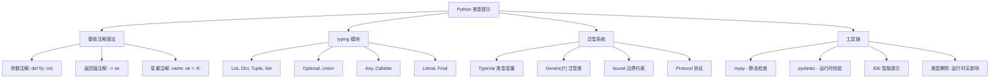
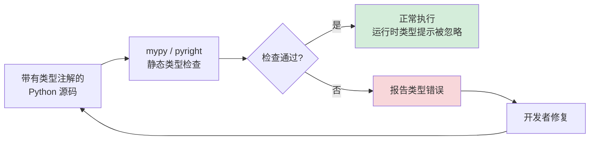

# Day 042 — 类型提示与检查

> 类型提示让 Python 代码更可读、更可维护，配合类型检查工具可以在开发阶段捕获大量隐藏错误。

---

## 概述

Python 3.5 引入了 `typing` 模块，提供了标准化的类型提示（Type Hints）语法。类型提示**不会影响运行时行为**，但可以被以下工具使用：

- **静态类型检查器**：mypy、pyright、pytype
- **IDE 智能提示**：VS Code（Pylance）、PyCharm
- **运行时验证**：pydantic、typeguard

```python
def greet(name: str) -> str:
    return f"Hello, {name}"
```

`name: str` 表示参数类型为 `str`，`-> str` 表示返回值类型为 `str`。仅此而已。

---

## 1. typing 模块详解

### 1.1 基础容器类型

```python
from typing import List, Dict, Tuple, Set

# 列表
names: List[str] = ["Alice", "Bob"]

# 字典
scores: Dict[str, int] = {"Alice": 95, "Bob": 87}

# 元组（固定长度，每个位置独立类型）
point: Tuple[float, float] = (1.0, 2.0)

# 集合
tags: Set[str] = {"python", "typing"}
```

> **Python 3.9+ 更新**：可以直接使用 `list[str]`、`dict[str, int]` 等内置泛型，不再需要从 `typing` 导入。

### 1.2 Optional 与 Union

```python
from typing import Optional, Union

# Optional[X] 等价于 Union[X, None]
# 表示值可能是 str，也可能是 None
def find_user(uid: int) -> Optional[str]:
    if uid == 1:
        return "Alice"
    return None  # 合法

# Union：多个可能的类型
def process(value: Union[int, float, str]) -> str:
    return str(value)
```

**Optional 的两种写法等价：**

```
Optional[str]  ≡  Union[str, None]  ≡  str | None (3.10+)
```

### 1.3 Any 与 类型逃生口

```python
from typing import Any

# Any 表示"任意类型"——类型检查器会跳过该值
def log(message: Any) -> None:
    print(message)
```

**最佳实践：** 尽量少用 `Any`，它绕过了所有类型检查。

### 1.4 Callable

```python
from typing import Callable

# Callable[[参数类型], 返回值类型]
def execute_handler(handler: Callable[[str, int], bool], data: str) -> None:
    if handler(data, 42):
        print("Handler succeeded")
```

---

## 2. 泛型与 TypeVar

### 2.1 TypeVar：类型变量

```python
from typing import TypeVar, List

T = TypeVar("T")  # 定义类型变量 T

def first(items: List[T]) -> T:
    return items[0]

# first([1, 2, 3]) → T 被推断为 int
# first(["a", "b"]) → T 被推断为 str
```

### 2.2 约束类型变量

```python
from typing import TypeVar

# T 只能是 int 或 float
Number = TypeVar("Number", int, float)

def add(a: Number, b: Number) -> Number:
    return a + b  # 类型检查器知道这里是 int+int 或 float+float
```

### 2.3 带边界的 TypeVar

```python
from typing import TypeVar

class Animal:
    def speak(self) -> str:
        return "..."

class Dog(Animal):
    def speak(self) -> str:
        return "Woof!"

# T 必须是 Animal 或其子类
TAnimal = TypeVar("TAnimal", bound=Animal)

def make_speak(animal: TAnimal) -> TAnimal:
    print(animal.speak())
    return animal  # 返回类型保持了原始类型（Dog 返回 Dog，不是 Animal）
```

### 2.4 自定义泛型类

```python
from typing import Generic, TypeVar, List

T = TypeVar("T")

class Stack(Generic[T]):
    def __init__(self) -> None:
        self._items: List[T] = []
    
    def push(self, item: T) -> None:
        self._items.append(item)
    
    def pop(self) -> T:
        return self._items.pop()

# 使用
int_stack = Stack[int]()
int_stack.push(1)
int_stack.push(2)
value = int_stack.pop()  # 类型推断为 int
```

---

## 3. 图解：类型提示体系



### 类型检查流程



---

## 4. 运行时类型检查：pydantic 简介

类型提示默认只在静态检查时生效，运行时 Python 会忽略它们。但我们可以用 **pydantic** 在运行时验证数据：

```python
from pydantic import BaseModel, ValidationError

class User(BaseModel):
    id: int
    name: str
    age: int
    email: str | None = None  # Python 3.10+ 语法，等价于 Optional[str]

# 有效数据
user = User(id=1, name="Alice", age=30)

# 无效数据 → 抛出 ValidationError
try:
    User(id="not-a-number", name="Bob", age="old")
except ValidationError as e:
    print(e)  # 详细的字段级错误信息
```

**pydantic 的特点：**
- 基于类型注解自动进行数据验证
- 支持 JSON 序列化/反序列化
- 自定义验证器（`@field_validator`）
- 广泛用于 FastAPI 等框架

---

## 5. 实战：类型安全的 API 封装

以下是一个完整的类型安全 HTTP API 客户端示例：

```python
from dataclasses import dataclass
from typing import Optional, Any, Dict, List
import json
import urllib.request
import urllib.error


@dataclass
class GitHubUser:
    """GitHub 用户数据模型"""
    login: str
    id: int
    name: Optional[str] = None
    public_repos: int = 0
    followers: int = 0


@dataclass
class ApiResponse:
    """通用 API 响应"""
    success: bool
    data: Optional[Any] = None
    error: Optional[str] = None


class GitHubClient:
    """类型安全的 GitHub API 客户端"""
    
    BASE_URL = "https://api.github.com"
    
    def _request(self, endpoint: str) -> ApiResponse:
        url = f"{self.BASE_URL}{endpoint}"
        try:
            req = urllib.request.Request(url, headers={"User-Agent": "Python"})
            with urllib.request.urlopen(req) as resp:
                data: Dict[str, Any] = json.loads(resp.read().decode())
                return ApiResponse(success=True, data=data)
        except urllib.error.HTTPError as e:
            return ApiResponse(success=False, error=f"HTTP {e.code}: {e.reason}")
        except Exception as e:
            return ApiResponse(success=False, error=str(e))
    
    def get_user(self, username: str) -> ApiResponse:
        """获取 GitHub 用户信息"""
        return self._request(f"/users/{username}")
    
    def parse_user(self, resp: ApiResponse) -> Optional[GitHubUser]:
        """将 API 响应解析为 GitHubUser"""
        if not resp.success or not resp.data:
            return None
        data: Dict[str, Any] = resp.data
        return GitHubUser(
            login=data.get("login", ""),
            id=data.get("id", 0),
            name=data.get("name"),
            public_repos=data.get("public_repos", 0),
            followers=data.get("followers", 0),
        )
```

完整的可运行代码见 `code/03-type-safe-api.py`。

---

## 6. 最佳实践总结

| 原则 | 说明 |
|------|------|
| **从公共 API 开始** | 优先为导出函数、类方法加类型注解 |
| **避免过度使用 Any** | Any 意味着放弃类型检查 |
| **用 Protocol 替代 Duck Typing** | 定义协议而非继承 |
| **Python 3.10+ 使用 `X \| Y`** | `str \| int` 比 `Union[str, int]` 更简洁 |
| **Python 3.9+ 使用内置泛型** | `list[int]` 而非 `List[int]` |
| **配置 mypy** | 在 `pyproject.toml` 中配置严格模式 |
| **CI 中运行类型检查** | 作为 CI 流水线的一部分 |

---

## 思考题

1. **Optional 的含义**：`Optional[str]` 和 `Union[str, None]` 是完全等价的吗？`str | None` 和它们有什么区别（Python 版本相关）？

**参考答案**

**`Optional[str]` 和 `Union[str, None]` 完全等价**——`Optional[X]` 在 `typing` 里就是直接定义成 `Union[X, None]` 的别名，二者产生的对象、语义、检查行为都一模一样。注意 `Optional` 不是「可选参数」的意思，而是「值可能是 X，也可能是 None」。

`str | None`（Python 3.10+ 的 `|` 写法）在**类型语义上**也和它们等价，区别主要在语法和版本：

- **版本要求**：`Optional`/`Union` 从 3.5 起就能用；`X | Y` 这种「类型联合表达式」要到 **3.10** 才在运行时支持。在 3.9 及以下直接写 `str | None` 会报 `TypeError`。
- **产生的对象不同**：`Union[str, None]` 是 `typing.Union` 对象，`str | None` 是新的 `types.UnionType` 对象；但类型检查器把它们视为同一类型。
- **`isinstance` 支持**：3.10+ 可以 `isinstance(x, str | None)`（实际等价于检查 str，None 需另判），而 `isinstance(x, Optional[str])` 会报错——`typing` 的联合不能直接用于 isinstance。
- **提前使用的技巧**：在文件顶部加 `from __future__ import annotations`，注解会被当成字符串延迟求值，于是 3.7+ 也能在「注解位置」写 `str | None`（但运行时主动求值仍需 3.10+）。

💡 提示：新项目（3.10+）优先用 `str | None`，更简洁；要兼容旧版本就用 `Optional[str]`。三者表达的类型含义没有差别。

2. **类型擦除**：Python 类型提示在运行时会被擦除，那么 `isinstance(x, list[int])` 会怎样？为什么？

**参考答案**

会**抛出 `TypeError`**，而不是返回 True/False。

```python
x = [1, 2, 3]
print(isinstance(x, list))        # True：只能检查外层容器
try:
    isinstance(x, list[int])      # 参数化泛型不能用于 isinstance
except TypeError as e:
    print("TypeError:", e)
```

预期输出：

```
True
TypeError: isinstance() argument 2 cannot be a parameterized generic
```

原因：`list[int]` 是一个「参数化泛型」（`types.GenericAlias`），它携带的「元素是 int」这条信息**只供静态检查器使用，运行时被擦除**。Python 的列表在运行时并不记录每个元素的类型，`isinstance` 也无从逐个校验，所以解释器干脆禁止把参数化泛型当作第二个参数，直接报错。

正确做法：

- 只检查外层容器：`isinstance(x, list)`。
- 若确实要校验元素类型，得自己遍历：`all(isinstance(i, int) for i in x)`，或交给 pydantic 这类运行时校验库。

⚠️ 注意：未参数化的 `list`、`dict` 可以用于 isinstance；带方括号的 `list[int]`、`dict[str, int]` 不行。`typing.List[int]` 同样会报错。

3. **TypeVar vs Protocol**：假设你想写一个函数，可以接受任何有 `.speak()` 方法的对象。你会用 `TypeVar(bound=...)` 还是 `Protocol`？为什么？

**参考答案**

优先用 **`Protocol`**（协议/结构化类型）。因为需求是「**只要有 `.speak()` 方法就行**」，这正是鸭子类型，而 Protocol 就是「给鸭子类型加上静态契约」的工具——它**不要求对象继承任何基类**，只要结构上长得对（有匹配的方法签名）就兼容。

```python
from typing import Protocol

class Speaker(Protocol):
    def speak(self) -> str: ...

class Dog:                      # 没有继承 Speaker
    def speak(self) -> str:
        return "Woof!"

class Robot:                    # 也没有继承 Speaker
    def speak(self) -> str:
        return "Beep!"

def make_speak(s: Speaker) -> str:
    return s.speak()

print(make_speak(Dog()))
print(make_speak(Robot()))
```

预期输出：

```
Woof!
Beep!
```

`Dog`、`Robot` 都没继承 `Speaker`，但类型检查器会认可它们，因为结构匹配。若改用 `TypeVar("T", bound=Animal)`，就**强制所有传入对象必须是 `Animal` 的子类**（名义继承），第三方那个恰好有 `.speak()` 却没继承 `Animal` 的类会被误判为不合法——这与「任何有 speak 的对象」的需求不符。

什么时候用 `TypeVar(bound=...)`？当你**既要约束能力、又要在返回值里保留精确类型**时。比如 `def f(x: T) -> T`，传入 `Dog` 返回的还是 `Dog` 而非 `Animal`。两者还能结合：`T = TypeVar("T", bound=Speaker)`，既有结构化约束又保留具体类型。

💡 提示：Protocol 默认只做静态检查；若想在运行时用 `isinstance` 判断，需给协议加 `@runtime_checkable`（且它只检查方法是否存在，不校验签名）。

4. **协变与逆变**：`List[Dog]` 是 `List[Animal]` 的子类型吗？`Callable[[Animal], None]` 和 `Callable[[Dog], None]` 之间有什么类型关系？

**参考答案**

先记住三个词（设 `Dog` 是 `Animal` 的子类）：**协变**＝方向相同（子类→父类照搬），**逆变**＝方向相反，**不变**＝谁也不是谁的子类型。

**`List[Dog]` 不是 `List[Animal]` 的子类型——`list` 是不变的。** 原因是列表可变：假如允许把 `List[Dog]` 当成 `List[Animal]` 用，那调用方就能往里 `append(Cat())`（Cat 也是 Animal），于是原本「只装狗」的列表混进了猫，类型安全被破坏。所以 mypy 会拒绝这种赋值。想要协变，得用**只读**容器，如 `Sequence[Dog]` 是 `Sequence[Animal]` 的子类型（不能 append，就不会被污染）。

**`Callable[[Animal], None]` 是 `Callable[[Dog], None]` 的子类型——参数是逆变的。** 直觉：一个「能处理任何 Animal」的函数，当然能安全地用在「只需要处理 Dog」的场合（给它 Dog 它也能处理）；反过来，「只会处理 Dog」的函数不能用在「需要处理任意 Animal」的场合（来一只 Cat 就崩了）。所以「接受更宽类型」的函数，可以替换「接受更窄类型」的函数，方向与子类关系相反，故称逆变。

小结口诀：

- **返回值协变**：函数返回 `Dog` 可以当作返回 `Animal` 用（更具体→更通用，安全）。
- **参数逆变**：函数接受 `Animal` 可以当作接受 `Dog` 用（更通用→更具体，安全）。
- **可变容器不变**：`list[Dog]` 与 `list[Animal]` 互不兼容；只读的 `Sequence` 才协变。

💡 提示：这套规则正是 `typing` 里 `Generic` 协变/逆变参数（`covariant=True` / `contravariant=True`）的由来，也是为什么 `Callable` 的参数位和返回位方向相反。

5. **运行时 vs 静态**：类型提示能被用作运行时验证吗？pydantic 是如何做到无需显式调用验证器的？

**参考答案**

**能，但默认不会自动发生。** Python 解释器本身在运行时忽略类型提示（只做静态检查用），不过注解并没有消失——它们被存在类/函数的 `__annotations__` 里，可以用 `typing.get_type_hints()` 取回。任何库都能在运行时读取这些注解，据此做校验。下面用标准库手写一个最简校验器，揭示原理：

```python
from typing import get_type_hints

class User:
    id: int
    name: str

print(User.__annotations__)          # 运行时仍能拿到注解
print(get_type_hints(User))          # 解析成真实类型对象

# 手写一个最简「运行时校验」，说明 pydantic 的原理
def validate(cls, **kwargs):
    hints = get_type_hints(cls)
    for field, typ in hints.items():
        value = kwargs[field]
        if not isinstance(value, typ):
            raise TypeError(f"{field} 期望 {typ.__name__}，得到 {type(value).__name__}")
    return kwargs

print(validate(User, id=1, name="Alice"))
try:
    validate(User, id="x", name="Bob")
except TypeError as e:
    print("校验失败:", e)
```

预期输出：

```
{'id': <class 'int'>, 'name': <class 'str'>}
{'id': <class 'int'>, 'name': <class 'str'>}
{'id': 1, 'name': 'Alice'}
校验失败: id 期望 int，得到 str
```

pydantic 做的正是这件事的「工业级自动化」：

- **类创建时读注解**：`BaseModel` 通过元类，在你定义 `class User(BaseModel)` 那一刻就读取所有字段注解，为每个字段**预先构建好校验器**（比每次临时 isinstance 更快、功能更强，支持类型强制转换、嵌套模型等）。
- **实例化时自动触发**：它重写了 `__init__`，`User(id=1, name="Alice")` 一调用就自动跑校验，失败抛 `ValidationError`。所以你**不用显式调用任何验证函数**——校验被织进了对象的构造过程。

一句话：**类型提示是「数据」，静态检查器和 pydantic 都是「读取这份数据的消费者」**；前者在开发期读，后者在运行期读，并把它变成自动校验。

⚠️ 注意：pydantic 是第三方库，需先 `pip install pydantic`；它默认会做「宽松转换」（如把 `"1"` 转成 int），若要严格禁止转换可开启 strict 模式。

---

> **延伸阅读：** [PEP 483 – The Theory of Type Hints](https://peps.python.org/pep-0483/) | [mypy 官方文档](https://mypy-lang.org/)
