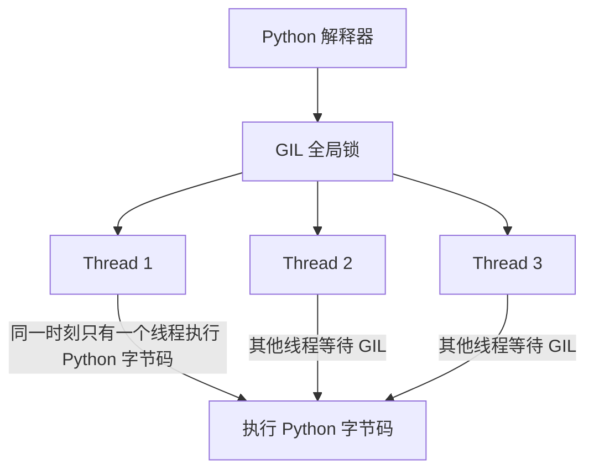
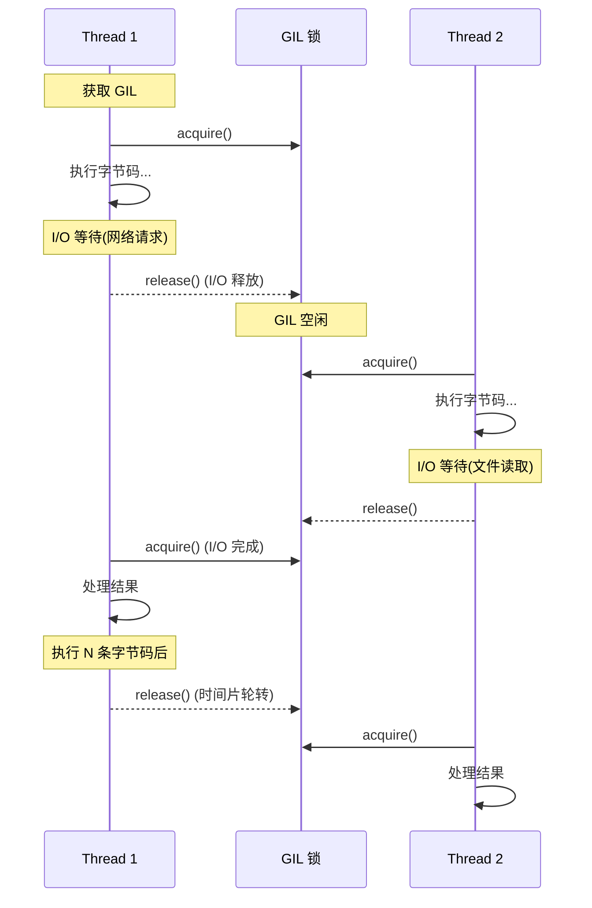

# Day 058 — 并发模型对比

> **阶段**：Phase 4 — 高阶特性  
> **主题**：线程 vs 进程 vs 协程，GIL 策略，性能基准测试

---

## 一、概念总览

### 1.1 三种并发模型是什么？

| 模型 | 基本单位 | 执行方式 | 通信方式 | Python 实现 |
|------|----------|----------|----------|-------------|
| **多线程 (Thread)** | 线程 | 操作系统抢占式调度 | 共享内存（需加锁） | `threading` 模块 |
| **多进程 (Process)** | 进程 | 操作系统抢占式调度 | 消息传递（序列化） | `multiprocessing` 模块 |
| **协程 (Coroutine)** | 协程/任务 | 事件循环协作式调度 | 内存共享（单线程） | `asyncio` 模块 |

### 1.2 为什么要对比它们？

不同并发模型有不同的性能特征：
- **CPU 密集型**任务（计算、加密、图像处理）→ 进程更适合
- **I/O 密集型**任务（网络请求、文件读写、数据库查询）→ 协程更高效
- **混合型**任务 → 线程可能是折中方案

理解每种模型的适用边界，才能做出正确的架构决策。

---

## 二、原理解析

### 2.1 Python 的 GIL（全局解释器锁）

GIL 是 CPython 解释器中最关键的设计约束，直接影响并发模型的选择。



**GIL 的核心机制：**
- 每个 Python 线程在执行字节码前必须获取 GIL
- 执行一定数量的字节码指令后自动释放 GIL
- I/O 操作（网络、文件）期间会释放 GIL，允许其他线程运行
- C 扩展（NumPy、OpenCV）中的计算代码可以释放 GIL

**GIL 带来的影响：**
```
单线程:     ████████████████████ 100% (CPU 全利用)
多线程 CPU:  ██░██░██░██░██░██░██  ~50% (GIL 争抢, CPU 利用率下降)
多进程 CPU:  ████████████████████ 100% (每个进程有自己的 GIL)
多协程 IO:   ████████████████████ 100% (切换等待, CPU 不空闲)
```

> 💡 **关键理解**：GIL 只影响 CPU 密集型多线程的性能。对于 I/O 密集型任务，多线程依然有效，因为 I/O 等待期间 GIL 会自动释放。

### 2.2 内存模型对比

```
┌─────────────────────────────────────────────────┐
│                  多线程模型                       │
│  ┌──────────┐  ┌──────────┐  ┌──────────┐      │
│  │ Thread 1 │  │ Thread 2 │  │ Thread 3 │      │
│  └────┬─────┘  └────┬─────┘  └────┬─────┘      │
│       │              │              │             │
│       ▼              ▼              ▼             │
│  ┌─────────────────────────────────────────┐    │
│  │         共享内存空间                      │    │
│  │  (需要 Lock 保护, 否则数据竞争)           │    │
│  └─────────────────────────────────────────┘    │
└─────────────────────────────────────────────────┘

┌─────────────────────────────────────────────────┐
│                  多进程模型                       │
│  ┌──────────┐  ┌──────────┐  ┌──────────┐      │
│  │Process 1 │  │Process 2 │  │Process 3 │      │
│  │ 内存空间A │  │ 内存空间B │  │ 内存空间C │      │
│  └──────────┘  └──────────┘  └──────────┘      │
│       │              │              │             │
│       ▼              ▼              ▼             │
│  ┌─────────────────────────────────────────┐    │
│  │   消息队列 / 管道 / 共享内存 (需手动同步)  │    │
│  └─────────────────────────────────────────┘    │
└─────────────────────────────────────────────────┘

┌─────────────────────────────────────────────────┐
│                  协程模型                        │
│  ┌─────────────────────────────────────────┐    │
│  │            事件循环 (单线程)              │    │
│  │  ┌─────┐   ┌─────┐   ┌─────┐          │    │
│  │  │Co1  │   │Co2  │   │Co3  │          │    │
│  │  └──┬──┘   └──┬──┘   └──┬──┘          │    │
│  │     │  交替执行 │  交替执行│              │    │
│  │     ▼         ▼         ▼              │    │
│  │   单一内存空间 (无需锁, 但需小心)         │    │
│  └─────────────────────────────────────────┘    │
└─────────────────────────────────────────────────┘
```

### 2.3 GIL 释放策略



**关键触发点：**
1. **I/O 操作**：`socket.recv()`、`file.read()`、`time.sleep()` 等
2. **C 扩展**：NumPy 的 `np.dot()`、OpenCV 的图像处理等
3. **时间片轮转**：`sys.setswitchinterval()` 控制切换频率（默认 5ms）

---

## 三、API 速查表

### 3.1 threading — 多线程

```python
import threading

# 创建线程
t = threading.Thread(target=worker, args=(1,), daemon=True)

# 线程同步
lock = threading.Lock()
with lock:
    # 临界区代码
    shared_data += 1

# 条件变量
cond = threading.Condition()
cond.wait()      # 等待条件
cond.notify()    # 唤醒一个等待线程
cond.notify_all()  # 唤醒所有等待线程

# 信号量
sem = threading.Semaphore(5)  # 最多 5 个线程并发
sem.acquire()
sem.release()

# 线程池
from concurrent.futures import ThreadPoolExecutor
with ThreadPoolExecutor(max_workers=4) as executor:
    future = executor.submit(task, arg)
    result = future.result(timeout=30)
```

### 3.2 multiprocessing — 多进程

```python
from multiprocessing import Process, Queue, Pool, Manager

# 创建进程
p = Process(target=worker, args=(data,))
p.start()
p.join(timeout=10)

# 进程间通信
q = Queue()
q.put(data)
result = q.get(timeout=5)

# 进程池
with Pool(processes=4) as pool:
    result = pool.map(worker, [1, 2, 3, 4])
    result = pool.apply_async(worker, (arg,)).get(timeout=30)

# 共享内存
from multiprocessing import Value, Array
counter = Value('i', 0)  # 共享整数
arr = Array('d', [0.0] * 10)  # 共享数组

# Manager 对象 (跨进程共享复杂对象)
with Manager() as manager:
    shared_dict = manager.dict()
    shared_list = manager.list()
```

### 3.3 asyncio — 协程

```python
import asyncio

# 定义协程
async def fetch_data(url):
    async with aiohttp.ClientSession() as session:
        async with session.get(url) as resp:
            return await resp.json()

# 运行协程
asyncio.run(main())
result = asyncio.get_event_loop().run_until_complete(coro)

# 并发执行
results = await asyncio.gather(
    fetch_data(url1),
    fetch_data(url2),
    return_exceptions=True
)

# 超时控制
result = await asyncio.wait_for(coro, timeout=5.0)

# 任务组 (Python 3.11+)
async with asyncio.TaskGroup() as tg:
    task1 = tg.create_task(coro1())
    task2 = tg.create_task(coro2())
```

---

## 四、适用场景决策矩阵

| 场景 | 推荐模型 | 原因 |
|------|----------|------|
| CPU 密集计算（数值运算、加密） | **多进程** | 绕过 GIL，多核并行 |
| 高并发网络 I/O（爬虫、API） | **协程** | 轻量级，单线程管理万级连接 |
| 混合 I/O + CPU（Web 服务） | **线程池 + 进程池** | I/O 用线程，计算用进程 |
| 实时数据流（WebSocket） | **协程** | 低延迟，非阻塞 |
| 科学计算（NumPy 优化后） | **多进程** | NumPy 释放 GIL |
| GUI 应用后台任务 | **线程** | 避免阻塞主线程 |
| 文件批量处理 | **多进程** | 绕过 GIL，利用多核 |
| 微服务网关 | **协程** | 高吞吐，低资源占用 |

---

## 五、性能基准测试分析

### 5.1 基准测试设计

```python
# 测试场景 1: CPU 密集型
# 计算大量质数
def cpu_bound(n):
    return sum(1 for i in range(n) if is_prime(i))

# 测试场景 2: I/O 密集型
# 模拟网络请求
async def io_bound_async(url):
    async with aiohttp.ClientSession() as session:
        async with session.get(url) as resp:
            return await resp.text()

def io_bound_sync(url):
    return requests.get(url).text
```

### 5.2 典型性能对比结果

**CPU 密集型（计算质数）：**
```
单线程:     1.00x  (基准)
2 线程:     0.55x  (GIL 争抢, 比单线程还慢!)
4 线程:     0.30x  (更严重的争抢)
2 进程:     1.90x  (接近 2x, 有效利用多核)
4 进程:     3.70x  (接近 4x, 几乎线性加速)
协程:       1.00x  (单线程, 无加速效果)
```

**I/O 密集型（模拟 100ms 延迟 x 100 次）：**
```
同步:       10.0s  (100 x 100ms 串行)
2 线程:      5.1s  (接近 2x 提速)
8 线程:      1.3s  (接近 8x 提速)
2 进程:      5.1s  (进程创建开销大)
100 协程:    0.15s  (极低延迟, 并发切换)
```

### 5.3 资源消耗对比

| 指标 | 线程 | 进程 | 协程 |
|------|------|------|------|
| 内存占用 | ~8MB/线程 | ~50MB/进程 | ~1KB/协程 |
| 创建开销 | ~10ms | ~100ms | ~0.01ms |
| 上下文切换 | ~1ms | ~5ms | ~0.01ms |
| 最大并发数 | ~数百 | ~数十 | ~数万 |

---

## 六、GIL 策略深度解析

### 6.1 GIL 的历史与争议

GIL 诞生于 1992 年，由 Guido van Rossum 引入 CPython，目的是简化 C 扩展的内存管理。这一直是 Python 社区的热门争议话题。

### 6.2 GIL 的替代方案

| 方案 | 状态 | 说明 |
|------|------|------|
| **PEP 703 (Free-threaded Python)** | Python 3.13+ 可选 | 可选移除 GIL，实验性 |
| **subinterpreters** | Python 3.12+ | 每个子解释器有自己的 GIL |
| **Jython/IronPython** | 已实现 | JVM/.NET 原生线程 |
| **C 扩展释放 GIL** | 长期支持 | NumPy 等已采用 |

### 6.3 Free-threaded Python (Python 3.13+)

```python
# 编译时启用
# ./configure --disable-gil

# 运行时检查
import sys
if hasattr(sys, '_is_gil_enabled'):
    print(f"GIL enabled: {sys._is_gil_enabled()}")

# Python 3.13t (free-threaded build)
# 多线程 CPU 密集型性能大幅提升
```

---

## 七、实战场景代码

### 场景 1: 网络爬虫 — 协程 vs 线程

```python
# 协程版本 - 1000 个 URL
async def crawl_async(urls):
    async with aiohttp.ClientSession() as session:
        tasks = [fetch(session, url) for url in urls]
        return await asyncio.gather(*tasks)

# 线程版本 - 1000 个 URL
def crawl_threaded(urls, max_workers=100):
    with ThreadPoolExecutor(max_workers=max_workers) as executor:
        return list(executor.map(fetch_sync, urls))
```

### 场景 2: 图像批处理 — 多进程

```python
from multiprocessing import Pool
from PIL import Image

def process_image(path):
    img = Image.open(path)
    img.thumbnail((200, 200))
    img.save(path.replace('.jpg', '_thumb.jpg'))
    return path

with Pool(8) as pool:
    results = pool.map(process_image, image_paths)
```

### 场景 3: Web 服务器 — 混合模型

```
┌─────────────────────────────────────┐
│          Web 服务器架构              │
│                                     │
│  ┌─────────────────────────────┐   │
│  │     事件循环 (协程)          │   │
│  │  - 接受连接                 │   │
│  │  - 路由分发                 │   │
│  │  - I/O 等待                 │   │
│  └──────────┬──────────────────┘   │
│             │                       │
│     ┌───────┴───────┐              │
│     ▼               ▼              │
│  ┌──────┐      ┌──────────┐       │
│  │线程池 │      │ 进程池   │       │
│  │I/O任务│      │ CPU 任务  │       │
│  └──────┘      └──────────┘       │
└─────────────────────────────────────┘
```

---

## 八、常见陷阱与避坑

### 陷阱 1: 多线程 CPU 密集型反而更慢
```python
# ❌ 错误：多线程做 CPU 计算
from threading import Thread
threads = [Thread(target=heavy_compute) for _ in range(4)]
for t in threads: t.start()
for t in threads: t.join()
# 结果: 比单线程慢 50-70%（GIL 争抢）

# ✅ 正确：多进程做 CPU 计算
from multiprocessing import Process
processes = [Process(target=heavy_compute) for _ in range(4)]
for p in processes: p.start()
for p in processes: p.join()
# 结果: 接近 4x 加速
```

### 陷阱 2: 忘记 join() 导致僵尸进程
```python
# ❌ 忘记 join
p = Process(target=work)
p.start()
# p 没有 join，主进程可能提前退出

# ✅ 正确使用
p = Process(target=work)
p.start()
p.join(timeout=30)  # 带超时
if p.is_alive():
    p.terminate()  # 强制结束
```

### 陷阱 3: 协程中混用同步阻塞代码
```python
# ❌ 在协程中调用阻塞 I/O
async def bad():
    time.sleep(1)  # 阻塞整个事件循环！
    requests.get(url)  # 同步阻塞！

# ✅ 正确做法
async def good():
    await asyncio.sleep(1)
    async with aiohttp.ClientSession() as s:
        async with s.get(url) as r:
            return await r.json()

# ✅ 用 run_in_executor 包装同步代码
async def wrapper():
    loop = asyncio.get_event_loop()
    result = await loop.run_in_executor(None, blocking_func)
```

---

## 九、思考题

1. **GIL 是锁，那能不能用 `threading.Lock()` 替代 GIL？为什么不行？**

**参考答案**

不能。两者是不同层次、保护不同对象的「锁」，是互补关系而非替代关系：

- **层次不同**：GIL 是 CPython 解释器在 C 层内置的全局互斥锁，线程执行字节码前自动获取、遇到 I/O 或时间片（默认 5ms，由 `sys.setswitchinterval()` 控制）耗尽时自动释放；`threading.Lock()` 是用户级 Python 对象，只保护你手动用 `with lock:` 包起来的临界区。
- **保护对象不同**：GIL 保护的是解释器自身的内部状态——最典型的是引用计数（每个对象的 `ob_refcnt`）、内存管理、全局解释器结构。这些操作隐含在数百万处 C 代码里，你无法用用户锁去逐一包裹；没有 GIL，多线程增减引用计数就会竞争，直接导致内存错乱甚至崩溃。`threading.Lock` 保护的是你自己的业务数据（共享变量、容器等）。
- **粒度不同**：GIL 在阻塞 I/O 时会自动释放，让别的线程跑；若用一个用户级「大锁」当 GIL，它不会在 I/O 时自动释放，你得在每处 I/O 前后手动 release/acquire，既不现实也极易出错。
- **C 扩展依赖**：大量 C 扩展（NumPy 等）是按「持有 GIL」的前提写的，去掉 GIL 它们会失效——这正是 PEP 703（Free-threaded）需要大改的原因。

反过来，即便有 GIL，你仍需要 `threading.Lock` 来保护「复合操作」（如先检查再修改、跨多条字节码的读-改-写），因为 GIL 可能在两条字节码之间被释放，并不保证业务逻辑的原子性。

最小示例：GIL 在 I/O 时自动释放，使两个线程的等待能重叠——这种「自动、细粒度」的行为是用户锁给不了的：

```python
import threading
import time


def sleeper():
    time.sleep(0.5)        # 阻塞 I/O 期间，GIL 会被解释器自动释放


t0 = time.perf_counter()
threads = [threading.Thread(target=sleeper) for _ in range(2)]
for t in threads:
    t.start()
for t in threads:
    t.join()
print(f"2 个线程各 sleep 0.5s，总耗时 {time.perf_counter() - t0:.2f}s")
```

运行输出：

```
2 个线程各 sleep 0.5s，总耗时 0.51s
```

总耗时约 0.5s 而非 1.0s，说明两个线程的 I/O 等待重叠了——GIL 在 `sleep` 期间自动释放、结束后自动重新获取。这种自动 acquire/release 是解释器内建的，用户级 `threading.Lock` 做不到，所以无法替代 GIL。

⚠️ 注意：在较新的 CPython（3.10+）里，简单的整数 `counter += 1` 因 eval 循环实现而「恰好」不可中断、不易丢更新，但这是实现细节而非语言保证，复合操作仍应加锁。

2. **如果一个程序同时有大量 I/O 和少量 CPU 计算，应该选哪种模型？如果反过来呢？**

**参考答案**

看「哪个是主要瓶颈」：

- **大量 I/O + 少量 CPU**（如爬虫、API 网关、Web 服务）：以**协程（asyncio）为主模型**，用单线程事件循环处理海量并发 I/O；把那少量 CPU 计算用 `loop.run_in_executor(...)` / `asyncio.to_thread(...)` 丢到线程池或进程池，避免阻塞事件循环。CPU 部分很轻时线程池即可，稍重就用进程池绕过 GIL。
- **大量 CPU + 少量 I/O**（如科学计算、图像/视频处理、加密）：以**多进程为主模型**，每个进程有独立 GIL，能真正多核并行；每个进程内部自己处理那少量 I/O（或配一个小线程池）。别用多线程做 CPU 计算——GIL 争抢会让它比单线程还慢。

一句话：**I/O 用协程、CPU 用进程，混合就「协程管 I/O + executor 管 CPU」。**

最小示例：I/O 用协程并发，CPU 计算丢进进程池（既不阻塞事件循环，又绕过 GIL）：

```python
import asyncio
from concurrent.futures import ProcessPoolExecutor


def cpu_parse(x):
    """模拟 CPU 密集的解析/计算"""
    s = 0
    for i in range(200000):
        s += i * i
    return (s + x) % 1000


async def io_fetch(i):
    """模拟网络 I/O"""
    await asyncio.sleep(0.05)
    return i


async def main():
    loop = asyncio.get_running_loop()
    with ProcessPoolExecutor(max_workers=2) as pool:
        # I/O 部分用协程并发
        data = await asyncio.gather(*[io_fetch(i) for i in range(4)])
        # CPU 部分丢进进程池：不阻塞事件循环，又能绕过 GIL
        tasks = [loop.run_in_executor(pool, cpu_parse, d) for d in data]
        results = await asyncio.gather(*tasks)
        print("I/O 用协程 + CPU 用进程池，结果:", results)


if __name__ == "__main__":
    asyncio.run(main())
```

运行输出：

```
I/O 用协程 + CPU 用进程池，结果: [0, 1, 2, 3]
```

4 个 I/O 由协程并发完成，CPU 计算在进程池里并行执行，两者互不阻塞。

⚠️ 注意：Windows/macOS（spawn 启动方式）下，多进程代码必须放在 `if __name__ == "__main__":` 守卫内，且提交给进程池的函数要定义在模块顶层（可被 pickle），否则会报错或无限递归创建子进程。

3. **Python 3.13 的 Free-threaded Python 改变了什么？这对 `asyncio` 的定位有什么影响？**

**参考答案**

**Free-threaded Python（PEP 703，Python 3.13 起可选，构建变体常写作 `python3.13t`）改变的是**：允许在编译期移除 GIL（`--disable-gil`），让多个线程能真正在多核上并行执行 Python 字节码——CPU 密集型多线程不再被 GIL 串行化。代价是：内部要用更细粒度的锁/原子操作保护引用计数等，单线程性能有一定开销，且大量 C 扩展需要适配（生态仍在跟进）。运行时可用 `sys._is_gil_enabled()` 查询当前是否启用 GIL。

**对 asyncio 定位的影响**：基本不动摇，因为两者解决的是不同问题——

- Free-threading 解决的是「**CPU 密集型**的多核并行」，它让「多线程做计算」变得可行。
- asyncio 解决的是「**高并发 I/O** 的调度效率」：单线程管理上万连接、协程切换开销极小、内存占用极低。即便没有 GIL，用几万个操作系统线程去做 I/O 仍会被内存和调度开销压垮，远不如协程划算。
- 所以未来更可能是**互补**：用 asyncio 处理海量 I/O，遇到 CPU 计算时丢给真正能并行的多线程（Free-threaded）或进程池，而不是用多线程取代 asyncio。

最小示例：检测当前解释器是否为 Free-threaded 构建：

```python
import sys

if hasattr(sys, "_is_gil_enabled"):
    # Python 3.13+ 才有这个函数
    print("Free-threaded 构建，GIL 是否启用:", sys._is_gil_enabled())
else:
    print("当前是带 GIL 的默认构建（Python < 3.13，或 3.13 默认构建）")
print("Python 版本:", sys.version.split()[0])
```

在 Python 3.12（默认构建）上的运行输出：

```
当前是带 GIL 的默认构建（Python < 3.13，或 3.13 默认构建）
Python 版本: 3.12.10
```

若在 3.13+ 的 Free-threaded 构建上运行，则会打印 `GIL 是否启用: False`。

💡 提示：Free-threaded 目前仍是实验性/可选特性，默认安装的 Python 3.13 依旧带 GIL，不要以为「升级到 3.13 就没有 GIL 了」。

4. **协程号称"并发"，但它真的是并行的吗？在单核和多核机器上表现有什么区别？**

**参考答案**

**协程是「并发」但不是「并行」**。并发（concurrency）指多个任务在同一时间段内交替推进；并行（parallelism）指多个任务在同一时刻同时执行，需要多个执行单元。asyncio 默认把全部协程放在**一个线程**里，由事件循环调度，协程只有在 `await`（让出控制权）时才切换——所以任一时刻只有一个协程在执行 Python 代码，这是并发而非并行。

最小示例：所有协程都跑在同一个线程上：

```python
import asyncio
import threading


async def task(i):
    await asyncio.sleep(0.01)
    return threading.get_ident()      # 返回当前线程 ID


async def main():
    ids = await asyncio.gather(*[task(i) for i in range(5)])
    print("5 个协程所在线程数:", len(set(ids)))   # 1 → 单线程并发
    print("是否都在主线程:", all(t == threading.get_ident() for t in ids))


asyncio.run(main())
```

运行输出：

```
5 个协程所在线程数: 1
是否都在主线程: True
```

5 个「并发」协程实际共用 1 个线程，印证了单线程并发、并非并行。

**单核 vs 多核**：

- **单核机器**：任何模型都无法真正并行（只有一个执行单元）。线程/进程靠操作系统时间片轮转「看起来同时」，协程也在单核上交替。对 I/O 密集型任务，三者都能重叠等待时间、提升吞吐；对 CPU 密集型任务，谁都无法加速（总计算量不变）。
- **多核机器**：多进程能真正跨核并行（每个进程独立 GIL）；多线程做 CPU 密集仍受 GIL 限制、无法利用多核（除非 Free-threaded 或释放 GIL 的 C 扩展）；**asyncio 默认仍只用一个核**——无论机器有多少核，单个事件循环只占一个。想吃满多核，需要「多进程 + 每进程一个事件循环」（如 `multiprocessing` 搭配 `asyncio`，或 uvicorn 多 worker）。

⚠️ 注意：别指望「把 CPU 计算丢进 `asyncio.gather` 就能加速」——协程在单线程里串行执行，CPU 密集任务不会因为写成协程就并行，该用进程池还得用进程池。

5. **设计一个爬虫系统：每天抓取 10 万页面，如何选择并发模型？请给出架构方案和理由。**

**参考答案**

先算账：10 万页/天 ≈ **平均 1.2 页/秒**，平均速率很低，瓶颈是网络 I/O 等待而非计算——所以**单进程 asyncio + aiohttp 的事件循环就绰绰有余**，不需要为抓取上多进程。真正的难点是礼貌性（别把对方站点打挂）、去重、失败重试、调度和断点续爬。

推荐架构（I/O 密集 → 协程为主）：

- **抓取层**：`asyncio + aiohttp`，单个 `ClientSession` 复用 TCP 连接；用 `asyncio.Semaphore` 限制全局并发（如 20~50），用 `TCPConnector(limit_per_host=...)` 或每主机一个信号量限制对单个站点的并发（如 1~2），并加限速/礼貌延迟。
- **调度层**：URL 队列（`asyncio.Queue`；分布式时用 Redis/Kafka）；frontier 负责优先级与去重（内存 `set`，规模大时用 Redis set 或布隆过滤器）。
- **解析层**：解析轻就直接在协程里做；若是 CPU 密集（复杂抽取、渲染），丢给 `ProcessPoolExecutor`，避免阻塞事件循环。
- **可靠性**：失败指数退避重试、超时控制（`ClientTimeout`）、断点续爬（持久化队列与已访问集合）、日志与监控。
- **存储层**：结果异步写入数据库/对象存储（批量写减少 I/O 次数）。
- **扩展**：10 万/天单机即可；若涨到百万/天或需多机，用「多 worker 进程/多机 + 共享 Redis 队列」，每个 worker 内部仍是 asyncio。

最小可运行骨架（队列 + worker 协程 + 全局信号量 + 重试，用模拟抓取代替真实网络）：

```python
import asyncio


async def fetch(url):
    """模拟抓取网页（真实项目换成 aiohttp）"""
    await asyncio.sleep(0.02)
    if "bad" in url:
        raise ConnectionError("抓取失败")
    return f"<html>{url}</html>"


async def fetch_with_retry(url, retries=3):
    """失败自动重试 + 退避"""
    for attempt in range(retries):
        try:
            return await fetch(url)
        except ConnectionError:
            if attempt == retries - 1:
                return None                       # 重试耗尽，记为失败
            await asyncio.sleep(0.01 * (attempt + 1))


async def worker(queue, sem, results):
    while True:
        url = await queue.get()
        if url is None:                           # 结束哨兵
            queue.task_done()
            break
        async with sem:                           # 全局并发上限
            html = await fetch_with_retry(url)
            results.append((url, html is not None))
        queue.task_done()


async def main():
    urls = [f"http://site.com/page{i}" for i in range(8)] + ["http://bad.com/x"]
    queue = asyncio.Queue()
    sem = asyncio.Semaphore(3)                    # 全局最多 3 个并发
    results = []
    for u in urls:
        queue.put_nowait(u)
    workers = [asyncio.create_task(worker(queue, sem, results)) for _ in range(3)]
    for _ in workers:
        queue.put_nowait(None)                    # 每个 worker 一个结束哨兵
    await asyncio.gather(*workers)
    ok = sum(1 for _, success in results if success)
    print(f"共 {len(results)} 页，成功 {ok}，失败 {len(results) - ok}")


asyncio.run(main())
```

运行输出：

```
共 9 页，成功 8，失败 1
```

骨架演示了「队列调度 + 并发上限 + 失败重试」的核心结构；真实项目把 `fetch` 换成 aiohttp 请求，并补上每主机限速、去重与持久化即可。

💡 提示：10 万/天的平均速率很低，别盲目追求高并发——**礼貌性与稳定性**（不被封 IP、能断点续爬）比速度更重要；规模变大再考虑分布式队列与代理池。

---

## 十、参考资源

- [Python GIL 官方文档](https://docs.python.org/3/glossary.html#global-interpreter-lock)
- [PEP 703 — Making the GIL Optional](https://peps.python.org/pep-0703/)
- [Real Python — Speed Up Python with Concurrency](https://realpython.com/python-concurrency/)
- [David Beazley — Understanding the Python GIL](https://pyvideo.org/pycon-us-2010/understanding-the-python-gil.html)

---

## 附录: 常见面试题

### Q1: Python 的 GIL 是什么？为什么存在？

GIL (Global Interpreter Lock) 是 CPython 解释器中的全局锁，确保同一时刻只有一个线程执行 Python 字节码。它简化了 C 扩展的内存管理，但限制了多线程的 CPU 并行能力。

### Q2: 多线程和多进程的区别？

| 特性 | 多线程 | 多进程 |
|------|--------|--------|
| 内存 | 共享 | 独立 |
| 创建开销 | 小 | 大 |
| 通信 | 简单（共享变量） | 复杂（IPC） |
| GIL 影响 | 受限 | 不受限 |
| 适用场景 | I/O 密集 | CPU 密集 |

### Q3: 什么时候用协程？

高并发 I/O 场景，如网络爬虫、API 网关、WebSocket 服务。协程在单线程中管理数万并发连接，内存占用极低。

### Q4: 如何绕过 GIL？

1. 使用多进程（每个进程有自己的 GIL）
2. 使用 C 扩展（NumPy 等释放 GIL）
3. 使用 Python 3.13+ 的 Free-threaded Python（实验性）
4. 使用 Jython/IronPython 等替代实现

---

## 附录: 并发模型选择速查卡

```
┌─────────────────────────────────────────────────────┐
│              并发模型选择速查卡                        │
├─────────────────────────────────────────────────────┤
│                                                     │
│  任务类型          推荐模型         关键指标          │
│  ───────────────────────────────────────────────    │
│  CPU 密集型        多进程          多核利用率         │
│  I/O 密集型        协程            并发连接数         │
│  混合型            线程池+进程池    平衡性             │
│  实时数据流        协程            延迟               │
│  GUI 后台          线程            响应性             │
│  批量文件处理      多进程          吞吐量             │
│                                                     │
│  ⚠️ 避坑:                                           │
│  • 多线程做 CPU 计算 → 比串行更慢!                   │
│  • 协程中调用 time.sleep() → 阻塞事件循环!           │
│  • 忘记 Process.join() → 僵尸进程!                   │
│  • 忘记 Lock 保护共享数据 → 数据竞争!                 │
│                                                     │
└─────────────────────────────────────────────────────┘
```

---

## 附录: Python 版本与并发特性对照

| Python 版本 | 并发特性 | 说明 |
|-------------|----------|------|
| 2.7 | threading, multiprocessing | 基础并发 |
| 3.4 | asyncio 引入 | 协程基础 |
| 3.5 | async/await 语法 | 更清晰的协程写法 |
| 3.6 | asyncio 改进 | 更稳定的事件循环 |
| 3.7 | asyncio.run() | 简化协程运行 |
| 3.8 | concurrent.futures 改进 | 更好的线程/进程池 |
| 3.9 | TaskGroup 准备 | 结构化并发 |
| 3.10 | match/case, 结构化并发 | 更好的并发模式 |
| 3.11 | TaskGroup 正式引入 | 异常处理更优雅 |
| 3.12 | subinterpreters | 每个子解释器独立 GIL |
| 3.13 | Free-threaded Python | 可选移除 GIL (实验性) |
