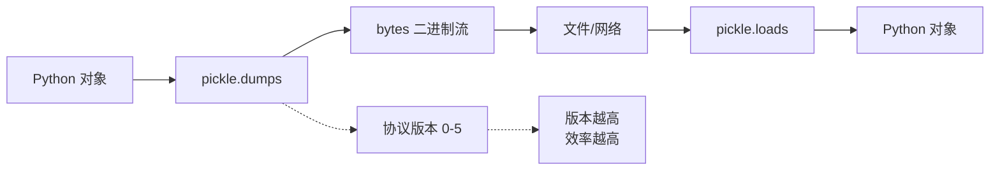
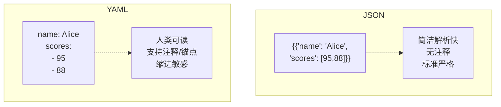

# Day 062 — 数据序列化与配置管理

## 概述

数据序列化（Serialization）是将内存中的数据结构（如 Python 的 dict、list、对象）转换为可以存储或传输的格式的过程。反序列化（Deserialization）则是逆过程——将存储/传输格式还原为内存中的数据结构。

> 通俗理解：序列化 = 把 Python 对象「打包」成字符串/二进制流，反序列化 = 把打包好的数据「解包」回 Python 对象。

---

## 1. 为什么需要序列化？

### 1.1 核心目的

| 场景 | 说明 |
|------|------|
| **持久化存储** | 将程序状态保存到磁盘文件，下次启动时恢复 |
| **网络传输** | 通过 HTTP、RPC 等协议在不同服务之间交换数据 |
| **跨语言通信** | 不同编程语言的系统之间共享数据 |
| **缓存** | 将计算结果序列化后存入 Redis/Memcached |
| **配置文件** | 使用人类可读的格式（JSON/YAML）作为配置 |

### 1.2 设计原理

Python 对象存活在进程的堆内存中，进程退出后内存被回收。如果要让数据「活」到进程之外，就必须将其转换为字节流——这就是序列化的本质。

```
┌─────────────────────────────────────────────────┐
│                  进程 A                          │
│  ┌──────────┐    序列化     ┌──────────────┐    │
│  │ {"name": │ ──────────→  │ b'{"name":..} │    │
│  │  "Alice"} │             │              │    │
│  └──────────┘    字节流     └──────────────┘    │
│                       │                         │
│                       ▼                         │
│                文件 / 网络 / 缓存                 │
│                       │                         │
│  ┌──────────┐    反序列化   ┌──────────────┐    │
│  │ {"name": │ ←──────────  │ b'{"name":..} │    │
│  │  "Bob"}  │             │              │    │
│  └──────────┘              └──────────────┘    │
│                  进程 B                          │
└─────────────────────────────────────────────────┘
```

---

## 2. JSON 序列化（json 模块）

### 2.1 概念

JSON（JavaScript Object Notation）是一种轻量级的数据交换格式，基于 JavaScript 语法子集，但被几乎所有编程语言支持。

**Python 类型 ↔ JSON 类型映射：**

| Python | JSON |
|--------|------|
| `dict` | `object` |
| `list`, `tuple` | `array` |
| `str` | `string` |
| `int`, `float` | `number` |
| `True` / `False` | `true` / `false` |
| `None` | `null` |

### 2.2 核心 API

| 函数 | 说明 | 参数 |
|------|------|------|
| `json.dumps(obj)` | Python 对象 → JSON 字符串 | `ensure_ascii`, `indent`, `sort_keys`, `default` |
| `json.dump(obj, fp)` | Python 对象 → 写入文件流 | 同上 + 文件对象 |
| `json.loads(s)` | JSON 字符串 → Python 对象 | `parse_float`, `object_hook` |
| `json.load(fp)` | 从文件流读取 → Python 对象 | 同上 |

**常用参数详解：**

```python
import json

data = {"name": "Alice", "scores": [95, 88], "active": True}

# 基础
json.dumps(data)               # '{"name": "Alice", "scores": [95, 88], "active": true}'

# 美化输出
json.dumps(data, indent=2)     # 带缩进格式化

# 中文不转义
json.dumps({"name": "张三"}, ensure_ascii=False)   # '{"name": "张三"}'

# 按键排序
json.dumps(data, sort_keys=True)

# 自定义类型编码
json.dumps(data, default=str)  # 遇到不可序列化的类型调用 str()
```

### 2.3 自定义编码器

当遇到 `datetime`、`Decimal` 等 Python 特有类型时，JSON 默认不支持，需要自定义：

```python
import json
from datetime import datetime

class CustomEncoder(json.JSONEncoder):
    def default(self, obj):
        if isinstance(obj, datetime):
            return obj.isoformat()
        return super().default(obj)

data = {"time": datetime.now(), "value": 42}
json.dumps(data, cls=CustomEncoder)
# '{"time": "2026-07-12T06:00:00", "value": 42}'
```

类似地，`object_hook` 用于反序列化时自定义转换：

```python
def decode_datetime(dct):
    if "time" in dct:
        dct["time"] = datetime.fromisoformat(dct["time"])
    return dct

json.loads(json_str, object_hook=decode_datetime)
```

---

## 3. pickle / msgpack

### 3.1 pickle — Python 专属序列化

`pickle` 是 Python 内置的二进制序列化协议，**只能用于 Python 之间**，不支持跨语言。

**特点：**
- ✅ 支持任意 Python 对象（包括自定义类、函数、生成器等）
- ✅ 二进制格式，比 JSON 更紧凑
- ✅ 内置协议版本（0-5，Python 3.8+ 支持 Protocol 5）
- ❌ **不安全**：反序列化不可信数据时可能执行任意代码
- ❌ 跨语言/跨版本兼容性差



**核心 API：**

| 函数 | 说明 |
|------|------|
| `pickle.dumps(obj)` | 对象 → bytes |
| `pickle.dump(obj, fp)` | 对象 → 二进制文件 |
| `pickle.loads(data)` | bytes → 对象 |
| `pickle.load(fp)` | 二进制文件 → 对象 |
| `pickle.HIGHEST_PROTOCOL` | 当前 Python 支持的最高协议版本 |

**安全警告：** 永远不要 `pickle.loads()` 来自不可信来源的数据。攻击者可以构造恶意的 pickle 数据来执行任意代码。

```python
# ⚠️ 危险示例 — 恶意 pickle 可以执行系统命令
import pickle
import os

# 攻击者构造的 payload
class Exploit:
    def __reduce__(self):
        return (os.system, ('rm -rf /',))

malicious_data = pickle.dumps(Exploit())
# pickle.loads(malicious_data)  # ⚡ 会执行 rm -rf /
```

### 3.2 msgpack — 跨语言二进制序列化

MessagePack 是一种高效的二进制序列化格式，类似 JSON 但更紧凑。

**与 JSON 对比：**
- 同样的数据，msgpack 体积约为 JSON 的 60-70%
- 支持二进制数据（JSON 需要 base64 编码）
- 跨语言支持广泛

**安装：** `pip install msgpack`

```python
import msgpack

data = {"name": "Alice", "age": 30, "scores": [95, 88]}

# 序列化
packed = msgpack.packb(data)   # bytes

# 反序列化
unpacked = msgpack.unpackb(packed)

# 处理自定义类型
from datetime import datetime

def encode(obj):
    if isinstance(obj, datetime):
        return msgpack.ExtType(1, obj.isoformat().encode())
    raise TypeError(f"Unknown type: {type(obj)}")

def decode(code, data):
    if code == 1:
        return datetime.fromisoformat(data.decode())
    return data

packed = msgpack.packb(data, default=encode)
unpacked = msgpack.unpackb(packed, ext_hook=decode)
```

---

## 4. YAML 配置

### 4.1 概念

YAML（YAML Ain't Markup Language）是一种人类可读的数据序列化格式，常用于配置文件。

**特点：**
- 依赖缩进表示层级（类似 Python）
- 比 JSON/XML 更易读
- 支持注释（JSON 不支持）
- 支持锚点/别名（`&`/`*`）避免重复

**安装：** `pip install pyyaml`

```yaml
# config.yaml
server:
  host: localhost
  port: 8080
  debug: true

database:
  host: ${DB_HOST}
  name: myapp
  pool:
    min: 5
    max: 20

# 列表
features:
  - auth
  - logging
  - cache

# 锚点 & 别名（避免重复）
defaults: &defaults
  timeout: 30
  retries: 3

service_a:
  <<: *defaults
  url: /api/a

service_b:
  <<: *defaults
  url: /api/b
```

### 4.2 PyYAML API

```python
import yaml

# 加载 YAML（字符串）
with open("config.yaml") as f:
    config = yaml.safe_load(f)    # ✅ 推荐：只加载标准 YAML
    # config = yaml.load(f, Loader=yaml.FullLoader)  # 更强大但风险更高

# 转储为 YAML
data = {"name": "Alice", "scores": [95, 88]}
yaml_str = yaml.dump(data, default_flow_style=False)
print(yaml_str)
# name: Alice
# scores:
# - 95
# - 88

# 写入文件
with open("output.yaml", "w") as f:
    yaml.dump(data, f, default_flow_style=False)
```

### 4.3 YAML vs JSON 对比



---

## 5. 三种序列化方案对比

| 特性 | JSON | pickle | YAML |
|------|------|--------|------|
| **格式** | 文本（字符串） | 二进制 | 文本 |
| **跨语言** | ✅ 几乎所有语言 | ❌ 仅 Python | ✅ 多数语言 |
| **可读性** | ⭐⭐⭐ | ⭐ | ⭐⭐⭐⭐⭐ |
| **安全性** | ✅ 安全 | ❌ 不安全 | ✅ safe_load 安全 |
| **速度** | ⭐⭐⭐⭐ | ⭐⭐⭐⭐⭐ | ⭐⭐ |
| **体积** | ⭐⭐⭐ | ⭐⭐⭐⭐⭐ | ⭐⭐ |
| **自定义类型** | ❌ 需要自定义 | ✅ 原生支持 | ❌ 需要自定义 |
| **适用场景** | API、配置文件、Web | 缓存、进程间通信 | 配置文件、文档 |

---

## 6. 配置管理：环境变量与多环境

序列化解决“数据怎么存”，配置管理解决“参数怎么注入”。生产级应用的配置来源分三层，**优先级从低到高**：

```
内置默认值  <  配置文件（YAML/TOML/INI）  <  环境变量  <  命令行参数
```

### 6.1 环境变量管理（python-dotenv）

把密钥、部署差异放环境变量，用 `.env` 文件方便本地开发：

```bash
# .env（永不提交到 git！）
DB_HOST=127.0.0.1
API_KEY=sk-xxxx
```

```python
from dotenv import load_dotenv
import os

load_dotenv()                          # 把 .env 注入 os.environ（不覆盖已有值）
host = os.getenv("DB_HOST", "localhost")   # 代码里永远给默认值
```

`code/04-config-management.py` 用标准库实现了一个零依赖的 dotenv 风格加载器（约 20 行），原理就是逐行解析 `KEY=VALUE` 后写入字典。

### 6.2 配置库对比

| 方案 | 格式 | 适用场景 |
|------|------|----------|
| PyYAML | YAML | 复杂配置、运维友好（Day 062 §4） |
| tomllib（3.11+） | TOML | pyproject.toml、现代项目配置 |
| configparser | INI | 简单平面配置、遗留项目 |
| json | JSON | 跨语言、程序生成的配置 |

选型原则：**人写选 YAML/TOML，机器写选 JSON，别自己发明格式**。

### 6.3 多环境配置实践

基础配置 + 环境覆盖，而不是维护四份全量配置：

```python
cfg = load_yaml("config.base.yaml")
cfg.update(load_yaml(f"config.{env}.yaml"))   # dev / prod 只写差异项
cfg.update(env_overrides(os.environ))          # 环境变量最后盖一层
```

三个铁律：默认值必须能在本地裸跑；生产密钥只走环境变量；`.env` 进 `.gitignore`。

## 7. 实战：配置文件解析器

详见 `code/03-config-parser.py`

实现一个通用配置管理器，支持：
- 自动检测配置文件格式（JSON/YAML）
- 支持环境变量替换（`${VAR_NAME}`）
- 配置合并与覆盖
- 配置验证

---

## 8. 思考题

1. **JSON 为什么不支持 datetime 类型？** 如果你是 JSON 标准委员会成员，你会怎么设计解决这个问题？

**参考答案**

JSON 的设计目标是「最小的跨语言数据交换格式」，只有六种值类型（对象、数组、字符串、数字、布尔、null）。日期是个很「重」的概念：时区、历法、精度、格式约定在各语言里千差万别，一旦加入日期类型，就会破坏 JSON 的简单性和通用性——所以标准故意把它留白。

如果我是委员会成员，我不会改核心类型，而是加一层**约定**：① 规定日期一律用 ISO 8601 字符串表示（如 `"2026-07-01T12:30:00"`）；② 用 JSON Schema 的 `format: "date-time"` 做校验；③ 需要强类型时用带标签的对象，如 `{"$date": "..."}`（MongoDB 的 Extended JSON 正是这么做的）。

Python 里的落地方式就是本章讲的 `default=` / `cls=`：序列化时把 `datetime` 转成 `isoformat()` 字符串，反序列化时再用 `fromisoformat()` 还原：

```python
import json
from datetime import datetime


def encode_datetime(obj):
    """遇到 datetime 就转成 ISO 8601 字符串，其他类型照常报错"""
    if isinstance(obj, datetime):
        return obj.isoformat()
    raise TypeError(f"无法序列化 {type(obj)}")


data = {"event": "登录", "time": datetime(2026, 7, 1, 12, 30)}
text = json.dumps(data, default=encode_datetime, ensure_ascii=False)
print(text)

restored = json.loads(text)                      # 读回来 time 还是字符串
restored["time"] = datetime.fromisoformat(restored["time"])  # 手动还原
print(restored["time"], type(restored["time"]).__name__)
```

预期输出：

```text
{"event": "登录", "time": "2026-07-01T12:30:00"}
2026-07-01 12:30:00 datetime
```

JSON 层面日期始终是字符串，「类型」靠两端约定维护——这正是 JSON 保持简单的代价与智慧。
2. **pickle 的安全性设计为什么如此糟糕？** 为什么要支持 `__reduce__` 这个接口？

**参考答案**

pickle 的定位是「序列化**任意** Python 对象」，包括自定义类的实例。要重建任意对象，就必须有一个通用协议：`__reduce__` 让类自己声明「用哪个可调用对象 + 哪些参数来重建我」。看一个无害的例子：

```python
import pickle


class Point:
    def __init__(self, x, y):
        self.x, self.y = x, y

    def __reduce__(self):
        # 告诉 pickle：反序列化时「调用 Point(x, y)」来重建对象
        return (Point, (self.x, self.y))


data = pickle.dumps(Point(1, 2))
p = pickle.loads(data)   # 这一步真的执行了 Point(1, 2) 这个调用
print(p.x, p.y)
```

预期输出：

```text
1 2
```

关键在最后一行注释：`loads` 不是「解析数据」，而是**执行字节流里记录的函数调用**。把 `(Point, (1, 2))` 换成 `(os.system, ("恶意命令",))`，反序列化就变成任意命令执行——这就是危险的根源。

所以 pickle 并非「设计失误」，而是**用安全性换表达力**：它诞生于进程间通信等可信场景，「数据即代码」在当时是合理的。为什么不删掉 `__reduce__`？因为删了它，大量自定义类型就无法序列化，整个生态会崩。官方的立场一直是：只 `loads` 自己生成的、可信的数据，文档里有醒目警告。

⚠️ 注意：来自网络、上传文件、未知缓存的 pickle 数据一律不要 `loads`；对外交换数据用 JSON/msgpack，必须用 pickle 时可自定义 `Unpickler` 重写 `find_class` 做类型白名单。
3. **YAML 的缩进规则和 Python 一样，那它有没有类似 PEP 8 的缩进规范？** 缩进多少个空格最合适？

**参考答案**

没有 PEP 8 那样的官方规范文档。YAML 规范只有两条硬性要求：**同一层级的缩进必须一致**；**只能用空格，禁止 Tab**（Tab 在不同编辑器里宽度不同，会导致解析歧义）。

事实标准是 **2 个空格**：PyYAML 的 `dump` 默认输出 2 空格缩进，Kubernetes、Ansible、GitHub Actions 的官方文档也都用 2 空格。4 空格完全合法，但 YAML 配置动辄嵌套五六层，4 空格很快吃掉行宽，可读性反而下降。

比「几个空格」更重要的是**项目内一致**：同一个文件里混用 2 和 4 会直接解析报错。团队约定一个值（推荐 2），再用编辑器的「显示空白字符」功能兜底即可。

验证 PyYAML 的默认风格（需先 `pip install pyyaml`）：

```python
import yaml

data = {"server": {"host": "localhost", "ports": [80, 443]}}
print(yaml.dump(data, default_flow_style=False))
```

预期输出：

```text
server:
  host: localhost
  ports:
  - 80
  - 443
```

可以看到映射缩进 2 空格；列表项 `- 80` 与父键 `ports` 对齐——这是列表缩进的两种合法风格之一（另一种是再缩进一层），PyYAML 默认用前者。
4. **如果一个配置文件中既有 YAML 的锚点别名，又有环境变量引用，解析时应该先处理哪个？** 为什么？

**参考答案**

**先处理锚点/别名，后处理环境变量。** 两者根本不在一个层面：锚点（`&`）/别名（`*`）是 YAML **语法**的一部分，由解析器（`safe_load`）在解析阶段展开，决定最终的数据结构；而 `${VAR}` 对 YAML 来说只是普通字符串，是**应用层**的约定，解析器根本不认识它。

如果反过来——先做文本替换再解析 YAML——环境变量值里可能含有冒号、引号、换行等特殊字符，会破坏 YAML 结构，甚至注入新的锚点或标签，既是正确性问题也是安全问题。

正确顺序：`safe_load` 解析（锚点此时已展开）→ 递归遍历得到的 dict/list → 只对叶子字符串做 `${VAR}` 替换。这样替换自然作用于所有引用了锚点的副本。完整示例（需先 `pip install pyyaml`）：

```python
import os
import re
import yaml

os.environ["DB_HOST"] = "10.0.0.8"   # 模拟环境变量

text = """
defaults: &defaults
  host: ${DB_HOST}
  timeout: 30
service_a:
  <<: *defaults
  name: a
"""

config = yaml.safe_load(text)        # 第 1 步：解析 YAML，锚点/别名此时已展开


def expand(node):                    # 第 2 步：递归替换叶子字符串里的 ${VAR}
    if isinstance(node, dict):
        return {k: expand(v) for k, v in node.items()}
    if isinstance(node, list):
        return [expand(v) for v in node]
    if isinstance(node, str):
        return re.sub(r"\$\{(\w+)\}",
                      lambda m: os.environ.get(m.group(1), m.group(0)),
                      node)
    return node


config = expand(config)
print(config["defaults"]["host"])
print(config["service_a"]["host"])
```

预期输出：

```text
10.0.0.8
10.0.0.8
```

`service_a` 通过合并键 `<<: *defaults` 继承了锚点内容，环境变量替换发生在解析之后，所以两处 `host` 都被正确替换。
5. **msgpack 比 JSON 更紧凑，为什么没有替代 JSON 成为 Web API 的主流格式？** 有哪些关键限制？

**参考答案**

- **不可读**：msgpack 是二进制，`curl` 看不到响应内容、日志没法肉眼检查、配置不能手工编辑；JSON 是文本，任何编辑器都能打开。调试体验的差距是巨大的。
- **浏览器不原生支持**：JavaScript 内置 `JSON.parse`，而 msgpack 需要额外的解码库并处理二进制（`ArrayBuffer`），前端接入成本高。Web API 的最大客户端就是浏览器，这一条几乎一票否决。
- **生态惯性**：OpenAPI/Swagger、JSON Schema、API 网关、日志系统、CDN 缓存……整条工具链都默认 JSON。省 30%~40% 带宽的收益，不足以让整个生态搬家。
- **带宽并非主要瓶颈**：多数 API 载荷很小，开启 gzip 压缩后 JSON 与 msgpack 的体积差距进一步缩小；真正追求极致性能的内部通信，又有 protobuf/gRPC 这样的更强方案。
- **缺少配套标准**：msgpack 本身没有 schema/校验标准，类型约定要自己维护；JSON 有 JSON Schema 这样成熟的生态。

结论：msgpack 适合「机器对机器」的内部场景——RPC、缓存序列化（如 Redis）、消息队列；面向公众的 Web API，JSON 依然是综合最优解。「更紧凑」只是众多权衡维度中的一个。

---

## 9. 最佳实践总结

| 场景 | 推荐方案 | 原因 |
|------|----------|------|
| REST API | JSON | 标准、跨语言、浏览器可直接解析 |
| 配置文件 | YAML | 可读性好、支持注释 |
| 内部缓存 | pickle | 速度快、支持任意对象 |
| 高性能 RPC | msgpack / protobuf | 体积小、解析快 |
| 日志输出 | JSON | 结构化、易于工具解析 |
| 数据持久化 | JSON | 安全、兼容性好 |
