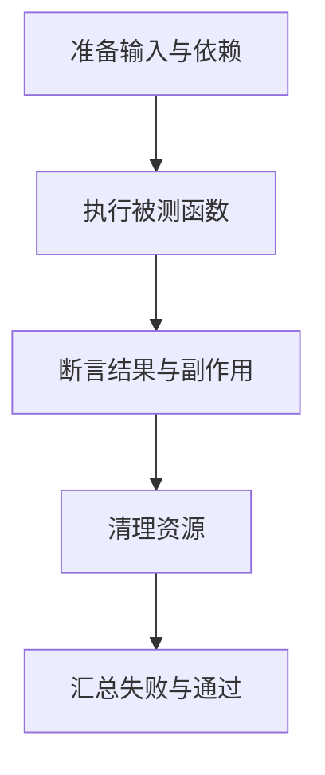
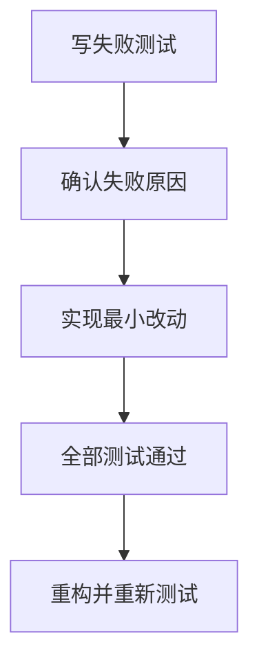
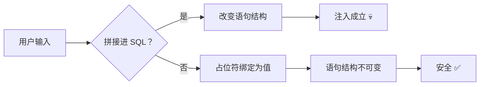

# Day 072 — 测试与数据库安全

## 测试基础图解

### 阅读与检查

Mock 只替代外部依赖，不应把被测试的业务本身替换掉。练习：在正常、边界、异常三种输入上写断言。

结合本日主 README 和 code 目录解释每个节点。此图解补充不代表重新运行了本日所有依赖环境。

## 测试进阶图解

### 阅读与检查

红灯必须因为缺少目标行为，而不是路径或环境错误。参数化测试减少重复，覆盖率高不代表断言有效。练习：加入边界断言并检查修改是否被测试捕获。

结合本日主 README 和 code 目录解释每个节点。此图解补充不代表重新运行了本日所有依赖环境。

## 数据库安全图解

## 阅读与检查

数据与语法的边界就是安全的边界。练习：挑出本日 code/13 里的任意一条 SQL，指出哪部分是"代码"、哪部分是"数据"。此图解补充不代表重新运行了本日所有依赖环境。
