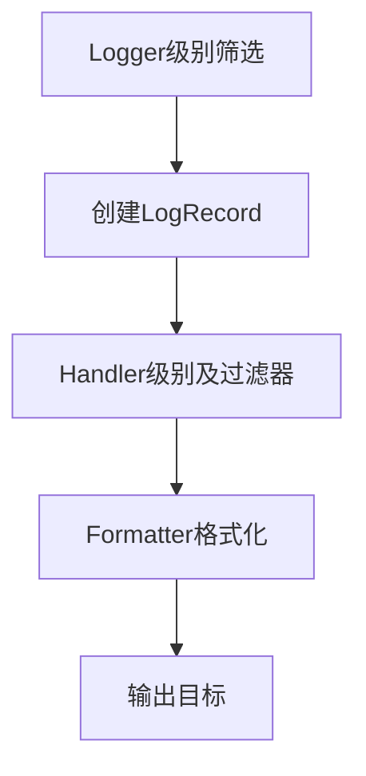
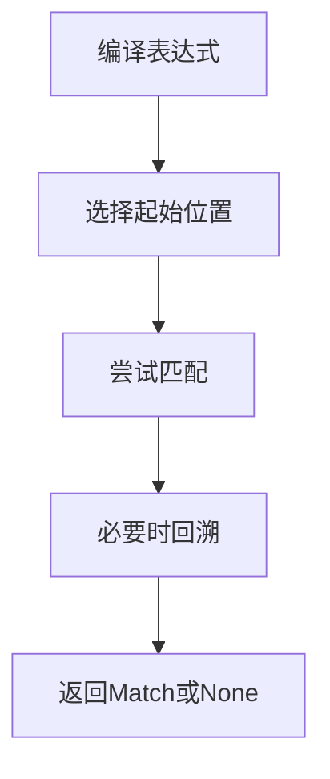

# Day 074 — 日志、调试与正则进阶 图解

## 日志与调试图解

### 阅读与检查

Logger 和 Handler 的级别会共同影响输出。日志避免保存密钥；父级传播配置不当会导致重复输出。练习：追踪 INFO 为什么没有出现在控制台。

结合本日主 README 和 code 目录解释每个节点。此图解补充不代表重新运行了本日所有依赖环境。

## 正则进阶图解

### 阅读与检查

限制输入长度，避免不必要的嵌套量词。search、match、fullmatch 的匹配范围不同。练习：用短字符串比较三者返回值，不做耗尽资源实验。

结合本日主 README 和 code 目录解释每个节点。此图解补充不代表重新运行了本日所有依赖环境。
