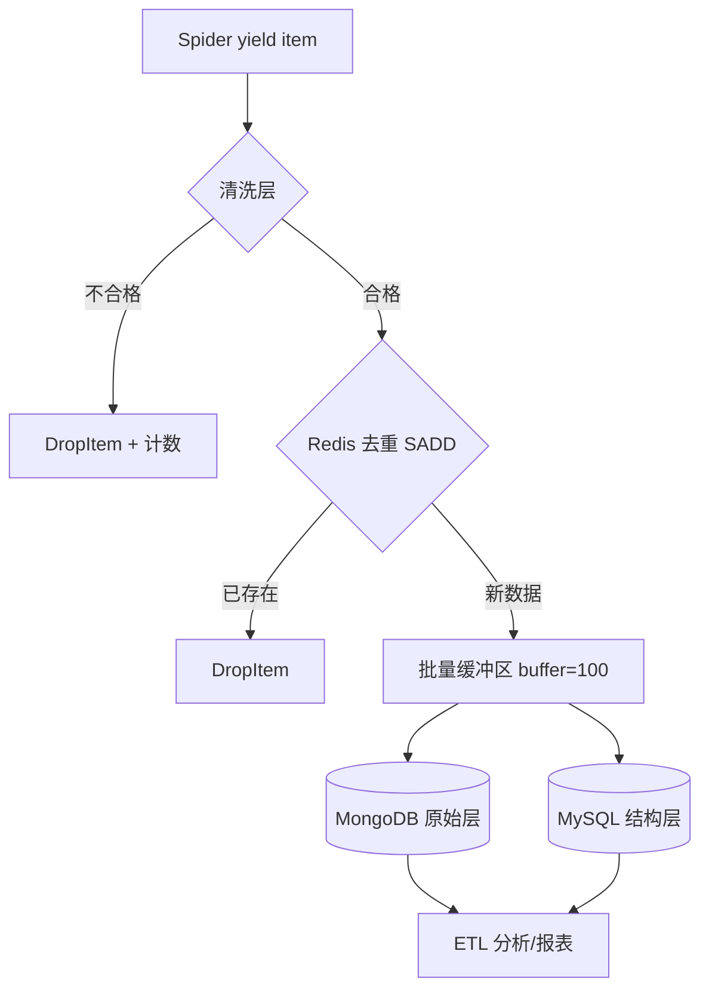

# Day 139 — 数据存储管道（Data Storage Pipelines）

> 阶段：Phase 7 - 进阶与性能优化 | 主题：实战

---

## 一、概念解释

### 1.1 为什么"管道"很重要？

爬虫的价值不在"爬到"，而在"存对"。脏数据入库 = 后续所有分析失真。数据管道要回答三个问题：

1. **清洗**：数据进库前怎么去噪、标准化？
2. **选型**：MySQL / MongoDB / Redis 各适合存什么？
3. **质量**：如何保证不重复、不丢、可追溯？

### 1.2 Scrapy Item 与 Pipeline 机制

- **Item** 是结构化数据的容器（类似 ORM 的 model），定义字段 + 校验规则。
- **Item Pipeline** 是流水线：每个 Pipeline 类实现 `process_item(item, spider)`，返回 item 传给下一级，抛 `DropItem` 则丢弃。

Pipeline 的四个常用钩子：

| 方法 | 时机 | 典型用途 |
|------|------|---------|
| `open_spider(spider)` | 爬虫启动 | 建连接、建表 |
| `close_spider(spider)` | 爬虫关闭 | 关连接、批量 flush |
| `process_item(item, spider)` | 每条数据 | 清洗、去重、入库 |
| `from_crawler(cls, crawler)` | 实例化 | 读 settings、注入依赖 |

### 1.3 存储选型速查

| 存储 | 数据模型 | 适用场景 | 不适用 |
|------|---------|---------|--------|
| MySQL | 关系表 | 结构稳定、需要 JOIN/事务/报表 | 字段经常变化的半结构化数据 |
| MongoDB | 文档(BSON) | 字段多变、嵌套深（如整页 JSON） | 强事务、复杂关联查询 |
| Redis | KV/内存 | 去重缓存、增量队列、热数据、计数 | 大容量冷数据（内存贵） |

经验法则：**爬虫原始层存 MongoDB（保留灵活性），分析层 ETL 到 MySQL（结构化报表），去重/状态用 Redis。**

---

## 二、原理深入

### 2.1 数据管道分层架构

```
 Spider yield item
      │
      ▼
 [P1 清洗层]  去空白/类型转换/默认值  -> 不合格 DropItem
      │
      ▼
 [P2 去重层]  Redis SADD 唯一键      -> 重复 DropItem
      │
      ▼
 [P3 入库层]  批量缓冲 + 事务写入 MySQL/MongoDB
      │
      ▼
 [P4 监控层]  统计计数、报警指标
```

为什么要分层？**单一职责**：清洗规则变化不影响入库逻辑，新增存储后端只需追加一层。

### 2.2 批量写入：为什么必须缓冲？

逐条 INSERT 的问题：每条一次网络往返 + 一次事务提交，吞吐约几百条/秒。改成攒 N 条（如 100）或 T 秒批量 `executemany` / `insert_many`，吞吐可提升 10~50 倍。

代价：**缓冲在内存，进程崩溃会丢最后一批**。生产上用 `close_spider` 兜底 flush + 定时器双保险。

### 2.3 幂等入库：ON DUPLICATE KEY UPDATE

爬虫重跑是常态。MySQL 侧靠唯一索引 + `INSERT ... ON DUPLICATE KEY UPDATE` 实现幂等；MongoDB 侧靠唯一索引 + `ReplaceOne(upsert=True)`；Redis 侧天然幂等（SET 覆盖）。**没有唯一键的表不允许爬虫直接写入**——这是数据质量的第一道红线。

### 2.4 数据质量控制四指标

- **完整性**：必填字段非空率（schema 校验，可用 `itemadapter` + pydantic）
- **唯一性**：业务主键去重率
- **时效性**：数据从抓取到可查询的延迟
- **可追溯性**：每条数据记录 `source_url`、`crawl_time`、`spider_name`，出问题能回溯重爬

---

## 三、定义与方法（API 速查）

### 3.1 Item 定义

```python
import scrapy

class BookItem(scrapy.Item):
    title = scrapy.Field()          # 必填
    price = scrapy.Field()          # 会被清洗成 float
    source_url = scrapy.Field()     # 溯源字段（强烈建议所有 Item 都有）
    crawled_at = scrapy.Field()
```

### 3.2 Pipeline 骨架

```python
class MySQLPipeline:
    def open_spider(self, spider):
        self.buffer, self.buf_size = [], 100

    def process_item(self, item, spider):
        self.buffer.append(dict(item))
        if len(self.buffer) >= self.buf_size:
            self._flush()
        return item          # 一定要 return，否则后续管道收不到

    def close_spider(self, spider):
        if self.buffer:
            self._flush()

    def _flush(self):
        # executemany + ON DUPLICATE KEY UPDATE
        ...
```

### 3.3 常用 API 速查表

| 操作 | MySQL | MongoDB | Redis |
|------|-------|---------|-------|
| 幂等写 | `INSERT ... ON DUPLICATE KEY UPDATE` | `replace_one(f, d, upsert=True)` | `SET` / `SADD` |
| 批量写 | `executemany` | `insert_many(ordered=False)` | pipeline 批量命令 |
| 唯一约束 | `UNIQUE KEY(url)` | `create_index(url, unique=True)` | set 天然唯一 |
| 连接库 | PyMySQL / mysqlclient | pymongo | redis-py |

---

## 四、图解



```
数据生命周期：
  抓取(parse) -> 校验 -> 去重 -> 缓冲 -> 落库 -> 可查询
  T+0s          T+0s    T+0s    T+~30s   T+~30s   T+~30s
                          ↑ 崩溃窗口：缓冲未 flush 的数据会丢（需 close_spider 兜底）
```

---

## 五、实战代码案例

见 `code/`：

- `01-cleaning-pipeline.py` -- 清洗 + 校验 + DropItem（基础）
- `02-multi-backend-pipeline.py` -- Redis 去重 + MySQL/MongoDB 双写 + 批量缓冲（进阶避坑）
- `03-full-data-pipeline.py` -- 完整管道：清洗→去重→双库→质量报表（实战）

---

## 六、思考题

1. 批量缓冲 100 条 vs 1000 条，各有什么代价？怎么选择缓冲大小的实验方法？

**参考答案**

- **缓冲 100 条**：崩溃丢失窗口小（最多丢 100 条）、数据延迟低（更快可查询）、内存占用小；但批次提交更频繁，吞吐提升有限。
- **缓冲 1000 条**：吞吐更高（网络往返和事务提交次数更少）；但崩溃最多丢 1000 条、数据滞后更久、单事务更大（锁时间长、回滚成本高，可能撞数据库包大小上限）。

**实验方法**：固定其他条件，对 buffer = 50/100/500/1000 分别压测吞吐（条/秒）、P99 延迟、内存占用，找到"吞吐不再显著提升"的拐点；再结合业务可容忍的丢失窗口和延迟要求，取较小值。通常 100~500 是甜点区。

另外务必加**定时 flush**（如每 5 秒强制刷一次），防止低流量时数据一直卡在缓冲区。

小例子：实测 100→500 吞吐翻倍，500→1000 只提升 10%，那就选 500。
2. 为什么推荐"原始层 MongoDB + 分析层 MySQL"而不是直接写 MySQL？

**参考答案**

因为爬下来的数据是**半结构化**的：字段随站点/页面变化、嵌套深、经常增减。MySQL 要求固定 schema，加字段要 `ALTER TABLE`，嵌套结构只能序列化成 JSON 字符串（失去查询能力）；MongoDB 的文档模型天然契合，先存下来不丢信息。

更关键的是**可重处理性**：原始层保留"原始快照"，当解析规则有 bug 时，可以从原始层重新 ETL，而不必重新爬取（重爬有风控成本）。如果直接写 MySQL，清洗错了数据就丢了。

分析层需要 JOIN、事务、报表、BI 工具，MySQL/关系库更强；从 MongoDB ETL 到 MySQL，schema 稳定后再结构化。

一句话：MongoDB 买"灵活性与可重处理"，MySQL 买"查询与分析能力"，各司其职。

小例子：商品页今天 30 个字段、明天多 5 个，MongoDB 直接存，MySQL 得先改表。
3. 如果爬虫在凌晨 3 点崩溃，怎么保证缓冲区里没 flush 的数据不丢？（提示：本地 WAL 文件 / 缩短定时 flush / 消息队列）

**参考答案**

三种思路：① **本地 WAL（预写日志）**——每条数据先追加写磁盘文件（fsync）再进缓冲，写库成功后才删日志，重启时重放未完成的日志；② **缩短定时 flush + close_spider 兜底**——只能防"正常退出"，防不了 kill -9/断电，丢失窗口 = flush 间隔；③ **消息队列（Kafka/Redis Stream）**——item 先入队再消费写库，队列自身持久化，天然不丢。

下面用标准库演示最小 WAL（崩溃后自动恢复）：

```python
import json
import os
import tempfile

class WalBuffer:
    """先写 WAL（预写日志）再进内存缓冲；崩溃重启后重放 WAL 找回数据"""

    def __init__(self, wal_path, db, batch=3):
        self.wal_path, self.db, self.batch = wal_path, db, batch
        self.buffer = []
        self._replay()                      # 启动时先恢复上次崩溃遗留的数据

    def _replay(self):
        if os.path.exists(self.wal_path):
            with open(self.wal_path, encoding="utf-8") as f:
                for line in f:
                    self.db.append(json.loads(line))
            os.remove(self.wal_path)        # 生产上还要按唯一键去重，防止重复入库

    def add(self, item):
        with open(self.wal_path, "a", encoding="utf-8") as f:
            f.write(json.dumps(item, ensure_ascii=False) + "\n")
            f.flush()
            os.fsync(f.fileno())            # 强制落盘，断电也不丢
        self.buffer.append(item)
        if len(self.buffer) >= self.batch:
            self.flush()

    def flush(self):
        self.db.extend(self.buffer)         # 模拟批量写库
        self.buffer.clear()
        os.remove(self.wal_path)            # 写库成功后才删 WAL

with tempfile.TemporaryDirectory() as tmp:
    wal = os.path.join(tmp, "spider.wal")
    db = []                                 # 用列表模拟数据库
    p1 = WalBuffer(wal, db, batch=3)
    p1.add({"title": "数据1"})
    p1.add({"title": "数据2"})              # 只有 2 条，没到批量阈值，还在缓冲区
    # --- 模拟进程崩溃：p1 直接丢弃，没来得及 flush ---
    p2 = WalBuffer(wal, db, batch=3)        # 重启：新实例自动重放 WAL
    print("重启后数据库里的数据:", db)
```

预期输出：

```text
重启后数据库里的数据: [{'title': '数据1'}, {'title': '数据2'}]
```

两条还在缓冲区的数据，因为先写了 WAL，重启后被完整找回。

⚠️ 注意："写库成功但 WAL 未删"的崩溃窗口会导致重放重复，所以写库必须幂等（唯一键 + upsert）；WAL 要放在与数据库同等或更可靠的磁盘上。
4. `insert_many(ordered=False)` 和默认 True 的区别是什么？部分文档主键冲突时行为有何不同？

**参考答案**

- **`ordered=True`（默认）**：按顺序插入，一旦遇到错误（如主键冲突）就**立即停止**，后面的文档不再插入，抛出 `BulkWriteError`。
- **`ordered=False`**：即使部分文档失败，也**继续插入剩余文档**，最后统一报告所有错误；成功的已经写入。

部分主键冲突时：`True` 只插到冲突点之前，"前半截入库、后半截丢失"；`False` 会把所有不冲突的都插进去，冲突的跳过（并报错）。爬虫批量入库通常用 `False`——一条脏数据不该阻塞整批。

小例子：100 条里第 3 条冲突，`True` 只插入前 2 条，`False` 插入其余 99 条。

⚠️ 注意：`False` 不是事务，"部分成功"是常态，要处理 `BulkWriteError.details` 里的失败文档（重试或记录）；它服务端可并行，通常也更快。
5. 如何设计一套"数据质量日报"，用哪些指标衡量昨天爬虫产出数据的质量？

**参考答案**

按四个维度设计指标，并落到"每天每爬虫"的粒度：

1. **完整性**：各必填字段非空率、schema 校验失败率；
2. **唯一性**：重复率（去重命中数/总数）、主键冲突数；
3. **时效性**：抓取到入库延迟 P50/P99、今日产出量 vs 近 7 日均值（骤降 >30% 告警）；
4. **准确/可追溯**：类型转换失败数、值域异常（如价格 ≤ 0）、`source_url` 覆盖率。

实现：Pipeline 监控层对每条数据计数（成功/丢弃/重复/字段缺失），按天 + spider 写入统计表；定时任务每早汇总昨日数据生成报表（Markdown/HTML）推送钉钉/企微，红项自动告警。

关键：报表要有**对比基线**（环比/同比），单个数字看不出好坏；保留每爬虫每站点粒度，方便定位是哪个爬虫出了问题。

小例子：报表显示"price 非空率从 99.9% 掉到 70%"，立刻知道是价格选择器失效，而不是模糊的"数据好像少了"。
