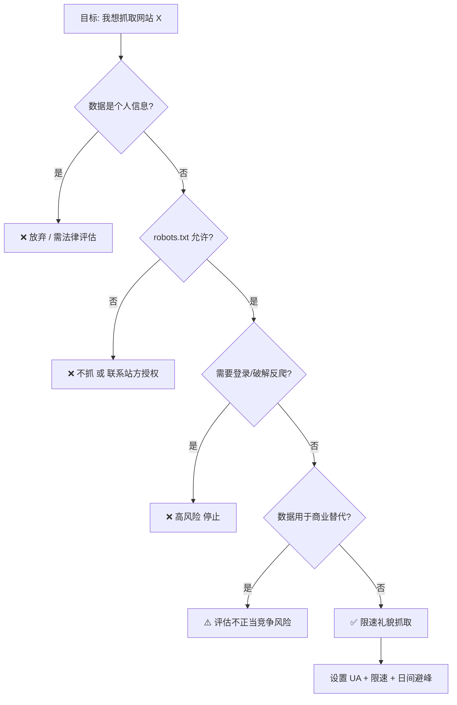

# Day 142 — 爬虫法律与规范

> 阶段：Phase 7 — 进阶与性能优化
> 主题：robots.txt 规范 / 数据合规与法律边界 / 爬虫职业道德

---

## 一、概念解释

### 1.1 robots.txt 是什么

`robots.txt` 是网站放在根目录下的一个**纯文本协议文件**（`https://example.com/robots.txt`），用来告诉爬虫："哪些路径欢迎你抓，哪些路径请你别碰"。

关键认知：

- 它叫 **Robots Exclusion Protocol（爬虫排除协议）**，是 1994 年诞生的**君子协定**
- **不具有强制法律约束力**（但在中国司法实践中，违反 robots.txt 可作为"明知不应抓取"的主观过错证据）
- 主流搜索引擎爬虫（Googlebot、Baiduspider）都会遵守它

### 1.2 robots.txt 语法速览

```text
# 注释以 # 开头
User-agent: *          # 对所有爬虫生效
Disallow: /admin/      # 禁止抓取 /admin/ 下所有内容
Disallow: /private.php # 禁止抓取特定文件
Allow: /admin/public/  # 例外：允许（优先级高于 Disallow）
Crawl-delay: 2         # 请求间隔至少 2 秒（非标准字段，部分引擎支持）
Sitemap: https://example.com/sitemap.xml

User-agent: BadBot     # 针对特定 UA 的独立规则组
Disallow: /            # 全站禁抓
```

### 1.3 数据合规相关法律（中国）

| 法律 | 与爬虫相关的核心条款 |
|---|---|
| 《网络安全法》 | 不得危害网络秩序；未经授权侵入网络属于违法行为 |
| 《数据安全法》 | 数据分类分级；窃取/非法获取数据需担责 |
| 《个人信息保护法》(PIPL) | 抓取个人信息（手机号、身份证、住址等）必须有合法基础，"合法正当必要"原则 |
| 《反不正当竞争法》 | 抓取竞对数据"不劳而获"、实质性替代对方服务，构成不正当竞争 |
| 《刑法》第 285 条 | **非法获取计算机信息系统数据罪**：违反规定侵入/采用其他技术手段获取数据，情节严重可入刑 |

### 1.4 什么情况爬虫会"踩红线"

1. **突破反爬措施**：绕过验证码、伪造登录态、破解加密接口 —— 可能被认定为"未经授权获取数据"
2. **抓取个人信息**：电话号码、住址、身份证号等，即使公开可见
3. **高频请求压垮服务**：造成对方服务器瘫痪，可能构成破坏计算机信息系统罪
4. **抓取后实质性替代原服务**：搬运内容直接变现，构成不正当竞争
5. **抓取+转售受版权保护的内容**

### 1.5 爬虫职业道德（Industry Ethics）

- **识别自己**：设置真实、可联系的 User-Agent（含邮箱）
- **限速**：单站点并发 ≤ 1~2，请求间隔 ≥ 1~3 秒
- **避开高峰**：夜间/清晨抓取对业务影响更小
- **尊重 robots.txt**：即使法律不强制
- **只抓需要的数据**：能拿列表页摘要就不要全站镜像
- **不碰隐私数据**：个人身份信息（PII）一律不碰

---

## 二、原理解析

### 2.1 robots.txt 匹配算法

匹配基于**最长前缀匹配 + Allow/Disallow 优先级**：

```text
1. 找到 User-agent 匹配当前爬虫名的规则组（* 是通配）
2. 对请求路径，收集所有匹配的 Allow / Disallow 规则
3. 规则匹配长度：Allow 和 Disallow 中"匹配路径最长的"获胜
4. 完全没有匹配规则 => 默认允许抓取
5. Disallow: (空) => 允许抓取全站
```

示例：

```text
User-agent: *
Allow: /public/
Disallow: /

请求 /public/a.html: 允许 ✅
请求 /private/x:     禁止 ❌
```

⚠️ **实测避坑**：CPython 的 `urllib.robotparser` 对规则顺序敏感——若把 `Disallow: /` 写在 `Allow: /public/` 之前，`/public/a.html` 也会被判为禁止。写 robots.txt 或离线解析时，请把更具体的 `Allow` 规则放在前面，并用真实用例回归验证。

### 2.2 Crawl-delay 与 politeness（礼貌抓取）

搜索引擎定义的"politeness"本质上是一个**公平资源共享问题**：

- 服务器带宽、CPU、数据库连接是有限资源
- 一个礼貌爬虫应保证自己占用 < 1% 的站点容量
- 实践经验：QPS ≤ (1 / 站点平均响应时间) × 安全系数 0.01~0.1

### 2.3 合规决策流程



---

## 三、API 速查：urllib.robotparser

| 方法 | 说明 |
|---|---|
| `RobotFileParser()` | 创建解析器 |
| `set_url(url)` / `parse(lines)` | 设置 robots.txt 地址 / 直接解析文本行 |
| `read()` | 发起请求读取并解析（404/网络错误时视为全允许） |
| `can_fetch(useragent, url)` | 该 UA 是否允许抓取该 URL → bool |
| `crawl_delay(useragent)` | 读取 Crawl-delay 值（无则 None） |
| `request_rate(useragent)` | 读取 Request-rate（返回 namedtuple 或 None） |
| `mtime()` / `modified()` | 上次读取时间 / 标记需要重新读取 |

---

## 四、实战代码案例

见 `code/` 目录：

1. `01-robots-parser.py` — 基础：解析并遵守 robots.txt
2. `02-compliance-checker.py` — 进阶：抓取前合规自检（避坑清单代码化）
3. `03-polite-crawler.py` — 实战：一个"礼貌爬虫"骨架，限速 + robots 检查 + 日志审计

---

## 五、思考题

1. robots.txt 写了 `Disallow: /`，但页面本身公开可访问且无登录墙。抓取它违法吗？为什么实践中仍建议遵守？

**参考答案**

不一定违法。robots.txt 是君子协定，没有直接法律强制力；是否违法要看实质要件：是否突破技术措施（登录墙/反爬）、是否抓个人信息、是否打垮服务、是否实质性替代/不正当竞争。公开页面 + 无反爬 + 限速 + 非个人信息 + 非商业替代，通常不会仅因违反 robots 就构成违法。

但仍建议遵守：① **司法证据**——违反 robots 可被认定为"明知不应抓取"的主观过错，在不正当竞争/刑事案件中加重责任；② **授权信号**——Disallow 是站方明确的"不欢迎"表示，继续抓属于"违背意愿"，纠纷中抗辩地位弱；③ **行业规范与声誉**——搜索引擎都遵守，违反可能被行业拉黑；④ **风险不对称**——遵守的收益小，违反的潜在代价大。

小例子：某站 robots 全站禁抓，你限速抓公开新闻做个人研究，一般不违法；但若拿去搬运变现，就可能构成不正当竞争。

⚠️ 注意：本答案为一般性知识，不构成法律意见，具体项目请咨询法务。
2. 为什么"绕过验证码"在中国司法实践中常被认定为"破坏技术措施/非法获取数据"？验证码在法律上代表什么信号？

**参考答案**

因为验证码在法律上是站方**"明确的授权边界信号"**：它告诉访问者"此资源不向自动化访问开放，需人工验证才能通过"。绕过它 = 明知对方不授权，仍用技术手段突破，主观上具有"未经授权"的故意。

这对应《刑法》第 285 条"非法获取计算机信息系统数据罪"中"违反国家规定，侵入……或者采用其他技术手段，获取数据"；验证码、登录墙、加密都属于表明授权范围的"技术措施"，突破它们即"未经授权"。还可能构成《反不正当竞争法》中"利用技术手段妨碍、破坏其他经营者合法提供的网络服务"。

所以验证码不只是技术障碍，更是"法律边界标记"：见到它应当停止/寻求授权，而不是想"我能不能破"。

小例子：站点用验证码保护查询接口，你打码绕过批量抓取，即便数据本身公开，也可能因"突破技术措施"被认定非法获取。

⚠️ 注意：不构成法律意见；验证码识别练习仅限自有/授权站点。
3. 如果只抓取一个公开 API 的数据做个人研究、不商用、不传播，是否就绝对安全？哪些边界仍需注意？

**参考答案**

不是绝对安全。"非商用"只降低了不正当竞争风险，并不豁免其他义务：

1. **个人信息**：即使公开、即使研究用途，抓手机号/身份证等仍可能违反《个人信息保护法》（缺乏合法基础）；
2. **突破技术措施**：若 API 有 sign/token/限频而你破解，仍可能触及《刑法》285 条，与用途无关；
3. **服务条款**：API 通常有使用协议，违反至少构成违约/封号；
4. **频率**：高频打垮服务可能构成破坏计算机信息系统；
5. **数据安全**：研究数据泄露也要担责。

相对安全的姿势：只抓非个人的公开数据、遵守 robots 与条款、不破解任何鉴权/反爬、严格限速、不二次传播原始数据、用完即删。

小例子：公开天气 API 限速抓来做气候研究，通常安全；但若破解其 token 高频抓用户位置数据，就越界了。

⚠️ 注意：不构成法律意见，边界情形请咨询法务。
4. 设计一个"合规中间件"：在 Scrapy 请求发出前自动检查 robots.txt 并限速，你会怎么设计缓存（robots.txt 本身不能每次请求都重新下载）？

**参考答案**

设计要点：① **按域名缓存 robots.txt**，TTL 设 1 小时~1 天，有效期内只下载一次；② **下载失败策略**——404 视为全允许，5xx/网络错误保守拒绝或重试，绝不每请求重新下载；③ **按域名限速**（而非全局），间隔 1~3 秒；④ Scrapy 里其实直接开 `ROBOTSTXT_OBEY=True` + `DOWNLOAD_DELAY` 即可，自定义中间件则把检查放在 `process_request`。下面用标准库离线演示缓存 + 限速：

```python
import time
from urllib.parse import urlparse
from urllib.robotparser import RobotFileParser

class RobotsCache:
    """带 TTL 的 robots.txt 缓存：有效期内每个域名只下载一次"""

    def __init__(self, loader, ttl=3600):
        self.loader = loader        # loader(scheme, host) -> RobotFileParser
        self.ttl = ttl
        self._cache = {}            # (scheme, host) -> (过期时间戳, 解析器)
        self.loads = 0              # 统计真实下载次数，验证缓存效果

    def can_fetch(self, ua, url):
        p = urlparse(url)
        key = (p.scheme, p.netloc)
        now = time.time()
        if key not in self._cache or self._cache[key][0] <= now:
            self._cache[key] = (now + self.ttl, self.loader(*key))
            self.loads += 1
        return self._cache[key][1].can_fetch(ua, url)

class RateLimiter:
    """按域名限速：同一域名两次请求之间至少间隔 interval 秒"""

    def __init__(self, interval=2.0):
        self.interval = interval
        self._last = {}

    def wait(self, url):
        host = urlparse(url).netloc
        now = time.monotonic()
        delay = self._last.get(host, now - self.interval) + self.interval - now
        if delay > 0:
            time.sleep(delay)
        self._last[host] = time.monotonic()

# ---- 离线演示：用本地文本代替网络下载 ----
ROBOTS_TEXT = """User-agent: *
Allow: /public/
Disallow: /
"""

def fake_loader(scheme, host):
    rp = RobotFileParser()
    rp.parse(ROBOTS_TEXT.splitlines())   # 真实中间件里换成 rp.set_url(...) + rp.read()
    return rp

cache = RobotsCache(fake_loader, ttl=3600)
limiter = RateLimiter(interval=0.2)      # 演示用 0.2 秒，生产建议 1~3 秒

urls = ["https://example.com/public/a.html",
        "https://example.com/private/x",
        "https://example.com/public/b.html"]
start = time.monotonic()
for u in urls:
    if cache.can_fetch("MyBot", u):
        limiter.wait(u)
        print("抓取:", u)
    else:
        print("跳过(robots禁止):", u)
print(f"robots 下载次数: {cache.loads}（3 个请求只下载 1 次）")
print(f"总耗时: {time.monotonic() - start:.2f}s（限速生效）")
```

预期输出（耗时约 0.2 秒，机器不同略有浮动）：

```text
抓取: https://example.com/public/a.html
跳过(robots禁止): https://example.com/private/x
抓取: https://example.com/public/b.html
robots 下载次数: 1（3 个请求只下载 1 次）
总耗时: 0.20s（限速生效）
```

3 个请求只下载 1 次 robots，`/private/x` 被正确拦截，同域名请求被限速错开。

⚠️ 注意：`robotparser` 对规则顺序敏感（见本日 2.1），把更具体的 `Allow` 放前面并用真实用例回归；异步中间件里要给每个域名加锁，防止并发重复下载。
5. 《个人信息保护法》下，"数据已公开"是否等于"可以自由抓取"？什么叫"合理的处理范围"？

**参考答案**

不等于。《个人信息保护法》第 27 条规定：处理已公开的个人信息，应在**合理范围**内；个人明确拒绝的应停止；处理对个人权益有重大影响的，仍需取得同意。"公开"只是"可被看到"，不等于"授权任意使用"。

"合理范围"要综合判断：① **公开目的**——为求职公开简历，不等于同意被抓去做营销骚扰；② **处理方式与规模**——个人浏览 vs 批量聚合画像，后者远超合理预期；③ **对个人权益的影响**——是否造成骚扰、歧视、名誉损害；④ **是否明确拒绝**（站点 robots/反爬/用户声明）。

小例子：招聘网站公开简历，抓去建"人才库"转售，超出合理范围，即使数据公开也可能违反《个人信息保护法》。

⚠️ 注意：不构成法律意见；原则是"个人信息（PII）一律不碰"。

---

## 六、今日总结

- robots.txt 是君子协定：无强制力，但违反它会成为"主观过错"的证据
- 中国爬虫红线：绕反爬、抓 PII、打垮服务、实质性替代
- 职业道德落地为三件事：**真实 UA、限速、只抓所需**
- `urllib.robotparser` 标准库即可实现合规检查
