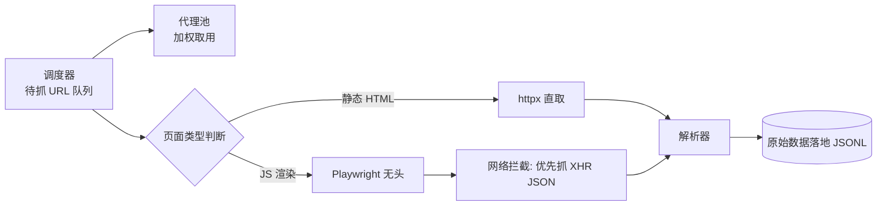

# Day 143 — 反爬项目实战（上）：代理池 + 浏览器模拟 + JS 解析

> 阶段：Phase 7 — 进阶与性能优化
> 主题：全栈反爬突破系统（上）—— 架构设计 / 代理池 / 浏览器模拟 / JS 动态内容解析

> ⚠️ **合规提醒**：本项目仅用于学习反爬技术原理与防御性测试，请只对自己拥有/授权的测试站点练习（见 Day 142）。

---

## 一、概念解释

### 1.1 项目整体架构

"全栈反爬突破系统"分三天搭建，今天负责**取数层**：

```text
Day 143: 代理池 + 浏览器模拟 + JS 解析   → 解决"请求被识别/页面是动态渲染"
Day 144: 验证码处理 + 数据清洗 + 调度告警 + 容器化 → 解决"人机验证"与"工程化运行"
```

### 1.2 代理池（Proxy Pool）

代理池是一个**自动维护可用代理列表的服务**：

- **采集**：从免费/付费代理 API 抓取代理
- **验证**：定时用目标（或通用）URL 测试代理的可用性与延迟
- **打分/淘汰**：连续失败的代理降分直至移除
- **供给**：爬虫按策略（轮询/随机/按成功率加权）取用

**为什么要代理池？** 目标站点按 IP 维度限频/封禁。单一 IP 高频请求必然触发风控；代理池把请求分散到大量出口 IP 上，使每个 IP 的请求频率降到阈值以下。

### 1.3 浏览器模拟（Headless Browser）

requests 拿到的 HTML 是"生面团"，很多站点的数据由 JS 在浏览器里执行后才"烤熟"（DOM 渲染、XHR 补数据）。浏览器模拟的思路：**不再猜接口，直接跑一个真浏览器**（Playwright/Selenium），等 JS 执行完再取 DOM。

| 方案 | 原理 | 成本 |
|---|---|---|
| requests/httpx | 直接发 HTTP | 极低，但拿不到渲染结果 |
| requests + 逆向 JS 接口 | 分析 XHR 直接调 API | 中（逆向难），效率最高 |
| Playwright(无头) | 真浏览器内核执行 JS | 高（内存/CPU），最通用 |
| Playwright + stealth | 补齐无头特征指纹 | 高，绕过基本无头检测 |

### 1.4 JS 解析的两种路线

1. **DOM 路线**：等页面 `networkidle`，用选择器取渲染后的 DOM（简单但慢）
2. **接口路线**：拦截页面的 XHR/fetch 请求，直接请求返回 JSON 的数据接口（快，且数据最干净）

---

## 二、原理解析

### 2.1 代理池评分模型

每个代理维护滑动窗口成功率，取用时按权重随机：

```text
score = 连续成功次数 / (连续成功次数 + 连续失败次数)
取用概率 ∝ score（加权随机，避免"最好用"的代理被打死）
```

### 2.2 无头浏览器为什么会被识别

无头 Chrome 与真浏览器的差异点（Day 137 的指纹知识回收利用）：

- `navigator.webdriver = true`
- UA 中含 `HeadlessChrome`
- 缺失插件/字体/WebGL 渲染特征
- 鼠标轨迹为空、事件节奏机械

Playwright 的 `playwright-stealth`（或手工注入 init script）可抹平大部分特征。

### 2.3 今日系统数据流



---

## 三、API 速查

### httpx 代理

| 用法 | 说明 |
|---|---|
| `httpx.Client(proxy="http://u:p@host:port")` | 全局走代理 |
| `httpx.get(url, proxy=...)` | 单次代理 |
| `client.get(url, timeout=10)` | 务必设超时 |

### Playwright 核心

| API | 说明 |
|---|---|
| `sync_playwright().start()` | 同步模式入口 |
| `browser.new_page(...)` | 新页面 |
| `page.goto(url, wait_until="networkidle")` | 等 JS 静默 |
| `page.content()` / `page.query_selector_all(sel)` | 取 DOM |
| `page.on("response", cb)` | 拦截网络响应 |
| `page.add_init_script(js)` | 页面加载前注入 JS（抹指纹） |

---

## 四、实战代码

见 `code/`：

1. `01-proxy-pool.py` — 基础：带评分与后台校验的代理池
2. `02-browser-render.py` — 进阶：Playwright 渲染 + XHR 接口拦截 + 无头检测规避（需 `pip install playwright && playwright install chromium`）
3. `03-fetch-pipeline.py` — 实战：静态/动态自动分流 + 代理池联动的取数管线

---

## 五、思考题

1. 加权随机取代理为什么比"永远取分数最高的"更健壮？

**参考答案**

"永远取最高分"会让全部流量集中到一个代理上：它的出口 IP 最快被目标站限频/封禁，分数掉下来后流量又整体切到下一个、再把它打死——"轮流烧代理"，池子迅速枯竭；而且单代理负载过高、延迟上升。

加权随机让高分代理多干活但不独占，流量分散到多个 IP，每个 IP 的频率都压在阈值以下；低分代理也有小流量，有机会恢复分数。用标准库模拟对比：

```python
import random
from collections import Counter

random.seed(42)
scores = {"代理A": 0.95, "代理B": 0.90, "代理C": 0.80, "代理D": 0.60}
proxies = list(scores)
weights = [scores[p] for p in proxies]

n = 10000
# 策略1：永远取分数最高的代理
best = max(scores, key=scores.get)
c1 = Counter({best: n})
# 策略2：按分数加权随机
c2 = Counter(random.choices(proxies, weights=weights, k=n))

for name, c in [("永远取最高分", c1), ("加权随机", c2)]:
    top = c.most_common(1)[0]
    print(f"{name}: '{top[0]}' 承担 {top[1] / n:.0%} 请求, 分布 {dict(c)}")
```

预期输出：

```text
永远取最高分: '代理A' 承担 100% 请求, 分布 {'代理A': 10000}
加权随机: '代理A' 承担 29% 请求, 分布 {'代理C': 2531, '代理A': 2894, '代理D': 1810, '代理B': 2765}
```

可见"永远取最高分"把 1 万次请求全压在代理 A 上，而加权随机让 4 个代理分担，A 只占约 29%，单个出口 IP 的压力大幅降低。

💡 提示：权重可用分数的平方拉开差距，但要保留非零下限，避免"一票否决"让低分代理永远没机会恢复。
2. `wait_until="networkidle"` 的缺陷是什么？什么场景应改用 `domcontentloaded` + 显式等待？

**参考答案**

`networkidle` 指"500ms 内没有网络连接"。缺陷：① 页面有轮询/心跳/长连接（WebSocket、统计 beacon、广告轮播）时永远不"空闲"，一直等到超时；② "空闲"不等于"数据渲染完"——JS 可能还在做本地计算/DOM 插入，拿到空壳；③ 慢接口拖累整页等待，效率低；④ 500ms 窗口是经验值，不可靠。

应改用 `domcontentloaded` + **显式等待**（`wait_for_selector` 等目标元素出现，或 `wait_for_response` 等特定 XHR 返回）：目标明确、不受无关请求干扰、又快又稳。

小例子：页面每 2 秒发一次心跳请求，`networkidle` 永远超时；改成 `wait_for_selector(".product-price")` 一秒就返回。
3. 拦截 XHR 拿 JSON 与解析 DOM 相比，数据质量与稳定性差异在哪？什么时候反而必须走 DOM？

**参考答案**

**XHR 优势**：① 数据干净——结构化 JSON，字段完整（含页面没展示的隐藏字段），无 HTML 解析损耗；② 稳定——接口契约比页面样式变化少，改版时选择器失效但接口往往不变；③ 快——无需渲染，可直接翻页。劣势：要逆向接口签名，可能有加密/反爬。

**DOM 优势**：通用、所见即所得、无需逆向。劣势：① 只拿到"渲染出来"的数据，隐藏字段丢失；② 选择器脆弱，改版即失效；③ 文本要清洗（空白/HTML 实体），精度损失（数字被截断、日期被格式化）。

**必须走 DOM 的情况**：① 数据只在前端计算后存在（图表聚合、本地拼接），没有独立接口；② 接口加密严重、逆向成本过高；③ 需要"页面可见状态"本身（截图、布局、A/B 测试内容）；④ WebSocket/canvas 渲染等没有 JSON 接口。

小例子：价格页面显示 "¥1,234.00"，XHR 返回数值 1234.00，DOM 还得去掉货币符号和千分位再转类型。
4. 代理池的验证 URL 如果直接用目标站点，会有什么法律与工程上的问题？

**参考答案**

**法律上**：① 验证也是请求，高频验证 = 对目标未经授权的高频访问，可能违反条款/robots，甚至构成"妨碍正常运行"；② 若验证还突破目标反爬（带伪造 Cookie/sign），性质升级为"突破技术措施"；③ 验证流量与业务流量混在一起，纠纷中难以自证"善意"。

**工程上**：① 验证消耗目标的限频配额，"验证"本身触发风控，把业务要用的代理封掉——自我拆台；② 目标不稳定/慢会拖累验证，把好代理误判为坏；③ 目标改版/反爬升级会让验证结果不再代表代理可用性；④ 验证与业务共用 IP 池，验证污染影响业务。

正确做法：日常验证用中立检测站（如 `httpbin.org/ip` 或自建），偶尔用目标站抽样验证并严格限速。

⚠️ 合规提示：高频验证练习仅限自有/授权测试站点。
5. 如果目标站使用 WebSocket 推送数据，今天的拦截方案要怎么扩展？

**参考答案**

Playwright 原生支持 WebSocket 事件：`page.on("websocket", handler)` 拿到 ws 对象，再 `ws.on("framereceived", cb)` / `ws.on("framesent", cb)` 捕获每一帧的 payload，相当于 XHR 的 `page.on("response")`。收集帧后按协议（JSON/Protobuf）解析即可。

若想脱离浏览器直连：逆向 ws 握手（URL、子协议、鉴权 token）和消息格式，用 Python 的 `websockets`/`aiohttp` 模拟客户端订阅；难点是 token 生成（回到 JS 逆向）和心跳/重连协议。

注意：① ws 是长连接，"请求—响应"模型变成"订阅—推送"，要维护连接并处理心跳；② 消息可能是二进制/加密，需按帧解析；③ 有些站用 socket.io（带 polling 降级），可优先拦截它的 HTTP polling 接口。

小例子：`page.on("websocket", lambda ws: ws.on("framereceived", lambda payload: save(payload)))` 即可捕获所有推送帧。

---

## 六、今日总结

- 代理池 = 采集 + 验证 + 评分 + 加权供给，核心是把单 IP 频率压到阈值下
- 动态页面两条路：DOM 渲染路线（通用慢）与 XHR 接口路线（快但需分析）
- 无头检测的本质是指纹差异，可用 init script 抹平基础特征
