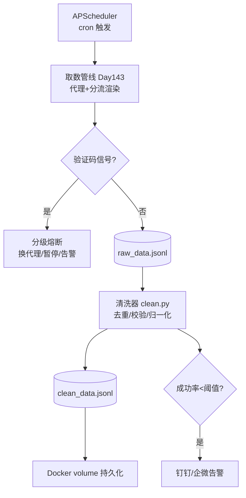

# Day 144 — 反爬项目实战（下）：验证码处理 + 数据清洗 + 调度告警

> 阶段：Phase 7 — 进阶与性能优化
> 主题：全栈反爬突破系统（下）—— 人机验证应对 / 数据清洗入库 / APScheduler 调度 / 告警 / Docker 部署

> ⚠️ **合规提醒**：验证码的存在本身就是站方"未授权"的明确信号（见 Day 142）。本日内容用于理解机制与防御测试，绕过他人站点的验证码在中国司法实践中可能构成违法。

---

## 一、概念解释

### 1.1 验证码的类型与应对思路

| 类型 | 原理 | 合规应对 |
|---|---|---|
| 图形验证码 | 扭曲字符图片 | OCR 识别（ddddocr）；**仅限自有站点** |
| 滑块验证码 | 轨迹行为分析 | 模拟人类轨迹（贝塞尔曲线 + 抖动） |
| 点选验证码 | 语义理解 | 打码平台（法律风险高，不建议） |
| 短信/邮箱验证 | 实名通道 | 无解，只能人工授权 |
| 遇到验证码的正确姿势 | — | **降速/暂停 + 告警人工介入** |

工程上最重要的是：**把"遇到验证码"当作一种可检测的信号**（响应特征：特定状态码、页面标记、跳转 captcha 域名），触发降级策略而非硬闯。

### 1.2 数据清洗管线（ETL 中的 T）

爬下来的原始数据（JSONL）通常脏在四处：

1. **重复**：同一条数据被抓多次 → 去重（URL/内容哈希）
2. **字段缺失/类型错误**：`None`、空串、数字变字符串 → 校验 + 规范化
3. **HTML 残留**：正文里混着 `<br>`、`&amp;` → 反转义 + 去标签
4. **编码/空白问题**：`\xa0`（不间断空格）、首尾空白、全半角混杂 → 归一化

### 1.3 调度（APScheduler）

- `BackgroundScheduler`：进程内后台调度
- 触发器：`date`（一次）、`interval`（间隔）、`cron`（表达式）
- `misfire_grace_time`：错过触发的宽限期
- `max_instances`：防止上一轮还没跑完又启动一轮

### 1.4 告警与容器化

- 告警通道：钉钉/企微 Webhook（Day 141 已学，复用）
- 容器化关键点：Playwright 的浏览器依赖要打进镜像；数据目录用 volume 挂载；调度器作为容器主进程

---

## 二、原理解析

### 2.1 验证码检测信号

```text
响应侧信号:
  - HTTP 状态码 403/412/429
  - 响应体含 "captcha" / "验证" / 指定错误码 JSON 字段
  - 被重定向到 /captcha/ 路径
触发后策略（分级熔断）:
  Level 1: 换代理 + 退避重试
  Level 2: 暂停该域名抓取 30 分钟
  Level 3: 停止任务 + 推送告警等人工介入
```

### 2.2 内容指纹去重

```text
fingerprint = sha256( normalize(标题) + normalize(正文前 N 字符) )
normalize = 小写 + 去空白/标点 + 全角转半角
存储: set/dict（量小）或 Redis bitmap/布隆过滤器（量大）
```

### 2.3 今日系统全景（承接 Day 143）



---

## 三、API 速查

### APScheduler

| API | 说明 |
|---|---|
| `BackgroundScheduler()` | 后台调度器 |
| `sched.add_job(fn, "cron", hour=3, minute=0)` | 每天 3 点 |
| `sched.add_job(fn, "interval", minutes=30, max_instances=1)` | 间隔触发 |
| `sched.start()` / `sched.shutdown()` | 启停 |
| `misfire_grace_time=300` | 错过触发的宽限秒数 |

### 数据清洗常用

| 工具 | 用途 |
|---|---|
| `hashlib.sha256(s.encode()).hexdigest()` | 内容指纹 |
| `html.unescape()` | `&amp;` → `&` |
| `re.sub(r"<[^>]+>", "", s)` | 去标签 |
| `unicodedata.normalize("NFKC", s)` | 全角→半角、`\xa0`→空格 |

---

## 四、实战代码

见 `code/`：

1. `01-captcha-detector.py` — 基础：验证码信号检测 + 分级熔断
2. `02-data-cleaner.py` — 进阶：去重/校验/归一化清洗管线（含避坑）
3. `03-scheduler-alert.py` — 实战：APScheduler 调度 + Webhook 告警 + Dockerfile（见文内）

---

## 五、思考题

1. 为什么"遇到验证码就停止"在工程上是正确策略，而"打码平台硬闯"在法律上高危？

**参考答案**

**工程上**：验证码是站方"风控升级"的信号，说明当前身份/IP 已被标记。硬闯（即使成功）会累积风控分，招致更重的封禁（封号/封 IP 段），成本螺旋上升；停止 + 降速 + 告警人工介入，保护了已有的 Cookie/IP 资产，是"以退为进"。而且验证码成功率不稳定，把识别逻辑硬塞进管线会让系统脆弱。

**法律上**：验证码是站方"未授权自动化访问"的明确边界标记（Day 142）。打码平台用人力突破这条边界，主观"明知未授权"、客观"突破技术措施"，可能构成非法获取计算机信息系统数据罪；平台本身常涉黑灰产，使用它等于关联违法链条。

正确姿势：把验证码当"熔断信号"——Level1 换代理退避、Level2 暂停域名、Level3 停止并告警人工，必要时寻求授权。

⚠️ 合规提示：识别练习仅限自有/授权站点。
2. 布隆过滤器与 `set` 做去重的取舍是什么？误判率如何影响爬虫数据质量？

**参考答案**

`set` 精确、无误判，但内存随数据量线性增长（5000 万 URL 要几 GB）；布隆过滤器用固定位数组（几十 MB）换"一定不在 / 可能在"的判断，空间省一到两个数量级，代价是**误判**（把新 URL 当成已爬）且不支持删除。

对爬虫而言，误判 = **漏爬**（新数据被误丢弃），而不是重复数据；漏爬率 ≈ 误判率，要按业务容忍度选（增量监控不能容忍，全量爬取可容忍 1%）。用标准库演示：

```python
import hashlib

class BloomFilter:
    """极简布隆过滤器：k 个哈希 + 位数组，只能回答“一定不在 / 可能在”"""

    def __init__(self, size=100_000, k=7):
        self.size, self.k = size, k
        self.bits = bytearray(size // 8 + 1)   # 位数组，10 万位约 12.5KB

    def _hashes(self, item):
        # 用 sha256 的前 k 段字节当作 k 个哈希值（演示用简化做法）
        digest = hashlib.sha256(item.encode()).digest()
        return [int.from_bytes(digest[i * 4:(i + 1) * 4], "big") % self.size
                for i in range(self.k)]

    def add(self, item):
        for pos in self._hashes(item):
            self.bits[pos // 8] |= 1 << (pos % 8)

    def might_contain(self, item):
        return all(self.bits[pos // 8] >> (pos % 8) & 1
                   for pos in self._hashes(item))

bf = BloomFilter()
seen = set()
for i in range(10000):                 # 1 万条已爬过的 URL
    url = f"https://example.com/page/{i}"
    bf.add(url)
    seen.add(url)

fp = 0
for i in range(10000, 20000):          # 1 万条从未爬过的 URL
    url = f"https://example.com/page/{i}"
    if bf.might_contain(url):          # 误判：被当成“可能爬过”
        fp += 1
    assert url not in seen             # set 是精确判断，绝不会误判

print(f"布隆过滤器误判: {fp}/10000 ({fp / 10000:.2%})")
print(f"内存: 布隆位数组 {len(bf.bits) / 1024:.1f} KB vs set 哈希表 {seen.__sizeof__() / 1024:.0f} KB（不含字符串对象本身）")
```

预期输出：

```text
布隆过滤器误判: 79/10000 (0.79%)
内存: 布隆位数组 12.2 KB vs set 哈希表 512 KB（不含字符串对象本身）
```

1 万条 URL、10 万位、k=7 时误判约 0.79%，内存却只有 set 的约 1/40。

💡 提示：误判率随插入量上升而升高，要按最终规模预留容量（或用可扩展布隆）；精确去重用 Redis set，大规模用 RedisBloom。
3. 调度器 `max_instances=1` 防止了什么故障？什么场景下你会故意放宽？

**参考答案**

防止**任务叠加**：上一轮还没跑完（目标慢、数据量大），下一次触发时间又到了，调度器又起一个实例 → 两轮同时跑：① 重复爬同一批 URL，浪费 + 触发风控；② 并发写库冲突/重复数据；③ 资源耗尽（内存/连接池），越叠越多形成雪崩。`max_instances=1` 让旧实例还在跑时新触发被跳过（或等待）。

故意放宽的场景：① 任务天然可并行且幂等（分片抓取，各实例处理不同分片，互不重叠）；② 短任务 + 长间隔，叠加概率极低且无害（如每次独立的报表生成）；③ 需要"追赶"——允许并行多实例消化积压（前提是有去重保证）。

小例子：每 30 分钟抓一次、每次只需 1 分钟，叠加几乎不可能，可放宽；但每轮要跑 40 分钟的任务必须 `max_instances=1`。

⚠️ 注意：放宽必须配套幂等/去重和资源上限，否则叠加即灾难；同时设 `misfire_grace_time`，避免"错过触发后补跑"瞬间起多实例。
4. Docker 镜像里跑 Playwright 为什么体积暴涨？有哪些瘦身手段（multi-stage / 换 CDP 远程浏览器）？

**参考答案**

暴涨原因：Playwright 需要完整的浏览器二进制（Chromium 约 300MB+）和一大堆系统依赖库（libnss3、libatk、字体、libgbm 等几十个共享库），再加 Python 运行时和依赖，轻松 1.5~2GB。浏览器是"重资产",没法和纯 Python 包比。

瘦身手段：① **只装需要的浏览器**（`playwright install chromium --with-deps`，不装 firefox/webkit）；② **multi-stage 构建**——builder 阶段装依赖/编译，最终镜像只拷贝运行时所需，丢弃构建缓存；③ 用精简基础镜像（`python:3.12-slim`）+ 手动装最小依赖集，或直接用官方 `mcr.microsoft.com/playwright/python` 镜像（依赖已优化）；④ 清理 apt/pip 缓存、`__pycache__`、`.whl`；⑤ **换架构**——浏览器不进镜像，通过 CDP 连远程浏览器服务（browserless/独立 Chrome 容器），业务镜像只留轻量 Python，浏览器独立扩缩容。

小例子：全量装约 2GB → 只装 chromium + slim + multi-stage 可降到约 800MB；CDP 远程方案业务镜像仅约 200MB。
5. 如果清洗阶段发现 30% 的字段缺失，这说明上游哪个环节出了问题？如何定位？

**参考答案**

说明问题在**解析层或取数层**，而不是清洗层（清洗只是发现缺失，不会制造缺失）。两大主因：① 目标站改版/A/B 测试——选择器/XPath 失效，新结构取不到；② 反爬降级——返回假页面/空壳/登录页/验证码页，HTTP 200 但内容不对（静默失败）。

定位步骤：① **看原始快照**——取数层应保存原始 HTML/JSON，对比缺失字段对应的原始内容，"原始里就没有" = 取数/反爬问题，"原始里有但没解析出" = 选择器问题；② **分组统计**——按 URL 类型/时间/代理统计缺失率，集中在某类页面 → 改版，集中在某时段/IP → 反爬；③ **金丝雀回放**——手动用浏览器打开几个缺失 URL，对比爬虫取到的结果；④ **检查响应特征**——状态码、页面标题、内容长度是否突变。

小例子：30% 缺失全集中在"商品详情页"，原始 HTML 里根本没有 price 节点，浏览器打开却正常 → 爬虫拿到了反爬假页面，要升级指纹/Cookie，而不是改选择器。

---

## 六、三日项目总结（Day 142–144）

- **Day 142**：合规地基——法律边界、robots.txt、职业道德
- **Day 143**：取数层——代理池、浏览器模拟、JS 解析、自动分流
- **Day 144**：工程层——验证码熔断、数据清洗、调度、告警、容器化
- 三层合起来即一个**可长期运行、可观测、合规可控**的数据采集系统骨架
