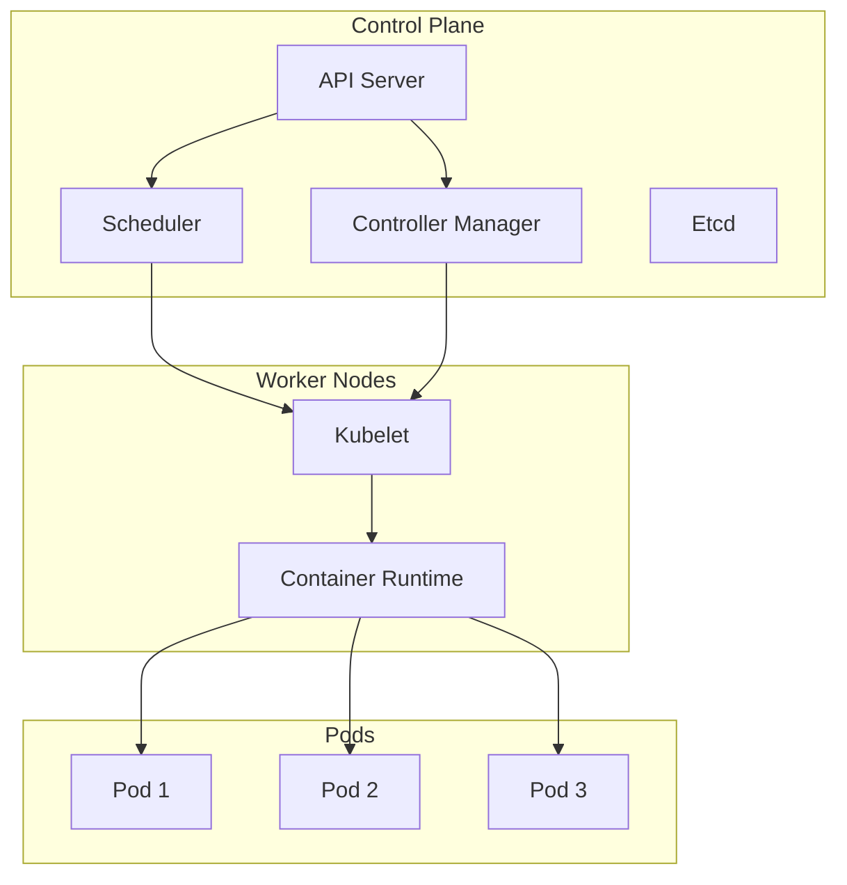

# Day 178: 容器编排（K8s 入门）

## 概念解释

### 1. Kubernetes（K8s）是什么
- Kubernetes 是谷歌开源的容器编排平台
- 解决容器化应用的部署、扩展、管理等问题
- 实现 "一次构建，随处运行" 的理念
- 提供容器应用的自动化部署、可扩展性和管理平台

### 2. K8s 核心概念
- **Pod**: 最小的部署单元，可容纳一个或多个容器
- **Service**: 提供网络访问和负载均衡
- **Deployment**: 用于管理ReplicaSet的控制器
- **ReplicaSet**: 确保 pod 副本数量
- **ConfigMap**: 配置数据
- **Secret**: 敏感数据
- **Namespace**: 资源隔离
- **Ingress**: 外部访问入口
- **Persistent Volume**: 持久存储

### 3. K8s 体系结构
- **控制平面**: master 节点管理集群状态
- **工作节点**: worker 节点运行 pod
- **API 服务器**: 所有操作的入口
- **调度器**: 分配 pod 到节点
- **控制器**: 确保状态符合期望

## 原理解释

### 1. Pod 的设计原理
- Pod 是 K8s 的基本单位
- 同一 Pod 中的容器共享网络命名空间和存储卷
- 容器在同一节点上运行，资源共享
- Pod 是不可预测的，始终被重启

### 2. ReplicaSet 的工作原理
- 确保指定数量的 pod 副本存在
- 自动监控 pod 数量
- 检测 pod 崩溃时自动替换
- 通过更新 pod 模板实现滚动更新

### 3. Service 的网络模型
- 通过 ClusterIP 提供内部服务发现
- 支持NodePort和LoadBalancer类型
- 使用EndpointSlice实现服务发现
- 自动健康检查和负载均衡

### 4. 命名空间隔离原理
- 基于 Kubernetes API 的分层组织
- 命名空间是资源的分组
- 不同命名空间互不影响
- 资源配额和限额管理

### 5. Ingress 控制器原理
- 外部HTTP/HTTPS流量的入口
- 基于主机名或路径的路由规则
- TLS证书管理
- 负载均衡和SSL终止

## API 速查表

### Deployment API
```bash
# 创建 Deployment
cat > deployment.yaml << EOF
apiVersion: apps/v1
kind: Deployment
metadata:
  name: nginx-deployment
spec:
  replicas: 3
  selector:
    matchLabels:
      app: nginx
  template:
    metadata:
      labels:
        app: nginx
    spec:
      containers:
      - name: nginx
        image: nginx:1.14.2
        ports:
        - containerPort: 80
EOF

# 应用
cat deployment.yaml | kubectl apply -f -

# 查看状态
kubectl get deployment nginx-deployment

# 扩缩容
kubectl scale deployment nginx-deployment --replicas=5

# 更新
cat deployment.yaml | kubectl apply -f -

# 删除
kubectl delete deployment nginx-deployment
EOF
```

### Service API
```bash
# 创建 Service
cat > service.yaml << EOF
apiVersion: v1
kind: Service
metadata:
  name: nginx-service
spec:
  selector:
    app: nginx
  ports:
  - protocol: TCP
    port: 80
    targetPort: 80
  type: NodePort
EOF

# 应用
cat service.yaml | kubectl apply -f -

# 获取服务地址
kubectl get service nginx-service

# 删除
service.yaml | kubectl delete -f -
EOF
```

### Pod 管理
```bash
# 创建 Pod
cat > pod.yaml << EOF
apiVersion: v1
kind: Pod
metadata:
  name: nginx-pod
spec:
  containers:
  - name: nginx
    image: nginx:1.14.2
    ports:
    - containerPort: 80
EOF

# 查看 Pod 详情
kubectl describe pod nginx-pod

# 执行命令
kubectl exec -it nginx-pod -- nginx -t

# 删除
kubectl delete pod nginx-pod
EOF
```

### 配置文件管理
```bash
# 创建 ConfigMap
cat > configmap.yaml << EOF
apiVersion: v1
kind: ConfigMap
metadata:
  name: app-config
data:
  APP_ENV: "production"
  LOG_LEVEL: "info"
  DATABASE_URL: "mysql://localhost:3306/app"
EOF

# 应用到 Deployment
cat deployment-with-configmap.yaml << EOF
apiVersion: apps/v1
kind: Deployment
metadata:
  name: app-deployment
spec:
  replicas: 2
  selector:
    matchLabels:
      app: app
  template:
    metadata:
      labels:
        app: app
      volumeMounts:
      - name: config-volume
        mountPath: /etc/config
    spec:
      containers:
      - name: app
        image: myapp:1.0
        envFrom:
        - configMapRef:
            name: app-config
      volumes:
      - name: config-volume
        configMap:
          name: app-config
EOF

kubectl apply -f configmap.yaml
kubectl apply -f deployment-with-configmap.yaml
EOF
```

### 持久化存储
```bash
# 创建 PersistentVolume
cat > pv.yaml << EOF
apiVersion: v1
kind: PersistentVolume
metadata:
  name: nginx-pv
spec:
  capacity:
    storage: 10Gi
  accessModes:
    - ReadWriteMany
  hostPath:
    path: /data/nginx
EOF

# 创建 PersistentVolumeClaim
cat > pvc.yaml << EOF
apiVersion: v1
kind: PersistentVolumeClaim
metadata:
  name: nginx-pvc
spec:
  accessModes:
    - ReadWriteMany
  resources:
    requests:
      storage: 10Gi
  storageClassName: standard
EOF

# 应用
cat pv.yaml pvc.yaml | kubectl apply -f -

# 挂载到 Pod
cat pod-with-pv.yaml << EOF
apiVersion: v1
kind: Pod
metadata:
  name: nginx-pv-pod
spec:
  containers:
  - name: nginx
    image: nginx:1.14.2
    ports:
    - containerPort: 80
    volumeMounts:
    - name: nginx-storage
      mountPath: /usr/share/nginx/html
  volumes:
  - name: nginx-storage
    persistentVolumeClaim:
      claimName: nginx-pvc
EOF

kubectl apply -f pod-with-pv.yaml
EOF
```

## 图解

### Mermaid: K8s 架构图


### ASCII: 部署流程
```
Kubernetes 部署流程:

┌─────────────────┐    ┌──────────────────┐    ┌─────────────────┐
│   Docker Image  │───▶│   Container Reg │───▶│   kubelet      │
└─────────────────┘    └──────────────────┘    └─────────────────┘
                                                       │
                                                       ▼
┌─────────────────┐    ┌──────────────────┐    ┌─────────────────┐
│  Deployment     │───▶│  Scheduler       │───▶│  Pod Creation   │
└─────────────────┘    └──────────────────┘    └─────────────────┘
                                                       │
                                                       ▼
┌─────────────────┐    ┌──────────────────┐    ┌─────────────────┐
│  ReplicaSet    │───▶│  Pod Management  │───▶│  Service        │
└─────────────────┘    └──────────────────┘    └─────────────────┘
                                                       │
                                                       ▼
┌─────────────────┐    ┌──────────────────┐    ┌─────────────────┐
│ Ingress        │───▶│  Load Balance   │───▶│  Client Request │
└─────────────────┘    └──────────────────┘    └─────────────────┘
```

## 实战代码案例

### 1. 基础 K8s 部署脚本
```python
#!/usr/bin/env python3
"""
Kubernetes 部署自动化脚本
功能：部署 Nginx 应用并监控其状态
"""
import subprocess
import time
import yaml
import sys

def run_command(cmd):
    """执行 shell 命令"""
    try:
        result = subprocess.run(cmd, shell=True, capture_output=True, text=True, check=True)
        return result.stdout.strip()
    except subprocess.CalledProcessError as e:
        print(f"命令失败: {cmd}")
        print(f"错误信息: {e.stderr}")
        return None

def create_deployment_yaml():
    """创建 Deployment YAML 文件"""
    deployment = {
        'apiVersion': 'apps/v1',
        'kind': 'Deployment',
        'metadata': {
            'name': 'nginx-deployment',
            'labels': {
                'app': 'nginx',
                'version': 'v1'
            }
        },
        'spec': {
            'replicas': 3,
            'selector': {
                'matchLabels': {
                    'app': 'nginx'
                }
            },
            'template': {
                'metadata': {
                    'labels': {
                        'app': 'nginx',
                        'version': 'v1'
                    }
                },
                'spec': {
                    'containers': [
                        {
                            'name': 'nginx',
                            'image': 'nginx:1.14.2',
                            'ports': [
                                {
                                    'containerPort': 80
                                }
                            ],
                            'resources': {
                                'requests': {
                                    'cpu': '100m',
                                    'memory': '128Mi'
                                },
                                'limits': {
                                    'cpu': '200m',
                                    'memory': '256Mi'
                                }
                            },
                            'livenessProbe': {
                                'httpGet': {
                                    'path': '/health',
                                    'port': 80
                                },
                                'initialDelaySeconds': 30,
                                'periodSeconds': 10
                            },
                            'readinessProbe': {
                                'httpGet': {
                                    'path': '/ready',
                                    'port': 80
                                },
                                'initialDelaySeconds': 5,
                                'periodSeconds': 5
                            }
                        }
                    ]
                }
            }
        }
    }
    
    with open('deployment.yaml', 'w') as f:
        yaml.dump(deployment, f, default_flow_style=False)
    
    print("✅ Deployment YAML 文件已创建")

def create_service_yaml():
    """创建 Service YAML 文件"""
    service = {
        'apiVersion': 'v1',
        'kind': 'Service',
        'metadata': {
            'name': 'nginx-service',
            'labels': {
                'app': 'nginx'
            }
        },
        'spec': {
            'selector': {
                'app': 'nginx'
            },
            'ports': [
                {
                    'protocol': 'TCP',
                    'port': 80,
                    'targetPort': 80
                }
            ],
            'type': 'NodePort'
        }
    }
    
    with open('service.yaml', 'w') as f:
        yaml.dump(service, f, default_flow_style=False)
    
    print("✅ Service YAML 文件已创建")

def deploy_app():
    """部署应用到 K8s"""
    print("🚀 开始部署 Nginx 应用...")
    
    # 检查是否安装了 kubectl
    if run_command("kubectl version --client") is None:
        print("❌ kubectl 命令不可用")
        return False
    
    # 检查是否连接到 K8s 集群
    if run_command("kubectl cluster-info") is None:
        print("❌ 无法连接到 K8s 集群")
        return False
    
    # 应用 Deployment
    deploy_output = run_command("kubectl apply -f deployment.yaml")
    if deploy_output is None:
        print("❌ Deployment 应用失败")
        return False
    
    print(f"📦 Deployment 应用成功: {deploy_output}")
    
    # 应用 Service
    service_output = run_command("kubectl apply -f service.yaml")
    if service_output is None:
        print("❌ Service 应用失败")
        return False
    
    print(f"🌐 Service 应用成功: {service_output}")
    
    # 等待 Pod 就绪
    print("⏳ 等待 Pod 就绪...")
    for i in range(30):
        pods = run_command("kubectl get pods -l app=nginx")
        if pods and "Running" in pods:
            print(f"✅ Pod 就绪: {pods}")
            break
        time.sleep(5)
    else:
        print("❌ Pod 未就绪")
        return False
    
    # 获取服务地址
    service_info = run_command("kubectl get service nginx-service")
    print(f"🔗 服务信息: {service_info}")
    
    return True

def monitor_app():
    """监控应用状态"""
    print("📊 开始监控应用...")
    
    # 监控 Pod 状态
    print("\n📋 Pod 状态:")
    run_command("kubectl get pods -l app=nginx -o wide")
    
    # 监控 Deployment 状态
    print("\n📦 Deployment 状态:")
    run_command("kubectl describe deployment nginx-deployment")
    
    # 监控 Service 状态
    print("\n🌐 Service 状态:")
    run_command("kubectl describe service nginx-service")
    
    # 模拟客户端请求
    print("\n🌐 模拟客户端请求...")
    try:
        import requests
        # 获取 NodePort 地址
        nodes = run_command("kubectl get nodes -o jsonpath='{.items[*].status.addresses[?(@.type==\"InternalIP\")].address}'")
        node_port = run_command("kubectl get service nginx-service -o jsonpath='{.spec.ports[0].nodePort}'")
        
        if nodes and node_port:
            for node in nodes.split():
                response = requests.get(f"http://{node}:{node_port}", timeout=5)
                print(f"📡 客户端请求 {node}:{node_port} -> 状态码: {response.status_code}")
    except ImportError:
        print("⚠️ 未安装 requests 库，跳过客户端请求测试")

def cleanup():
    """清理资源"""
    print("🧹 开始清理资源...")
    
    # 删除资源
    run_command("kubectl delete -f deployment.yaml")
    run_command("kubectl delete -f service.yaml")
    
    # 删除本地文件
    import os
    for file in ['deployment.yaml', 'service.yaml']:
        if os.path.exists(file):
            os.remove(file)
            print(f"🗑️ 删除文件: {file}")
    
    print("✅ 资源清理完成")

def main():
    """主函数"""
    print("=" * 60)
    print("Kubernetes 部署自动化脚本 v1.0")
    print("=" * 60)
    
    # 导入 yaml 模块
    try:
        import yaml
    except ImportError:
        print("⚠️ 未安装 PyYAML 库，正在安装...")
        run_command("pip install pyyaml")
        import yaml
    
    # 创建 YAML 文件
    create_deployment_yaml()
    create_service_yaml()
    
    # 部署应用
    if deploy_app():
        # 监控应用
        monitor_app()
        
        # 提示用户
        print("\n🎉 应用部署成功！")
        print("📊 统计信息:")
        print("  - Pod 数量: 3")
        print("  - 服务端口: 80")
        print("  - 类型: NodePort")
        
        # 询问是否清理
        choice = input("\n是否要清理资源? (y/n): ").lower()
        if choice == 'y':
            cleanup()
    else:
        print("❌ 部署失败")
        sys.exit(1)

if __name__ == '__main__':
    main()
```

### 2. K8s 配置管理工具
```python
#!/usr/bin/env python3
"""
K8s 配置管理工具
功能：管理 K8s 配置文件，验证 YAML 格式，部署应用
"""
import yaml
import json
import sys
from typing import Dict, Any

class K8sConfigManager:
    def __init__(self, config_file: str = None):
        self.config_file = config_file
        self.configs = []
    
    def load_config(self, file_path: str):
        """加载 YAML 配置文件"""
        try:
            with open(file_path, 'r') as f:
                config = yaml.safe_load(f)
                self.configs.append((file_path, config))
                print(f"✅ 成功加载配置文件: {file_path}")
                return config
        except Exception as e:
            print(f"❌ 加载配置文件失败: {file_path}, 错误: {e}")
            return None
    
    def validate_config(self, config: Dict[str, Any]) -> bool:
        """验证 K8s 配置的基本格式"""
        required_fields = ['apiVersion', 'kind']
        
        for field in required_fields:
            if field not in config:
                print(f"❌ 配置缺少必需字段: {field}")
                return False
        
        # 根据 kind 验证特定字段
        kind = config.get('kind')
        if kind == 'Deployment':
            if 'spec' not in config:
                print("❌ Deployment 类型配置缺少 spec 字段")
                return False
            if 'template' not in config['spec']:
                print("❌ Deployment 类型配置缺少 template 字段")
                return False
        
        elif kind == 'Service':
            if 'spec' not in config:
                print("❌ Service 类型配置缺少 spec 字段")
                return False
            if 'ports' not in config['spec']:
                print("❌ Service 类型配置缺少 ports 字段")
                return False
        
        elif kind == 'Pod':
            if 'spec' not in config:
                print("❌ Pod 类型配置缺少 spec 字段")
                return False
            if 'containers' not in config['spec']:
                print("❌ Pod 类型配置缺少 containers 字段")
                return False
        
        print(f"✅ {kind} 配置验证通过")
        return True
    
    def validate_all_configs(self) -> bool:
        """验证所有已加载的配置"""
        all_valid = True
        for file_path, config in self.configs:
            print(f"\n📋 验证配置文件: {file_path}")
            if not self.validate_config(config):
                all_valid = False
        
        return all_valid
    
    def generate_manifest(self) -> Dict[str, Any]:
        """生成 K8s 资源清单"""
        manifest = {
            'apiVersion': 'v1',
            'kind': 'List',
            'items': [config for _, config in self.configs]
        }
        
        with open('k8s-manifest.yaml', 'w') as f:
            yaml.dump(manifest, f, default_flow_style=False)
        
        print("✅ K8s 资源清单已生成: k8s-manifest.yaml")
        return manifest
    
    def export_to_json(self, output_file: str = None):
        """导出配置为 JSON 格式"""
        if output_file is None:
            output_file = 'k8s-config.json'
        
        json_data = []
        for file_path, config in self.configs:
            # 转换 YAML 为 JSON 可序列化的格式
            json_config = json.loads(json.dumps(config))
            json_data.append({
                'file': file_path,
                'content': json_config
            })
        
        with open(output_file, 'w') as f:
            json.dump(json_data, f, indent=2)
        
        print(f"✅ 配置已导出到 JSON 文件: {output_file}")
    
    def compare_configs(self, other_manager: 'K8sConfigManager'):
        """比较两个配置管理器中的配置"""
        print("🔍 开始比较配置...")
        
        for file_path, config in self.configs:
            # 查找相同文件名的配置
            other_config = None
            for other_path, other_c in other_manager.configs:
                if file_path == other_path:
                    other_config = other_c
                    break
            
            if other_config:
                # 比较配置内容
                if config == other_config:
                    print(f"✅ 配置相同: {file_path}")
                else:
                    print(f"❌ 配置不同: {file_path}")
                    self._print_differences(config, other_config)
            else:
                print(f"⚠️  找到新配置: {file_path}")
    
    def _print_differences(self, config1: Dict[str, Any], config2: Dict[str, Any]):
        """打印配置差异"""
        import difflib
        
        yaml1 = yaml.dump(config1, default_flow_style=False)
        yaml2 = yaml.dump(config2, default_flow_style=False)
        
        diff = difflib.unified_diff(
            yaml1.splitlines(),
            yaml2.splitlines(),
            fromfile='config1',
            tofile='config2',
            lineterm=''
        )
        
        for line in diff:
            if line.startswith('+'):
                print(f"  + {line[1:]}")
            elif line.startswith('-'):
                print(f"  - {line[1:]}")
            else:
                print(f"    {line}")

def main():
    """主函数"""
    print("=" * 60)
    print("K8s 配置管理工具 v1.0")
    print("=" * 60)
    
    # 初始化配置管理器
    manager = K8sConfigManager()
    
    # 加载配置文件
    config_files = ['deployment.yaml', 'service.yaml', 'pod.yaml']
    for file in config_files:
        manager.load_config(file)
    
    # 验证所有配置
    if manager.validate_all_configs():
        print("\n🎉 所有配置验证通过！")
        
        # 生成资源清单
        manager.generate_manifest()
        
        # 导出为 JSON
        manager.export_to_json()
        
        # 显示统计信息
        print("\n📊 配置统计:")
        print(f"  - 总配置文件数: {len(manager.configs)}")
        print(f"  - Deployment 类型: {sum(1 for _, c in manager.configs if c.get('kind') == 'Deployment')}")
        print(f"  - Service 类型: {sum(1 for _, c in manager.configs if c.get('kind') == 'Service')}")
        print(f"  - Pod 类型: {sum(1 for _, c in manager.configs if c.get('kind') == 'Pod')}")
    else:
        print("\n❌ 配置验证失败，请检查配置")

if __name__ == '__main__':
    main()
```