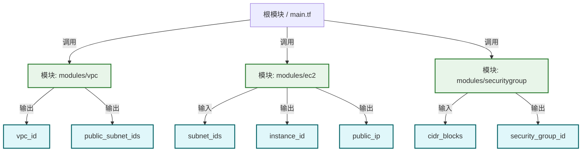

# Day 179: Terraform 图解

## 📊 Terraform 架构图

```mermaid
graph TD
    %% 用户交互
    user[用户/CI系统] -->|HCL 配置文件| tf_core[Terraform Core]
    tf_core -->|语法检查| validator[验证器]
    validator -->|执行计划| planner[规划器]
    
    %% 状态管理
    state[状态存储] <-->|读写| tf_core
    state -->|锁定| state_lock[状态锁]
    
    %% 提供商接口
    provider_aws[AWS Provider] <-->|API 调用| aws[AWS API]
    provider_gcp[Google Cloud Provider] <-->|API 调用| gcp[GCP API]
    provider_azurerm[Azure Provider] <-->|API 调用| azurerm[Azure API]
    
    %% 资源操作
    planner -->|创建/更新/删除| provider_aws
    planner -->|创建/更新/删除| provider_gcp
    planner -->|创建/更新/删除| provider_azurerm
    
    %% 输出
    planner -->|输出值| outputs[输出]
    outputs -->|返回给| user
    
    %% 样式
    classDef user fill:#e3f2fd,stroke:#1976d2,stroke-width:2px;
    classDef core fill:#fff3e0,stroke:#fb8c00,stroke-width:2px;
    classDef provider fill:#e8f5e9,stylesheet-type:#2e7d32;
    classDef state fill:#f3e5f5,stroke:#8e24aa,stroke-width:2px;
    classDef output fill:#e0f7fa,stylesheet-type:#006064;
    
    class user user
    class tf_core core,validator,planner
    class provider_aws provider_gcp provider_azurerm
    class state state_lock
    class outputs output
```

## 🏗️ Terraform 工作流程

```mermaid
flowchart TD
    %% 主要阶段
    phase1[ terraform init ] -->|成功| phase2[ terraform plan ]
    phase2 -->|无变更| phase1
    phase2 -->|有变更| phase3[ terraform apply ]
    phase3 -->|成功| phase4[ 状态更新 ]
    phase3 -->|失败| phase5[ 回滚/错误处理 ]
    
    %% 子阶段
    phase1 -->|下载插件| init_sub1[配置后端]
    phase1 -->|初始化目录| init_sub2[创建 .terraform]
    
    phase2 -->|资源查询| plan_sub1[读取状态]
    phase2 -->|计算变更| plan_sub2[生成执行计划]
    phase2 -->|输出方案| plan_sub3[输出到 tfplan 文件]
    
    phase3 -->|资源创建| apply_sub1[并行创建资源]
    phase3 -->|更新资源| apply_sub2[顺序更新资源]
    phase3 -->|销毁资源| apply_sub3[有序销毁资源]
    
    phase4 -->|保存状态| state_sub1[写入 .tfstate]
    phase4 -->|状态版本| state_sub2[ serial 递增]
    
    phase5 -->|部分回滚| rollback1[保留原有状态]
    phase5 -->|错误信息| rollback2[显示错误详情]
    
    %% 样式
    classDef phase fill:#bbdefa,stroke:#1565c0,stroke-width:2px,font-weight:bold;
    classDef sub fill:#e8f5e9,stroke:#2e7d32,stroke-width:1px;
    classDef rollback fill:#ffebee,stroke:#c62828,stroke-width:1px;
    
    class phase1,phase2,phase3,phase4,phase5 phase
    class init_sub1,init_sub2,plan_sub1,plan_sub2,plan_sub3 apply_sub1,apply_sub2,apply_sub3 sub
    class rollback1,rollback2 rollback
```

## 📈 资源依赖图示例

```mermaid
graph LR
    %% VPC 资源
    vpc[AWS VPC "main"]
    sg[AWS Security Group "allow_ssh"]
    subnet[AWS Subnet "public-1"]
    instance[AWS Instance "web_server"]
    eip[AWS EIP "elastic_ip"]
    
    %% 依赖关系
    vpc -->|包含| subnet
    sg -->|安全组| instance
    subnet -->|子网关联| instance
    instance -->|关联| eip
    
    %% 样式
    classDef resource fill:#e3f2fd,stroke:#1976d2,stroke-width:2px;
    classDef dependency fill:#fff3e0,stroke:#fb8c00,stroke-width:1px,font-style:italic;
    
    class vpc,sg,subnet,instance,eip resource
    class vpc-.->subnet dependency
```

## 📦 模块层级结构



## ⚠️ 常见陷阱图

```mermaid
graph TD
    pitfall1[陷阱 1: 忘记运行 init]
    pitfall2[陷阱 2: 状态冲突]
    pitfall3[陷阱 3: count vs for_each]
    pitfall4[陷阱 4: 敏感变量泄露]
    pitfall5[陷阱 5: 未锁定的后端]
    
    cure1[解药: 运行 terraform init]
    cure2[解药: 使用远程后端 + 锁]
    cure3[解药: 理解 count/for_each 区别]
    cure4[解药: 标记 sensitive = true]
    cure5[解药: 配置 DynamoDB 锁]
    
    pitfall1 -->|导致| error1[ terraform 未识别资源 ]
    pitfall2 -->|导致| error2[ state 文件损坏 ]
    pitfall3 -->|导致| error3[ 资源创建失败/重复 ]
    pitfall4 -->|导致| error4[ AWS 控制台泄露密钥 ]
    pitfall5 -->|导致| error5[ 并发执行冲突 ]
    
    cure1 -.->|修复| error1
    cure2 -.->|修复| error2
    cure3 -.->|修复| error3
    cure4 -.->|修复| error4
    cure5 -.->|修复| error5
    
    classDef pitfall fill:#fff3e0,stroke:#fb8c00,stroke-width:2px,font-weight:bold;
    classDef cure fill:#e8f5e9,stroke:#2e7d32,stroke-width:2px;
    classDef error fill:#ffebee,stroke:#c62828,stroke-width:2px;
    
    class pitfall1,pitfall2,pitfall3,pitfall4,pitfall5 pitfall
    class cure1,cure2,cure3,cure4,cure5 cure
    class error1,error2,error3,error4,error5 error
```



## 🔧 调试命令快捷键

```bash
# 初始化
terraform init [-backend-config="..."]

# 验证
terraform validate

# 计划 (保存到文件)
terraform plan -out=tfplan

# 应用
terraform apply tfplan

# 销毁
terraform destroy

# 状态操作
terraform state list           # 列出所有资源
terraform state show <addr>    # 显示资源状态
terraform state mv <from> <to> # 移动资源地址
terraform import <addr> <id>   # 导入现有资源

# 工作区
terraform workspace list       # 列出工作区
terraform workspace new <name> # 创建新工作区
terraform workspace select <name> # 切换工作区

# 远程后端
terraform init -reconfigure -backend-config="bucket=my-state"
```