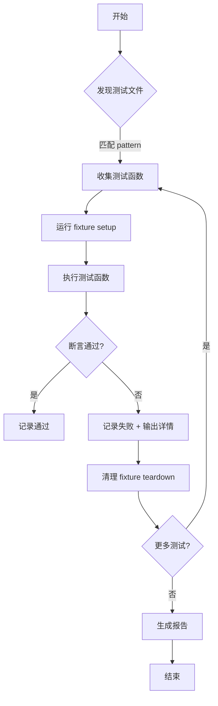
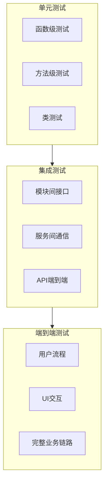

# Day 180: 自动化测试

## 阶段
Phase 11: 自动化运维与 DevOps (Days 166–185)

## 子主题
- 单元测试 pytest
- 集成测试
- 端到端测试
- 测试覆盖率
- 实战：自动化测试套件

## 概念解释

### 单元测试
单元测试是对软件中最小可测试单元（函数、方法或类）的测试。目的是在开发早期发现bug，确保每个小组件按预期工作。

**核心原则：**
- **自动化**：无人干预即可运行
- **快速**：执行时间应在毫秒级
- **独立**：每个测试用例之间无依赖
- **可重复**：相同输入必须产生相同输出

**pytest 优势：**
- 简洁的断言语法
- 强大的fixture机制
- 参数化测试
- 插件生态丰富
- 隔离性测试运行

### 集成测试
集成测试验证不同模块、服务或组件之间的交互。相比单元测试，它覆盖的范围更广，但执行速度较慢。

**关键特性：**
- **跨模块**：测试模块间接口
- **环境模拟**：模拟数据库、外部服务
- **接口验证**：请求/响应格式、协议契合
- **错误处理**：网络中断、超时、错误响应

### 端到端 (E2E) 测试
E2E 测试从用户视角验证整个应用流程，包括前端界面、后端逻辑、数据库操作和外部集成。

**目标：**
- 模拟真实用户操作
- 验证业务流程完整性
- 发现系统级问题
- 确保各组件协同工作

### 测试覆盖率
覆盖率指代码有多少被测试覆盖。它是质量的辅助指标，而非目标。

**常见工具：**
- `pytest --cov`：覆盖率分析
- `coverage.py`：Python覆盖率工具
- 语句覆盖率、分支覆盖率

**注意：** 高覆盖率不等于无bug，测试需要有意义且覆盖关键路径。

## 原理解释

### pytest 的测试发现机制
pytest 通过模式匹配自动发现测试文件：
- `test_*.py` 或 `*_test.py` 文件名模式
- `test_` 或 `_test` 前缀的函数/类
- 命令行参数 `--collect-only` 可列出所有测试

**测试执行流程：**
1. 收集：扫描文件，解析测试函数
2. 设置：运行 fixture 的 setup 代码
3. 运行：执行测试函数，捕获输出和异常
4. 清理：运行 fixture 的 teardown 代码
5. 报告：生成通过/失败状态

### fixture 的生命周期
pytest fixture 管理测试所需的资源：
- **session**：整个测试会话的一次设置
- **module**：每个模块运行一次
- **class**：每个类运行一次
- **function**：每个测试函数运行一次（默认）
- **session**：跨函数共享

Fixture 可以通过 `@pytest.fixture` 装饰器定义，支持 `yield` 语句实现清理工作。

### 测试孤立与Mock
为了保持测试独立，需要隔离外部依赖：
- **Mock**：模拟对象的行为
- **Patch**：临时替换对象属性
- **Fixture**：提供测试所需的数据或服务

**关键策略：**
- 不要在测试中连接真实数据库
- 模拟外部API调用
- 使用内存数据库而非真实服务

## 定义与使用方法

### 基础pytest语法

```python
# content of test_basic.py
def func(x):
    return x + 1

# 简单断言
def test_basic():
    assert func(3) == 4
```

### 断言表

| 情况 | 断言 | 含义 |
|------|------|------|
| 相等 | `assert a == b` | a 等于 b |
| 不相等 | `assert a != b` | a 不等于 b |
| 真值 | `assert condition` | condition 为 True |
| 为 None | `assert x is None` | x 为 None |
| 不为 None | `assert x is not None` | x 不为 None |
| 包含 | `assert x in y` | x 在 y 中 |
| 不包含 | `assert x not in y` | x 不在 y 中 |
| 相似 | `assert a == pytest.approx(b)` | a 近似等于 b |

### 常用pytest功能

**参数化测试：**
```python
import pytest

@pytest.mark.parametrize("input,expected", [
    (1, 2),
    (2, 3),
    (3, 4),
])
def test_addition(input, expected):
    assert input + 1 == expected
```

**标记：**
```python
@pytest.mark.slow
def test_slow_stuff():
    pass

# 运行: pytest -m slow
pytest -m "not slow"  # 跳过慢速测试
```

**Fixtures：**
```python
import pytest

@pytest.fixture
def db_connection():
    conn = create_real_database_connection()
    yield conn
    conn.close()

def test_with_db(db_connection):
    result = db_connection.query("SELECT ...")
    assert result is not None
```

### Expect 失败输出格式

当断言失败时，pytest 提供详细信息：
- 断言表达式
- 实际值
- 预期值
- 文件路径和行号

## ASCII 图解

### pytest 测试执行流程



### 测试分层结构



## 实战代码案例

### 01-基础用法.py - 基础断言测试

```python
"""基础单元测试示例"""
import pytest


def add(a, b):
    """两数相加"""
    return a + b


def test_add_basic():
    """测试基本加法"""
    result = add(2, 3)
    assert result == 5


def test_add_negative():
    """测试负数相加"""
    result = add(-1, -2)
    assert result == -3


def test_add_mixed():
    """测试正负混合"""
    result = add(-1, 1)
    assert result == 0


#  parametrize 示例
@pytest.mark.parametrize("a, b, expected", [
    (0, 0, 0),
    (1, 2, 3),
    (-1, 1, 0),
    (100, 200, 300),
])
def test_add_parametrized(a, b, expected):
    """参数化测试add函数"""
    assert add(a, b) == expected
```

### 02-进阶用法与避坑.py - 常见错误避免

```python
"""进阶测试模式与避坑示例"""
import pytest


class BankAccount:
    """模拟银行账户"""
    
    def __init__(self, initial_balance=0):
        self.balance = initial_balance
    
    def deposit(self, amount):
        if amount <= 0:
            raise ValueError("存款金额必须大于0")
        self.balance += amount
    
    def withdraw(self, amount):
        if amount <= 0:
            raise ValueError("取款金额必须大于0")
        if amount > self.balance:
            raise ValueError("余额不足")
        self.balance -= amount


def test_withdraw_insufficient_funds():
    """测试余额不足情况"""
    account = BankAccount(100)
    
    with pytest.raises(ValueError, match="余额不足"):
        account.withdraw(200)


def test_withdraw_negative_amount():
    """测试负数取款 - 应该失败"""
    account = BankAccount(100)
    
    # 正确的断言：期望抛出异常
    with pytest.raises(ValueError, match="取款金额必须大于0"):
        account.withdraw(-50)


def test_deposit_zero_fails():
    """测试零存款应该失败"""
    account = BankAccount()
    
    with pytest.raises(ValueError, match="存款金额必须大于0"):
        account.deposit(0)


def test_account_initial_balance():
    """测试账户初始余额"""
    account = BankAccount(50)
    assert account.balance == 50
    assert account.balance is not None


def test_account_negative_deposit():
    """测试负数存款"""
    account = BankAccount()
    
    # 匹配错误信息
    with pytest.raises(ValueError) as exc_info:
        account.deposit(-100)
    
    # 验证异常信息内容
    assert "存款金额必须大于0" in str(exc_info.value)
```

### 03-实战案例 - 完整测试套件

```python
"""完整的自动化测试套件示例"""
import pytest
import tempfile
import os
from pathlib import Path


# Fixture：临时文件
@pytest.fixture
def temp_dir():
    """创建临时目录，测试结束自动清理"""
    with tempfile.TemporaryDirectory() as tmpdir:
        yield Path(tmpdir)


@pytest.fixture
def sample_data():
    """提供测试用的样本数据"""
    return {
        "name": "测试用户",
        "age": 25,
        "email": "test@example.com"
    }


class TestUserManagement:
    """用户管理测试类"""
    
    def test_create_user(self, sample_data):
        """测试创建用户"""
        assert sample_data["name"] == "测试用户"
        assert sample_data["age"] == 25
        assert "@" in sample_data["email"]
    
    def test_user_email_format(self, sample_data):
        """测试邮箱格式验证"""
        parts = sample_data["email"].split("@")
        assert len(parts) == 2
        assert len(parts[1]) > 0
    
    def test_user_name_not_empty(self, sample_data):
        """测试用户名不为空"""
        assert sample_data["name"].strip() != ""


class TestFileOperations:
    """文件操作测试"""
    
    def test_temp_file_creation(temp_dir):
        """测试临时文件创建"""
        test_file = temp_dir / "test.txt"
        test_file.write_text("Hello Test")
        assert test_file.exists()
        assert test_file.read_text() == "Hello Test"
    
    def test_temp_file_cleanup(temp_dir):
        """测试临时文件自动清理"""
        # 在此之后，temp_dir及其内容会自动删除
        pass
    
    def test_content_integrity(temp_dir):
        """测试内容完整性"""
        (temp_dir / "data.json").write_text('{"key": "value"}')
        data = eval((temp_dir / "data.json").read_text())
        assert data == {"key": "value"}
```

## 思考题

1. 单元测试和集成测试的主要区别是什么？何时使用各自？

2. pytest fixture 的作用域如何影响测试性能和资源管理？请列出各个作用域的适用场景。

3. 测试覆盖率 100% 是否意味着代码没有 bug？请解释你的观点。

4. 如何在测试中正确处理外部依赖（如数据库、API）？请列出至少 3 种策略。

5. 编写一个参数化的 pytest 测试，测试一个函数，该函数接受两个参数并返回它们的除法结果。需要考虑除以零的情况。

6. 描述 "Mock" 和 "Stub" 之间的区别。何时各自使用？

7. 如何设计测试来确保测试之间的独立性？如果测试之间有依赖应该怎么做？

8. CI/CD 流水线中如何利用 pytest 进行质量门控？阈值应该如何设置？