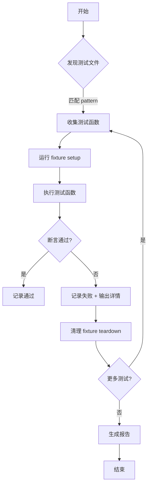
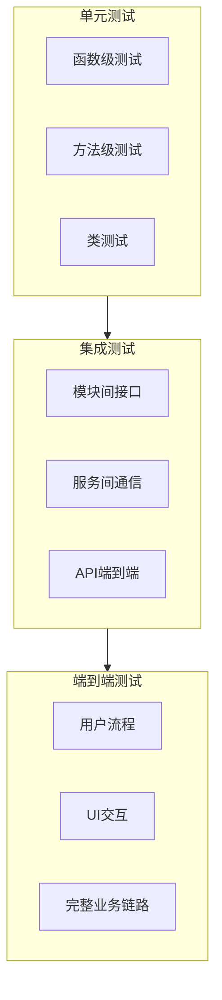

# Day 180 — 自动化测试

## 阶段
Phase 11: 自动化运维与 DevOps (Days 166–185)

## 子主题
- 单元测试 pytest
- 集成测试
- 端到端测试
- 测试覆盖率
- 实战：自动化测试套件

## 概念解释

### 单元测试
单元测试是对软件中最小可测试单元（函数、方法或类）的测试。目的是在开发早期发现bug，确保每个小组件按预期工作。

**核心原则：**
- **自动化**：无人干预即可运行
- **快速**：执行时间应在毫秒级
- **独立**：每个测试用例之间无依赖
- **可重复**：相同输入必须产生相同输出

**pytest 优势：**
- 简洁的断言语法
- 强大的fixture机制
- 参数化测试
- 插件生态丰富
- 隔离性测试运行

### 集成测试
集成测试验证不同模块、服务或组件之间的交互。相比单元测试，它覆盖的范围更广，但执行速度较慢。

**关键特性：**
- **跨模块**：测试模块间接口
- **环境模拟**：模拟数据库、外部服务
- **接口验证**：请求/响应格式、协议契合
- **错误处理**：网络中断、超时、错误响应

### 端到端 (E2E) 测试
E2E 测试从用户视角验证整个应用流程，包括前端界面、后端逻辑、数据库操作和外部集成。

**目标：**
- 模拟真实用户操作
- 验证业务流程完整性
- 发现系统级问题
- 确保各组件协同工作

### 测试覆盖率
覆盖率指代码有多少被测试覆盖。它是质量的辅助指标，而非目标。

**常见工具：**
- `pytest --cov`：覆盖率分析
- `coverage.py`：Python覆盖率工具
- 语句覆盖率、分支覆盖率

**注意：** 高覆盖率不等于无bug，测试需要有意义且覆盖关键路径。

## 原理解释

### pytest 的测试发现机制
pytest 通过模式匹配自动发现测试文件：
- `test_*.py` 或 `*_test.py` 文件名模式
- `test_` 或 `_test` 前缀的函数/类
- 命令行参数 `--collect-only` 可列出所有测试

**测试执行流程：**
1. 收集：扫描文件，解析测试函数
2. 设置：运行 fixture 的 setup 代码
3. 运行：执行测试函数，捕获输出和异常
4. 清理：运行 fixture 的 teardown 代码
5. 报告：生成通过/失败状态

### fixture 的生命周期
pytest fixture 管理测试所需的资源：
- **session**：整个测试会话的一次设置
- **module**：每个模块运行一次
- **class**：每个类运行一次
- **function**：每个测试函数运行一次（默认）
- **session**：跨函数共享

Fixture 可以通过 `@pytest.fixture` 装饰器定义，支持 `yield` 语句实现清理工作。

### 测试孤立与Mock
为了保持测试独立，需要隔离外部依赖：
- **Mock**：模拟对象的行为
- **Patch**：临时替换对象属性
- **Fixture**：提供测试所需的数据或服务

**关键策略：**
- 不要在测试中连接真实数据库
- 模拟外部API调用
- 使用内存数据库而非真实服务

## 定义与使用方法

### 基础pytest语法

```python
# content of test_basic.py
def func(x):
    return x + 1

# 简单断言
def test_basic():
    assert func(3) == 4
```

### 断言表

| 情况 | 断言 | 含义 |
|------|------|------|
| 相等 | `assert a == b` | a 等于 b |
| 不相等 | `assert a != b` | a 不等于 b |
| 真值 | `assert condition` | condition 为 True |
| 为 None | `assert x is None` | x 为 None |
| 不为 None | `assert x is not None` | x 不为 None |
| 包含 | `assert x in y` | x 在 y 中 |
| 不包含 | `assert x not in y` | x 不在 y 中 |
| 相似 | `assert a == pytest.approx(b)` | a 近似等于 b |

### 常用pytest功能

**参数化测试：**
```python
import pytest

@pytest.mark.parametrize("input,expected", [
    (1, 2),
    (2, 3),
    (3, 4),
])
def test_addition(input, expected):
    assert input + 1 == expected
```

**标记：**
```python
@pytest.mark.slow
def test_slow_stuff():
    pass

# 运行: pytest -m slow
pytest -m "not slow"  # 跳过慢速测试
```

**Fixtures：**
```python
import pytest

@pytest.fixture
def db_connection():
    conn = create_real_database_connection()
    yield conn
    conn.close()

def test_with_db(db_connection):
    result = db_connection.query("SELECT ...")
    assert result is not None
```

### Expect 失败输出格式

当断言失败时，pytest 提供详细信息：
- 断言表达式
- 实际值
- 预期值
- 文件路径和行号

## ASCII 图解

### pytest 测试执行流程



### 测试分层结构



## 实战代码案例

### 01-基础用法.py - 基础断言测试

```python
"""基础单元测试示例"""
import pytest


def add(a, b):
    """两数相加"""
    return a + b


def test_add_basic():
    """测试基本加法"""
    result = add(2, 3)
    assert result == 5


def test_add_negative():
    """测试负数相加"""
    result = add(-1, -2)
    assert result == -3


def test_add_mixed():
    """测试正负混合"""
    result = add(-1, 1)
    assert result == 0


#  parametrize 示例
@pytest.mark.parametrize("a, b, expected", [
    (0, 0, 0),
    (1, 2, 3),
    (-1, 1, 0),
    (100, 200, 300),
])
def test_add_parametrized(a, b, expected):
    """参数化测试add函数"""
    assert add(a, b) == expected
```

### 02-进阶用法与避坑.py - 常见错误避免

```python
"""进阶测试模式与避坑示例"""
import pytest


class BankAccount:
    """模拟银行账户"""
    
    def __init__(self, initial_balance=0):
        self.balance = initial_balance
    
    def deposit(self, amount):
        if amount <= 0:
            raise ValueError("存款金额必须大于0")
        self.balance += amount
    
    def withdraw(self, amount):
        if amount <= 0:
            raise ValueError("取款金额必须大于0")
        if amount > self.balance:
            raise ValueError("余额不足")
        self.balance -= amount


def test_withdraw_insufficient_funds():
    """测试余额不足情况"""
    account = BankAccount(100)
    
    with pytest.raises(ValueError, match="余额不足"):
        account.withdraw(200)


def test_withdraw_negative_amount():
    """测试负数取款 - 应该失败"""
    account = BankAccount(100)
    
    # 正确的断言：期望抛出异常
    with pytest.raises(ValueError, match="取款金额必须大于0"):
        account.withdraw(-50)


def test_deposit_zero_fails():
    """测试零存款应该失败"""
    account = BankAccount()
    
    with pytest.raises(ValueError, match="存款金额必须大于0"):
        account.deposit(0)


def test_account_initial_balance():
    """测试账户初始余额"""
    account = BankAccount(50)
    assert account.balance == 50
    assert account.balance is not None


def test_account_negative_deposit():
    """测试负数存款"""
    account = BankAccount()
    
    # 匹配错误信息
    with pytest.raises(ValueError) as exc_info:
        account.deposit(-100)
    
    # 验证异常信息内容
    assert "存款金额必须大于0" in str(exc_info.value)
```

### 03-实战案例 - 完整测试套件

```python
"""完整的自动化测试套件示例"""
import pytest
import tempfile
import os
from pathlib import Path


# Fixture：临时文件
@pytest.fixture
def temp_dir():
    """创建临时目录，测试结束自动清理"""
    with tempfile.TemporaryDirectory() as tmpdir:
        yield Path(tmpdir)


@pytest.fixture
def sample_data():
    """提供测试用的样本数据"""
    return {
        "name": "测试用户",
        "age": 25,
        "email": "test@example.com"
    }


class TestUserManagement:
    """用户管理测试类"""
    
    def test_create_user(self, sample_data):
        """测试创建用户"""
        assert sample_data["name"] == "测试用户"
        assert sample_data["age"] == 25
        assert "@" in sample_data["email"]
    
    def test_user_email_format(self, sample_data):
        """测试邮箱格式验证"""
        parts = sample_data["email"].split("@")
        assert len(parts) == 2
        assert len(parts[1]) > 0
    
    def test_user_name_not_empty(self, sample_data):
        """测试用户名不为空"""
        assert sample_data["name"].strip() != ""


class TestFileOperations:
    """文件操作测试"""
    
    def test_temp_file_creation(temp_dir):
        """测试临时文件创建"""
        test_file = temp_dir / "test.txt"
        test_file.write_text("Hello Test")
        assert test_file.exists()
        assert test_file.read_text() == "Hello Test"
    
    def test_temp_file_cleanup(temp_dir):
        """测试临时文件自动清理"""
        # 在此之后，temp_dir及其内容会自动删除
        pass
    
    def test_content_integrity(temp_dir):
        """测试内容完整性"""
        (temp_dir / "data.json").write_text('{"key": "value"}')
        data = eval((temp_dir / "data.json").read_text())
        assert data == {"key": "value"}
```

## 思考题

1. 单元测试和集成测试的主要区别是什么？何时使用各自？

   **参考答案**

   - **单元测试**：验证最小单元（一个函数/类），外部依赖（数据库、网络、时钟）全部用替身隔离。快（毫秒级）、失败定位准——红了就知道是哪个函数坏了。用来覆盖业务逻辑、边界条件和异常分支，数量上应占绝大多数。
   - **集成测试**：验证多个真实组件协作（真数据库、真 HTTP 调用、消息队列）。慢（秒到分钟级）、失败要排查整条链路。用来覆盖"组件之间的缝隙"：SQL 真的能执行、序列化格式对得上、配置真的生效——这些在单测里因为全被 mock 而测不到。

   何时用哪个：按测试金字塔——大量单测保证逻辑正确，适量集成测试保证组装正确，少量端到端测试保证主流程。写新函数先补单测；接入新外部系统时补集成测试；别用集成测试去覆盖每个分支（太慢），也别迷信"单测全绿"就等于系统能跑（缝隙没测到）。

2. pytest fixture 的作用域如何影响测试性能和资源管理？请列出各个作用域的适用场景。

   **参考答案**

   作用域（scope）决定"一个 fixture 实例被多少测试共享"：作用域越大，创建次数越少、跑得越快，但测试间状态串味的风险也越大。

   - **function（默认）**：每个测试都新建一份。适合可变资源（带事务的数据库连接、临时对象）——天然隔离，不担心上一个测试弄脏数据；
   - **class**：一个测试类内共享。适合一组测试需要同一份昂贵上下文、且互不影响的场景；
   - **module**：一个 .py 文件内共享。适合初始化贵但只读的资源（加载大配置、编译模板）；
   - **session**：整次测试运行只建一次。适合最贵且全局只读的资源（启动测试容器、创建数据库 engine、连接测试服务器）。

   性能与安全的权衡：只读的大资源用 session/module 摊薄成本；可变资源用 function + yield  teardown（回滚事务、删临时文件）保证独立。经典组合：session 作用域建 engine，function 作用域给每个测试开事务、结束回滚——既快又干净。

3. 测试覆盖率 100% 是否意味着代码没有 bug？请解释你的观点。

   **参考答案**

   不意味着。覆盖率只回答"这行代码被执行过没有"，不回答"执行结果对不对"：

   - **执行 ≠ 断言**：测试调用了函数但没写任何断言，覆盖率照样 100%，函数返回错得离谱测试也是绿的；
   - **行覆盖 ≠ 路径覆盖**：if 的两个分支、多条件组合、边界值（空列表、0、负数、溢出）可能根本没测到；
   - **缺失的需求测不出来**：压根没写的代码（比如忘了做权限校验）不在覆盖率的分母里，100% 也发现不了"少做了功能"；
   - **并发/时序/资源问题**：竞态、死锁、泄漏基本不体现在覆盖率上。

   所以覆盖率是"底线指标"——低了肯定测试不足，高了不保证质量。想真正检验测试有效性，用变异测试（mutmut 等工具）：故意往代码里注入小 bug，看测试会不会红；不会红，说明测试只是"路过"了那些代码。

4. 如何在测试中正确处理外部依赖（如数据库、API）？请列出至少 3 种策略。

   **参考答案**

   常用策略从轻到重：

   - **Mock/Patch（进程内替身）**：用 `unittest.mock.patch` 把外部调用替换成预设返回值。最快、完全离线，适合单元测试；缺点是"假定的行为"可能和真实系统不一致（API 改了 mock 没改）。
   - **轻量真实替代品（内存数据库/fakeredis）**：用 SQLite `:memory:` 代替 PostgreSQL、fakeredis 代替 Redis——真实引擎语义、无需网络，适合测 SQL 和数据结构；缺点是方言差异（某些 PG 特有语法 SQLite 不支持）。
   - **Testcontainers（一次性真容器）**：用代码拉起真实 PostgreSQL/Redis 的 Docker 容器，测完即销毁。保真度最高，适合集成测试；需要 Docker 环境（需自行准备环境），启动有秒级开销。
   - **依赖注入 + Fake 实现**：代码设计上接受"网关对象"参数，测试时注入手写 Fake（如用内存 dict 模拟存储）。比 Mock 更可控，能模拟有状态的行为。
   - **录制回放（VCR 模式）**：第一次真跑 HTTP 交互并录成"cassette"文件，之后测试回放录音。适合难以 mock 的第三方 API。

   原则：单元测试用替身，集成测试用真实依赖（内存版或容器），再保留极少量对真实环境的冒烟测试。

5. 编写一个参数化的 pytest 测试，测试一个函数，该函数接受两个参数并返回它们的除法结果。需要考虑除以零的情况。

   **参考答案**

   完整可运行代码（需先 `pip install pytest`；保存为 `test_divide.py`）：

   ```python
   import pytest

   def divide(a, b):
       """除法：除数为 0 时抛出 ZeroDivisionError。"""
       if b == 0:
           raise ZeroDivisionError("除数不能为零")
       return a / b

   # 正常路径：参数化多组输入，一个测试函数覆盖多个用例
   @pytest.mark.parametrize("a, b, expected", [
       (6, 3, 2.0),
       (-6, 3, -2.0),
       (7, 2, 3.5),
       (0, 5, 0.0),
   ])
   def test_divide_ok(a, b, expected):
       assert divide(a, b) == pytest.approx(expected)   # 浮点比较用 approx

   # 异常路径：除数为 0 必须抛出指定异常，match 校验错误信息
   @pytest.mark.parametrize("a", [1, 0, -1])
   def test_divide_by_zero(a):
       with pytest.raises(ZeroDivisionError, match="除数不能为零"):
           divide(a, 0)
   ```

   运行 `python -m pytest test_divide.py -v`，实际输出：

   ```text
   test_divide.py::test_divide_ok[6-3-2.0] PASSED                           [ 14%]
   test_divide.py::test_divide_ok[-6-3--2.0] PASSED                         [ 28%]
   test_divide.py::test_divide_ok[7-2-3.5] PASSED                           [ 42%]
   test_divide.py::test_divide_ok[0-5-0.0] PASSED                           [ 57%]
   test_divide.py::test_divide_by_zero[1] PASSED                            [ 71%]
   test_divide.py::test_divide_by_zero[0] PASSED                            [ 85%]
   test_divide.py::test_divide_by_zero[-1] PASSED                           [100%]

   ============================== 7 passed in 0.01s ==============================
   ```

   说明：`@pytest.mark.parametrize` 把 4 组输入展开成 4 个独立用例（共 4+3=7 个），某个用例失败不影响其余；`pytest.approx` 容忍浮点误差；`pytest.raises(..., match=...)` 同时断言异常类型和错误信息，防止"抛对了异常但原因是别的"。

6. 描述 "Mock" 和 "Stub" 之间的区别。何时各自使用？

   **参考答案**

   - **Stub（桩）**：提供"罐头答案"——预置返回值，让被测代码拿到数据能继续跑，不关心它怎么被调用。校验的是**状态**（最终结果对不对）；
   - **Mock（模拟）**：校验**行为**（交互本身）——有没有被调用、调用几次、参数是什么、顺序对不对，调用不符合预期就判失败。

   何时用哪个：依赖只是"数据来源"（查汇率、读配置）时用 stub，只关心计算结果；依赖是"副作用"（发邮件、扣款、写审计日志）时用 mock，因为副作用本身就是被测行为，必须验证"确实给对的人发了且只发了一次"。

   用标准库 `unittest.mock` 的最小示例（Mock 对象两种角色都能扮演）：

   ```python
   from unittest.mock import Mock

   # Stub：预置返回值，让被测代码拿到数据即可，不校验交互过程
   stub_gateway = Mock()
   stub_gateway.charge.return_value = {"status": "ok"}          # 罐头答案
   result = stub_gateway.charge(100)
   assert result["status"] == "ok"                              # 校验的是“状态”（结果）

   # Mock：校验交互本身——是否调用、调用几次、参数是什么
   mock_mailer = Mock()
   mock_mailer.send("ops@example.com", "告警")                   # 被测代码触发的副作用
   mock_mailer.send.assert_called_once_with("ops@example.com", "告警")  # 校验“行为”
   print("stub 提供预设结果；mock 校验调用参数与次数")
   ```

   实际运行输出：

   ```text
   stub 提供预设结果；mock 校验调用参数与次数
   ```

   💡 提示：日常口语里 "mock" 常泛指一切测试替身（含 stub、fake、spy）；严格分类才区分"stub 验状态、mock 验行为"。另外别过度 mock——把每个内部调用都验证一遍，测试会脆弱到一重构就碎。

7. 如何设计测试来确保测试之间的独立性？如果测试之间有依赖应该怎么做？

   **参考答案**

   核心原则：每个测试都"不假设外界有任何现成状态"——单独跑、乱序跑、重复跑，结果都一样。设计要点：

   - **资源随用随建**：用 function 作用域 fixture 提供数据/连接，yield teardown 里清理（回滚事务、删临时文件）；
   - **不共享可变状态**：全局变量、类属性、模块级缓存是串味重灾区，必须用时在 fixture 里显式重置；
   - **环境隔离**：文件操作用 `tmp_path`（pytest 给每个测试独立临时目录），环境变量用 `monkeypatch`（测试结束自动还原）；
   - **用乱序验证**：装 pytest-randomly 让每次运行随机打乱顺序，有顺序依赖的测试立刻现形。

   真有依赖时怎么办：先问"这是业务流程还是坏耦合"。如果只是"测试 B 恰好要用测试 A 建的数据"，那是坏耦合——让 B 自己建数据（把公共准备抽成 fixture）。如果确实是流程（下单→支付→退款），就写成**一个**集成测试在内部走完整条流程；或用 pytest-dependency 插件显式声明依赖（前置失败时后续标记 skip 而非报错）——但后者要少用，它本质上是把脆弱性合法化。

8. CI/CD 流水线中如何利用 pytest 进行质量门控？阈值应该如何设置？

   **参考答案**

   怎么做：在 CI（GitHub Actions/Jenkins）里加测试 job，运行 `python -m pytest --cov=你的包 --cov-report=xml --cov-fail-under=80 --junitxml=report.xml`，并把这个 job 设为 PR 合并的 **required status check**——测试失败或覆盖率低于阈值，PR 就无法合并。junitxml 让平台展示逐用例结果，覆盖率报告可接 Codecov 做增量对比。

   阈值怎么设：

   - **从现状基线起步，只升不降（棘轮）**：先测出现有覆盖率（比如 62%），门禁设 60% 止血，之后每个迭代上调 1–2 个点；别一上来设 100%，团队要么刷数字要么直接放弃；
   - **分模块差异化**：核心支付/鉴权模块要求 95%+，工具脚本 70% 即可——按目录设阈值，或只对新增代码设门槛；
   - **增量门禁比总量门禁更有效**："本次 PR 新增/修改的行覆盖率 ≥ 90%"，既不让历史欠债卡死新功能，也不让新代码搭总量的便车；
   - **门禁失败必须真拦截**：不要写 `|| true`、不要 continue-on-error——可以被绕过的门禁等于没有门禁。