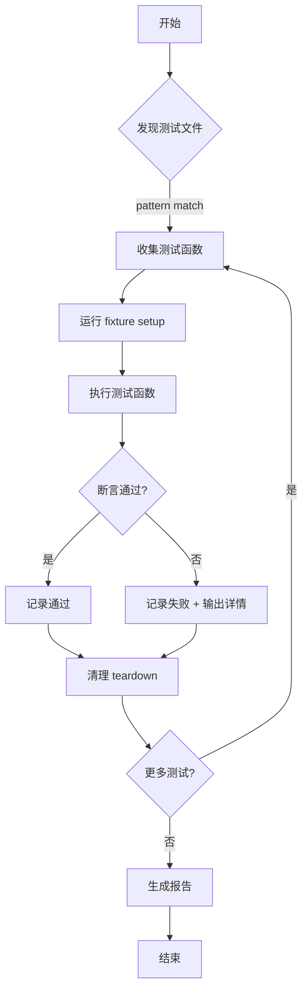
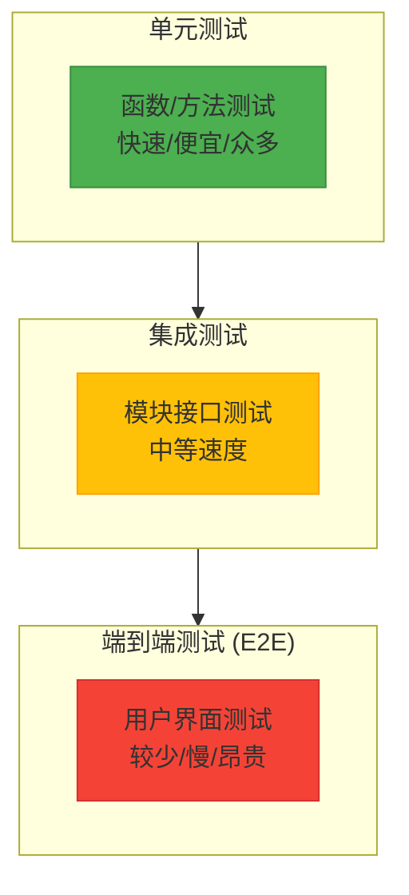
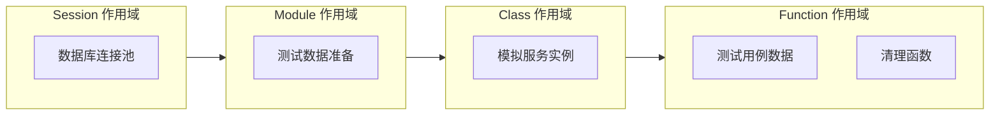
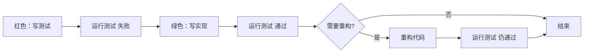
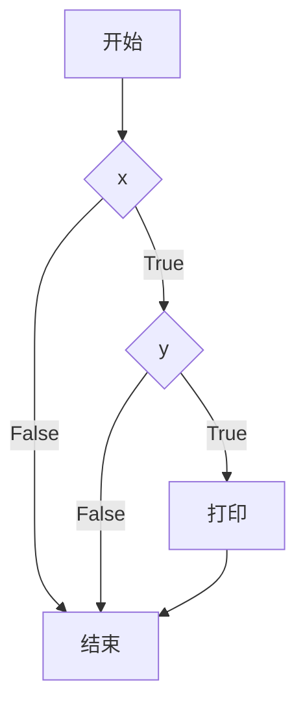

# Diagrams - Day 180: 自动化测试

## pytest 测试生命周期



## 测试金字塔



## Fixture 作用域层次



## TDD 流程



## 测试覆盖率类型

```
语句覆盖 (Statement):
    if x:        → 需要 x=True 才能执行 if 体
        print()

分支覆盖 (Branch):
    if x:         → 需要 x=True 和 x=False 两个分支
        print()
    → 语句 + 分支

条件覆盖 (Condition):
    if x and y:  → 每个条件独立测试 True/False
        print()

路径覆盖 (Path):
    if x:        → 所有可能执行路径
        if y:
            print()
```



**路径分析：**
- 路径 1: Start → x=True → y=True → print → End
- 路径 2: Start → x=True → y=False → End
- 路径 3: Start → x=False → End