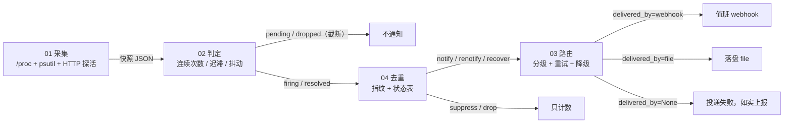
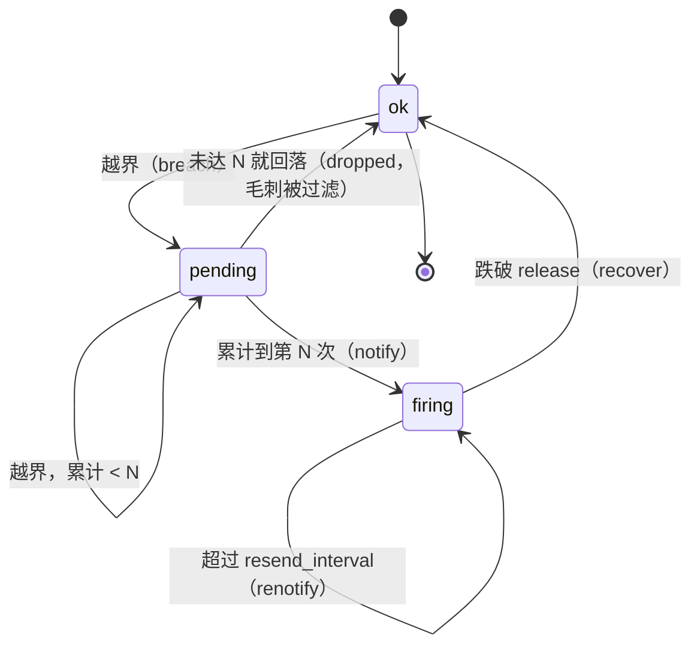
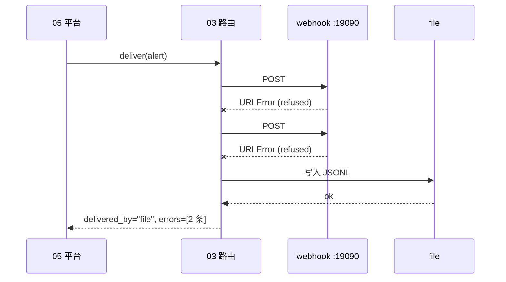

# Day 182 — 原理图解

六张图，从「数据怎么流」到「为什么平台重启后会漏掉恢复」。

---

## 图 1 · 四层链路：一份数据怎么变成一次通知

```
┌────────────────────────────── 05-platform-demo.py（把四段串起来）──────────────────────────────┐
│                                                                                            │
│  ┌────────────────┐   快照 JSON    ┌────────────────┐   事件    ┌──────────────┐   动作      │
│  │ 01 采集         │ ─────────────▶ │ 02 判定         │ ────────▶ │ 04 去重       │ ────────┐  │
│  │                │                │                │           │              │         │  │
│  │ /proc/stat     │                │ consecutive=3  │           │ fingerprint  │         ▼  │
│  │ /proc/meminfo  │                │ release=80     │           │ 状态表        │   ┌────────────┐
│  │ psutil         │                │ flap_window    │           │ notify/       │   │ 03 路由     │
│  │ HTTP 探活       │                │ =300s          │           │ suppress/     │   │            │
│  └────────────────┘                └────────────────┘           │ renotify/     │   │ critical→wh │
│        ▲                                  ▲                     │ recover/drop  │   │ warn→file   │
│        │                                  │                     └──────────────┘   │ 抖动→file    │
│        │                                  │                                        └─────┬──────┘
│        │                                  │                                              │
│   真机/假快照                        事件只在「状态变化」时产生                      投递报告（delivered_by）
│                                                                                            │
└────────────────────────────────────────────────────────────────────────────────────────────┘
                                                                                             ▼
                                                              webhook（HTTP POST）/ file（JSONL）/ console
```

关键：**只有 firing / resolved 两种事件能走到 04**。
`pending`（越界但没到连续次数）和 `dropped`（毛刺被过滤）在第 02/05 层就被吃掉了——
它们的存在只是为了让你会诊「为什么不报警」，不该变成通知。

对应 mermaid（同样的链路）：



---

## 图 2 · 一条告警的状态机（本日 02 + 04 合起来）

```
                          ┌──────────────── 样本流（每 2s 一条）────────────────┐
                          ▼                                                    │
   ┌──────┐  越界 1 次   ┌─────────┐  累计到 N 次   ┌────────┐  同指纹再来   ┌──────────┐
   │  ok  │ ───────────▶ │ pending │ ────────────▶ │ firing │ ───────────▶ │ suppress │
   └──────┘              └─────────┘               └────────┘   （计数+1）  └──────────┘
      ▲                       │                        │                        │
      │  未达 N 次就回落        │                        │ 未到恢复线（迟滞）        │ 超过 resend
      │  = dropped（毛刺）      │                        │ → 保持 firing，无事件     │ → renotify
      └───────────────────────┘                        │                        │
                                                       │ 跌破 release
                                                       ▼
                                                   ┌────────┐
                                                   │   ok   │ ──▶ recover（恢复通知）+ 状态表删除
                                                   └────────┘
```

mermaid 版（状态转移带条件）：



**注意 `firing -> firing` 的三条自环**：
状态没变，但**动作不同**（无事件 / 计数 / 再提醒）。这就是为什么把「状态」和「动作」分成两个概念
写代码会清爽很多——本日 `02` 只管状态，`04` 只管动作。

---

## 图 3 · 迟滞带：进去难，出来也难

```
   指标值
     ▲
 100 │                        ┌──┐        ← 抖动点都在这附近（89.9 / 90.1）
  95 │                    ┌───┘  └───┐
  90 ├══════════════════════════════════════════  越界线 threshold = 90
     │                        │
  85 │                        │              ← 这段（80, 90] 是「迟滞带」
  80 ├──────────────────────────────────────────  恢复线 release = 80
     │                        │
  75 │                        │
     └──────────────────────────────────────────▶ 时间
              越界开始                     跌破 80 才恢复

  没有迟滞：每次穿越 90 都翻转一次 → 89.9/90.1 抖动 = 刷屏
  有迟滞：  必须一路跌到 80 以下 → 0.2 个点的抖动完全被吸收
```

实测证据（实验 2c，真机输出）：值从 95 一路降到 79 的过程中，
`88 → 86 → 84 → 82 → 81` 全部是「迟滞保持」，**一个通知都没发**，直到 79 才 `resolved`。

```
3      95.0     firing    firing    升级为告警
4      88.0     firing    -         迟滞保持（未到恢复线 80.0）
...
9      79.0     ok        resolved  恢复通知
```

---

## 图 4 · 抖动判定：时间窗口，而不是总次数

```
 采样   1    2    3    4    5    6    7    8
 值    95   60   95   60   95   60   95   60
 状态  F    R    F    R    F    R    F    R        F=firing R=resolved
        ↑    ↑    ↑    ↑    ↑    ↑    ↑    ↑
 翻转  #1   #2   #3   #4

             flap_window = 300s 内翻转 >= 4 次  ⇒  flapping = True
             ┌──────────────────────────────┐
             │  窗口内的翻转全部被算进来       │
             └──────────────────────────────┘

 关键对比（本日自检实测）：
   窗口 100s、间隔 1s  → 翻转 4 次 → flapping = True   （真抖动）
   窗口 2s、间隔 10s   → 同样 7 次翻转 → 不是抖动      （每次翻转之间平静了 10s）
```

第二条是本日自检专门钉住的：**同样的翻转次数，间隔 10 秒就算不上抖动**。
用「总次数」判定的话，一个跑了 30 天、每天抖 1 次的系统会被误判成抖动。

---

## 图 5 · 指纹去重：60 次采样怎么变成 1 条通知

```
  采样流（每 2s 一条，同一条时间线）
  ┌─────────────────────────────────────────────────────────────┐
  │ cpu=95  cpu=96  cpu=97  cpu=95  cpu=98  ...  cpu=94         │   ← 30 条
  └─────────────────────────────────────────────────────────────┘
        │
        │  每个样本算指纹（只取「身份」字段）
        │  sha256(name + severity + labels)  =  f05360f106d8
        ▼
  ┌─────────────── 状态表（fp -> 记录）─────────────────┐
  │ f05360f106d8 → {count: 30, first: t0, last: t29}    │
  └─────────────────────────────────────────────────────┘
        │
        ├─ 第 1 次：表里没有 → notify      （★真正打扰人的那一条）
        └─ 第 2..30 次：表里有 → suppress  （count 累加，不通知）

  指纹**不能**包含的字段：
    value   → 每次值都不同 → 每次都算新指纹 → 去重失效
    status  → firing / resolved 指纹不同 → 恢复通知匹配不上（★本日踩过）
    ts      → 同 value 的后果
  指纹**应该**包含的字段：
    name / severity / instance / job / 挂载点 …（故障的「身份」）

  实测：10 条同指纹告警 → 1 条 notify + 9 条 suppress
```

---

## 图 6 · 降级链：顺序尝试，失败必须可见

```
  告警（severity=critical, flapping=False）
        │
        ▼
  选路由：critical → primary=webhook, fallback=[file, console]
        │
        ├─▶ ① webhook  尝试 1 次  ✗ URLError: Connection refused
        │              尝试 2 次  ✗ URLError: Connection refused     ← attempts=2
        │        （重试是「同一通道」，不是「换通道」）
        │
        ├─▶ ② file     写入 JSONL  ✓  → delivered_by = "file"        ← 降级成功
        │        （到此结束，不会再去发 console）
        │
        └─  ③ console  （不会被执行：链是顺序的，不是广播的）

  如果全部失败：
        delivered_by = None   ← ★绝不假装成功，上层必须看得见

  实测投递报告（实验 5）：
     路由=critical      链=webhook->file->console       投递=file /tmp/day182/live/fallback.jsonl
     路由=warning       链=file->console                投递=file   （压根没碰 webhook）
     路由=flap-silenced 链=file                         投递=file   （抖动不叫人）
```

mermaid 时序版：



---

## 附：本日四层的「谁负责什么」一页纸

| 问题 | 由哪一层回答 | 本日实现 | 典型的「答错」后果 |
|---|---|---|---|
| 现在值是多少 | 01 采集 | psutil / `/proc` / HTTP 探活 | 阈值配错口径（38.3% vs 36.3%） |
| 这算不算事 | 02 判定 | 连续次数 + 迟滞 + 抖动窗口 | 抖动风暴 |
| 这事喊过没有 | 04 去重 | 指纹 + 状态表 + 恢复 | 刷屏 / 恢复通知丢失 |
| 喊给谁、怎么喊 | 03 路由 | 分级路由 + 重试 + 降级链 | 半夜叫醒人 / 告警悄悄丢掉 |
| 四段拼起来对不对 | 05 串联 | 假时钟自检 + 真机模式 | 每层都「对」，合起来漏告警 |
