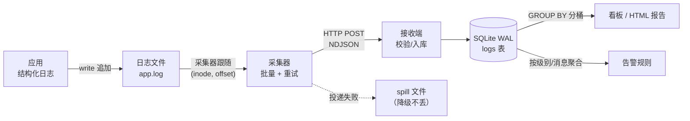

# Day 184 概念与原理 —— 日志收集 + 可视化

> 今天不是"用某个日志框架"，而是**把日志从「人读的文本」变成「能查的数据」**。
> 这一章先把概念和原理讲透，代码示例（`code/` 目录）是这些原理的可运行证明。

---

## 1. 为什么需要「收集」：三个真实痛点

| 痛点 | 具体表现 | 今天的解法 |
|---|---|---|
| 日志散在各处 | 10 台机器 10 个文件，出事时挨个 ssh `grep` | 统一接收端（`02-log-ingest-server.py`） |
| 日志是给人看的 | `ERROR 用户支付失败 order=123` —— 想问"错误率多少"只能正则 | 结构化字段（`01-structured-logging.py`） |
| 日志会丢 | 轮转之后采集器还在读被 rename 的旧文件 | 抗轮转采集器（`03-log-collector.py`） |

三者是**一条管道上的三步**，少任何一步，"可视化"都是假的：
图上没数据的时候，你分不清是"真的没请求"还是"日志丢了"。

---

## 2. 日志的三种形态

1. **人读形态**：`2026-10-17 14:01:00 [INFO] 处理完成 order=123 耗时=12ms`
   - 优点：`tail -f` 就能看懂。
   - 缺点：机器解析要靠不稳定的正则（格式一变就全崩）。
2. **半结构形态**：`ts=2026-10-17T14:01:00+08:00 level=INFO order=123 duration_ms=12`
   - key=value，`grep` / `awk` 友好，解析比自然语言稳。
   - 缺点：值里带空格或引号就要转义，嵌套结构表达不了。
3. **结构化形态（JSON Lines）**：一行一个 JSON 对象
   ```json
   {"ts":"2026-10-17T14:01:00.123+08:00","level":"INFO","service":"api","request_id":"req-8f21","msg":"request handled","status":200,"duration_ms":12.4}
   ```
   - 天然可嵌套（`extra={"db":{"host":"...","rows":3}}`）。
   - **每行一个对象**是关键：它能被按行增量读取（`tail -f` / 采集器），
     而"整个数组一个大 JSON"做不到增量读 —— 必须读完才能解析。

> 设计原理：日志的第一消费者其实**是机器**（采集器、聚合器、告警器），
> 人是第二消费者。让机器省事的格式，最终也让人省事（`jq .duration_ms` 就完事）。

---

## 3. 结构化日志的字段设计

最小可用集（少一个都会在某个场景里卡住）：

| 字段 | 为什么必须有 | 没有会怎样 |
|---|---|---|
| `ts` | 事件发生时间，**必须带时区偏移** | 跨机房聚合时顺序错乱、桶对不上 |
| `level` | 过滤与告警的第一维 | 只能全量扫 |
| `service` | 多服务区分 | 混在一起分不清谁在报错 |
| `request_id` / `trace_id` | 串起一次请求的所有日志 | 只能靠时间猜，并发下必错 |
| `duration_ms` | 延迟分布（P50/P95/P99） | 无法回答"慢不慢" |
| `status` | 错误率分母/分子 | 无法算成功率 |
| `msg` | 人读的兜底短描述 | 看日志还得反查代码 |

两条实现上的硬规则（Python `logging`）：

- `extra={}` 的 key **不能和 LogRecord 自带属性重名**，否则 `KeyError`：
  撞名的坑包括 `msg`、`args`、`name`、`levelname`、`module`、`filename`、`exc_info`。
  示例里用 `logging.LogRecord("",0,"",0,"",(),None).__dict__` 取出全部保留名做白名单过滤。
- `exc_info=True` 的 traceback 要放在**独立字段**（如 `traceback`）而不是拼进 `msg`：
  这样"按错误类型聚合"就是 `GROUP BY error_type`，而不是正则。

---

## 4. 日志管道的四个阶段



每一段都有它自己的失败模式，这才是"日志系统难"的真实原因：

| 阶段 | 典型失败 | 本项目里的对策 |
|---|---|---|
| 产生 | 格式不统一、时间没时区 | 统一 JSON Lines + 强制 ISO8601 |
| 采集 | 轮转/截断/半行导致丢或碎 | 监控 `(ino, size, mtime_ns)` 的状态机 |
| 传输 | 接收端重启、网络抖动 | 批量 + 指数退避重试 + 降级落盘 |
| 存储 | 并发写锁冲突丢日志 | WAL + `busy_timeout` + 批提交 |
| 查询 | 全表扫、把行拉进 Python 聚合 | 索引 + 在 SQL 里分桶 |

---

## 5. 采集的本质：一个「读文件 + 记位置」的状态机

采集器看着像 `tail -f`，其实是一个状态机，状态是三元组：

```text
(state) = (inode, offset, buffer)
```

- **为什么要 inode 而不是文件名**：`open("app.log")` 拿到的是那个时刻文件名指向的 inode。
  `logrotate` 默认用 `rename`：`app.log → app.log.1`，然后应用重新创建 `app.log`。
  采集器的 fd 还绑在旧 inode 上 —— 旧 inode 不再增长，新文件它根本不知道，
  **一条不报错地永久丢失**（这就是本日翻车实验）。
- **为什么要有 offset**：重启采集器时不能从头重读（会重复），也不能只记行号
  （半行会让行号错位）。字节偏移 + 只在换行处推进，是最稳的记法。
- **为什么要有 buffer**：应用写日志不是原子的。`write()` 两次调用之间，
  采集器可能正好读到一半 —— 此时 `json.loads` 必失败。只处理"以 `\n` 结尾"的完整行，
  尾巴留在 buffer 里等下一轮，是唯一正确的做法。
- **mtime 也是状态的一部分**：只比 `size` 会漏掉"truncate 后正好写成同样字节数"的情况
  （本日自证脚本抓到的真实 bug），所以判断截断要 `size < offset` **或** (`size <= offset` 且 `mtime` 变了)。

> 三种轮转语义都要认识：`rename`（新文件新 inode）、`copytruncate`（同 inode 大小归零）、
> `create`（先删再建）。前两种本项目都处理了，第三种等价于 `rename` 的检测路径。

---

