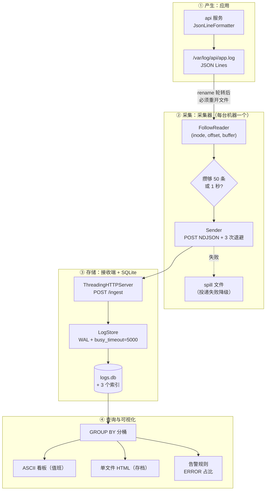
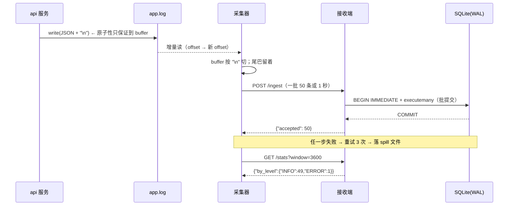

# Day 184 图解 —— 日志管道与采集状态机

> 全部用 Mermaid / ASCII，**不生成图片文件**：这样它们能跟代码一起 review，
> 也能在 GitHub、终端（配合 mermaid-cli）里直接看。

---

## 图 1：日志管道全景（谁把日志搬到哪去了）



**读图要点**：箭头上的小字才是真正的知识点。管道的每一跳都有自己的失败模式，
"日志丢了"从来不是单一原因。

---

## 图 2：一次请求的日志生命周期（时序）



---

## 图 3：采集器状态机（为什么必须记 inode）

```text
                  ┌──────────────────────────────────────────┐
                  │  state = (inode, offset, buffer, mtime)  │
                  └──────────────────────────────────────────┘
                                     │ 每 0.2s poll 一次
                                     ▼
                      ┌──────────────────────────────┐
                      │ os.stat(path) 成功?           │
                      └──────────────────────────────┘
                        │ 否                        │ 是
                        ▼                           ▼
                  等待文件出现            ┌───────────────────────────┐
                  （不报错）              │ st_ino != state.inode ?    │
                                          └───────────────────────────┘
                                             │ 是（发生了 rename 轮转）
                                             ▼
                                   把旧 fd 读到 EOF → 关闭
                                   → open(path) 重新取 inode
                                   → rotations += 1
                                             │ 否
                                             ▼
                             ┌──────────────────────────────────────┐
                             │ size < offset 或 (size<=offset 且       │
                             │ mtime 变了) ?  → 截断                  │
                             └──────────────────────────────────────┘
                                             │ 是
                                             ▼
                                    seek(0); offset = 0
                                    truncations += 1
                                             │ 否
                                             ▼
                                  chunk = fd.read()
                                  buffer += chunk
                                  *完整行, buffer = buffer.split("\n")
                                  → 完整行交给 Sender
```

**反例（naive 模式）**：删掉图中的两个判断框，只保留 `fd.read()`。
文件被 rename 后，`fd` 仍指向旧 inode，读不到任何新内容，
而且**不报错** —— 这是日志系统里最危险的一种失败（静默丢数据）。

---

## 图 4：SQLite 两种 journal 模式的锁时间线

```text
默认 rollback journal（DELETE）—— 写会挡住读
时间轴 →
写者 A:  [BEGIN IMMEDIATE]──写──[RESERVED]──────────[EXCLUSIVE 落盘]──[COMMIT]
读者 R:  ──────────读 OK──────────┐                    ↑ 读被挡
写者 B:                            └─[尝试写]→ SQLITE_BUSY（立刻失败！）

WAL —— 一写多读并行，写者之间排队
写者 A:  [BEGIN IMMEDIATE]──写──[追加 -wal]──────[COMMIT]
读者 R:  ──────────始终读旧快照，不阻塞─────────→ 看见新数据
写者 B:                            └─[尝试写]→ busy_timeout 内轮询等待 → 成功后写
```

**结论**：WAL 解决"读写互斥"，但**不解决"多写者互斥"**。
多写者场景必须再加上 `busy_timeout`（让 B 等而 A 而不是立刻报错）。
04 号示例实测：`timeout=0` 时 B 在 0.000s 就失败；加 WAL + `busy_timeout=5000` 后
B 等待 0.738s 拿到锁并成功。

---

## 图 5：轮转（rename）—— 正确采集器 vs naive 采集器

```text
时刻 T0  app.log ──┐
                   └─ inode 8823645  ← 两个采集器的 fd 都指向它
        正确采集器: state.inode = 8823645
        naive 采集器: fd → inode 8823645

时刻 T1  mv app.log app.log.1        （inode 8823645 还在，只是换了名字）
        应用 open("app.log", O_CREAT) → 新 inode 8823700，开始往里写

        正确采集器: os.stat("app.log").st_ino = 8823700 ≠ 8823645
                    → 重开 → 收到新行 ✅   rotations_detected: 1
        naive 采集器: fd 仍是 8823645（旧文件，无人再写）
                    → 永远 EOF，静默什么都不发 ❌  rotations_detected: 0
```

这就是 `--naive` 开关存在的意义：**它把"看起来能跑"和"真的不丢"的差别
变成一次可复现的对照实验**，而不是一句口头警告。
