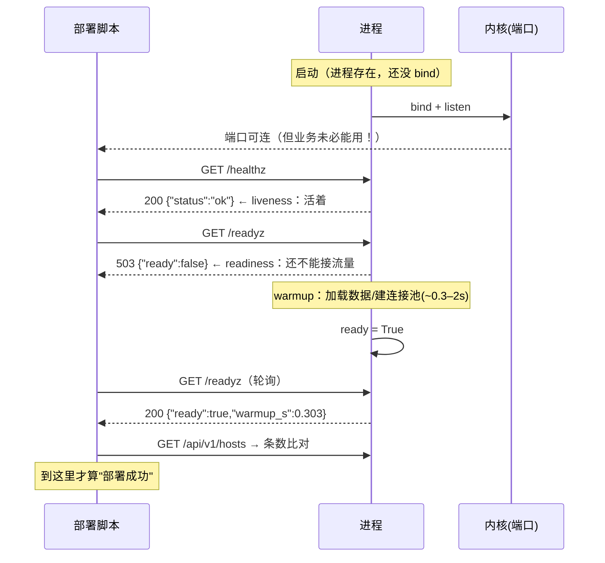

# Day 185 图解 —— 部署流水线、探针状态机与停机时间线

> 全部 Mermaid / ASCII，不生成图片文件，跟代码一起 review。

---

## 图 1：一键部署流水线与失败出口


---

## 图 2：存活 / 就绪 状态机（本课服务真实行为）



---

## 图 3：优雅停机时间线（SIGTERM vs SIGKILL，实测）

```text
SIGTERM（正确实现：shutdown → wait_idle → server_close）
t=0.00s  ├─ 收到 SIGTERM，日志 sigterm_received
         ├─ 停止 accept：新连接被拒（连接被内核拒绝，而不是被应用重置）
t=0.25s  ├─ 在途请求 /slow?ms=1500 还在 sleep
t=1.20s  ├─ 请求处理完 → 客户端拿到 200  ✅（实测 elapsed=1.202s）
t=1.29s  ├─ wait_idle 返回：{"msg":"drained","waited_s":0.839,"max_concurrent":1}
t=1.34s  └─ 进程退出（实测 exit_took=0.051s）      → 用户零感知

SIGKILL / 没有排空的实现（第一版真机结果）
t=0.00s  ├─ kill -9（或：handler 只 shutdown 不排空）
t=0.30s  ├─ 进程消失（实测 0.297s）
t=0.55s  └─ 客户端：RemoteDisconnected ❌（在途请求被切断，用户看到连接重置）
```

**这张图就是"滚动发布为什么不能随便用 kill -9"的全部理由。**

---

## 图 4：PID 身份判定（哪一条判据在防哪种事故）

```text
                  pidfile 里有 12345
                          │
        ┌─────────────────┴──────────────────┐
        │ /proc/12345 存在吗？                │  ← 只看这个 → 僵尸也算"活着"
        └─────────────────┬──────────────────┘
                  否 ─────┘───── 是
                  │                │
          认为"没在跑"        /proc/12345/stat 的 state 是 Z？
          → 启动它              │            │
                          是 ──┘            └── 否
                          │                     │
                    僵尸=已死              cmdline 里有我们的标记吗？
                    → 启动它                  │              │
                                        没有 ─┘              └─ 有
                                        │                       │
                                  PID 被复用！               这才是我们的服务
                                  拒绝操作（别杀）           → 可以停/可以跳过启动
```

---

## 图 5：故障演练 D1（kill -9）的时间线，实测 0.416s 恢复

```text
t=0.000s  ● kill -9（故障注入，不给任何收尾机会）
          │  服务端口立刻关闭
t=0.001s  ● 探针轮询发现不可用（healthz 连接失败）   ← detect_latency
          │
t=0.002s  ● 判定需要重启，拉起新进程
          │  warmup ~0.3s（本地）
t=0.416s  ● MTTR：业务接口 /api/v1/hosts 重新返回 200，条数正确
```

配套的 D2/D3 数字（同一轮演练）：
 - D2 端口冲突：预检 **0.0002s** 内失败，占用者（一个无关的 sleep 进程）**未被杀**
 - D3 停机对比：SIGTERM 在途请求 **200**（1.202s 完成） / SIGKILL 在途请求 **连接失败**（0.252s 被切断）
