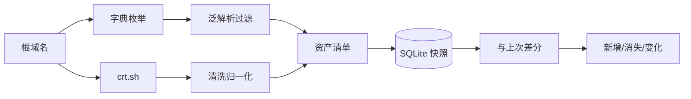

# Day 186 — 综合项目 I（一）：项目架构与子域名收集

> **阶段**：Phase 12 — 综合实战（Day 186–200）
> **项目**：企业资产监控系统 · 第 1/5 天
> **子主题**：资产测绘五层模型 · DNS 枚举 · 证书透明日志 · 泛解析过滤 · 快照差分
> **代码**：4 个标准库脚本，全部带 `--self-test`，离线可自证
> **环境**：Linux 7.0.0-34-generic / Python 3.12.3 / 零第三方依赖

---

## 今天在项目里的位置

前 185 天我们学了爬虫、安全、运维各自的工具。从今天起把它们**串成一个系统**：

```text
Day 186  资产发现（今天）      —— 我有哪些域名/IP？
Day 187  端口与服务指纹        —— 它们开了什么？
Day 188  Web 漏洞检测          —— 有什么问题？
Day 189  入库与趋势可视化      —— 怎么长期跟踪？
Day 190  调度、告警、部署      —— 怎么自动跑起来？
```

今天只做一件事，但要做扎实：**把一个根域名展开成一份可信的资产清单，并且能回答"比上次多了什么"。**



---

## 概念速览

完整定义、DNS 记录表、三条路线对比、合规边界见 **`concepts.md`**。

| 概念 | 一句话解释 | 为什么重要 |
|---|---|---|
| 资产测绘 | 把组织在互联网上的名字/地址整理成清单 | 不知道有什么，就谈不上保护 |
| 子域名枚举 | 用字典/CT/被动 DNS 找子域 | 暴露面最大的盲区 |
| 证书透明日志 | CA 必须公开签发的证书 | 不碰目标就能拿到历史主机名 |
| 泛解析 | `*.example.com` 让任何名字都能解析 | 不做过滤会得到成吨假资产 |
| 快照差分 | 两次扫描结果对比 | 安全价值在"变化"而非"清单" |

---

## 原理解释

### 1. 为什么"记录数"和"资产数"必须分开报

crt.sh 对 `python.org` 返回 **4,013 条证书记录**，清洗去重后只有 **74 个主机名**。
差额来自：同一主机多次续签、一张证书多个 SAN、通配符、根域、邮箱条目、大小写差异。

如果报告写"发现 4,013 个资产"，后果是：
- 管理层高估暴露面；
- 后续端口扫描把同一 IP 扫几千遍；
- 差分时噪音淹没真正的变化。

**结论**：采集量（records）与资产量（unique hosts）是两个指标，必须同时展示。

### 2. 为什么字典枚举必须并发

DNS 解析是 I/O 等待，不是 CPU 计算。串行 200 个候选 × 20ms ≈ 4 秒；
线程池 16 路可以压到 0.27 秒。线程在 `getaddrinfo` 等待时释放 GIL，
所以线程池有效，且比进程池轻量。

**但并发不是越大越好**：还要考虑本地 DNS 解析器限速、目标权威 DNS 限速、
文件描述符上限。生产环境应加令牌桶。

### 3. 为什么快照要"只增不改"

如果每次扫描覆盖 `assets` 表：
- 无法回答"这个 dev 域名是哪天出现的"；
- 无法回溯"上周的扫描结果"；
- 差分只能和"当前"比，历史丢失。

所以用 `snapshots + assets(snapshot_id, ...)` 的追加模型。
代价是存储增长，用定期归档解决，而不是覆盖。

### 4. 泛解析过滤的边界

本日实现用"IP 集合完全等于随机探测集合"判定假阳性。
它能干掉绝大多数噪音，但会误杀"真实子域恰好解析到泛解析 IP"的情况。
更稳妥的二次确认：
- HTTP 响应是否与随机域名一致；
- TLS 证书 SAN 是否包含该名字；
- 响应体是否包含统一错误页。

---

## API 速查

| 需求 | 写法 | 注意 |
|---|---|---|
| 解析主机（IPv4+IPv6） | `socket.getaddrinfo(host, None)` | 返回 `(family, type, proto, canonname, sockaddr)` |
| 取 IP | `info[4][0]` | IPv6 也在这里 |
| 全局超时 | `socket.setdefaulttimeout(3)` | 记得 finally 恢复 |
| 并发映射 | `ThreadPoolExecutor(max_workers=n).map(fn, items)` | 异常会在迭代时抛出 |
| 提交任务 | `pool.submit(fn, arg)` + `as_completed` | 可逐条处理结果 |
| HTTP 请求 | `urllib.request.Request(url, headers={...})` | 必须设 UA，否则易被拒 |
| JSON 读写 | `json.dump(..., ensure_ascii=False, indent=2)` | 中文可读 |
| SQLite 事务 | `with conn: conn.executemany(...)` | 批量插入快 10 倍以上 |
| 临时目录 | `tempfile.TemporaryDirectory()` | 自测不污染工作区 |

---

## 代码导览

| 文件 | 类型 | 核心内容 |
|---|---|---|
| `code/01-dns-enum-basic.py` | 基础 | 并发解析、IPv6、泛解析检测、`--self-test` |
| `code/02-crt-sh-advanced.py` | 进阶/避坑 | crt.sh 重试退避、名字清洗、后缀伪装过滤 |
| `code/03-asset-inventory.py` | 实战 | SQLite 快照、added/removed/changed 差分 |
| `code/04-benchmark-concurrency.py` | 性能 | 受控延迟实验 + 真实 DNS 实验（含缓存陷阱） |

每个脚本都可以先离线自证：

```bash
cd days/day-186-项目架构与子域名收集/code
for f in 0*.py; do python3 "$f" --self-test || exit 1; done
```

---

## 思考题

1. 如果目标同时有泛解析和真实子域，怎样在不误杀的前提下过滤？
2. 为什么 `getaddrinfo` 的结果必须去重排序？不排序会让差分出现什么假变化？
3. CT 日志里 4,013 条记录只得到 74 个名字，剩下的信息对安全分析还有价值吗？
4. 设计一个限速策略：既能在 10 分钟内覆盖 5 万词，又不触发解析器/目标限速。
5. "新增资产"里，哪些应该立即告警？哪些应该每天汇总？给出你的判定规则。
