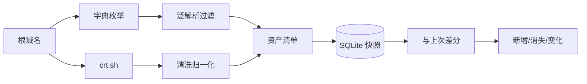

# Day 186 — 综合项目 I（一）：项目架构与子域名收集

> **阶段**：Phase 12 — 综合实战（Day 186–200）
> **项目**：企业资产监控系统 · 第 1/5 天
> **子主题**：资产测绘五层模型 · DNS 枚举 · 证书透明日志 · 泛解析过滤 · 快照差分
> **代码**：4 个标准库脚本，全部带 `--self-test`，离线可自证
> **环境**：Linux 7.0.0-34-generic / Python 3.12.3 / 零第三方依赖

---

## 今天在项目里的位置

前 185 天我们学了爬虫、安全、运维各自的工具。从今天起把它们**串成一个系统**：

```text
Day 186  资产发现（今天）      —— 我有哪些域名/IP？
Day 187  端口与服务指纹        —— 它们开了什么？
Day 188  Web 漏洞检测          —— 有什么问题？
Day 189  入库与趋势可视化      —— 怎么长期跟踪？
Day 190  调度、告警、部署      —— 怎么自动跑起来？
```

今天只做一件事，但要做扎实：**把一个根域名展开成一份可信的资产清单，并且能回答"比上次多了什么"。**



---

## 概念速览

完整定义、DNS 记录表、三条路线对比、合规边界见 **`concepts.md`**。

| 概念 | 一句话解释 | 为什么重要 |
|---|---|---|
| 资产测绘 | 把组织在互联网上的名字/地址整理成清单 | 不知道有什么，就谈不上保护 |
| 子域名枚举 | 用字典/CT/被动 DNS 找子域 | 暴露面最大的盲区 |
| 证书透明日志 | CA 必须公开签发的证书 | 不碰目标就能拿到历史主机名 |
| 泛解析 | `*.example.com` 让任何名字都能解析 | 不做过滤会得到成吨假资产 |
| 快照差分 | 两次扫描结果对比 | 安全价值在"变化"而非"清单" |

---

## 原理解释

### 1. 为什么"记录数"和"资产数"必须分开报

crt.sh 对 `python.org` 返回 **4,013 条证书记录**，清洗去重后只有 **74 个主机名**。
差额来自：同一主机多次续签、一张证书多个 SAN、通配符、根域、邮箱条目、大小写差异。

如果报告写"发现 4,013 个资产"，后果是：
- 管理层高估暴露面；
- 后续端口扫描把同一 IP 扫几千遍；
- 差分时噪音淹没真正的变化。

**结论**：采集量（records）与资产量（unique hosts）是两个指标，必须同时展示。

### 2. 为什么字典枚举必须并发

DNS 解析是 I/O 等待，不是 CPU 计算。串行 200 个候选 × 20ms ≈ 4 秒；
线程池 16 路可以压到 0.27 秒。线程在 `getaddrinfo` 等待时释放 GIL，
所以线程池有效，且比进程池轻量。

**但并发不是越大越好**：还要考虑本地 DNS 解析器限速、目标权威 DNS 限速、
文件描述符上限。生产环境应加令牌桶。

### 3. 为什么快照要"只增不改"

如果每次扫描覆盖 `assets` 表：
- 无法回答"这个 dev 域名是哪天出现的"；
- 无法回溯"上周的扫描结果"；
- 差分只能和"当前"比，历史丢失。

所以用 `snapshots + assets(snapshot_id, ...)` 的追加模型。
代价是存储增长，用定期归档解决，而不是覆盖。

### 4. 泛解析过滤的边界

本日实现用"IP 集合完全等于随机探测集合"判定假阳性。
它能干掉绝大多数噪音，但会误杀"真实子域恰好解析到泛解析 IP"的情况。
更稳妥的二次确认：
- HTTP 响应是否与随机域名一致；
- TLS 证书 SAN 是否包含该名字；
- 响应体是否包含统一错误页。

---

## API 速查

| 需求 | 写法 | 注意 |
|---|---|---|
| 解析主机（IPv4+IPv6） | `socket.getaddrinfo(host, None)` | 返回 `(family, type, proto, canonname, sockaddr)` |
| 取 IP | `info[4][0]` | IPv6 也在这里 |
| 全局超时 | `socket.setdefaulttimeout(3)` | 记得 finally 恢复 |
| 并发映射 | `ThreadPoolExecutor(max_workers=n).map(fn, items)` | 异常会在迭代时抛出 |
| 提交任务 | `pool.submit(fn, arg)` + `as_completed` | 可逐条处理结果 |
| HTTP 请求 | `urllib.request.Request(url, headers={...})` | 必须设 UA，否则易被拒 |
| JSON 读写 | `json.dump(..., ensure_ascii=False, indent=2)` | 中文可读 |
| SQLite 事务 | `with conn: conn.executemany(...)` | 批量插入快 10 倍以上 |
| 临时目录 | `tempfile.TemporaryDirectory()` | 自测不污染工作区 |

---

## 代码导览

| 文件 | 类型 | 核心内容 |
|---|---|---|
| `code/01-dns-enum-basic.py` | 基础 | 并发解析、IPv6、泛解析检测、`--self-test` |
| `code/02-crt-sh-advanced.py` | 进阶/避坑 | crt.sh 重试退避、名字清洗、后缀伪装过滤 |
| `code/03-asset-inventory.py` | 实战 | SQLite 快照、added/removed/changed 差分 |
| `code/04-benchmark-concurrency.py` | 性能 | 受控延迟实验 + 真实 DNS 实验（含缓存陷阱） |

每个脚本都可以先离线自证：

```bash
cd days/day-186-项目架构与子域名收集/code
for f in 0*.py; do python3 "$f" --self-test || exit 1; done
```

---

## 思考题

1. 如果目标同时有泛解析和真实子域，怎样在不误杀的前提下过滤？
2. 为什么 `getaddrinfo` 的结果必须去重排序？不排序会让差分出现什么假变化？
3. CT 日志里 4,013 条记录只得到 74 个名字，剩下的信息对安全分析还有价值吗？
4. 设计一个限速策略：既能在 10 分钟内覆盖 5 万词，又不触发解析器/目标限速。
5. "新增资产"里，哪些应该立即告警？哪些应该每天汇总？给出你的判定规则。

---

## 实战实验手册

> 所有命令都在 `~/code/Learn-Python/days/day-186-项目架构与子域名收集/code` 下执行。
> 实测环境：Linux 7.0.0-34-generic (x64) / Python 3.12.3 / 2026-10-18。
> 实验对象 `python.org` 是公开域名，仅做 DNS/CT 查询，不做端口与漏洞探测。

### 实验 1：真实子域名枚举（20 词字典）

**目的**：验证并发枚举、IPv6 收集、泛解析检测在真实 DNS 上的行为。

**准备**：无需外部服务，标准库即可。

**执行**：

```bash
python3 01-dns-enum-basic.py \
  --domain python.org \
  --words www,docs,api,mail,dev,blog,status,pypi,download,test,staging,git,cdn,static,m,app,wiki,monitor,grafana,admin \
  --workers 16 --json /tmp/day186-subs.json
```

**实际结果**（2026-10-18 真机 stdout，节选）：

```text
[*] 目标 python.org，候选 20 个，并发 16
  [+] www.python.org                           151.101.128.223, 151.101.192.223, 151.101.64.223, 2a04:4e42:200::223, 2a04:4e42:400::223, 2a04:4e42::223
  [+] docs.python.org                          151.101.128.223, 151.101.192.223, 151.101.64.223, 2a04:4e42:200::223, 2a04:4e42:400::223, 2a04:4e42:600::223
  [+] mail.python.org                          188.166.95.178, 2a03:b0c0:2:d0::71:1
  [+] pypi.python.org                          151.101.128.223, 151.101.192.223, 151.101.64.223, 2a04:4e42:200::223, 2a04:4e42:400::223, 2a04:4e42:600::223, 2a04:4e42::223
  [+] test.python.org                          151.101.0.223, 151.101.128.223, 151.101.192.223, 2a04:4e42:200::223, 2a04:4e42:400::223, 2a04:4e42:600::223
  [+] blog.python.org                          185.199.108.153, 185.199.109.153, 185.199.110.153, 185.199.111.153, 2606:50c0:8000::153, 2606:50c0:8001::153, 2606:50c0:8002::153, 2606:50c0:8003::153
  [+] wiki.python.org                          159.89.245.108, 167.99.21.118, 2604:a880:800:10::92a:1001, 2604:a880:800:10::f7d:7001
  [+] status.python.org                        3.165.102.30, 3.165.102.41, 3.165.102.53, 3.165.102.80
{
  "domain": "python.org",
  "candidates": 20,
  "found": 8,
  "errors": 0,
  "workers": 16,
  "wildcard_ips": [],
  "elapsed_sec": 2.17,
  "rate_per_sec": 9.2
}
```

**结论**：
- 20 个候选命中 8 个，命中率 40%；
- 0 个错误，说明解析器没有限速；
- `python.org` 没有泛解析（`wildcard_ips` 为空），所以 8 个结果都是真资产；
- `test.python.org` 能解析但不在后续 CT 结果里（见实验 2），说明**单一来源必漏**。

**清理**：`rm -f /tmp/day186-subs.json`

---

### 实验 2：crt.sh 证书透明日志（含 502 重试）

**目的**：验证被动收集、重试退避、名字清洗。

**准备**：可访问 `https://crt.sh`。首次用 `curl` 探测时返回 **502**，
说明接口确实不稳定，脚本的重试不是摆设。

**执行**：

```bash
python3 02-crt-sh-advanced.py --domain python.org --retries 2 --timeout 15 --out /tmp/day186-crt.json
```

**实际结果**（2026-10-18，节选前 12 行）：

```text
[*] 查询 crt.sh: python.org（可能较慢，最多重试 2 次）
[*] 收到 4013 条证书记录
[+] 去重后得到 74 个主机名
  - africa.python.org
  - analytics.python.org
  - api.wiki.python.org
  - blog-stage.python.org
  - blog.python.org
  - bugs.python.org
  - buildbot.python.org
  - calendario.es.python.org
  - chat.uk.python.org
  - cheeseshop.python.org
  - cla.python.org
  - clabot.python.org
```

**结论**：
- **4,013 条记录 → 74 个唯一主机名**，压缩比 54:1；
- 发现字典里没有的名字：`blog-stage`、`pycon-archives`、`devguide`、`speed` 等；
- 第一次外部探测 502，重试后成功 —— 生产环境必须把 CT 查询做成"可失败、可重跑"的步骤。

**清理**：`rm -f /tmp/day186-crt.json`

---

### 实验 3：资产快照与差分（本日翻车实验）

**目的**：验证 SQLite 快照模型，并暴露"跨来源直接差分"的错误。

**准备**：先生成两份输入（实验 1、2 的输出），再合并成同口径输入。

**执行**：

```bash
rm -f /tmp/day186-assets.db

# 快照 1：CT 结果（74 个名字，无 IP）
python3 03-asset-inventory.py --db /tmp/day186-assets.db \
  --input /tmp/day186-crt.json --label ct-pass

# 快照 2：DNS 结果（8 个有 IP）
python3 03-asset-inventory.py --db /tmp/day186-assets.db \
  --input /tmp/day186-subs.json --label dns-pass
```

**第一次实际结果**（错误示范）：

```text
[*] 已写入快照 #1 (ct-pass)，资产 74 条
[*] 还没有两次快照，无法差分（再跑一次就有了）
[*] 已写入快照 #2 (dns-pass)，资产 8 条
[*] 对比快照 #1 -> #2
新增 1 个：
  + test.python.org
消失 67 个：
  - africa.python.org
  - analytics.python.org
  ...（共 67 行）
IP 变化 7 个：
  ~ blog.python.org: [] -> ['185.199.108.153', ...]
  ...
```

**现象**：报告"67 个资产消失、7 个 IP 变化"。

**假设**：
1. python.org 真的下线了 67 个子域？—— 不可能，`docs.python.org` 刚刚还能访问。
2. 差分逻辑写错了？—— 自测覆盖了 added/removed/changed，逻辑正确。
3. 两次快照的**采集口径不同**？—— 这是最可疑的。

**验证**：看两份输入的大小与字段：
- `day186-crt.json`：74 个名字，`ips` 全为空（CT 只证明签过证书）；
- `day186-subs.json`：8 个主机，有 IP，但字典只有 20 个词。

**真实根因**：把"CT 发现的名字集合"和"DNS 字典枚举的解析结果"当成同一口径比较。
前者是**历史签名记录**，后者是**当前可解析子集**，两者本来就不该相等。
这不是程序 bug，是**指标口径 bug**。

**修复**：先把多来源合并成同一口径（名字 ∪ IP），再和历史同口径快照比：

```bash
python3 - <<'PY'
import json
ct = json.load(open('/tmp/day186-crt.json'))
dns = json.load(open('/tmp/day186-subs.json'))
merged = {n: [] for n in ct['names']}
for h, ips in dns['assets'].items():
    merged.setdefault(h, []).extend(ips)
json.dump({'assets': merged}, open('/tmp/day186-merged.json','w'), indent=2)
print('merged assets:', len(merged))
PY

python3 03-asset-inventory.py --db /tmp/day186-assets.db \
  --input /tmp/day186-merged.json --label merged-pass
```

**复测实际结果**：

```text
merged assets: 75
[*] 已写入快照 #3 (merged-pass)，资产 75 条
[*] 对比快照 #2 -> #3
新增 67 个：
  + africa.python.org
  ...
消失 0 个：
IP 变化 0 个：
[*] 数据库共有 3 个快照: /tmp/day186-assets.db
```

**结论**：
- 合并后 75 条 = 74 CT 名字 + 1 个仅 DNS 可见的 `test.python.org`；
- 74 + 8 = 82，去重后 75，说明 7 个 DNS 主机已在 CT 中出现；
- **差分必须先统一口径**，否则"消失 67 个"会触发一场不存在的应急。

**清理**：`rm -f /tmp/day186-assets.db /tmp/day186-merged.json`

---

### 实验 4：并发性能（含 DNS 缓存陷阱）

**目的**：量化线程池收益，并验证真实 DNS 测试会被缓存污染。

**执行**：

```bash
python3 04-benchmark-concurrency.py
```

**实际结果**（2026-10-18 真机）：

```text
=== A. 受控实验：200 个候选，单次解析固定 20ms ===
  workers=1   用时  4.065s  加速比  1.00x  命中 177
  workers=4   用时  1.024s  加速比  3.97x  命中 177
  workers=16  用时  0.268s  加速比 15.17x  命中 177
  workers=64  用时  0.098s  加速比 41.62x  命中 177

=== B. 真实 DNS：8 个域名 × 3 次 ===
  round 1: 串行 0.146s  并发(8) 0.007s
  round 2: 串行 0.002s  并发(8) 0.003s
  round 3: 串行 0.005s  并发(8) 0.006s
  中位数: 串行 0.005s  并发 0.006s  加速 0.90x
```

**结论**：
- 受控实验里，16 线程加速 **15.17x**，接近线性；64 线程 **41.62x**，
  说明等待型任务可以显著超采样。
- 真实 DNS 实验第一轮串行 0.146s vs 并发 0.007s（约 21x），
  但第二、三轮串行掉到 2~5ms —— **本地解析器缓存命中**，加速比变成 0.90x。
- **教训**：性能测试必须使用冷缓存（新随机域名）或直接对权威 DNS 发查询，
  否则测的是内存缓存，不是网络。这个坑在教材里很常见，本日实测复现。

**清理**：无残留（纯计算 + DNS 查询）。

---

## 收尾卫生

本日实验只产生 4 个临时文件，均已删除：

```bash
rm -f /tmp/day186-subs.json /tmp/day186-crt.json \
      /tmp/day186-merged.json /tmp/day186-assets.db
```

- 没有启动任何服务、容器或端口；
- 没有修改 `/etc/hosts`、DNS 配置；
- 没有对 `python.org` 做端口扫描或漏洞探测，只做了 DNS 与 CT 查询。

