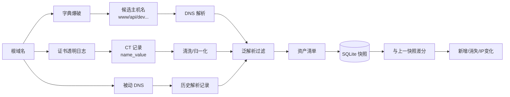

# Day 186 · 图解：资产测绘数据流

## 1. 五层资产模型

```text
┌─────────────┐     ┌─────────────┐     ┌─────────────┐
│  L1 根域名   │ ──▶ │  L2 子域名   │ ──▶ │   L3 IP     │
│ example.com │     │ api.xxx.com │     │ 192.0.2.10  │
└─────────────┘     └─────────────┘     └──────┬──────┘
                                               │
                    ┌─────────────┐     ┌──────▼──────┐
                    │  L5 漏洞     │ ◀── │ L4 端口/服务 │
                    │ SQLi / XSS  │     │ 443 / https │
                    └─────────────┘     └─────────────┘
```

每一层只依赖上一层：没有域名就没有子域名，没有 IP 就扫不了端口。
Pipeline 的输入输出必须落盘，才能重跑和差分。

## 2. 子域名收集三条路线



## 3. 泛解析为什么会骗人

```text
正常 DNS:
  www.example.com  ──▶ 192.0.2.10
  api.example.com  ──▶ 192.0.2.11
  nope.example.com ──▶ NXDOMAIN      ✅ 可以区分

泛解析:
  *.example.com    ──▶ 192.0.2.99
  www.example.com  ──▶ 192.0.2.10
  nope.example.com ──▶ 192.0.2.99    ❌ 看起来"存在"
  x7f2k9q1.example.com ──▶ 192.0.2.99
```

检测思路：先问 3 个随机名字，拿到泛解析 IP 集合；枚举时把
"IP 集合完全等于泛解析集合"的结果丢掉。

## 4. 快照差分的三种结果

```text
snapshot #1                snapshot #2
┌──────────────┐          ┌──────────────┐
│ www  → .10   │          │ www  → .10   │   不变
│ api  → .11   │          │ api  → .12   │   changed
│ old  → .13   │          │ new  → .14   │   removed: old
└──────────────┘          └──────────────┘   added: new
```

## 5. 本日真实数据流（python.org）

```text
字典 20 词 ──DNS──▶ 8 个可解析主机
crt.sh     ──HTTP─▶ 4,013 条证书 ──清洗──▶ 74 个主机名
                                     │
        合并（名字 ∪ IP）──────────────┘
                     │
                     ▼
              75 条资产快照
                     │
        与上一次同口径快照差分
                     ▼
           added / removed / changed
```

注意：74 + 8 = 82，但合并后只有 75，因为 7 个 DNS 主机在 CT 里已经出现。
这正是"去重"存在的意义。
