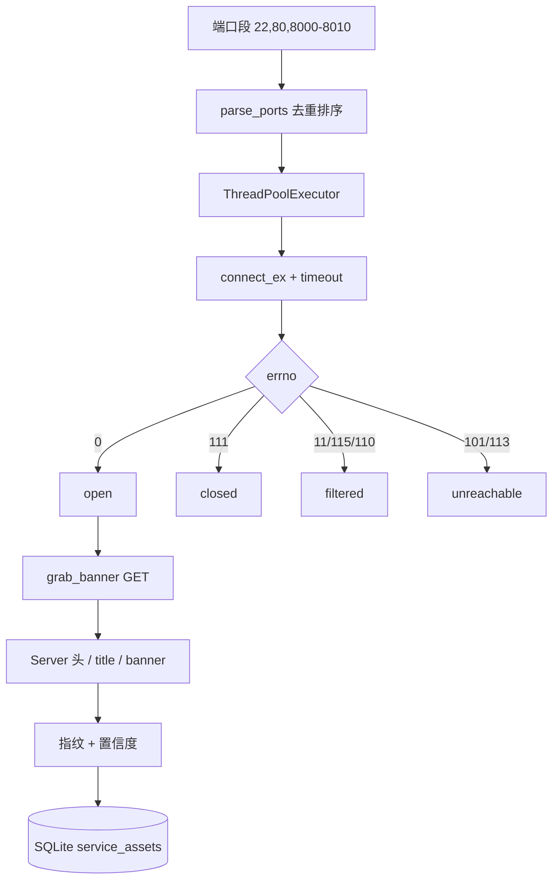

# Day 187 · 图解：端口扫描与指纹识别

## 1. 三种端口状态

```text
                 ┌──────────────┐
   SYN  ────────▶│    目标主机   │
                 └──────┬───────┘
                        │
        ┌───────────────┼────────────────┐
        ▼               ▼                ▼
   SYN+ACK           RST            无响应
   open             closed         filtered
   有进程监听       没有监听        防火墙 DROP
   ~0.1ms           ~0.02ms         = timeout
```

## 2. 扫描器内部流程



## 3. 指纹证据链

```text
┌────────────────────────────────────────────────┐
│ 1. 原始 banner（SSH/FTP/SMTP 主动发）           │  置信度 中
│    SSH-2.0-OpenSSH_9.6p1                        │
├────────────────────────────────────────────────┤
│ 2. HTTP 响应头                                  │  置信度 高
│    Server: nginx/1.24.0                         │
│    X-Powered-By: PHP/8.2                        │
├────────────────────────────────────────────────┤
│ 3. 页面内容                                     │  置信度 低
│    <title>Directory listing for /</title>       │
└────────────────────────────────────────────────┘
```

## 4. 为什么 filtered 决定扫描总耗时

```text
1000 个端口，timeout=1s，并发=100

情况 A：全 closed
  [########################] 约 0.1s

情况 B：20% filtered
  [####                    ] 第 1 批 100 个，其中 20 个等满 1s
  [####                    ] 第 2 批 ...
  ... 共 10 批 → 最坏 10s
```

并发只重叠等待，不消除单个端口的 timeout 下限。

## 5. 本日实测：18080 本地 HTTP 服务

```text
自研扫描器                       nmap -sT -Pn
┌──────────────────────┐        ┌──────────────────────┐
│ 18080 open           │        │ 18080 open           │
│  Python http.server  │        │  unknown             │
│  title: Directory... │        │                      │
│ 18022 closed         │        │ 18022 closed         │
└──────────────────────┘        └──────────────────────┘
        │                                │
        └──────── 判定一致 ──────────────┘
```

差异：自研脚本多做了 HTTP 指纹，所以知道"是什么"；nmap 只回答"开没开"。
