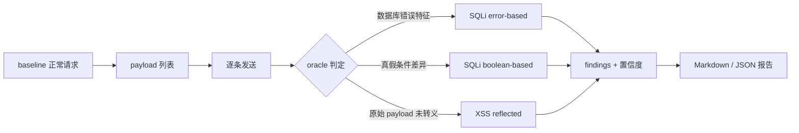

# Day 188 · 图解：SQLi 与 XSS 检测流程

## 1. 扫描器三段式



## 2. SQLi：数据变成代码

```text
正常:
  SELECT id,name,price FROM products WHERE id = 1
                                              ↑ 数据

注入 1':
  SELECT id,name,price FROM products WHERE id = 1'
                                                 ↑ 引号提前闭合
  → unrecognized token: "'"
  → 500 + "SQL error: ..."        ← 检测信号
```

参数化:
```text
  SQL 模板: SELECT ... WHERE id = ?
  参数:     ["1'"]
  数据库把 "1'" 当纯数据 → 不会报错
```

## 3. XSS：转义只改变表示

```text
输入 payload:
  <svg/onload=alert('LPX123')>

/search（漏洞）响应:
  <p>Results for: <svg/onload=alert('LPX123')></p>
                   └──────── 原始 payload 存在 ────────┘
  → 浏览器执行 → 真阳性

/safe-search（修复）响应:
  <p>Results for: &lt;svg/onload=alert('LPX123')&gt;</p>
                   └─ 文本仍是 alert，但 < 已转义 ─┘
  → 不执行 → 若按关键字判定就是假阳性
```

## 4. 误报演练结果

```text
endpoint           naive  precise  has_alert   raw  escaped
/search             True     True       True  True    False
/safe-search        True    False       True  False    True
                    ↑        ↑
                 误报      正确

naive:   2 命中 / 1 假阳性
precise: 1 命中 / 0 假阳性
```

## 5. 本日真实扫描结果

```text
severity: critical
findings: 6
  ├─ SQLi error-based    × 4   (payload: 1' / 1" / 1) / 1'--)
  ├─ SQLi boolean-based  × 1   (1 AND 1=1 vs 1 AND 1=2)
  └─ XSS reflected       × 1   (/search, LPX 标记)
```

6 条 finding 里 5 条来自同一个 SQLi 根因（4 个 payload + 1 个布尔验证）。
报告要能合并同类项，否则"发现 6 个漏洞"会夸大风险。
