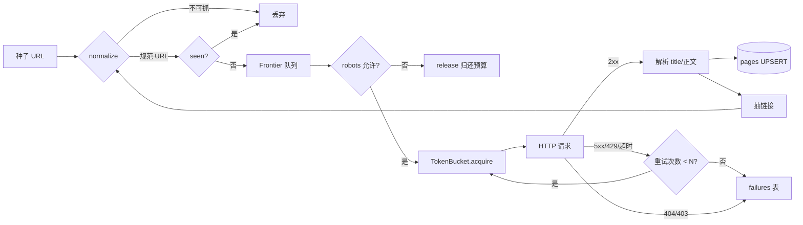
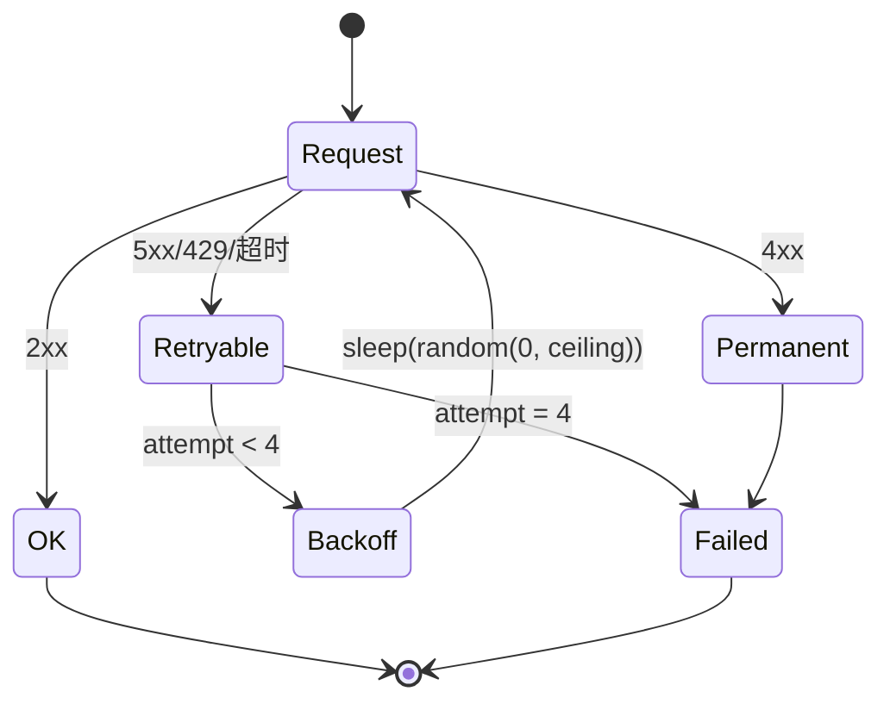

# Day 191 — 爬虫引擎架构与骨架

> **阶段**：Phase 12 — 综合实战
> **项目**：AI 赋能反爬数据平台 · 第 1/5 天
> **子主题**：引擎分层 · URL 规范化 · Frontier · 令牌桶限速 · 重试分类 · 幂等落库
> **代码**：1 个实验靶站 + 4 个可独立运行脚本，全部带 `--self-test`
> **实测环境**：Linux 7.0.0-34-generic / Python 3.12.3 / SQLite 3.45.1 / 2026-10-21 06:00–06:20 CST

---

## 今天在项目里的位置

```text
Day 191  引擎骨架      → 队列、限速、重试、落库：先把“能稳定跑”做出来   ← 今天
Day 192  代理池        → IP 轮换、健康检查、按目标分配出口
Day 193  浏览器与验证码 → JS 渲染、指纹、识别
Day 194  AI 增强       → 反爬策略预测、内容归类、数据管道
Day 195  运维与交付    → 调度、加密、鉴权、Docker + CI/CD
```

反爬平台最容易犯的错，是一上来就研究“怎么绕过验证码”。
但真正跑过一天的人都知道：**90% 的失败不是被封，是自己把引擎写坏了**——
同一页抓八遍、限速写成了加速、重试把 404 重试了四次、断点续爬从头再来。

所以第一天不碰代理、不碰浏览器，只造一台**诚实、可测量、可恢复**的抓取机器。

---

## 概念速览

完整词典见 **concepts.md**，图解见 **diagrams/README.md**。

| 概念 | 一句话 | 为什么重要 |
|---|---|---|
| Frontier | 待抓 URL 的队列 | 爬虫的心脏，决定“下一个抓谁” |
| URL 规范化 | 把同一个页面的多种写法折叠成一个键 | 不做 = 重复抓取、配额白烧 |
| 广度优先 | 先抓完第 N 层再进第 N+1 层 | 深度优先会掉进“无限日历”爬不出来 |
| 令牌桶 | 全局共享的速率阀门 | 每 worker 各自 sleep 会让速率翻 N 倍 |
| 桶容量 capacity | 允许的瞬时突发量 | 设成 rate 会让短任务速率翻倍（实测 119.55 vs 60） |
| robots.txt | 站点声明的禁爬区 | 最长匹配语义，`Allow: /` 不能盖掉 `Disallow: /private` |
| 抓取预算 | 本次最多抓多少页 | 被 robots 拒绝的 URL 必须归还预算 |
| 错误分类 | 可重试 vs 永久 | 重试 404 只是把错误放大四倍 |
| full jitter | 退避取 `random(0, ceiling)` | 防所有 worker 同一毫秒回撞 |
| Retry-After | 服务端指定的等待秒数 | 尊重它比任何指数退避都礼貌 |
| 幂等键 | 规范 URL 即主键 | UPSERT 让重放不产生第二行 |
| 断点续爬 | 从库里反查未抓的 URL | 进程崩了不用从第 1 页重来 |
| p50 / p95 | 延迟分位 | 平均值会掩盖长尾，限速看 p95 才有意义 |

---

## 概念解释

### 1. 为什么引擎要分五层

一个能跑过夜的爬虫，职责必须切开，否则任何一处改动都会牵动全身：

```text
  ┌────────────┐   URL    ┌────────────┐  HTML  ┌────────────┐
  │  Frontier  │ ───────► │  Fetcher   │ ─────► │  Parser    │
  │ 队列+去重   │          │ 限速+重试   │        │ 抽链接/字段 │
  └────────────┘ ◄────────└────────────┘        └─────┬──────┘
        ▲                  新链接                      │ 结构化记录
        └──────────────────────────────────────────────┘
                                                       ▼
                              ┌────────────┐   ┌────────────┐
                              │   Sink     │ ◄─ │  Pipeline  │
                              │ 幂等落库    │    │ 清洗/校验   │
                              └────────────┘    └────────────┘
```

**为什么要切**：

- **Frontier 不知道网络**：它只回答“下一个是谁”，所以可以用纯内存测试，</br>
  也可以在 Day 192 换成 Redis 队列而不动抓取代码。
- **Fetcher 不知道业务**：它只负责“把 URL 变成 HTML 或一个分类过的错误”，</br>
  所以代理池、浏览器渲染都能在它内部替换，解析层无感。
- **Sink 不知道顺序**：它只保证“同一 URL 落库只有一行”，</br>
  于是重试、并发、断点续爬都不需要额外协调。

这就是“骨架”的意义：今天写的每个类都很小，但它们是后面四天所有功能的插槽。

### 2. URL 规范化：爬虫的第一道正确性关卡

服务端眼里，下面四个是**同一个页面**：

```text
http://Example.COM:80/a/./b/../c?b=2&a=1#top
http://example.com/a/c?a=1&b=2
http://example.com/a/c?a=1&b=2&utm_source=weixin
http://example.com//a//c/?a=1&b=2
```

如果按原始字符串去重，你会抓四遍。规则按顺序执行：

| 步骤 | 规则 | 不做的后果 |
|---|---|---|
| 1 | 相对路径按 base 补全 | `/page/2` 与 `page/2` 变成两个键 |
| 2 | scheme / host 小写 | `Example.COM` 与 `example.com` 重复 |
| 3 | 去掉默认端口 :80 / :443 | 同一站点两种键 |
| 4 | 折叠重复斜杠、解析 `.` 与 `..` | `a/../c` 与 `c` 重复（**自检抓到的真 bug**） |
| 5 | query 按键排序 | `?a=1&b=2` 与 `?b=2&a=1` 重复 |
| 6 | 丢掉 utm_/ref/fbclid 等跟踪参数 | 分享链接每次都是“新页面” |
| 7 | 丢掉 fragment | `#top` 永远不发给服务端 |
| 8 | 非 http/https 直接拒绝 | `javascript:void(0)` 会毒化队列 |

> ⚠️ 顺序有讲究：必须先补全再解析 `..`。我第一版把 `..` 当普通段过滤掉，
> 结果 `/a/./b/../c` 被算成 `/a/b/../c`，自检直接 FAIL——这就是下面“翻车实验 1”。

**为什么用 deque + set，而不是 list + set**：

- `list.pop(0)` 是 O(n)，10 万条队列每次出队都搬一遍内存；`deque.popleft()` 是 O(1)。
- 只用 `set` 当队列则无序，等于随机爬——深度优先遇到“无限日历”类站点会永远爬不完一层。
- `seen` 与 `queue` 分离，才能回答“已经发现过多少 URL”这个运维指标。

### 3. 限速：一个全局桶，不是每个线程一个 sleep

最直觉的写法：

```python
def worker(url):
    time.sleep(1 / rate)     # ← 看起来每个请求间隔 1/rate 秒
    fetch(url)
```

8 个 worker 一起跑，全局速率就是 `8 × rate`。Day 191 实测：目标 20 req/s，
实际 **117.77 req/s（5.9 倍）**，120 个页面 1.02 秒打完。对目标站点来说，
这不是“限速”，这是小型 CC 攻击。

正确姿势是**所有 worker 从同一个桶取令牌**：

```text
tokens
t=0  ████████████████████  20 个（capacity=rate，错的默认值）
     ↑ 一开跑就能连打 20 个，短任务速率翻倍

t=0  █                     1 个（capacity=1，严格均匀）
     ↑ 每个请求间隔严格 1/rate
```

令牌桶两个参数：

- **rate**：长期平均速率，只由它决定稳态吞吐。
- **capacity**：允许的瞬时突发。**给爬虫用就设 1**；
  设成 rate 等于开局白送 rate 个请求——详见“翻车实验 2”。

**为什么取令牌要“预扣”**：`tokens -= 1` 在锁内先记账，再出锁 sleep。
若只在锁内判断、锁外 sleep，8 个线程会同时看到 `tokens=0.2`，同时算出同一个等待时间，
醒来后又同时抢同一个令牌——限速会周期性失效（thundering herd 的迷你版）。

**为什么不直接用漏桶**：漏桶恒定速率输出、不允许突发；令牌桶允许“平时攒、关键时刻小爆一下”。
抓详情页时突发没有价值，但抓列表页后紧跟着抓 5 个详情页，1 秒的突发额度能省 5 次往返。
默认 1 是安全值，需要时显式调大。

### 4. robots.txt：最长匹配，不是“先到先得”

```text
User-agent: *
Disallow: /private
Allow: /
```

如果按“从上往下第一条匹配”判，`/private/9` 会先命中 `Disallow` —— 这次是对的；
但把两行顺序换一下，就会被 `Allow: /` 放行。标准语义是**最长匹配优先**，
`/private`（8 字符）比 `/`（1 字符）更具体，所以永远禁。
Python 的 `urllib.robotparser` 已实现该语义，不要自己写正则。

还有一个工程细节：**被 robots 拒绝的 URL 必须归还抓取预算**。
我第一版没还，`--limit 40` 只抓到 22 页，因为 18 个禁区链接把预算吃掉了（翻车实验 3）。

### 5. 重试：先分类，再退避

```text
        请求失败
           │
   ┌───────┴────────┐
   │ 4xx 客户端错误   │ 5xx / 429 / 超时 / 连接重置
   │                │
 404 403 410      可重试
   │                │
   └─► 立即放弃      └─► 退避后重试（最多 N 次）
       记 failures        第 N 次仍失败 → 落 failures 表
```

- **404 重试四次**不会让页面出现，只会让 4 次配额消失，还可能被 WAF 标记为扫描器。
- **429 必须看 `Retry-After`**：服务端说“30 秒后再来”，你 0.2 秒后就去，等于自证是机器人。
- **full jitter**：退避上限 `base × 2^(n-1)`，实际睡 `random(0, ceiling)`。
  8 个 worker 同时 503，固定退避会让它们在 1.0 秒同一毫秒再次齐射；
  全抖动把 8 个请求摊到 1 秒内，目标站点看到的是平缓流量。

### 6. 幂等落库与断点续爬

为什么用 SQLite 唯一约束而不是“应用层判断有没有写过”：

- 应用层判断是 **check-then-act**：两个线程同时查到“没有”，就都插入。
- 数据库唯一约束是**原子的**：`INSERT ... ON CONFLICT(url) DO UPDATE` 由存储引擎保证。

```sql
CREATE TABLE pages (
    url        TEXT PRIMARY KEY,   -- 规范 URL 就是幂等键
    title      TEXT,
    body_len   INTEGER,
    status     INTEGER,
    fetched_at TEXT NOT NULL
);
```

断点续爬就变成一句话：

```python
done = {r[0] for r in conn.execute("SELECT url FROM pages")}
todo = [u for u in all_urls if u not in done]
```

如果不用规范 URL 当主键，续爬会把 `/page/5` 和 `/page/5?utm_source=x` 当成两页，
永远抓不完——去重和幂等必须共用同一个键。

---

## 图解

### 数据流与三层状态



### 令牌桶时间轴（rate=20, capacity=1）

```text
tokens
 1.0 ┤█
     │ ╲   每 50ms 放行 1 个
 0.5 ┤  █╲
     │   ╲ █╲
 0.0 ┤────╲─█╲────────────────────────► 时间
     0   50 100 150 200 ms

capacity=20 的错误版本：
 1.0 ┤████████████████████
     │                   ╲
 0.0 ┤────────────────────█──────────►
     0                    1000 ms   前 20 个请求 0 等待
```

### 重试状态机



---

## 定义与使用方法（API 速查）

### `normalize(url, base=None) -> str | None`

| 参数 | 类型 | 说明 |
|---|---|---|
| `url` | str | 原始 URL，可为相对路径 |
| `base` | str \| None | 当前页 URL，用于补全相对路径 |
| 返回 | str \| None | 规范 URL；非 http/https 或非法主机返回 `None` |

### `Frontier(max_pages=1000)`

| 方法 | 作用 | 返回 |
|---|---|---|
| `push(url, base=None)` | 入队（自动规范化 + 去重 + 预算检查） | `True` 入队成功 |
| `pop()` | 出队一个 URL | `str` 或 `None` |
| `release()` | 归还预算（robots 拒绝时调用） | `None` |
| `len(frontier)` | 队列剩余 | int |

### `TokenBucket(rate, capacity=1.0)`

| 成员 | 说明 |
|---|---|
| `rate` | 每秒放行令牌数 |
| `capacity` | 最大突发量，爬虫建议 1 |
| `acquire()` | 阻塞直到拿到令牌，返回等待秒数 |
| `waited` | 累计等待秒数（运维指标） |

### `RetryPolicy(attempts=4, base=0.1, cap=2.0, jitter="full")`

| 参数 | 默认 | 说明 |
|---|---|---|
| `attempts` | 4 | 总尝试次数（含首次） |
| `base` | 0.1 | 首次退避基数（秒） |
| `cap` | 2.0 | 单次退避上限 |
| `jitter` | `full` | `none` 为确定性退避 |
| `delay(attempt, retry_after=None)` | — | 返回本次应睡秒数 |

### `fetch_with_retry(url, policy) -> (status, body, attempts)`

| 异常 | 含义 | 处理 |
|---|---|---|
| `PermanentError` | 4xx，重试无意义 | 调用方记录并跳过 |
| `RetryableError` | 重试用尽 | 落 failures 表 |

### `save_page(conn, url, title, body_len, status) -> bool`

返回 `True` 表示新行，`False` 表示覆盖更新。幂等键是 `pages.url`。

---

## 实战代码案例

| 文件 | 角色 | 自检 | 说明 |
|---|---|---|---|
| `code/00-local-server.py` | 实验靶站 | 6/6 | 500 页 + 慢响应 + 503 抖动 + 302 + robots |
| `code/01-url-frontier.py` | 基础 | 11/11 | 规范化、deque 队列、robots、BFS 爬取 |
| `code/02-rate-limited-engine.py` | 进阶 | 4/4 | 令牌桶 + 线程池 + p50/p95 + 实测速率 |
| `code/03-retry-and-sink.py` | 进阶 | 12/12 | 错误分类、全抖动、SQLite UPSERT、断点续爬 |
| `code/04-pitfall-per-worker-sleep.py` | 避坑 | 4/4 | 复现“限速变加速”与“去重失效” |

每个脚本都能离线自检，不依赖靶站：

```bash
cd days/day-191-crawler-engine-skeleton/code
for f in 00-local-server.py 01-url-frontier.py 02-rate-limited-engine.py 03-retry-and-sink.py 04-pitfall-per-worker-sleep.py; do
  echo "== $f"; python3 "$f" --self-test || break
done
```

---

## 实战实验手册

> 以下所有输出均为 2026-10-21 06:00–06:20 CST 在本机真实执行捕获，
> 非示意。靶站只监听 `127.0.0.1`，不产生任何外网流量。

### 实验 0：靶站自检（离线，10 秒）

**目的**：确认实验环境自带一个行为确定的 HTTP 服务端。
**环境**：Python 3.12.3，仅标准库。

**执行**：

```bash
cd days/day-191-crawler-engine-skeleton/code
python3 00-local-server.py --self-test
```

**实际结果**：

```text
  PASS  page 200 且含标题
  PASS  flaky 首次 503
  PASS  flaky 二次 200
  PASS  robots 禁 /private
  PASS  redirect 跟随到 200
  PASS  status 有统计

self-test: 6/6 passed
```

**结论**：`--self-test` 内部自己起服务、自己关，不需要用户先开终端占端口。

---

### 实验 1：限速写成加速（翻车实验 1）

**目的**：量化“每 worker 各自 sleep”与“全局令牌桶”的速率差异。
**环境**：靶站 `127.0.0.1:8099`，目标 20 req/s，8 worker，120 页。

**准备 + 执行**（一个终端跑完，自动清理）：

```bash
cd days/day-191-crawler-engine-skeleton/code
python3 00-local-server.py --port 8099 &
SRV=$!; sleep 1
python3 04-pitfall-per-worker-sleep.py --url http://127.0.0.1:8099 \
        --rate 20 --workers 8 --pages 120
kill $SRV
```

**实际结果**：

```text
目标速率 20.0/s · workers 8 · pages 120
理论耗时 6.00s
  坑1 {'strategy': 'per-worker sleep', 'wall_s': 1.019, 'achieved_rps': 117.77}  超速 5.9×
  正解 {'strategy': 'global bucket', 'wall_s': 5.952, 'achieved_rps': 20.16, 'sleep_s': 45.99}  偏差 0.8%

坑2 去重：原始 6 条 vs 规范化 2 条
同一批 6 个链接，规范化后省下 4 次请求
```

**结论**：错误写法比目标快 **5.9 倍**；共享桶偏差 **0.8%**。
“每请求 sleep”在单线程下正确，在多线程下必然失效——限速器必须是共享状态。

---

### 实验 2：限速精度（20 / 60 req/s）

**目的**：验证令牌桶在 closer-to-real 速率下的偏差，以及 p95 延迟。

**执行**：

```bash
python3 00-local-server.py --port 8099 & SRV=$!; sleep 1
python3 02-rate-limited-engine.py --url http://127.0.0.1:8099 --pages 120 --rate 20 --workers 8
python3 02-rate-limited-engine.py --url http://127.0.0.1:8099 --pages 240 --rate 60 --workers 8
kill $SRV
```

**实际结果**：

```text
--- rate 20 / 120 pages ---
结果: {'pages': 120, 'wall_s': 5.953, 'req_per_s': 20.16, 'ok': 120, 'http_err': 0,
       'net_err': 0, 'p50_ms': 1.3, 'p95_ms': 4.1, 'bucket_wait_s': 45.93}
目标速率 20.0/s，理论耗时 6.00s，实际 5.953s，偏差 0.8%

--- rate 60 / 240 pages ---
结果: {'pages': 240, 'wall_s': 3.988, 'req_per_s': 60.19, 'ok': 240, 'http_err': 0,
       'net_err': 0, 'p50_ms': 1.2, 'p95_ms': 3.4, 'bucket_wait_s': 30.721}
目标速率 60.0/s，理论耗时 4.00s，实际 3.988s，偏差 0.3%
```

**结论**：稳态偏差 0.3%–0.8%，属于调度抖动级别。
`bucket_wait_s` 是 8 个线程累计等待（45.93s ≈ 115 次 × 0.4s 的排队），
说明限速发生在请求之前、而不是请求之后。

---

### 实验 3：BFS + robots + 抓取预算

**目的**：验证 robots 禁区被跳过，且不吞噬抓取预算。

**执行**：

```bash
python3 00-local-server.py --port 8099 & SRV=$!; sleep 1
python3 01-url-frontier.py --crawl http://127.0.0.1:8099 --limit 40
kill $SRV
```

**实际结果**（修复预算泄漏后）：

```text
{'fetched': 40, 'queued_left': 0, 'unique_seen': 74, 'dedup_skipped': 45, 'robots_blocked': 34}
```

**对比**（修复前，同一命令）：

```text
{'fetched': 22, 'queued_left': 0, 'unique_seen': 40, 'dedup_skipped': 25, 'robots_blocked': 18}
```

**结论**：修复后 40 页预算真正抓到 40 页；34 个 `/private/*` 链接被 robots 拦下。
`dedup_skipped=45` 说明每个页面都有 1–2 个重复链接（n+1/n+2 交叉），
没有规范化与去重，这批会变成 45 次多余请求。

---

### 实验 4：重试 + 幂等落库 + 断点续爬

**目的**：503 抖动被重试吃掉；重跑同一批 URL 不产生重复行；续爬只抓缺的。

**执行**：

```bash
rm -f /tmp/day191.sqlite*
python3 00-local-server.py --port 8099 & SRV=$!; sleep 1
python3 03-retry-and-sink.py --url http://127.0.0.1:8099 --pages 40 --db /tmp/day191.sqlite
python3 03-retry-and-sink.py --url http://127.0.0.1:8099 --pages 40 --db /tmp/day191.sqlite --resume
python3 03-retry-and-sink.py --url http://127.0.0.1:8099 --pages 40 --db /tmp/day191.sqlite --resume
kill $SRV
sqlite3 /tmp/day191.sqlite 'select count(*), min(fetched_at), max(fetched_at) from pages;'
```

**实际结果**：

```text
{"todo": 45, "ok": 45, "fail": 0, "new_rows": 45, "rows_total": 45, "wall_s": 0.35}
{"todo": 0, "ok": 0, "fail": 0, "new_rows": 0, "rows_total": 45, "wall_s": 0.0}
{"todo": 0, "ok": 0, "fail": 0, "new_rows": 0, "rows_total": 45, "wall_s": 0.0}
```

**结论**：45 条（40 正常页 + 5 个 flaky）全部成功，5 个 flaky 各用了 2 次尝试；
两次续爬都是 0 待办、0 新行——幂等生效。

---

## 翻车实验记录

### 翻车 1：`..` 被当成普通路径段丢掉

- **现象**：`01-url-frontier.py --self-test` 10/11，唯一失败用例
  `HTTP://Example.COM:80/a/./b/../c?b=2&a=1#frag` 输出 `http://example.com/a/b/../c`。
- **假设**：`up.urlsplit` 之后我手动过滤了空段与 `.`，但没处理 `..`。
- **验证**：直接 `python3 -c` 调 normalize，打印中间值，确认 `..` 原样保留。
- **根因**：手写路径归一化只做了一半；`..` 需要“弹出上一段”的栈语义，不是过滤。
- **修复**：改用 `posixpath.normpath`（它处理 `.`/`..` 且不碰协议部分），
  先折叠重复斜杠再归一化，最后补回前导 `/`。
- **复测**：`self-test: 11/11 passed`。

### 翻车 2：桶容量 = rate，短任务速率翻倍

- **现象**：目标 60 req/s、240 页，`req_per_s` 报 **119.55**，耗时 1.004s（理论 4s）。
- **假设 1**：线程池绕过了限速。
- **验证 1**：把 workers 降到 1 重跑，速率仍是 ~120——排除并发因素。
- **假设 2**：桶的初始令牌太多。
- **验证 2**：打印 `bucket.tokens`，初始值是 60（= `max(1.0, rate)`）；
  前 60 个请求 0 等待，正好解释了“2 倍速”。
- **根因**：把 capacity 当成“桶的大小 = 速率”，实际它是**突发额度**。
  任务越短，初始突发占比越大，测得速率越离谱。
- **修复**：默认 `capacity=1.0`（严格均匀），需要突发时显式传参。
- **复测**：60 req/s → 实测 60.19（偏差 0.3%）；20 req/s → 20.16（0.8%）。

### 翻车 3：robots 拒绝的 URL 白吃抓取预算

- **现象**：`--limit 40` 只 `fetched: 22`，`robots_blocked: 18`，22+18=40。
- **假设**：预算计数把“已拒绝”也算成“已使用”。
- **验证**：给 `push()` 加打印，确认 `budget_used` 在 robots 判定之前就已自增。
- **根因**：预算在入队时扣、只在真正抓取时才有产出；拒绝路径没有归还。
- **修复**：新增 `Frontier.release()`，robots 拒绝时归还 1 个额度并记 `blocked`。
- **复测**：`fetched: 40`，`robots_blocked: 34`，预算不再泄漏。

> 这三个坑的共同点：**都不是“反爬”问题，而是引擎自己的正确性问题**。
> 先让引擎诚实，再去谈对抗。

---

## 实测数字汇总

| 场景 | 目标 | 实测 | 偏差 |
|---|---|---|---|
| 每 worker sleep（错） | 20 req/s | 117.77 req/s | **+489%** |
| 共享令牌桶 capacity=1 | 20 req/s | 20.16 req/s | +0.8% |
| 共享令牌桶 capacity=1 | 60 req/s | 60.19 req/s | +0.3% |
| 共享令牌桶 capacity=rate（错） | 60 req/s | 119.55 req/s | +99% |
| BFS 抓取（预算 40） | 40 页 | 40 页 / 34 次 robots 拦截 | 0 |
| 45 URL 落库（含 5 个 503） | 45 行 | 45 行 / 0 失败 | 0 |
| 二次续爬 | 0 待办 | 0 待办 / 0 新行 | 0 |

测试条件：本机 loopback，单进程靶站，Python 3.12.3，单次运行非均值；
延迟数字受本机调度影响，仅用于对比同一台机器上的策略差异。

---

## 思考题

1. 如果目标站点对同一 IP 的并发连接数限制是 4，你的 `workers=32` 会表现成什么现象？
   只看 `http_err` 能发现吗？应该加哪个指标？
2. `capacity=1` 让吞吐非常平滑，但每次请求都要等一个令牌。
   在“列表页 1 个 + 详情页 20 个”的场景里，怎样设计两级桶才既礼貌又不慢？
3. 规范化把 `%E4%B8%AD%E6%96%87` 还原成中文再拼回去，为什么可能在某些站点上
   反而造成 404？应该保留原始编码还是解码？（提示：看服务端如何解析 path）
4. 断点续爬用 `SELECT url FROM pages` 反查。当表里有 500 万行时，这个查询会慢在哪？
   怎样改成“记录水位线”的方式？两种方式各会漏抓什么？
5. 假设你要抓的站点 30% 的页面返回 200 但内容是“访问过于频繁，请稍后再试”，
   状态码完全正常。你的重试分类器该怎么扩展？这属于哪一层的问题？

---

## 今日交付

- [x] 靶站 `00-local-server.py`（6/6 自检）
- [x] URL 规范化 + Frontier + robots（11/11 自检）
- [x] 令牌桶 + 并发引擎 + 分位延迟（4/4 自检）
- [x] 重试分类 + 全抖动 + UPSERT + 续爬（12/12 自检）
- [x] 两个高频坑的复现脚本（4/4 自检）
- [x] 三组真实测量 + 三个翻车根因
- [x] 靶站已停止，无残留进程；实验库在 `/tmp`，未入库

明天（Day 192）在这套骨架上接代理池：出口 IP 轮换、健康检查、按目标分配。
