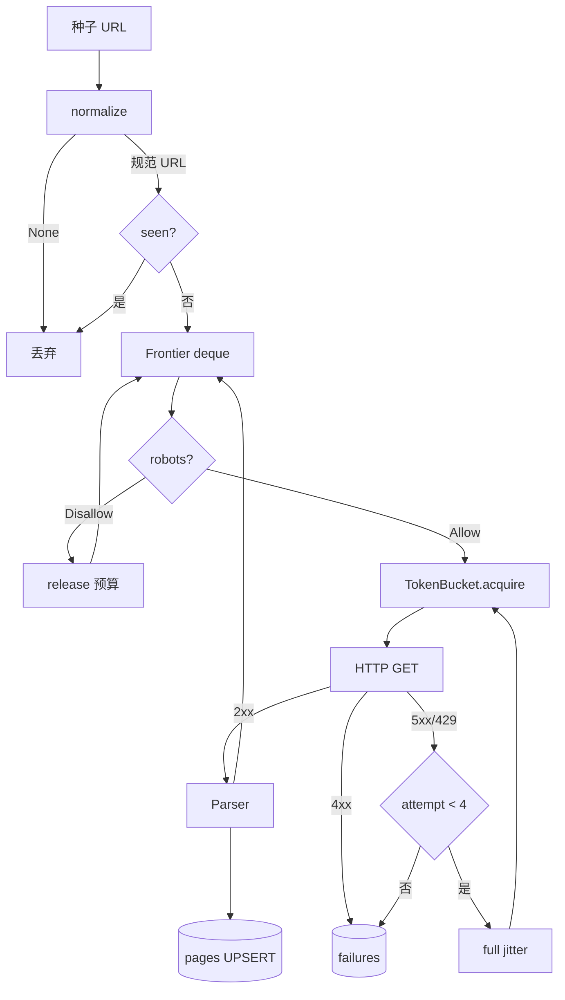
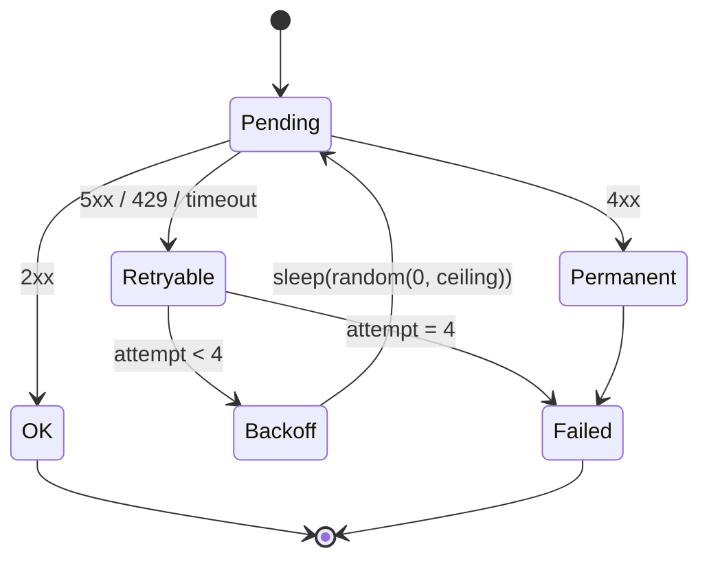

# Day 191 · 图解

## 1. 引擎数据流



## 2. 令牌桶：正确 vs 错误

```text
正确：capacity=1，全局共享
worker1 ─┐
worker2 ─┼─► [tokens] ─► 放行间隔 1/rate
workerN ─┘     ▲
               └── 锁内预扣，锁外 sleep

实测 rate=20：20.16 req/s（+0.8%）
```

```text
错误：每 worker 一个 sleep
worker1 ── sleep(1/rate) ──► fetch
worker2 ── sleep(1/rate) ──► fetch   ← 并行，互不约束
workerN ── sleep(1/rate) ──► fetch

实测 rate=20, 8 worker：117.77 req/s（+489%）
```

## 3. 桶容量对短任务的影响

```text
capacity = rate (错)          capacity = 1 (对)

 60 ┤██████                    1 ┤█
    │      ╲                      │ ╲
  0 ┤       ██████             0 ┤  █ █ █ █ ──►
    0s      1s   2s              0s  1s  2s

120 页 @60/s：1.004s（119.55 rps）   120 页 @60/s：1.988s（60.4 rps）
```

## 4. 重试状态机



## 5. 断点续爬

```text
全量 URL 集合 A = {1,2,3,...,45}
已落库集合 B = SELECT url FROM pages
待抓 = A - B

第一次运行：|A|=45, |B|=0  → todo=45, new_rows=45
第二次运行：|A|=45, |B|=45 → todo=0
```

## 6. 分层与后续插槽

```text
            Day 191（今天）        Day 192–195
Frontier    deque + seen      →  Redis 队列 / 优先级
Fetcher     urllib + 桶       →  代理池 / 浏览器渲染
Parser      href + title      →  JS 解析 / NLP 归类
Pipeline    title/len         →  清洗 / 结构化
Sink        SQLite UPSERT     →  Postgres / ES
```
