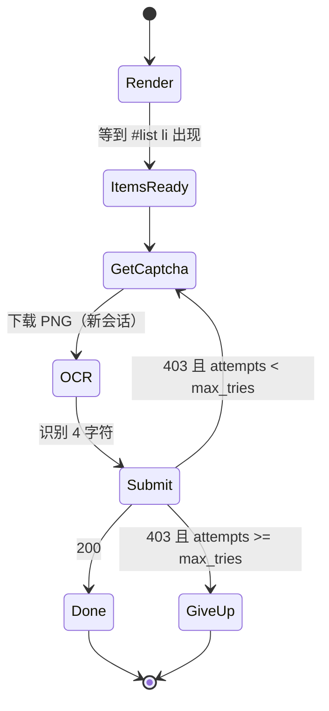

# Day 193 图解 — 浏览器渲染与验证码识别

> 所有图都可用 Mermaid Live Editor 渲染；ASCII 图在终端里可直接看。

---

## 1. 同一条 URL 的两种命运：静态抓取 vs 浏览器渲染

```text
                      服务器返回的原始 HTML（4257 字节）
                      ┌──────────────────────────────┐
  urllib / requests → │ <ul id="list"><!-- 空 --></ul>│ → 0 条商品
                      │ <p>booting…</p>               │
                      └──────────────────────────────┘

                      浏览器进程
  Playwright ────────→ ┌──────────┐   ┌───────────┐   ┌──────────────┐
                       │ HTML 解析 │ → │ JS 引擎    │ → │ DOM 被改写    │
                       │ 建 DOM    │   │ setTimeout│   │ 12 个 <li>    │
                       └──────────┘   │ fetch     │   └──────────────┘
                                      └───────────┘            │
                                                               ↓
                                                        page.locator() → 12 条
```

**关键点**：渲染不是"更高级的下载器"。原始 HTML 里根本不存在这些数据，
它是浏览器**执行 JS 之后才被创造出来的**。抓不到不是速度问题，是信息不存在。

---

## 2. 等待策略时间线（真实测量）

靶站行为：`load` 事件约 180ms 触发；`setTimeout(700ms)` 后才发 `fetch`；
接口 `ds=700` 再延迟 700ms；内容在 **≈1400ms** 时才进 DOM。

```text
0ms        200      400      600      800      1000     1200     1400     1600
│          │        │        │        │        │        │        │        │
├─ load ───┤                                                                  → 0 条 ❌
│          └─ selector-exists (#status 早就在) ─→ 0 条 ❌
│                    │                                                       
│                    └──── sleep(1s) 醒了 ────→ 0 条 ❌（差 400ms）
│                             │                                              
│                             └─ networkidle（500ms 无请求）→ 0 条 ❌
│                                                                            
└──────────────────────── 内容真正出现 ────────────────────────┬──→ 12 条 ✅
                                                               │
                                          selector-items ◄─────┤  1550ms
                                          wait-function ◄──────┘  1452ms
```

**为什么 `networkidle` 会骗人**：它判断的是"最近 500ms 没有网络活动"。
页面在 0–700ms 之间**一个请求都没发**（定时器还没到），所以"网络空闲"成立，
但它对"页面即将发请求"一无所知。实测 698ms 就返回了，此时列表还是空的。

---

## 3. 指纹一致性矩阵：破绽来自"字段之间互相矛盾"

```text
                  A 默认无头   B 改UA/时区   C 再抹webdriver   D 无GPU
UA                 Headless     Win10        Win10            Headless
platform           Linux        Linux  ✗     Linux   ✗        Linux
timezone           Shanghai     New_York     New_York         Shanghai
screen             1280x720     1920x1080    1920x1080        1280x720
webdriver          true    ✗    true    ✗    undefined        true    ✗
WebGL renderer     SwiftShader✗ SwiftShader✗ SwiftShader  ✗   SwiftShader✗
canvas hash        37db8d7b     37db8d7b     37db8d7b         37db8d7b
fontsCount         5            5            5                5
─────────────────────────────────────────────────────────────────────────
risk               2            3 ← 更多     2                2
```

真实测出来的反直觉结论：**只改 UA 会让风险从 2 升到 3**。
因为你新增了一条 `UA=Windows 但 platform=Linux` 的矛盾，而原来没有这条矛盾。
一致性比"像不像人"更容易被检查。

---

## 4. 验证码识别流水线

```text
 ┌────────────┐   ┌──────────────┐   ┌──────────────┐   ┌──────────────┐
 │ 取图        │ → │ 预处理        │ → │ OCR 推理      │ → │ 提交 + 判定   │
 │ GET /captcha│   │ gray/otsu/... │   │ ddddocr CNN  │   │ POST /login  │
 └────────────┘   └──────────────┘   └──────────────┘   └──────┬───────┘
       ↑                                                        │
       │  403（错）→ 必须换一张新图，不能重试旧图                 │
       └────────────────────────────────────────────────────────┘
                          200 → 结束；超过 max_tries → 放弃并记账
```

**一次性**是验证码的核心设计：服务端校验后立刻作废会话。
所以"重试"的语义是"重新取图 + 重新识别"，不是"重新提交同一个答案"。

---

## 5. 预处理不是免费午餐（实测准确率）

```text
  准确率
  100% ┤ 98   98                     ← clean：不处理最好
   96% ┤        96   94
   92% ┤                          92  91   ← hard：Otsu 反而最好
   88% ┤              91  91  89
   84% ┤                          86  85
   80% └───┬────┬────┬────┬────┬────┬────
          none gray otsu denoise ...
          └── clean ──┘└─ medium ─┘└─ hard ─┘

  规律：
    噪声弱  → 预处理是负担（抹掉笔画细节）
    噪声强  → 二值化能救回一部分（+6pp）
    结论    → 必须按噪声强度做 A/B，不能凭直觉固定一条流水线
```

---

## 6. 端到端状态机（04 脚本）



每一次 `403 → GetCaptcha` 都是一次"新图 + 新识别"，并且计入 attempts。
没有这个上限，脚本会在风控眼里变成"一秒刷新 100 次验证码的机器"。

---

## 7. 本课实验拓扑

```text
  ┌──────────────────────────── 本机 127.0.0.1:随机端口 ────────────────────────────┐
  │                                                                              │
  │  00-lab-target.py                                                             │
  │   ├── GET /            动态页（700ms 后 fetch 注入 12 条）                     │
  │   ├── GET /api/items   可注入延迟（ds=ms）                                     │
  │   ├── GET /captcha     生成 PNG + Set-Cookie: sid（一次性）                    │
  │   └── POST /login      校验答案，对错都作废 sid                                │
  │                                                                              │
  └───────────────▲──────────────────────────▲───────────────────────────────────┘
                  │ Playwright (01/02/04)    │ urllib (04 --dry-run)
         ┌────────┴────────┐        ┌────────┴─────────┐
         │ Chromium 151     │        │ http.cookiejar    │
         │ SwiftShader      │        │ ddddocr           │
         └─────────────────┘        └──────────────────┘
```
