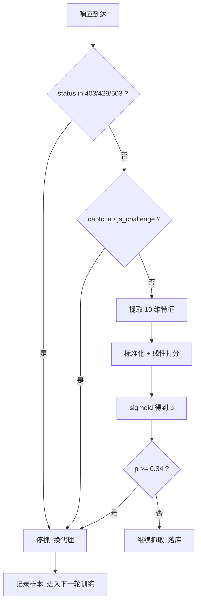

# Day 194 图解 — AI 增强与数据管道

本课所有图都是文本形式（Mermaid / ASCII），不依赖图片文件。

---

## 1. 一个页面要不要继续抓：从规则到模型



规则层只覆盖显式拒绝；软封（200 + 空壳）走完整的模型分支。
阈值 0.34 来自"漏报代价 = 误报 × 5"的期望代价最小化。

---

## 2. 模型内部：一行特征怎么变成概率

```text
status_code 403 ─┐
body_len   1200 ─┤    ┌─────────────┐   ┌─────────┐   ┌────────┐
latency_ms  380 ─┼──► │ 标准化 x'    │──►│ w·x' + b │──►│sigmoid │──► p=0.87
captcha       1 ─┤    │ (训练集 μσ) │   └─────────┘   └────────┘
header_count  5 ─┘    └─────────────┘
                                        系数（标准化后）：
                                        body_len     -1.289  (越小越可疑)
                                        status_code  +0.985
                                        header_count -0.759
```

为什么必须标准化：body_len 在 10⁵ 量级，status_code 只有 3 位，
同一个学习率下小量纲特征根本不动。

---

## 3. SimHash：64 位逐位投票

```text
token          哈希(64bit)                     权重
"新能"   →  1011 0010 ... 0110   w=1.0
"能源"   →  0011 1010 ... 1101   w=1.0
"汽车"   →  1110 0011 ... 0101   w=1.0
              │
              ▼  逐位求和（+w / -w）
votes[i] = Σ (+w if bit==1 else -w)
              │
              ▼
fingerprint = 每一位取符号 → 0/1 串（64 位）
```

改写少量 token 只会翻转少数位，所以"内容相近 → 汉明距离小"。

---

## 4. 分桶索引：鸽巢原理把 n² 压成候选

```text
64 位指纹切成 bands 段（例：bands=8，每段 8 位）

 ┌────┬────┬────┬────┬────┬────┬────┬────┐
 │ b0 │ b1 │ b2 │ b3 │ b4 │ b5 │ b6 │ b7 │
 └─┬──┴─┬──┴─┬──┴─┬──┴─┬──┴─┬──┴─┬──┴─┬──┘
   │    │    │    │    │    │    │    │
   ▼    ▼    ▼    ▼    ▼    ▼    ▼    ▼
  桶(0,v) (1,v) ...                        查 8 个桶

若两篇距离 ≤ 7，则至少一段 8 位完全相同
→ 必落在同一个桶里 → 召回有保证（实测 454 对候选 = 全量的 0.06%）
```

| bands | 每段位宽 | 保证 k | 平均候选/篇 |
|---|---|---|---|
| 4 | 16 | 3 | 1.5 |
| 8 | 8 | 7 | 1.8 |

段越多，保证阈值越高；但每段取值空间越小，桶越挤。

---

## 5. 两阶段去重漏斗（实测数字）

```text
719,400 对（1200 篇两两组合）
        │
        │  SimHash 汉明距离 ≤ 7（8 段索引）
        ▼
   454 对候选  (0.06%)
        │
        │  Jaccard(token 集合) ≥ 0.6
        ▼
    真实重复 451 对
    precision 1.000 / recall 0.853
    漏报 78（改写幅度大，指纹已超阈值）
```

单阶段做不到：k=3 召回 0.539，k=10 精度掉到 0.923，k=15 精度只剩 0.153。

---

## 6. 管道：五阶段 + 双出口

```text
        ┌────────────┐
输入 ──►│ S1 采集     │  3000
        └─────┬──────┘
              ▼
        ┌────────────┐
        │ S2 清洗     │  去脚本/标签/实体/零宽
        │ S3 抽取     │  title/price/date/body
        └─────┬──────┘
              ▼
        ┌────────────┐
        │ S4 去重     │  SimHash 粗筛 + Jaccard 精排
        └─────┬──────┘   丢 349 (11.6%)
              ▼
        ┌────────────┐
        │ S5 质检     │  8 条可判定规则
        └──┬──────┬──┘
           │      └──────────────► quarantine 表（885 条，带 reason code）
           ▼
        ┌────────────┐
        │ S6 入库     │  UPSERT(url_key)  2115 行
        └────────────┘
```

关键设计：脏数据不静默丢，进隔离区并记 reason code；入库用 UPSERT 保证重跑幂等。

---

## 7. 幂等 ≠ 正确（真实事故）

```text
第一次跑：  2709 条 URL ──► 401 行   ← 日志无报错
重跑一遍：  2709 条 URL ──► 401 行   ← "幂等"✅

但真实页面有 820 个：
  /product/106?sku=red  ┐
  /product/106?sku=blue ┴─► 同一个 key → 后写的覆盖先写的
                                     ↑
                          规范化删掉了 sku，业务主键消失

断言（CI 里应该有的）：
  distinct(url_key) >= 原始 URL 数 / 10
  count(rows) == count(distinct 真实页面)   ← 需要一份黄金样本
```
