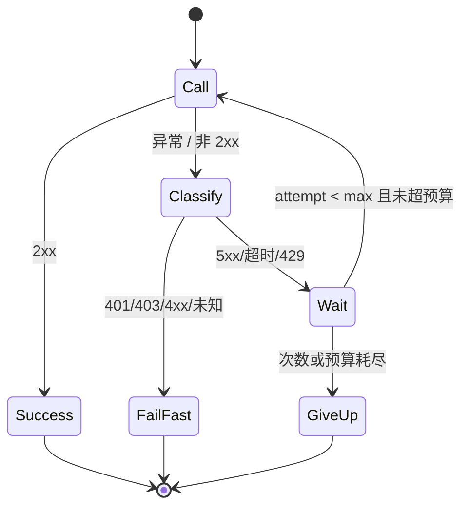
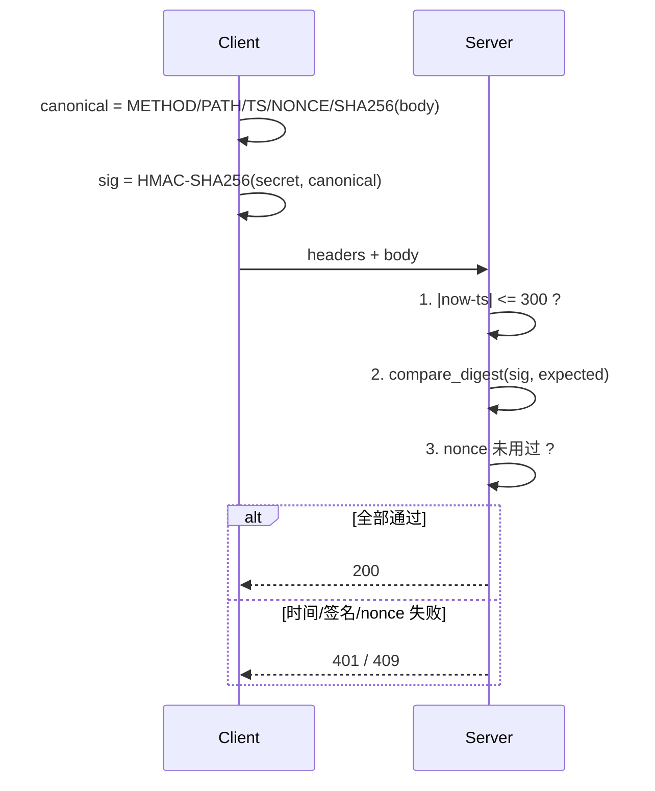
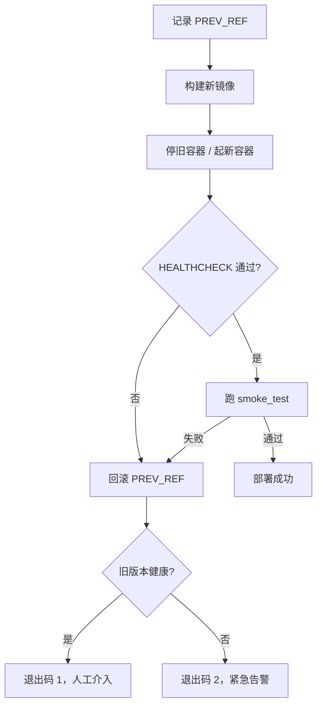

# Day 195 图解 — 重试、加密、交付

> Mermaid 源码可直接粘到支持 Mermaid 的 Markdown 渲染器；ASCII 图用于终端阅读。

## 1. 重试状态机



ASCII 时间线（实测 01 脚本，base=0.1s，factor=2，full jitter）：

```text
attempt 1 ──503──▶ sleep 0.079s
attempt 2 ──503──▶ sleep 0.200s   (Retry-After 下限)
attempt 3 ──200──▶ done            总耗时 0.313s
```

## 2. 抖动如何削平重试洪峰

```text
无抖动（500 客户端）               full jitter
│██████████████████│ 500           │█│█│█│█│█│█│█│█│ 峰值 5
└── 同一 10ms 桶 ──┘               └── 分散到整个窗口 ──┘
```

## 3. 信封密文布局

```text
 v1. | kid_len | kid | nonce(12B) | ciphertext + tag(16B)
 ─┬─   ─┬──     ─┬─   ───┬─────     ─────────┬─────────
  │     │        │        │                   │
  │     │        │        └─ 随机，绝不复用    └─ AES-256-GCM 输出
  │     │        └─ 密钥 ID，支持轮换
  │     └─ 1 字节长度
  └─ 版本前缀（base64url 整体编码）

AAD（例如 record_id）不进密文，但参与认证：
密文从 row-42 复制到 row-43 → tag 校验失败 → InvalidTag
```

## 4. 请求签名与校验顺序



## 5. 部署与自动回滚



## 6. liveness vs readiness

```text
            ┌──────────────┐
  probe ───▶│  /healthz    │ 进程活着？ → 失败：重启容器
            └──────────────┘
            ┌──────────────┐
  probe ───▶│  /readyz     │ 能写库 + 有密钥？ → 失败：摘掉流量
            └──────────────┘

合并成一个的后果：数据库抖 10 秒 → 所有副本被重启 → 雪崩
```

## 7. 告警收敛时间轴

```text
t=0s      error █  → 发第 1 条（suppressed=0）
t=0.6s    error █  → 抑制
...
t=59.4s   error █  → 抑制（共 99 条）
t=60s     error █  → 发第 2 条（suppressed=99）
```