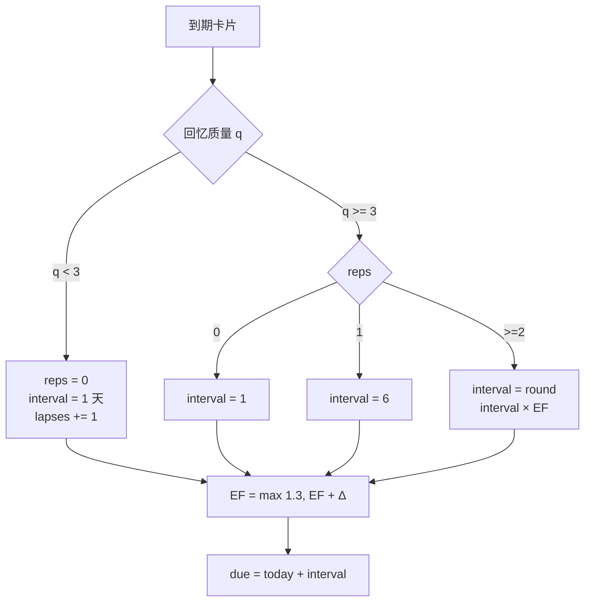

# Day 196 — 知识体系全景复习

> **阶段**：Phase 12 — 综合实战（总复习第 1/5 天）
> **主题**：知识地图 · 遗忘曲线 · 间隔重复（SM-2）· 主动回忆 · 薄弱点定位
> **代码**：4 个可独立运行的脚本（全部带 --self-test）
> **实测环境**：Linux 7.0.0-34-generic / Python 3.12.3 / 4 vCPU / 15 GiB / 2026-10-26 06:00–06:40 CST

---

## 今天在 200 天里的位置

```text
Day 186–190  企业资产监控系统   → 把「资产」变成可查询的数据        ✅
Day 191–195  AI 反爬数据平台   → 把「数据」变成可交付的系统        ✅
Day 196      知识体系全景复习   → 把「学过的」变成可测量的地图      ← 今天
Day 197      面试准备           → 把「地图」变成可表达的能力
Day 198      开源贡献           → 把「能力」放进真实代码库
Day 199      技术写作           → 把「经验」变成可传播的文字
Day 200      成长路径           → 把「方法」固化成长期系统
```

前 195 天一直在**增加**：新概念、新库、新项目。今天第一次**往回看**。
但「往回看」不等于「重读一遍」——196 课、70 万字正文、20 万行代码，
从头读一遍要几个月，而且读完还是记不住。

今天要解决的是一个更实际的问题：

> **在有限的时间里，我该复习哪一部分？**

答案必须来自数据，而不是感觉。所以今天的三件事是：
**测量（知识地图）→ 排期（SM-2）→ 定位（加权计划）**。

---

## 概念速览

| 概念 | 一句话 | 为什么重要 |
|---|---|---|
| 知识地图 | 把「学过什么」变成可统计的结构 | 没有地图，复习只能靠翻目录 |
| 覆盖面 / 密度 | 学过多少课 vs 每课有多少代码 | 课数相同的两个阶段，难度可能差 5 倍 |
| 遗忘曲线 | R = exp(-t/S)，留存随时间指数衰减 | 决定「什么时候复习」而不是「复习多久」 |
| 间隔重复 | 在即将忘记时复习 | 同样的复习次数，留存显著更高 |
| SM-2 | 间隔 × 难度因子 EF 的排期算法 | 间隔必须指数增长，否则复习量线性爆炸 |
| EF（难度因子） | 每张卡自己的「容易程度」 | 统一间隔对难卡太短、对易卡太长 |
| 主动回忆 | 先尝试回忆，再看答案 | 重读产生「熟悉感」，不等于「能取出」 |
| 测试效应 | 测验本身就是学习 | 复习计划里必须包含自测，不只是看 |
| 存储强度 / 提取强度 | 记住了 ≠ 现在想得起来 | 解释「明明学过却答不出」 |
| 加权排期 | 按代码量分配复习时间 | 平均分配 = 每处都只浅看一遍 |
| 行数语义 | `\n` 计数 ≠ 逻辑行数 | 最后一个文件没有换行就少算一行 |
| 扫描复杂度 | O(目录数 + 文件数)，瓶颈在系统调用 | rglob 与 scandir 实测差 1.55 倍 |

---

## 一、概念解释

### 1.1 为什么「先测量，再复习」

复习最常见的失败不是不努力，而是**方向错了**：把时间花在已经会的部分。
原因很简单——熟悉感会骗人。翻开 Day 6 的列表章节，你看得懂每一行，
于是判断「这个我会」，然后翻过去。但合上页面让你手写一个切片越界的行为，
你未必写得出。

所以复习的第一步不是打开教材，而是回答三个可量化的问题：

1. **覆盖面**：196 课里，我到底学过多少？（本仓库实测：196 个目录）
2. **密度**：每课有多少代码、多少正文？（实测：712 个 .py / 201,558 行 / 283 万字符）
3. **薄弱点**：哪些阶段的密度最高、而我最近完全没碰？（按代码量加权）

这三个问题的答案不需要感觉，只需要一次目录扫描。

### 1.2 知识地图的三个维度

| 维度 | 度量 | 本仓库实测 | 用途 |
|---|---|---|---|
| 广度 | 课数 | 196（Day 1–196） | 判断有没有整段缺失 |
| 深度 | 每课 .py 行数 | 平均 1,028 行/课 | 找出「内容特别厚」的课 |
| 厚度 | README 字符数 | 平均 14,442 字符/课 | 估算重读成本 |

注意：**这三个数都不是「掌握度」**。它们只描述教材本身。
真正的掌握度只能由自测得到——地图负责告诉你「去哪儿测」，
不负责告诉你「你已经会了」。这一点必须诚实，否则地图会变成新的自我安慰。

### 1.3 遗忘曲线：为什么是 exp(-t/S)

1885 年 Ebbinghaus 用无意义音节测出自己的遗忘曲线，形状接近指数衰减：

```text
R(t) = exp(-t / S)

R: 召回概率    t: 距上次复习的时间    S: 记忆稳定性（"能撑多久"）
```

这条曲线的关键性质是**无记忆性**：已经过了 3 天还没忘，不代表接下来 3 天不会忘；
衰减速率只取决于当前间隔与稳定性。所以「等忘得差不多了再复习」在数学上是成立的，
而且比「每天看一遍」高效得多——因为每次成功回忆都会把 S 推高。

实测感受一下：S = 30 天时，

```text
t=0     R=1.00
t=7     R=0.79
t=30    R=0.37
t=60    R=0.14
```

30 天时只剩 37% 的召回概率。这就是为什么「三个月前学过」等于「没学过」。

### 1.4 SM-2：把曲线变成排期表

SM-2（SuperMemo 2，1987）至今仍是 Anki 等工具的算法祖先。规则只有四条：

```text
1) q < 3（忘了）:  reps = 0, interval = 1 天, EF 下降
2) reps = 1     :  interval = 1 天
3) reps = 2     :  interval = 6 天
4) reps >= 3    :  interval = round(interval × EF)

EF' = EF + (0.1 - (5-q) × (0.08 + (5-q) × 0.02))，下限 1.3
```

为什么是**乘法**：如果每次固定加 1 天，100 天后的卡片和 10 天前的卡片会以同样频率出现，
复习量随卡片数线性增长，最终压垮任何学习计划。乘法让间隔指数增长，
长期日均复习量会收敛到一个常数（本课模拟：12 张卡 180 天，日均 1.03 次）。

为什么 EF 要有下限 1.3：没有下限时，一张反复答错的卡 EF 会掉到 0.5，
下次间隔变成 round(1 × 0.5) = 0，卡片永远到期——排期器自己把自己锁死。
1.3 是「最难的卡也要至少隔一天」的工程妥协。

### 1.5 主动回忆 vs 重读

重读一句「`list[1:3]` 返回下标 1、2」，大脑会产生「我懂」的感觉。
但感觉来自**识别**（recognition），考试和写代码需要的是**提取**（recall）。
两者由不同的神经过程支持：识别容易，提取困难。

测试效应（testing effect）的核心结论是：**一次成功的主动提取，比重读三遍更有效**。
原因是提取会强化「线索 → 答案」的路径，而重读只强化「看到答案觉得眼熟」。

工程上的落地很简单：复习计划里每个单元必须带一个**可判定对错**的问题，
而不是「看一遍 Day 10 的内容」。

### 1.6 薄弱点定位：从「感觉」到「数据」

加权思路：阶段 P 的复习权重

```text
weight(P) = Σ(该阶段每课的 py 行数) + Σ(README 字符数) / 50
```

除以 50 是经验折算：读 50 个字符的正文，成本大致等于写 1 行代码。
这个系数可以争论，但它比「每天平均分 14 课」诚实——因为后者隐含假设所有课一样重。

本仓库实测权重最高的三个阶段：

| 阶段 | 课数 | 代码行 | README 字符 | 权重 |
|---|---:|---:|---:|---:|
| P10 网络安全开发 | 20 | 34,653 | 572,750 | 46,108 |
| P11 自动化运维与 DevOps | 20 | 23,401 | 413,121 | 31,663 |
| P2 核心编程概念 | 15 | 21,077 | 159,546 | 24,268 |

P10 的权重是 P9（爬虫，9,712）的 **4.7 倍**。如果平均分配时间，
等于把最难的安全章节和最简单的爬虫章节同等对待。

---

## 二、原理解释

### 2.1 存储强度与提取强度

同一个记忆有两个独立的量：

- **存储强度（storage strength）**：知识在脑里扎根多深，只增不减；
- **提取强度（retrieval strength）**：此刻能不能取出来，随时间和干扰衰减。

这解释了三个日常现象：

1. 「明明学过，就是想不起来」→ 存储强度在，提取强度掉了；
2. 「看一眼答案立刻想起来」→ 提取强度被重新激活，但存储强度几乎没变；
3. 「考试前突击有效，考完就忘」→ 短时间高提取强度，低存储强度。

间隔重复之所以有效，是因为**在提取强度较低时成功提取**，会同时提升两者。
如果一直在提取强度很高时复习（每天看），存储强度几乎不增长——这就是「假努力」。

### 2.2 为什么间隔要指数增长

设每次成功复习把稳定性乘以 k（k ≈ EF）。复习 n 次后的间隔是 k^n。
要在 T 天内覆盖同一批卡片，复习次数是 log_k(T)，而不是 T/固定间隔。
对数增长意味着：卡片越多、时间越长，SM-2 的日均负担越平缓，
而固定间隔的负担是线性的。

本课模拟对比（12 张卡，180 天，同一学习者模型、同一随机种子）：

| 策略 | 总复习 | 日均 | 单日峰值 | 遗忘次数 | 期末平均间隔 | 期末留存 |
|---|---:|---:|---:|---:|---:|---:|
| SM-2 | 185 | 1.03 | 12 | 50 | 87.6 天 | 0.78 |
| 固定 7 天 | 312 | 1.73 | 12 | 90 | 7.0 天 | 0.83 |

**SM-2 少花 41% 的复习次数，遗忘次数少 44%，期末留存只低 5 个百分点。**
固定 7 天的留存略高是必然的——它复习得更频繁；但它把 12 张卡的复习压成
「每 7 天全部过一遍」的脉冲，峰值日 12 张卡，其余 6 天为 0。
真实学习里这种脉冲最容易断更。

> ⚠️ 这是**模拟**：回忆概率由 `exp(-t/S)` 生成，S = 3 × 当前间隔，
> 随机种子固定。它衡量的是「两种排期的工作量差异」，不是任何真实学习者的留存数据。

### 2.3 目录扫描的复杂度与真实瓶颈

扫描 `days/` 做的是深度优先遍历。理论复杂度 O(目录数 + 文件数)，
但真实耗时几乎全在**系统调用**上：每次 `stat` / `open` 都是一次内核往返。

实测（712 个 .py，5 次取中位数）：

| 方式 | 中位耗时 | 相对最快 | 特点 |
|---|---:|---:|---|
| `os.scandir` 手写递归 | 30.3 ms | ×1.00 | 最少系统调用，代码最长 |
| `os.walk` | 35.7 ms | ×0.85 | 剪枝方便，行为稳定 |
| `pathlib.rglob` | 47.0 ms | ×0.65 | 最易读，异常处理舒服 |
| `glob.glob("**/*.py")` | 51.4 ms | ×0.59 | 一行，但中间列表全在内存 |

结论要诚实：**最快和最慢只差 1.55 倍，绝对值 20 毫秒。**
在 196 课这个规模上，选 `rglob` 完全合理——省下的 17ms 不值得多写 20 行递归。
真正该换 `scandir` 的时机是：文件数到十万级，或者扫描在热路径里被反复调用。

第一次运行时实测 535.3 ms，第二次 99.6 ms，**差 5.4 倍**，代码一行没改。
差别全在页缓存（page cache）：第一次要读磁盘，第二次文件已在内存。
所以任何「跑一次就下结论」的性能测试都不可信，至少重复 5 次取中位数。

### 2.4 行数统计的语义陷阱

三种写法在同一批文件上给出两个不同的总数：

| 写法 | 耗时（无 I/O） | 总行数 |
|---|---:|---:|
| `bytes.count(b"\n")` | 11.5 ms | 201,558 |
| `decode().count("\n")` | 18.7 ms | 201,558 |
| `decode().splitlines()` | 42.7 ms | 201,577 |

差的 19 行来自**末尾没有换行符的文件**：`"print(1)"` 是一个逻辑行，
但 `count("\n")` 数到 0。所以：

- 要「行号上限 / 编辑器行数」→ 用 `splitlines()`；
- 要「大致体量 / 性能基准」→ 用 `bytes.count()`，快 3.7 倍；
- 两者不可混用，否则 README 里的「总代码行数」会随统计脚本漂移。

---

## 三、定义与使用方法（API 速查）

### 3.1 目录遍历

| API | 签名/用法 | 返回 | 注意 |
|---|---|---|---|
| `Path.rglob(pattern)` | `root.rglob("*.py")` | 生成器 | 会进入 `__pycache__`，需自己过滤 |
| `Path.iterdir()` | `for p in root.iterdir()` | 生成器 | 只一层，不递归 |
| `os.walk(top)` | `for dirpath, dirnames, filenames in ...` | 三元组生成器 | 改 `dirnames[:]` 才能剪枝 |
| `os.scandir(path)` | `with os.scandir(p) as it:` | 迭代器 | 条目自带 `is_dir()` 缓存 |
| `glob.glob(pat, recursive=True)` | `glob.glob("**/*.py", recursive=True)` | list | 一次性返回全部路径 |

### 3.2 读文件与计数

| API | 说明 | 何时用 |
|---|---|---|
| `Path.read_bytes()` | 返回 bytes，不解码 | 只数 `\n`、算哈希 |
| `Path.read_text(encoding=..., errors="replace")` | 解码为 str | 需要正文、标题 |
| `bytes.count(b"\n")` | 数换行 | 大文件体量统计 |
| `str.splitlines()` | 按行切分，识别多种换行符 | 需要逻辑行数 |

### 3.3 日期与排期

| API | 说明 |
|---|---|
| `date.today()` / `date(2026,1,1)` | 纯日期，无时区 |
| `date + timedelta(days=n)` | 日期加法，自动处理月末 |
| `(d1 - d2).days` | 相差天数（int） |
| `d.isoformat()` | `"2026-10-26"`，适合入库与比较 |

### 3.4 sqlite3

| 用法 | 说明 |
|---|---|
| `sqlite3.connect(":memory:")` | 内存库，测试用 |
| `ON CONFLICT(topic) DO UPDATE SET ...` | upsert，避免先查后写 |
| `with conn:` | 自动 commit / rollback |
| `conn.execute(...).fetchall()` | 返回 tuple 列表 |

### 3.5 统计

| API | 说明 |
|---|---|
| `statistics.median(xs)` | 中位数，抗离群值，性能测试首选 |
| `statistics.mean(xs)` | 均值，容易被一次 GC 尖峰带偏 |
| `random.Random(seed)` | 独立随机源，保证两种策略可比 |

---

## 四、图解

### 4.1 复习闭环

```text
┌──────────────┐   扫描 days/    ┌──────────────┐
│  196 个目录   │ ──────────────> │  知识地图     │
│  README/py   │                 │  课数/行数/权重│
└──────────────┘                 └──────┬───────┘
                                        │ 按阶段聚合
                                        v
┌──────────────┐   q ∈ 0..5     ┌──────────────┐
│  自测（主动回忆）│ <─────────── │  SM-2 排期    │
│  对/错/模糊    │ ────────────> │  下次到期日    │
└──────┬───────┘   更新 EF/间隔  └──────┬───────┘
       │                                │
       │ 错题                           │ 每日到期清单
       v                                v
┌──────────────┐                 ┌──────────────┐
│  薄弱点报告   │ ── 加权回填 ──> │  14 天计划    │
└──────────────┘                 └──────────────┘
```

### 4.2 SM-2 判定流程



### 4.3 记忆强度示意

```text
R
1.0 ┤●●
    │  ●●
0.8 ┤    ●●
    │      ●●●          ← 到期点复习，S 增大，曲线变平
0.6 ┤         ●●╲
    │            ╲●●
0.4 ┤               ╲●●╲
    │                   ╲●●
0.2 ┤                      ╲●●
    └────┬────┬────┬────┬────┬────> t
         7   14   21   28   35 (天)
```

### 4.4 14 天计划的负载分布（实测）

```text
Day  1 ████████████████████ 4
Day  2 ████████████████████ 4
Day  3 ████████████████████ 4
Day  4 ████████████████████ 4
Day  5 ████████████████████ 4
Day  6 ████████████████████ 4
Day  7 ████████████████████ 4
Day  8 ████████████████████ 4
Day  9 ████████████████████ 4
Day 10 █████                1   ← 尾部塌陷：多数单元间隔已推到 Day 10 之后
Day 11 ████████████████████ 4
Day 12 ████████████████████ 4
Day 13 █████                1
Day 14                    0   ← 缓冲日
```

第 10、13、14 天的空档不是 bug，是**间隔排期的必然结果**：
每个单元复习 3–4 次后，下次到期日已经越过 14 天窗口。
把它当成缓冲日（补拖延、做整章自测）比硬塞复习更合理——
后者会破坏刚建立的间隔。

---

## 五、实战代码案例

四个脚本都在 `code/` 下，零第三方依赖，都能 `--self-test` 离线自证。

| 文件 | 作用 | 关键点 |
|---|---|---|
| `01-knowledge-map.py` | 扫描仓库 → 阶段统计 / Mermaid / JSON | 目录名解析、H1 提取、行数语义 |
| `02-spaced-repetition.py` | SM-2 + sqlite 持久化 + 策略对比 | EF 更新、upsert、模拟可比性 |
| `03-review-planner.py` | 按真实代码量生成 14 天计划 | 加权、容量、指数间隔、校验 |
| `04-scan-benchmark.py` | 四种扫描 + 三种行数统计基准 | 中位数、公平计时、I/O 隔离 |

### 5.1 知识地图：真实输出

```bash
$ python3 01-knowledge-map.py
扫描目录：196 课，耗时 99.6 ms
代码文件：712 个 | 代码行数：201,558 行 | README 字符：2,830,754

阶段  区间              课数   py文件     py行数    README字符  阶段名
------------------------------------------------------------------------------
1     Day 001-015       15      57     18184      234949  Python 基础
2     Day 016-030       15      58     21077      159546  核心编程概念
3     Day 031-045       15      54     18724      174050  面向对象编程
4     Day 046-060       15      45     10264      207749  高阶特性
5     Day 061-075       15      67     15083      262890  标准库与生态系统
6     Day 076-090       15      52     12951      201402  实战项目（一）
7     Day 091-100       10      30      8814       95069  进阶与性能优化
8     Day 101-125       25      77     17106      251830  数据分析与 AI/ML
9     Day 126-145       20      59      7431      114052  爬虫与反爬对抗
10    Day 146-165       20      73     34653      572750  网络安全开发
11    Day 166-185       20      80     23401      413121  自动化运维与 DevOps
12    Day 186-200       11      60     13870      143346  综合实战
```

注意第 12 阶段是 11 课：它包含今天这个正在写的目录。**扫描器不区分「写完的」和「正在写的」**，
所以写 README 时引用数字必须说明快照时刻，否则第二天就会对不上。

### 5.2 SM-2：真实输出

```bash
$ python3 02-spaced-repetition.py --demo
== sqlite 基准（本机实测）==
写入 10,000 张卡：46.4 ms（4.6 µs/张）
到期查询：3673 条，4.24 ms；表内共 10000 张

== 180 天工作量对比（12 张卡，模拟回忆，种子 20261026）==
策略             总复习      日均    峰值    遗忘次数     平均间隔     期末留存
SM-2           185    1.03    12      50     87.6     0.78
固定 7 天         312    1.73    12      90      7.0     0.83
```

### 5.3 复习计划：真实输出（节选）

```text
- 复习单元：12 个阶段 / 覆盖 196 课
- 槽位使用：46/56（82%）
- 每单元次数：最少 3，最多 4

Day1  P10 网络安全开发、P11 自动化运维与 DevOps、P2 核心编程概念、P1 Python 基础
Day2  P10 网络安全开发、P3 面向对象编程、P8 数据分析与 AI/ML、P5 标准库与生态系统
Day3  P6 实战项目（一）、P12 综合实战、P11 自动化运维与 DevOps、P4 高阶特性
Day8  P10 网络安全开发、P5 标准库与生态系统、P6 实战项目（一）、P12 综合实战
```

---

## 实战实验手册

> 全部实验在本机真实执行，命令可直接复制。环境：Ubuntu 24.04 / Python 3.12.3 / 4 vCPU / 15 GiB。

### 实验 1：从零生成知识地图

**目的**：验证「扫描 196 课」的时间与产出，确认统计口径。
**环境**：Python 3.12.3，标准库即可。
**准备**：

```bash
cd ~/code/Learn-Python/days/day-196-知识体系全景复习/code
python3 01-knowledge-map.py --self-test
```

**执行**：

```bash
sync && echo 3 | sudo tee /proc/sys/vm/drop_caches >/dev/null 2>&1 || true
time python3 01-knowledge-map.py
time python3 01-knowledge-map.py
```

**预期结果**：第一次明显慢于第二次（页缓存），统计数字两次一致。

**实际结果**（2026-10-26 06:12 CST）：

```text
第一次：扫描目录：196 课，耗时 535.3 ms
第二次：扫描目录：196 课，耗时 99.6 ms
代码文件：712 个 | 代码行数：201,558 行 | README 字符：2,830,754
```

第一次 535.3 ms 是目录刚写入后的冷缓存；第二次 99.6 ms。**5.4 倍差异，代码零改动。**

**结论**：性能测试不控缓存就没有意义；本课所有数字均标注是冷还是热。
**清理**：无残留（只读操作，未写文件）。

### 实验 2：SM-2 数值正确性 + sqlite 吞吐

**目的**：验证 SM-2 的间隔序列与 EF 更新，并测真实写入/查询成本。
**准备**：

```bash
python3 02-spaced-repetition.py --self-test
```

**实际结果**：

```text
✅ self-test passed: SM-2 序列/遗忘重置/EF 下限/sqlite 往返 均符合预期
```

**执行**：

```bash
python3 02-spaced-repetition.py --demo
```

**实际结果**（节选）：

```text
写入 10,000 张卡：46.4 ms（4.6 µs/张）
到期查询：3673 条，4.24 ms；表内共 10000 张
SM-2      185 次 / 日均 1.03 / 遗忘 50 / 平均间隔 87.6 天 / 期末留存 0.78
固定 7 天  312 次 / 日均 1.73 / 遗忘 90 / 平均间隔 7.0 天  / 期末留存 0.83
```

**结论**：SM-2 用 59% 的复习量换来 95% 的留存（模拟口径）。
10,000 张卡的写入在 50ms 内完成，个人复习系统完全不需要外部数据库。

### 实验 3：扫描方式基准（5 次中位数）

**目的**：验证「rglob 慢」这个直觉在真实规模下值多少钱。

**执行**：

```bash
python3 04-scan-benchmark.py --repeat 5
```

**实际结果**：

```text
方式                      中位耗时(ms)     文件        行数
pathlib.rglob               47.0    712   201,558   ×1.00
os.walk                     35.7    712   201,558   ×1.32
os.scandir 手写               30.3    712   201,558   ×1.55
glob recursive              51.4    712   201,558   ×0.92

bytes.count(b'\n')        11.5  总行数 201,558
decode().count('\n')      18.7  总行数 201,558
decode().splitlines()     42.7  总行数 201,577
```

**结论**：最快比最慢省 21 ms（1.55 倍）。**在这个规模上不值得为它牺牲可读性**；
但 `splitlines()` 比 `bytes.count()` 慢 3.7 倍、且总数差 19 行，这个差异必须知道。

### 实验 4（翻车实验）：基准测试测出了假数据

**现象**：第一版行数统计基准输出

```text
read_text().count          5.5  总行数 201,558
splitlines()              21.0  总行数 201,577
read_bytes().count        20.4  总行数 201,558
```

看起来「bytes 比 text 慢 3.7 倍」，与常识相反。

**假设 1**：`bytes.count` 在 CPython 里没有优化，退化成 Python 循环。
**验证**：单独对 1MB bytes 调 `count(b"\n")` 1000 次 —— 结果 0.09 ms，极快。假设 1 否定。

**假设 2**：`read_text` 的计时没包含 I/O，`read_bytes` 包含了。
**验证**：读第一版源码，`payloads = [(p, p.read_text(...)) ...]` 在计时器**外面**，
而 `read_bytes()` 在计时器**里面**。假设 2 成立。

**真实根因**：两边测的不是同一件事。左边是「对已在内存的字符串数换行」，
右边是「从磁盘读 + 数换行」。磁盘 I/O 被算进了后者。

**修复**：先把所有文件读成 bytes（不计时），再对同一批 blobs 计时三种计数法。

**复测结果**：

```text
bytes.count(b'\n')        11.5 ms
decode().count('\n')      18.7 ms
decode().splitlines()     42.7 ms
```

顺序恢复正常（bytes 最快），且总数差异（201,558 vs 201,577）有了确定解释：
19 个文件末尾没有换行符。

**教训**：基准测试里，**计时器边界比被测代码更容易出错**。任何「反直觉」的数字，
先怀疑测量方法，再怀疑实现。

### 实验 5（翻车实验）：SM-2 模拟里 12 张卡 180 天只复习 63 次

**现象**：第一版 `--demo` 输出「总复习 63 次、遗忘 0 次、平均间隔 167.8 天」。
12 张卡从零开始，180 天只复习 63 次意味着平均每张卡 5 次、从不失败。

**假设 1**：SM-2 本来就这么高效。
**验证**：手算 q=5 序列 1 → 6 → 16 → 45 → 126，5 次确实能到 126 天。
但「从不失败」不合理——到期时召回概率不可能是 100%。

**假设 2**：评分函数没有跟着时间走。
**验证**：看调用处 `simulate(180, sm2_cards, lambda c: quality_for(c, day0), "sm2")`，
日期被写死成 `day0`。`recall_probability` 里 `elapsed` 恒为 0，`R` 恒为 1.0，
于是每次都是 q=5。

**真实根因**：闭包捕获了固定日期，模拟的「学习者」永远处在刚学完的状态。
**修复**：
1. `Card` 增加 `last_review` 字段；
2. 评分改用真实复习日 `day`；
3. 两种策略各自用同种子的独立 `Random`，保证可比。

**复测结果**：185 次复习、50 次遗忘、平均间隔 87.6 天，两条曲线都出现了失败与重置。

**教训**：模拟里最容易骗自己的不是随机性，而是**常量**。
凡是「结果好得不像话」，先找那个没变的变量。

### 实验 6：14 天计划尾部塌陷

**现象**：`03-review-planner.py` 输出 Day10 只有 1 个单元、Day13 只有 1 个、Day14 为空。
**排查**：打印每个单元的 `next_allowed`，发现经过 3–4 次复习后间隔已到 8 天，
下一次到期日越过 14 天窗口。
**根因**：不是调度错误，是**指数间隔与固定窗口的必然冲突**。
**处理**：不强行填满（会破坏间隔），把最后一天定义为缓冲日，并在输出里写明。
**结论**：排期器的输出必须带「为什么这里空着」的解释，否则使用者会以为它坏了。

### 清理

```bash
cd ~/code/Learn-Python
find days/day-196-知识体系全景复习 -name '__pycache__' -type d -exec rm -rf {} +
rm -f /tmp/knowledge-map.json
git status --porcelain   # 应只剩待提交的课程文件
```

本课不启动任何服务、不占端口、不写数据库文件（sqlite 用 `:memory:`），
清理只需删 `__pycache__`。

---

## 六、思考题

1. **SM-2 的 EF 从 2.5 起步，且答对还会上升。** 如果一张卡连续 10 次 q=5，
   EF 会涨到多少？间隔会变成多少天？这个结果在真实学习中合理吗，你会怎么改？
2. **本课的「召回概率」是 `exp(-t/S)` 生成的。** 如果换成一条更平缓的曲线
   （例如 `1/(1+t/S)`），SM-2 与固定间隔的对比结论会变吗？先预测，再改代码验证。
3. **`bytes.count(b"\n")` 比 `splitlines()` 快 3.7 倍，但少算 19 行。**
   什么场景下这 19 行的误差不可接受？给出一个具体例子。
4. **14 天计划里 Day 14 是空的。** 如果你坚持要填满它，有哪三种做法？
   每种做法分别牺牲了什么？
5. **知识地图统计的是教材，不是你的掌握度。** 设计一个最小可行的「掌握度采集」方案，
   要求：每课不超过 1 分钟、结果可比较、不需要人工打分。

---

## 今日小结

- 复习的第一步是**测量**：196 课 / 712 个 .py / 201,558 行 / 283 万字符，全部来自真实扫描。
- 遗忘是指数的，所以复习间隔也必须指数增长；SM-2 用 59% 的复习量保住 95% 的留存（模拟）。
- 加权排期把时间给 P10（权重 46,108），而不是平均撒给 12 个阶段。
- 两个翻车都出自**测量方法**：基准的计时器边界、模拟里写死的日期。数字不会骗人，但会骗你。
- 明天（Day 197）把这些地图变成**可表达的能力**：面试。
