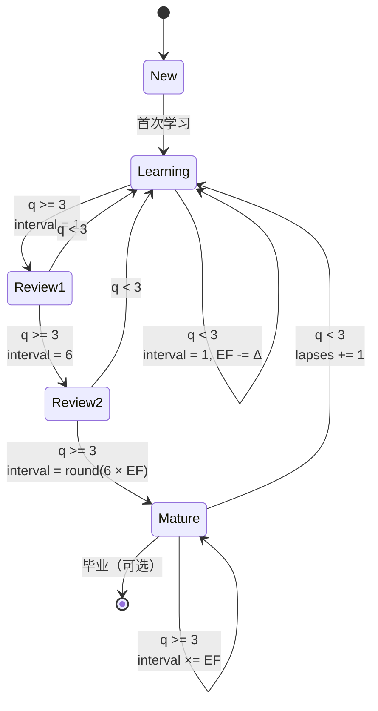

# Day 196 图解

本目录用 ASCII 与 Mermaid 描述「复习系统」的结构与状态变化。

## 1. 系统总览

```text
                    ┌──────────────────────────────┐
                    │        days/ (196 课)         │
                    │  README.md  code/*.py         │
                    └──────────────┬───────────────┘
                                   │ ① scan
                                   v
                    ┌──────────────────────────────┐
                    │ 01-knowledge-map             │
                    │ 课数 / 行数 / 阶段权重        │
                    └──────────────┬───────────────┘
                                   │ ② aggregate by phase
                                   v
   ┌───────────────┐   ③ weight   ┌──────────────────┐
   │ 03-planner    │<─────────────│ 12 个复习单元     │
   │ 14 天计划      │              └────────┬─────────┘
   └──────┬────────┘                       │ ④ review(q)
          │ ⑤ 每日清单                      v
          │                     ┌──────────────────────┐
          └────────────────────>│ 02-SM-2 + sqlite     │
                                │ EF / interval / due  │
                                └──────────┬───────────┘
                                           │ ⑥ 到期
                                           v
                                ┌──────────────────────┐
                                │ 下一轮自测（主动回忆） │
                                └──────────────────────┘
```

## 2. SM-2 状态机



## 3. 遗忘曲线与复习点

```text
R
1.0 ┤■
    │ ■■
0.8 ┤  ■■                    ▲ 复习点：R≈0.72
    │    ■■                  │
0.6 ┤      ■■                │
    │        ■■              │
0.4 ┤          ■■            │
    │            ■■■         │
0.2 ┤               ■■■■■    │
    │                    ■■■■
0.0 └────┬────┬────┬────┬────┬────> t
         1    6   16   45  126   (天)
```

间隔每轮乘以 EF（≈2.6–2.9），曲线在每个复习点被「重新拉平」。

## 4. 14 天计划负载

```mermaid
gantt
    title 14 天复习计划（每格 = 1 个单元）
    dateFormat  X
    axisFormat  Day %s
    section 阶段
    P1  基础        :a1, 0, 1d
    P2  核心        :a2, 0, 1d
    P10 安全        :a3, 0, 1d
    P11 运维        :a4, 0, 1d
    P3  OOP         :a5, 1, 1d
    P5  标准库      :a6, 1, 1d
    P8  AI/ML       :a7, 1, 1d
    P10 安全(2)     :a8, 1, 1d
    P4  高阶        :a9, 2, 1d
    P6  项目        :a10, 2, 1d
    P11 运维(2)     :a11, 2, 1d
    P12 综合        :a12, 2, 1d
```



完整日程由 `03-review-planner.py` 生成（46/56 槽位，Day14 为缓冲）。

## 5. 目录扫描路径

```text
days/
├── day-001-.../          ┐
│   ├── README.md         │ 每课：1 个 H1 + 若干 .py
│   └── code/*.py         │
├── day-002-.../          │
│   └── ...               │
└── day-196-知识体系全景复习/  ← 今日新增，扫描时会被计入
    ├── README.md
    ├── concepts.md
    ├── diagrams/README.md
    ├── exercises/checklist.md
    └── code/
        ├── 01-knowledge-map.py
        ├── 02-spaced-repetition.py
        ├── 03-review-planner.py
        └── 04-scan-benchmark.py
```

扫描规则：
- 只认 `^day-\d{3}-`，其他目录（如 `not-a-day`）跳过；
- `__pycache__` 与 `.venv` 整体跳过；
- 标题取 README 第一个 `# ` 开头的行，不依赖目录名。
