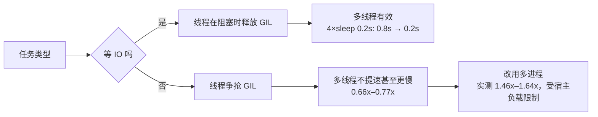

# Day 197 — 面试准备

> **阶段**：Phase 12 — 综合实战（总复习第 2/5 天）
> **主题**：算法题模板 · Python 八股文 · 项目 STAR · 本地题库与模拟面试评分器
> **代码**：4 个可独立运行的脚本 + 1 份 12 题 JSON 题库（全部带 `--self-test`）
> **实测环境**：Linux 7.0.0-34-generic / Python 3.12.3 / 4 vCPU / 2026-10-27 06:00 CST
> **基准说明**：实测时宿主 loadavg 为 5.31（4 vCPU），并发数字会受负载影响，文中给出两次运行结果

---

## 今天在 200 天里的位置

```text
Day 186–190  企业资产监控系统   → 把「资产」变成可查询的数据        ✅
Day 191–195  AI 反爬数据平台   → 把「数据」变成可交付的系统        ✅
Day 196      知识体系全景复习   → 把「学过的」变成可测量的地图      ✅
Day 197      面试准备           → 把「地图」变成能说出口的能力      ← 今天
Day 198      开源贡献           → 把「能力」放进真实代码库
Day 199      技术写作           → 把「经验」变成可传播的文字
Day 200      成长路径           → 把「方法」固化成长期系统
```

昨天做的是**测量**：哪些会、哪些不会、先复习哪一块。
今天做的是**输出**：把「我会」变成「面试官能确认我会」。

这两件事之间有一条很窄的缝：

> 你懂一个概念，和你能在 90 秒内让对方相信你懂，是两种能力。

今天的所有内容都围绕这条缝：**用模板压缩思考时间，用实测支撑结论，用结构降低对方的理解成本。**

---

## 概念速览

| 概念 | 一句话 | 为什么重要 |
|---|---|---|
| 算法模板 | 约束 → 算法的稳定映射 | 面试时省下的是「选择」的注意力 |
| 不变量 | 循环/递归每一步都成立的条件 | 边界写对的唯一可靠依据 |
| 复杂度预算 | 由 n 反推允许的复杂度 | 先看数据规模，再选算法 |
| GIL | CPython 同一时刻只让一个线程执行字节码 | 决定 CPU 密集用进程、IO 密集用线程 |
| 引用计数 | 计数归零立即回收 | 大多数对象靠它回收，GC 只是兜底 |
| 分代 GC | 按存活时间分 0/1/2 代扫描 | 解决循环引用，同时避免全量扫描 |
| 迭代器协议 | `__iter__` + `__next__` + `StopIteration` | 生成器、for、解包都建立在它上面 |
| 生成器 | 用 `yield` 暂停/恢复的函数 | 惰性、省内存，但只能遍历一次 |
| 装饰器 | 函数 → 函数的语法糖 | AOP、缓存、鉴权、计时的统一入口 |
| 可变默认参数 | 默认值只求值一次，挂在函数对象上 | 跨调用共享，是最高频的 Python 陷阱 |
| MRO | C3 线性化出的方法查找顺序 | 多继承下 super() 的行为由它决定 |
| STAR | 背景 → 目标 → 行动 → 结果 | 让面试官低成本重建你的经历 |
| 词袋评分 | 按关键词与结构信号打分 | 能自查，但不懂语义，有明确上限 |
| 校准集 | 人工标注的通过/不通过样本 | 没有校准的评分器只是拍脑袋 |
| 阈值选择 | 在标注集上最大化准确率 | 及格线应该是量出来的，不是感觉出来的 |

---

## 一、概念解释

### 1.1 面试到底在考什么

很多人把面试准备等同于「刷题 + 背八股」。这只覆盖了第一层。

面试官在 45 分钟里实际在确认四件事：

1. **知识是否存在**：GIL 是什么、二分怎么写。
2. **推理是否成立**：为什么 IO 密集多线程有效？凭什么说这个方案更好？
3. **表达是否可控**：能不能在 2 分钟内讲清一个复杂项目。
4. **协作是否安全**：不确定的地方会不会承认，会不会验证，会不会回滚。

第 1 层可以背，第 2–4 层背不出来。所以今天的结构是：

```text
知识层  → 12 条八股 + 9 类模板（可验证，不靠记忆）
推理层  → 每条结论都配一个实验或反例
表达层  → STAR / 结论先行 / 分点 / 边界
元认知  → 评分器的四维反馈，指出下一轮改什么
```

一个实用判据：**如果你不能用一句话说出「为什么」，那你还不会，只是见过。**

### 1.2 算法题：从约束到模板

面试算法题的第一动作不是想算法，而是**读约束**。数据规模直接排除掉大部分选项。

```text
n ≤ 10          → 回溯 / 暴力枚举 / 全排列
n ≤ 20          → 状压 DP（2^n 状态）
n ≤ 100         → O(n^3)：区间 DP、Floyd
n ≤ 1,000       → O(n^2)：普通 DP、双重循环
n ≤ 100,000     → O(n log n)：排序、堆、二分
n ≤ 1,000,000   → O(n)：双指针、滑动窗口、哈希
n ≤ 10^8        → O(log n) / O(1)：数学、二分答案
```

这张表的价值在于：**它把「灵感题」变成了「选择题」**。看到 n = 200,000 还去想 O(n²)，
不是不够聪明，是没读约束。

#### 模板的四个固定部件

每个模板都必须能回答四个问题，缺一个就会在边界上翻车：

| 部件 | 作用 | 例子（二分） |
|---|---|---|
| 识别信号 | 什么时候用它 | 有序、找边界、答案单调 |
| 状态/区间语义 | 变量到底表示什么 | `[lo, hi)` 左闭右开 |
| 不变量 | 每步为什么仍正确 | 答案始终在 `[lo, hi)` 内 |
| 退出条件 | 什么时候停、停在哪 | `lo == hi`，即插入点 |

### 1.3 九类高频模板

#### ① 哈希表：用空间换「查过没有」

- **识别**：需要判断「某个值是否出现过」、去重、计数、配对。
- **核心**：一次遍历，先查后存。查的是「与当前元素配对的另一半」。
- **常见错误**：先排序再双指针却还想返回原始下标；重复元素时覆盖了前一个下标。
- **代价**：O(n) 空间。面试时要主动说出这个代价。

#### ② 双指针：利用有序性排除候选

- **识别**：数组有序、求两数/三数之和、盛水、移除元素。
- **核心**：每次移动指针，都要能证明「被排除的候选里不可能有答案」。
- **常见错误**：移动了较高的一侧（盛水问题），或没有处理重复值。

#### ③ 滑动窗口：连续子段的 O(n)

- **识别**：最长/最短的连续子数组或子串，且窗口性质单调。
- **核心**：right 扩张、left 收缩；每个元素最多进出各一次。
- **常见错误**：窗口收缩条件写成 `len(t)` 而不是「配额是否满足」，遇到重复字符就错。

#### ④ 二分：先定区间，再写 ±1

- **识别**：有序、找边界、答案具有单调性（二分答案）。
- **核心**：全文只用一种区间语义。左闭右开时：`while lo < hi`、`hi = mid`。
- **常见错误**：混用闭区间与开区间；`mid` 更新后区间不缩小，死循环。

#### ⑤ BFS：第一次到达就是最短

- **识别**：无权图/网格最短路、层序、最少步数。
- **核心**：队列按层扩展；**入队即标记**，不能等出队。
- **常见错误**：出队才标记，同一节点被多个前驱重复入队，复杂度退化。

#### ⑥ DFS：连通块与回溯骨架

- **识别**：岛屿数量、连通分量、拓扑、排列组合。
- **核心**：访问即标记；回溯时「选择 → 递归 → 撤销选择」三步不能少。
- **常见错误**：原地修改输入却没告知调用方；递归深度过大导致栈溢出。

#### ⑦ 动态规划：状态 → 转移 → 边界 → 顺序

- **识别**：最优子结构 + 重叠子问题。
- **核心**：先写记忆化搜索验证转移，再改自底向上；一维背包必须倒序。
- **常见错误**：状态定义含糊（`dp[i]` 到底表示前 i 个还是以 i 结尾）；遍历顺序让物品被重复使用。

#### ⑧ 堆：只维护「当前最好的 k 个」

- **识别**：Top-K、第 k 大、合并 K 路、数据流中位数。
- **核心**：求前 k 大用小顶堆，堆顶是门槛；比门槛大才替换。
- **常见错误**：用大顶堆然后取前 k 个，复杂度变成 O(n log n)。

#### ⑨ 回溯：指数级问题的统一骨架

- **识别**：全排列、子集、组合、棋盘、切割。
- **核心**：路径、选择列表、结束条件；撤销选择必须与选择对称。
- **常见错误**：结果里存了同一个 `path` 引用（忘了 `path[:]`）；剪枝条件写错导致漏解。

代码入口：`code/01-algorithm-templates.py`，9 类共 25 条断言。

### 1.4 Python 八股文：12 条能跑出来的答案

八股文的问题不是「背」，而是**背了一句自己没验证过的话**。下面每条都给出结论、原因、验证方式。

| # | 问题 | 一句话答案 | 验证 |
|---|---|---|---|
| 1 | 可变默认参数 | 默认值在 `def` 时求值一次，跨调用共享；用 `None` 哨兵 | `02` 第 1 节 |
| 2 | 闭包晚绑定 | 自由变量在调用时取值；用默认参数冻结 | `02` 第 2 节 |
| 3 | `is` vs `==` | `is` 比身份，`==` 比值；小整数仅 -5..256 缓存 | `02` 第 3 节 |
| 4 | dict 为什么快 | 哈希 + 开放寻址，平均 O(1)；list 是线性扫描 | `02` 第 4 节 |
| 5 | 迭代器协议 | `__iter__` 返回迭代器，`__next__` 推进，`StopIteration` 结束 | `02` 第 5 节 |
| 6 | 生成器内存 | 惰性求值，峰值内存与数据量无关 | `02` 第 5 节 |
| 7 | 装饰器 | 高阶函数 + 闭包；`wraps` 保元数据 | `02` 第 6 节 |
| 8 | MRO | C3 线性化：子类先于父类，声明靠前者优先 | `02` 第 7 节 |
| 9 | `finally` 里的 `return` | 会吞掉异常和返回值 | `02` 第 8 节 |
| 10 | 浅拷贝/深拷贝 | 浅拷贝共享内层，深拷贝递归复制 | `02` 第 9 节 |
| 11 | `__slots__` | 省 `__dict__`，代价是不能动态加属性 | `02` 第 10 节 |
| 12 | 排序稳定性 | Timsort 稳定，key 每元素只调一次 | `02` 第 11 节 |

其中三条最容易被追问「为什么」：

- **GIL 为什么存在**：CPython 的引用计数不是线程安全的。给每个对象加锁成本太高，
  所以用一把全局锁保护解释器状态。代价是 CPU 密集任务无法并行。
- **为什么还要分代 GC**：引用计数处理不了循环引用（A 引用 B，B 引用 A，计数都不为 0）。
  分代假设「越年轻的对象越容易死」，只频繁扫描 0 代，降低停顿。
- **生成器为什么只能遍历一次**：生成器对象自己保存执行帧和游标，
  遍历就是推进这个帧；耗尽后帧结束，不会自动回到开头。

### 1.5 项目经验：STAR 与追问三层

STAR 不是作文模板，它是**决策链**：

```text
S 背景  → 约束是什么（人、时间、数据量、历史包袱）
T 目标  → 要达成什么，成功标准是什么
A 行动  → 我具体做了什么，为什么这么做，备选是什么
R 结果  → 数字证明；没有数字就说明口径
```

面试官的追问通常有三层，准备时按层准备：

1. **是什么**：你用了什么技术？（能答）
2. **为什么**：为什么选它？备选是什么？约束是什么？（区分背过与想过）
3. **怎么验证**：指标怎么测？最坏情况是什么？怎么回滚？（区分做过与负责过）

一个反例：

> 「做过一个资产管理系统，用了 Python 和数据库，挺有挑战的，学到很多。」

这句话的信息量接近 0：没有约束、没有你的动作、没有结果。
换成：

> 「背景是 2000 台服务器靠 Excel 盘点，一次两周。目标压到一天内、准确率 95%。
> 我负责采集与差分：并发 DNS 加端口指纹，SQLite 快照差分，grace 去抖避免误报。
> 结果 4 小时完成，漏报从 18% 降到 2%，每周省 30 人时。」

同样的经历，第二版让面试官能直接追问「grace 去抖的窗口怎么定」——
**能被追问，说明他信了。**

### 1.6 评分器：把「感觉」拆成四个维度

本课的评分器（`code/03-mock-interview-scorer.py`）用四个维度打分：

| 维度 | 权重 | 看什么 | 为什么这样设计 |
|---|---|---|---|
| 概念覆盖 | 35% | 必答概念命中了几个 | 漏概念是硬伤，但只占三分之一 |
| 技术深度 | 25% | 因果、复杂度、边界、实测信号 | 区分「背过」与「想过」 |
| 表达结构 | 30% | 首句定义、分句、边界；项目看 STAR | 听感决定对方能否跟上 |
| 简洁度 | 10% | 80–1200 字 | 太短像敷衍，太长抓不住重点 |

及格线不是拍的：在 8 条人工标注答案上，以 0.5 为步长搜索 0–100，
选出准确率最高的阈值。结果是 **60 分，8/8 分类正确，通过组最低 65.4，
未通过组最高 43.2，间隔 22.2**。

必须说清局限：

- 这是**词袋 + 结构启发式**，不懂语义。同义改写可能被低估。
- 校准集只有 8 条，且是作者自己写的，存在过拟合风险；换一批人、换一批题，阈值可能要重调。
- 长段落的关键词堆砌仍可能骗过覆盖分（自检里只拦住了「无句子关键词列表」）。
- 它适合做**自查清单**，不能替代真人面试。

---

## 二、原理解释

### 2.1 GIL：限制的是字节码，不是等待

CPython 执行字节码时持有 GIL。线程在两种情况下会释放：

1. **时间片到**：默认每 5ms 检查一次（`sys.getswitchinterval()`）。
2. **主动让出**：IO、`time.sleep`、某些 C 扩展（NumPy 的大矩阵运算会释放）。

所以：

```text
CPU 密集型：线程 A 算 5ms → 让出 → 线程 B 算 5ms → ...
            总时间 ≈ 串行 + 切换开销  → 多线程通常更慢

IO 密集型： 线程 A 发起 read 阻塞 → 立即释放 GIL
            线程 B 拿到 GIL 继续发起 read → 也阻塞
            等待期间 GIL 被反复释放 → 总时间 ≈ 最慢的一次 IO
```

实测（本机，4 vCPU，loadavg 5.31）：

| 场景 | 顺序 | 线程 | 进程 |
|---|---|---|---|
| 4 个 CPU 任务（各筛到 20M） | 1.037s / 1.100s / 1.171s | 1.573s / 1.438s / 2.066s（0.57–0.77x） | 0.712s / 0.671s / 0.560s（1.46–2.09x） |
| 4 个 sleep(0.2s) | 0.800s | 0.201s（3.98x） | — |

两个必须诚实说明的点：

- 线程比顺序还慢，不是测量错误：GIL 争抢 + 线程切换 + 缓存局部性变差。
- 进程只有 1.46–2.09x，而不是接近 4x：宿主机 loadavg 5.31，4 vCPU 已被其他任务占用。
  **速度比依赖环境，能复现的是方向：线程不提速、进程有提速、IO 线程接近线性。**

### 2.2 引用计数与分代 GC

```text
对象分配
  │
  ├─ 引用计数 +1（赋值、传参、放入容器）
  ├─ 引用计数 -1（del、离开作用域、容器销毁）
  │
  ├─ 计数 == 0 → 立即释放（大多数对象走这条路径）
  │
  └─ 计数 > 0 但互相引用 → 循环垃圾
        │
        └─ 分代 GC：
             0 代：新对象，阈值约 700，扫描最频繁
             1 代：0 代存活下来的，阈值约 10 次 0 代扫描
             2 代：老对象，扫描最少
             标记-清除：找出不可达的循环，回收
```

为什么这样设计：引用计数是**增量**回收，成本摊到每次赋值；分代 GC 是**批量**回收，
成本集中在扫描。两者互补：前者快但漏循环，后者能兜底但不能太频繁。

面试追问「为什么不用纯 GC」：纯 GC 需要暂停或并发标记，实现复杂；
引用计数让大多数对象在离开作用域时立刻释放，内存曲线更平滑。

### 2.3 迭代器协议与生成器状态机

```text
for x in obj:
    it = iter(obj)          # 调用 obj.__iter__()
    while True:
        try:
            x = next(it)    # 调用 it.__next__()
        except StopIteration:
            break
        body(x)
```

- **可迭代对象**：实现 `__iter__`，每次返回**新的**迭代器。
- **迭代器**：同时实现 `__iter__`（返回 self）和 `__next__`。
- **生成器**：函数里有 `yield`，调用时返回生成器对象；`yield` 处暂停，
  下次 `next` 从暂停处恢复，局部变量保留在帧里。

一个常被忽略的细节：生成器的帧在耗尽后结束，再次 `next` 仍抛 `StopIteration`，
不会重新开始。这就是「只能遍历一次」的机制级解释。

### 2.4 装饰器：两次调用，一层闭包

```python
@timed
def add(a, b):
    return a + b
```

等价于：

```python
def add(a, b):
    return a + b
add = timed(add)
```

调用 `add(1, 2)` 时，实际执行的是 `wrapper(1, 2)`：
`wrapper` 通过闭包持有原函数 `fn`，在 `try/finally` 里调用它。
`functools.wraps` 把 `__name__`、`__doc__`、`__wrapped__` 复制到 wrapper 上，
不改行为，只改元数据。

实测开销：`0.281 µs/次`（20 万次调用，扣除空函数基线）。这个量级说明：
装饰器适合「每次调用都值得」的场景（日志、鉴权、重试），
不适合放在每秒千万次的内层循环里。

### 2.5 dict 为什么平均 O(1)

CPython 的 dict 是**开放寻址**的哈希表：

```text
key → hash(key) → 掩码取桶下标
    ├─ 桶空 → 插入
    ├─ 桶的 key 相等 → 命中
    └─ 冲突 → 线性探测下一个桶（CPython 用扰动序列）
负载因子超过 2/3 → 扩容（重新分配并重插）
```

所以：

- 平均 O(1)，最坏 O(n)（所有 key 冲突）。
- key 必须可哈希：`list`、`dict` 不可哈希，`tuple`（元素都可哈希时）可以。
- 自定义对象默认用 `id()` 哈希；要实现值语义，必须同时实现 `__hash__` 和 `__eq__`。

实测（1 万键 × 200 次查找）：list 14.21ms，dict 0.01ms，约 **1220x**。
这个倍数随 n 线性放大；n 很小时差距会缩小，不要把它当成固定常数。

### 2.6 复杂度预算：Python 的常数有多大

算法课的 O() 忽略了常数，但面试的 n 往往卡在常数上。经验量级（本机、纯 Python）：

```text
简单循环/比较      ~1e7 次/秒
函数调用           ~5e6 次/秒
哈希查找           ~1e7 次/秒
排序（C 实现）     ~1e6–1e7 元素/秒
```

所以 n = 10^7 时，O(n) 的 Python 循环大约要 1 秒；n = 10^8 时，
即使 O(n) 也可能超时，需要向量化或换语言。**这就是「先看 n」的物理依据。**

### 2.7 STAR 的信息论解释

面试官听你讲项目，本质是在做**状态重建**：他要在脑子里建立一个模型，
知道约束、你的选择、结果。每缺一块，他就要猜；猜的成本高，他就会打断或降低评价。

STAR 的顺序对应重建的最短路径：

```text
约束（S）→ 目标（T）→ 选择（A）→ 验证（R）
没有 S，不知道难度；没有 T，不知道判断标准；
没有 A，不知道是不是你做的；没有 R，不知道有没有效果。
```

数字的作用不是「显得厉害」，而是**降低验证成本**：
「漏报从 18% 降到 2%」比「效果很好」多提供了口径、基线、变化量三个信息。

---

## 三、定义与使用方法（速查）

### 3.1 模板选择表

| 题干信号 | 首选 | 复杂度 | 入口函数 |
|---|---|---|---|
| 两数之和、出现次数、去重 | 哈希 | O(n) | `two_sum` |
| 有序数组、盛水、三数之和 | 双指针 | O(n) | `two_sum_sorted` / `max_area` |
| 最长/最短连续子串 | 滑动窗口 | O(n) | `min_window` |
| 有序、找边界、答案单调 | 二分 | O(log n) | `lower_bound` / `search_rotated` |
| 网格最短路、最少步数 | BFS | O(V+E) | `bfs_shortest` |
| 连通块、岛屿、拓扑 | DFS | O(V+E) | `count_islands` |
| 最优子结构 + 重叠子问题 | DP | 视状态 | `knapsack` / `lis` |
| 前 k 大、第 k 个 | 小顶堆 | O(n log k) | `top_k` |
| 全排列、子集、棋盘 | 回溯 | O(n!) | `permutations` / `n_queens` |

### 3.2 八股速查（一句话 + 验证命令）

```bash
python3 code/02-python-interview-facts.py          # 打印 12 条实测
python3 code/02-python-interview-facts.py --json   # 导出机器可读结果
```

| 主题 | 一句话 | 关键数字（本机） |
|---|---|---|
| 小整数缓存 | 仅 -5..256；`is` 比身份 | `256 is 256 → True`，`int('257') is int('257') → False` |
| 字符串驻留 | 编译期常量会合并，运行时拼接不自动驻留 | `"hello"+" world" is "hello world" → True`；`join` → False |
| dict vs list | 哈希 vs 线性扫描 | 14.21ms vs 0.01ms（1 万键 × 200 次） |
| 生成器内存 | 惰性，峰值与数据量无关 | list 7835.5KB vs gen 0.5KB（20 万元素） |
| 装饰器开销 | 闭包 + 一次额外调用 | 0.281 µs/次 |
| `__slots__` | 省 `__dict__` | 344B vs 48B（单对象） |
| 排序 key | 每元素只调用一次 | 3 行数据 → 3 次 |

### 3.3 评分维度与权重

| 维度 | 权重 | 满分条件 | 扣分信号 |
|---|---|---|---|
| 概念覆盖 | 35% | 必答概念全命中 | 缺核心概念 |
| 技术深度 | 25% | ≥4 个深度信号 | 只有结论、没有因果 |
| 表达结构 | 30% | 首句定义 + ≥3 分句 + 边界；项目 4 组 STAR | 一段流水账 |
| 简洁度 | 10% | 80–1200 字 | <80 或 >1200 |

### 3.4 命令行用法

```bash
# 题库
python3 code/03-mock-interview-scorer.py --list

# 评分（三种输入方式）
python3 code/03-mock-interview-scorer.py --question py-gil --answer-text "GIL 是..."
python3 code/03-mock-interview-scorer.py --question py-gil --answer-file answer.txt
python3 code/03-mock-interview-scorer.py --demo

# 校准与自检
python3 code/03-mock-interview-scorer.py --calibrate
python3 code/03-mock-interview-scorer.py --self-test
```

### 3.5 题库字段

```json
{
  "id": "py-gil",
  "category": "python",
  "question": "什么是 GIL？",
  "must_have": ["GIL", "同一时刻|一次只能", "线程", "IO", "CPU", "多进程"],
  "model_answer": "...",
  "follow_ups": ["GIL 在什么时机释放？"],
  "structure_groups": [["现象"], ["定位"], ["根因"], ["修复"], ["复盘"]]
}
```

- `must_have` 支持 `a|b|c` 同义词；空格会被 normalize 掉。
- `structure_groups` 可选；项目题用它定义自己的叙事骨架，技术题不填则走默认结构。
- `model_answer` 是自检基准，必须 ≥70 分。

---

## 四、图解

完整 8 张图见 `diagrams/README.md`，包括：准备闭环、GIL 时序、迭代器状态机、
装饰器调用链、STAR 结构、复杂度预算、评分流水线、一句话记忆卡。

核心一张（GIL 的行为差异）：



---

## 五、实战代码案例

### 5.1 `01-algorithm-templates.py` — 九类模板

包含：两数之和、盛水、最长无重复子串、最小覆盖子串、`lower_bound`、
旋转数组查找、BFS 最短路、岛屿数量、爬楼梯、LIS、0/1 背包、Top-K、
反转链表、Floyd 判圈、全排列、N 皇后。

每个函数都写了不变量。例如二分的注释：

```python
# 统一用左闭右开 [lo, hi)：循环条件 lo < hi，收缩时 hi = mid
# 答案区间始终是 [lo, hi)，退出时 lo == hi 就是插入点
```

真实运行：

```text
✅ 01-algorithm-templates: 25 项断言全部通过
```

### 5.2 `02-python-interview-facts.py` — 12 条八股实测

不是打印答案，而是**现场跑出答案**。输出节选（真实）：

```text
1) 可变默认参数
   bad : [[1], [1, 2]]  ← 两次调用共享同一个 list
   good: [[1], [2]]  ← None 哨兵每次新建

2) 闭包晚绑定
   bad : [20, 20, 20]   good: [0, 10, 20]

3) is / == / 缓存
   256 is 256                       → True
   int('257') is int('257')         → False
   join_is_literal                  → False
   sys.intern_equal                 → True

4) dict vs list 查找（1 万键 × 200 次）
   list 14.21 ms / dict 0.01 ms → 1220.6x
```

### 5.3 `03-mock-interview-scorer.py` — 题库与评分器

12 道题覆盖 python / algorithm / project 三类。评分输出包含每一维的得分、
缺失概念、可执行建议、追问清单。

`--demo` 汇总（真实）：

```text
汇总：{"count": 4, "average": 64.7, "passed": 2,
 "by_category": {"python": 65.5, "algorithm": 56.0, "project": 72.0},
 "dimension_avg": {"概念覆盖": 0.938, "技术深度": 0.312,
                   "表达结构": 0.525, "简洁度": 0.835}}
```

这组数字本身就是诊断：概念覆盖 0.938 但技术深度只有 0.312，
说明四段示例答案「知道点」但「没讲透」，下一轮该补因果与边界，而不是继续背题。

### 5.4 `04-concurrency-and-memory.py` — 并发与内存基准

```bash
python3 code/04-concurrency-and-memory.py --bench
python3 code/04-concurrency-and-memory.py --bench --json
```

真实输出（两次运行）：

```text
① CPU 密集：4 个任务，每个筛到 20000000（答案 5082428）
   顺序 1.037s | 线程 1.573s (0.66x) | 进程 0.712s (1.46x)
   （第二次：1.100s | 1.438s (0.77x) | 0.671s (1.64x)；
     第三次：1.171s | 2.066s (0.57x) | 0.560s (2.09x)）

② IO 密集：4 个 sleep(0.2s)
   顺序 0.800s | 线程 0.201s (3.98x)

③ 忘记 join 会测到什么
   不 join：0.0004s，完成 0/4
   有 join：0.201s，完成 4/4

④ 内存口径：list(range(100000))
   sys.getsizeof(list)           800,056 B
   逐元素 getsizeof 之和       2,800,000 B
   tracemalloc 峰值           3,991,952 B
   array('i')                    408,360 B
   容器口径低估 4.99x；array 比 list[int] 省 9.78x
```

---

## 六、实战实验手册

> 所有实验都在本目录执行，零第三方依赖。
> 没有启动任何外部服务、容器、端口，因此不需要停服务；清理见 6.6。

### 实验 1：GIL 对 CPU / IO 两类任务的影响

**目的**：验证「CPU 密集多线程不提速、IO 密集多线程接近线性」。
**环境**：Python 3.12.3 / Linux / 4 vCPU / loadavg 5.31。
**准备**：

```bash
cd days/day-197-面试准备
python3 --version
nproc
cat /proc/loadavg
```

**执行**：

```bash
python3 code/04-concurrency-and-memory.py --bench
python3 code/04-concurrency-and-memory.py --bench
```

**预期结果**：线程耗时 ≥ 顺序耗时；进程耗时 < 顺序耗时；IO 线程约等于单次 sleep。

**实际结果**（2026-10-27 06:00 CST，真实 stdout 节选）：

```text
① CPU 密集：4 个任务，每个筛到 20000000（答案 5082428）
   顺序 1.037s | 线程 1.573s (0.66x) | 进程 0.712s (1.46x)

② IO 密集：4 个 sleep(0.2s)
   顺序 0.800s | 线程 0.201s (3.98x)
```

第二、三次运行：顺序 1.100s / 1.171s；线程 1.438s（0.77x）/ 2.066s（0.57x）；
进程 0.671s（1.64x）/ 0.560s（2.09x）。

**结论**：方向与理论一致；绝对值受宿主负载影响，进程加速比远低于核数，
说明「4 vCPU」不等于「4 核独占」。面试时如果被问「为什么不是 4x」，
这是一个很好的展开点。

**清理**：无外部资源；进程池由 `with` 自动关闭。检查：

```bash
pgrep -af '04-concurrency' || echo 'no leftover process'
```

### 实验 2：内存的三个口径（翻车实验）

**目的**：证明 `sys.getsizeof(list)` 不能用来估 list[int] 的内存。
**环境**：同实验 1。
**准备/执行**：

```bash
python3 code/04-concurrency-and-memory.py --bench | tail -8
```

**预期结果**：`getsizeof` 只返回指针数组大小，远小于真实分配。

**实际结果**（真实）：

```text
sys.getsizeof(list)           800,056 B  ← 只有指针数组
逐元素 getsizeof 之和       2,800,000 B  ← 高估/低估都不是真值
tracemalloc 峰值           3,991,952 B  ← 真实分配
array('i')                    408,360 B
容器口径低估 4.99x；array 比 list[int] 省 9.78x
```

**翻车过程**（真实发生在本课编写时）：

1. 现象：最初只写 `sys.getsizeof(data)`，得到 800KB，
   据此准备下结论「100 万个 int 只占 8MB」。
2. 假设：容器大小就是内存占用。
3. 验证：加 `tracemalloc` 与逐元素求和，得到 3.99MB，差 4.99 倍。
4. 根因：`list` 只存指针（8B/个）；int 对象单独分配（28B/个）。
5. 修复：报告三个口径，并明确「真实分配看 tracemalloc，容器本身看 getsizeof」。
6. 复测：数字稳定（800,056 / 2,800,000 / 3,991,952）。

**结论**：任何「Python 对象占多少内存」的结论，必须说明口径。

**清理**：无。

### 实验 3：评分器校准

**目的**：验证四维评分能在标注集上分开「通过」与「不通过」，并选出及格线。
**准备**：无需额外依赖；标注集内置于脚本（8 条）。
**执行**：

```bash
python3 code/03-mock-interview-scorer.py --calibrate
```

**预期结果**：准确率 100%，通过组最低分 > 未通过组最高分。

**实际结果**（真实）：

```text
校准集 8 条：最佳及格线 60.0，准确率 100%
通过组最低 65.4，未通过组最高 43.2，间隔 22.2
  ✓ py-gil-strong      期望=通过 实际= 84.8 (通过)
  ✓ py-gil-weak        期望=未通过 实际= 43.2 (未通过)
  ✓ algo-binary-mid    期望=通过 实际= 65.4 (通过)
  ✓ algo-binary-weak   期望=未通过 实际= 32.0 (未通过)
  ✓ proj-star-strong   期望=通过 实际= 72.0 (通过)
  ✓ proj-star-weak     期望=未通过 实际= 18.9 (未通过)
  ✓ py-default-strong  期望=通过 实际= 72.5 (通过)
  ✓ py-default-weak    期望=未通过 实际= 11.7 (未通过)
```

**结论**：在当前 8 条样本上可分。但这**不能**证明评分器普遍有效：
样本少、由作者编写、与关键词表同源，存在过拟合。真实使用时要周期性换题重标。

**清理**：无。

### 实验 4：算法模板断言（翻车实验）

**目的**：确认 9 类模板的边界行为，而不只是「样例能过」。
**执行**：

```bash
python3 code/01-algorithm-templates.py --self-test
```

**实际结果**：

```text
✅ 01-algorithm-templates: 25 项断言全部通过
```

**翻车过程**（真实）：

1. 现象：第一次运行报 `AssertionError: count_islands: got 2, want 3`。
2. 假设：岛屿数量函数写错了（DFS 漏掉某个方向）。
3. 验证：把网格画出来逐格标号，发现 (1,3) 与 (2,3) 垂直相邻，
   我原本以为它们是两个岛。
4. 根因：**测试用例错了，不是被测代码错了**。原网格实际只有 2 个岛。
5. 修复：把 (2,3) 改成 0，构造出真正的 3 个岛；复测通过。
6. 教训：断言失败时先怀疑测试，再怀疑实现；两者都要能独立解释。

**清理**：无。

### 6.5 本次实验的翻车清单（汇总）

| # | 现象 | 根因 | 修复 | 复测 |
|---|---|---|---|---|
| 1 | `count_islands` 断言失败 | 测试网格里两个 1 垂直相邻，被当成两个岛 | 改网格，保留 3 个独立岛 | 25 项全过 |
| 2 | 内存只有 800KB 的结论 | 用 `getsizeof(list)` 当总内存 | 加 `tracemalloc` 与逐元素口径 | 4.99x 差距显现 |
| 3 | 线程基准测出 0.0004s | 只 `start` 没 `join`，测到的是启动时间 | 加 `join` | 0.201s，完成 4/4 |
| 4 | `sys.intern(f) is e` 为 False | 字面量 `"hello world"` 含空格，本来就不驻留 | 两边都 `sys.intern` 后再比 | 断言改为 True |

### 6.6 收尾卫生

本次没有启动服务、容器或监听端口，清理只涉及 Python 缓存与练习文件：

```bash
cd days/day-197-面试准备
find . -name '__pycache__' -type d -prune -exec rm -rf {} +
rm -f code/answer*.txt
git status --porcelain
pgrep -af 'mock-interview|04-concurrency' || echo 'no leftover process'
```

已清理：`__pycache__`、练习答案文本（若存在）。未创建虚拟环境、未安装依赖。

---

## 七、思考题

1. **GIL 与 asyncio**：asyncio 是单线程，为什么能处理上万并发连接？
   它和「多线程处理 IO」在什么场景下互换，什么场景下不能？

2. **二分答案的边界**：如果答案空间是浮点数，「左闭右开 + lo == hi」这套写法还适用吗？
   你会怎么改，如何保证精度与终止？

3. **评分器的反例**：构造一段「覆盖分很高但实际是废话」的回答，
   说明四维评分为什么没拦住它，并提出一个不引入大模型的改法。

4. **STAR 的取舍**：如果项目因保密不能透露指标，STAR 的 R 该怎么讲，
   才能既可信又不违反保密？

5. **复杂度预算**：n = 10^7，你的 O(n) Python 循环跑了 8 秒，超时。
   在不换语言的前提下，列出三种可行的优化方向，并说明各自的代价。

---

## 八、今日交付与下一步

**交付**：

- `code/01-algorithm-templates.py`：9 类模板、25 条断言
- `code/02-python-interview-facts.py`：12 条八股实测、25 条断言
- `code/03-mock-interview-scorer.py` + `interview_bank.json`：12 题、35 条断言、8 条校准
- `code/04-concurrency-and-memory.py`：GIL/IO/内存基准、12 条断言
- `diagrams/README.md`：8 张图
- `exercises/checklist.md`：5 道基础 + 4 道挑战 + 验收命令

**明天（Day 198 开源贡献）要带的问题**：

- 一个 PR 从 issue 到 merge，最小可交付的切片是什么？
- 读一个陌生仓库，先看哪五个文件？
- 怎样让维护者愿意 review 你的 patch，而不是直接关掉？

**今天最该记住的一句**：

> 面试不是证明你什么都会，而是让对方在有限时间里，准确地知道你会什么、不会什么、
> 以及遇到不会的会怎么处理。
