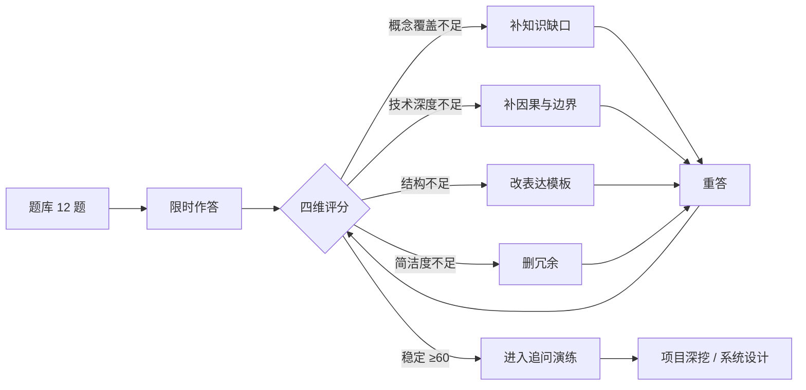
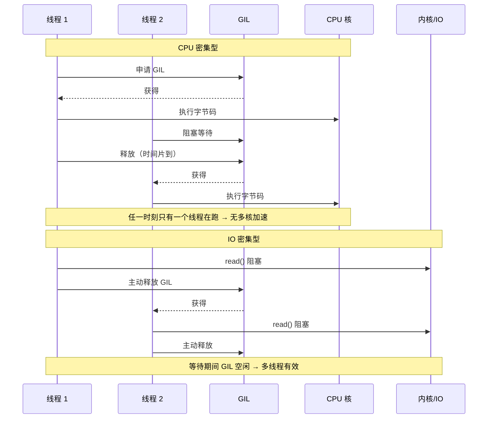
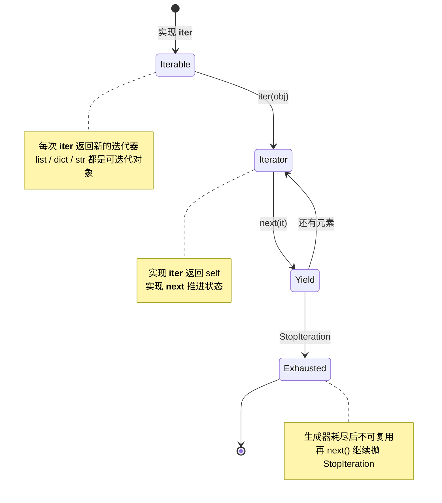
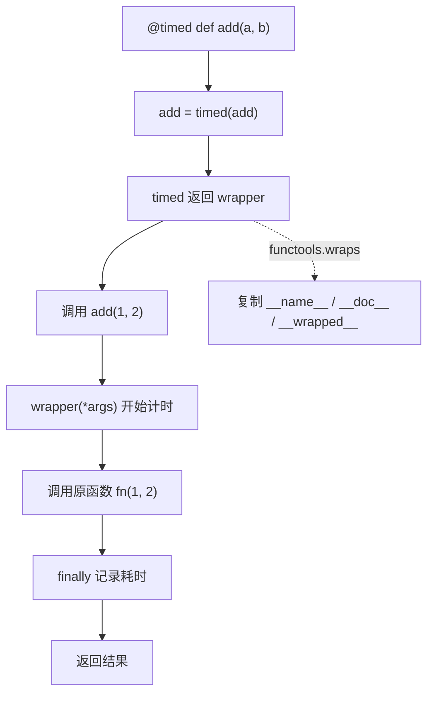
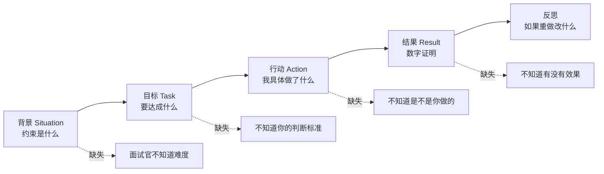

# Day 197 图解 — 面试准备

> 所有图都可用 Mermaid Live（https://mermaid.live）或支持 Mermaid 的 Markdown 渲染器打开。
> 最后一张是纯 ASCII，方便在终端里直接看。

---

## 1. 面试准备的闭环



要点：**评分不是为了打分，而是为了决定下一轮改什么**。
没有反馈的重复练习，只是把同一个错误练得更熟练。

---

## 2. GIL 下的 CPU 密集 vs IO 密集



一句话：**GIL 限制的是「同时执行 Python 字节码」，不是「同时等待 IO」**。

---

## 3. 迭代器协议状态机



---

## 4. 装饰器的调用链



没有 `wraps` 时，`add.__name__` 会变成 `"wrapper"`，
日志、文档生成、框架反射全部拿到错误信息。

---

## 5. STAR 的信息结构



STAR 的本质是**降低对方重建你经历的成本**。
顺序固定，是因为它对应「约束 → 目标 → 选择 → 验证」的决策链。

---

## 6. 复杂度预算图（n 与可接受复杂度）

```text
每秒可执行的 Python 基本操作（量级，实测相关）：
  简单循环/比较       ~1e7 次/秒
  函数调用            ~5e6 次/秒
  哈希查找            ~1e7 次/秒
  排序（C 实现）      ~1e6~1e7 元素/秒

题目给的 n          允许的复杂度            典型算法
---------------------------------------------------------------
n ≤ 10               O(n!) / O(2^n)          回溯、暴力枚举
n ≤ 20               O(2^n)                  状压 DP
n ≤ 100              O(n^3)                  区间 DP、Floyd
n ≤ 1,000            O(n^2)                  普通 DP、双重循环
n ≤ 100,000          O(n log n)              排序、堆、二分
n ≤ 1,000,000        O(n)                    双指针、滑动窗口、哈希
n ≤ 10^8             O(log n) / O(1)         数学、二分答案
---------------------------------------------------------------
经验：先把 n 写下来，再选模板。反过来（先想算法再看 n）十次有三次会选错。
```

---

## 7. 评分流水线（本课实现）

```text
answer.txt
   │
   ├─ normalize：去空白 + 小写
   │
   ├─ 概念覆盖 ── must_have 逐项匹配（支持 a|b 同义词）── 权重 35%
   ├─ 技术深度 ── 因果/复杂度/边界/实测等信号计数 ────── 权重 25%
   ├─ 表达结构 ── 首句定义 + 分句数 + 边界（或 STAR 组）─ 权重 30%
   └─ 简洁度   ── 80–1200 字区间 ───────────────────── 权重 10%
   │
   ├─ 总分 = Σ(维度得分 × 权重)
   ├─ 及格线 60（校准集上选出）
   └─ 建议 = 缺失概念 + 最低维度对应的改法
```

已知局限：词袋匹配不懂语义；同义改写可能被低估；长段关键词堆砌可能蒙混过关。
所以它只能当自查清单，不能替代真人面试。

---

## 8. 一句话记忆卡（ASCII）

```text
GIL      : 同一时刻一个线程跑字节码；IO 等待会释放 → IO 用线程，CPU 用进程
内存     : 引用计数为主，分代 GC 兜循环引用
迭代器   : __iter__ 返回迭代器，__next__ 推进，StopIteration 结束
生成器   : yield 暂停/恢复，惰性，只能遍历一次
装饰器   : 函数 → 函数；@ 是语法糖；wraps 保元数据
默认参数 : 定义时求值一次，可变默认值跨调用共享 → 用 None 哨兵
MRO      : C3 线性化；子类先于父类，声明靠前者优先
拷贝     : 浅拷贝共享内层，深拷贝递归复制
slots    : 省 __dict__，代价是不能动态加属性
异常     : finally 里的 return 会吞异常
哈希     : dict 平均 O(1)，key 必须可哈希
排序     : Timsort 稳定，key 每元素只调一次
二分     : 先定区间语义，再写 mid ± 1
滑动窗口 : 连续子段 + 单调性 → O(n)
DP       : 状态 → 转移 → 边界 → 顺序 → 空间优化
STAR     : 背景 → 目标 → 行动 → 结果（+ 数字 + 反思）
```
