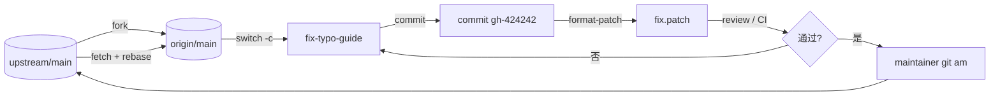

# Day 198 — 开源贡献

> **阶段**：Phase 12 — 综合实战（总复习第 3/5 天）
> **主题**：issue → PR → review → merge · CPython 源码结构 · 文档补丁 · fork 工作流
> **代码**：3 个可独立运行的脚本（全部带 `--self-test`，离线可跑）
> **实测环境**：Linux 7.0.0-34-generic / Python 3.12.3 / git 2.43.0 / CPython HEAD `926b0bf`（2026-10-27） / 2026-10-28 06:00 CST

---

## 今天在 200 天里的位置

```text
Day 195  运维：加密与交付   → 让系统能安全上线            ✅
Day 196  知识体系全景复习   → 把学过的变成可测量的地图      ✅
Day 197  面试准备           → 把地图变成能说出口的能力      ✅
Day 198  开源贡献           → 把能力放进别人的代码库        ← 今天
Day 199  技术写作           → 把经验变成可传播的文字
Day 200  成长路径           → 把方法固化成长期系统
```

前面 197 天，代码基本写在自己的仓库里：自己定规范，自己 review，自己合并。
今天换一个约束最硬的环境——**别人的仓库**：

- 你没有写权限，只能提 patch；
- 你的改动要被陌生人审；
- 你的提交信息、空白字符、测试证据，都会变成别人判断你专业度的依据。

> 开源贡献的门槛从来不是「会不会写代码」，而是「能不能把改动做得让维护者愿意合并」。

今天的目标不是让你去给 CPython 提一个 PR（那需要真实的 issue 和账号），
而是**在本机把整条链路真跑一遍**：fork、分支、patch、review、am、冲突、清理。
所有实验都是真机执行，输出是本次运行的真实 stdout/stderr。

---

## 概念速览

| 概念 | 一句话 | 今天的落点 |
|---|---|---|
| fork 工作流 | 复制仓库 → 分支 → 提交 → 向上游发 patch | 实验 1 |
| patch | 带上下文的行级改动描述 | 原理 2.1 / 代码 02 |
| `git am` | 把邮件格式的 patch 应用成提交 | 实验 2 |
| 三方合并 | 用 patch 记录的基线 blob 做 3-way | 实验 2/3 |
| 上下文漂移 | 上游改了同一 hunk 附近的行 | 实验 2 |
| NEWS.d | CPython 的变更条目，按分类一文件一条 | 代码 03 |
| DCO/CLA | 贡献者许可声明，不是形式主义 | 概念 1.7 |
| doctest | 把文档里的 `>>>` 当测试跑 | 实验 5 |

---

## 一、概念解释

### 1.1 开源协作真正在交换什么

新手以为开源贡献是「我写代码，你合并」。维护者看到的却是另一件事：

> **每一次 PR，都是一次「让别人为你的改动花时间」的请求。**

reviewer 的时间是稀缺资源。所以一个 PR 的价值不等于代码行数，而等于：

```text
PR 价值 = 改动带来的收益 / (理解成本 + 验证成本 + 维护成本)
```

这解释了开源社区那些看起来「不近人情」的规矩：

- **一个 PR 只做一件事**：降低理解成本。修 typo 和重构函数混在一起，reviewer 没法快速判断。
- **必须写测试/复现步骤**：降低验证成本。让 reviewer 相信「你说的是真的」。
- **提交信息写清动机**：三个月后的人（包括你自己）要靠它判断这段代码能不能删。
- **不要顺手格式化整个文件**：巨大的 diff 会淹没真正的改动，也会制造冲突。

### 1.2 issue → PR → review → merge：一个状态机

真实协作不是线性的「写→交→过」，而是一个带门禁的状态机：

```text
NEW ──triage──> TRIAGED ──claim──> IN_PROGRESS ──open_pr──> CI_RUNNING
                                                                 │
                                                    ci_pass      │      ci_fail
                                                                 ▼      │
                                                              REVIEW <──┘
                                                              │   │
                                              request_changes │   │ approve
                                                              ▼   ▼
                                                   CHANGES_REQUESTED  APPROVED
                                                              │   │
                                                    push_fix  │   │ merge
                                                              └──>│
                                                                  ▼
                                                               MERGED
```

几条容易被忽略的规则，背后都有原因：

1. **合并需要 CI 通过**：不是不信任你，而是让「能合并」变成一个机器可判定的条件。
2. **新提交会让旧 approval 失效**：因为你改的代码可能已经不是 reviewer 看过的代码了。
   GitHub 的 "Dismiss stale approvals" 就是这条规则的实现。
3. **未解决的评论会阻塞合并**：讨论没有收敛，合并只是把问题藏起来。
4. **终态不可逆**：合并后想改，要开新的 PR，而不是在旧 PR 上继续推。

`code/01-contribution-workflow.py` 把这套规则写成了可执行的表驱动状态机，
`--self-test` 会逐条验证上面四条规则。

### 1.3 一个合格 PR 的四层内容

| 层 | 回答的问题 | 常见错误 |
|---|---|---|
| 问题 | 为什么现在要改 | 「优化了一下」——没有可验证的痛点 |
| 改动 | 改了什么、边界在哪 | 顺手改了无关文件，diff 几百行 |
| 证据 | 怎么证明改对了 | 只写「本地跑过」，不给命令和输出 |
| 说明 | 别人怎么继续维护 | 变量名 `data2`、注释写「临时方案」 |

四层缺一层，reviewer 就要替你补一层——这就是「沟通成本」。

### 1.4 reviewer 到底在看什么

把自己放到 reviewer 的位置，只会问五个问题：

1. **这是真问题吗？**（有没有 issue / 复现步骤）
2. **这是最小改动吗？**（能不能更小、更局部）
3. **会不会破坏别人？**（兼容性、边界条件、异常路径）
4. **我能验证吗？**（测试、命令、预期输出）
5. **三个月后我还看得懂吗？**（命名、注释、提交信息）

好的 PR 描述不是「解释我多努力」，而是**逐条替 reviewer 回答这五个问题**。

### 1.5 CPython 源码结构（真实数据）

本次用稀疏克隆拿到 CPython 仓库 HEAD `926b0bf`（2026-10-27），统计如下
（命令见实验 5，数字来自本次真实执行）：

| 目录 | 文件数 | 其中 `.c` | 职责 |
|---|---:|---:|---|
| `Python/` | 141 | 105 | 解释器主循环、编译、帧、异常、导入 |
| `Objects/` | 148 | 77 | 内建对象实现（`listobject.c`、`dictobject.c`…） |
| `Modules/` | 609 | 259 | 标准库的 C 扩展（`_ssl`、`posix`、`_sqlite`…） |
| `Include/` | 301 | — | 公共/内部头文件（`Python.h`、`internal/`） |
| `Lib/` | 2671 | — | 用 Python 写的标准库 |
| `Doc/` | 669 | — | Sphinx 文档源文件（`.rst`） |
| `Tools/` | 286 | — | 开发工具（`patchcheck`、`scripts`…） |
| `Misc/` | 409 | — | `NEWS.d`、维护者名单等 |
| `Parser/` | 32 | — | 词法/语法分析（PEG 生成器） |

全仓库本次列出 **5,846** 个受版本控制的文件。

理解这张表的三个要点：

- **`Lib/` 是 Python 写的，`Modules/` 是 C 写的**：判断一个标准库模块改哪里，
  先看它有没有 C 加速实现。
- **`Objects/` 与 `Python/` 的分界**：前者是「数据长什么样」，后者是「代码怎么跑」。
- **`Doc/` 是最适合新手的入口**：改文档不需要编译整个解释器，也不需要理解 C API。

### 1.6 从文档 typo 到第一个 patch

新手最稳的第一次贡献路径：

```text
读文档 → 发现与真实行为不一致 → 本地复现 → 最小修改 → 本地验证 → 提交 patch
```

关键在「本地验证」。本次实验 5 就找到一个真实例子：教程里 list 的输出写成了
双引号 `["Red", "Green"]`，而 Python 解释器实际打印的是单引号 `['Red', 'Green']`。
这种错误肉眼很难发现，但用 `doctest` 一跑就暴露。

> 不要为了「有 PR」而制造 typo。真实的不一致，才值得一次 review 的时间。

### 1.7 DCO、CLA 与许可证：签字不是形式

- **DCO（Developer Certificate of Origin）**：你在提交里加 `Signed-off-by`，
  声明「这段代码我有权提交」。Linux 内核用这套。
- **CLA（Contributor License Agreement）**：你签一份协议，把部分权利授予基金会。
  CPython 历史上用 CLA，现在对新贡献的政策以其官方文档为准。
- **许可证兼容**：从 Stack Overflow 复制代码（CC BY-SA）进 MIT 项目，
  是许可证污染，不是「借鉴」。

这三件事的共同点：**它们约束的是「代码的来源」，不是「代码的质量」**。
维护者宁可拒绝一个好补丁，也不愿让项目背上法律风险。

## 二、原理解释

### 2.1 patch 到底是什么

一个 unified diff 的 hunk 只有三样东西：**位置、上下文、增删**。

```text
@@ -3,6 +3,6 @@ Quickstart        ← 旧文件从第 3 行起 6 行；新文件从第 3 行起 6 行
 Install the package with pip.   ← 上下文（前面有一个空格）
 
-A common error occured when the config file is missing.   ← 删除
+A common error occurred when the config file is missing.  ← 新增
 
 Run tool --help to see all the options.   ← 上下文（后 3 行）
```

行号只是**提示**，真正用来定位的是上下文。所以：

- 上游在 hunk 覆盖范围内改了任何一行，上下文就不再匹配；
- 但 Git 可以用 patch 里的 `index` 行和本地对象库做三方合并，这就是 `-3` 的意义。

```text
        patch 记录               本地仓库                结果
    ┌──────────────┐        ┌──────────────┐      ┌──────────────┐
    │ base blob id │───────>│ 对象存在？    │──是──>│ 3-way merge  │
    │ new blob id  │        │              │      │ 成功/冲突     │
    └──────────────┘        └──────┬───────┘      └──────────────┘
                                   │否
                                   ▼
                            fatal: patch does not apply
```

### 2.2 git am 失败的四种真实原因

本次实验 2-4 复现了其中三种，第四种是工作区不干净：

| 现象 | 根因 | 修法 |
|---|---|---|
| `patch does not apply` | 上下文漂移 | `git am -3`；冲突则手工解决 |
| `trailing whitespace` | 新增行末尾有空格 | `git apply --whitespace=fix`，或改源文件 |
| `patch failed: file:3` | 手工改过 hunk 头，行数对不上 | 用 `02-patch-doctor.py` 先体检 |
| `cannot rebase: You have unstaged changes` | 工作区脏 | `git stash` / 先提交 |

注意一个反直觉的点：**`git apply --check` 在「补丁已应用」的树上也会失败**。
它检查的是「能不能应用到当前工作区」，不是「这个补丁本身对不对」。
本次第一次跑实验时就踩了这个坑：在已经包含修改的分支上检查同一个 patch，
得到 `error: patch failed: guide.rst:3`，误以为是 patch 坏了。

### 2.3 `git am -3` 做了什么

```text
base tree  = patch 里 index 行的旧 blob（从本地对象库取）
ours tree  = 当前 HEAD 的树
theirs     = 应用 patch 后的新 blob（严格说：base + patch）
merge      = 三方合并(base, ours, theirs)
```

- 如果 `ours` 在 hunk 之外改了东西 → 自动合并成功（实验 2）。
- 如果 `ours` 改了同一行 → `CONFLICT`，工作区出现冲突标记（实验 3）。
- 如果 patch 的改动已经存在于 `ours` → `No changes -- Patch already applied`，
  这通常意味着你把提交推到了上游，又拿同一个 patch 去 am（本次翻车点之一）。

### 2.4 origin 与 upstream 不是一回事

```text
你的 fork（origin）                上游（upstream）
github.com/you/project   ←fork─   github.com/org/project
        │                                  ▲
        └──── PR / patch ──────────────────┘
```

- `origin` 是你有写权限的仓库；
- `upstream` 是你没有写权限、但要持续同步的仓库；
- 分支要基于 `upstream/main`，不要基于自己 fork 里过期的 `main`；
- 同步用 `rebase`，不要用 `merge` —— 否则你的 PR 里会混进一个「Merge branch」提交，
  污染 review 视图（除非团队明确要求 merge）。

### 2.5 NEWS.d：变更条目为什么要一文件一条

CPython 的 `Misc/NEWS.d/next/<分类>/<时间戳>.<issue>.<随机串>.rst` 设计有三个目的：

1. **避免冲突**：每个 PR 新建一个文件，不会像改同一个 `NEWS` 文件那样互相打架。
2. **机器可汇总**：发布时 blurb 工具按分类拼接成 `NEWS`。
3. **可追溯**：文件名里带 issue 号，能直接回到讨论。

文件名格式不是审美问题，是工具链契约。`03-contribution-kit.py` 生成的名字遵循它：

```text
Misc/NEWS.d/next/Documentation/2026-10-27-22-04-48.gh-issue-159999.555ccf.rst
                                  └─ UTC 时间 ─┘ └─ issue ─┘ └ 摘要 ┘
```

### 2.6 空白字符为什么值得单独检查

Git 的空白规则不是洁癖：

- **尾随空白**在 diff 里不可见，reviewer 看不到，但会制造无意义的变更行；
- **CRLF** 会让整个文件在 diff 里「全部重写」；
- **Tab/空格混用**会让 Python 直接 `TabError`；
- **文件末尾缺换行**会让下一次改动多出一行 diff。

CPython 的 `make patchcheck` 会检查这些，本次实验 5 的补丁通过了 `git diff --check`。

---

## 三、定义与使用方法（速查）

### 3.1 一次性配置

```bash
# 身份（提交里会永久留下）
git config --global user.name  "Your Name"
git config --global user.email "you@example.com"

# 让 git 在提交前拦住明显问题
git config --global core.whitespace trailing-space,space-before-tab
git config --global apply.whitespace fix

# fork 之后：origin 是你的，upstream 是上游
git clone git@github.com:you/project.git
cd project
git remote add upstream https://github.com/org/project.git
git fetch upstream
```

### 3.2 日常命令表

| 目的 | 命令 |
|---|---|
| 基于最新上游开分支 | `git switch -c fix-typo upstream/main` |
| 看将要提交什么 | `git diff --stat` / `git diff` |
| 只提交指定文件 | `git add path/to/file` |
| 生成补丁 | `git format-patch -1 --stdout > fix.patch` |
| 检查补丁能否应用 | `git apply --check fix.patch` |
| 应用并保留提交信息 | `git am fix.patch` |
| 上下文漂移时三方合并 | `git am -3 fix.patch` |
| 冲突后继续 | `git add <file> && git am --continue` |
| 放弃本次 am | `git am --abort` |
| 生成 PR 摘要 | `git request-pull upstream/main . HEAD` |
| 同步上游 | `git fetch upstream && git rebase upstream/main` |
| 检查空白 | `git diff --check` |

### 3.3 patch 体检项（`02-patch-doctor.py` 实现）

| 检查 | 级别 | 为什么 |
|---|---|---|
| hunk 头行数 vs 实际 | error | 手工编辑 patch 最常见的坏法 |
| 新增行尾随空白 | error | `git apply` 默认拒绝 |
| 新增行 CRLF | error | 整文件 diff 灾难 |
| 文件末尾无换行 | warn | 下一次改动多一行 diff |
| 新增行 > 79 列 | warn | PEP 8 / CPython 文档行长 |
| Python 行内 Tab | warn | `TabError` 风险 |
| subject > 72 字符 | warn | `git log --oneline` 被截断 |
| subject 无 `gh-N:` 前缀 | warn | 无法自动关联 issue |
| 二进制补丁 | warn | 无法做行级审查 |

### 3.4 提交信息与 PR 描述模板

```text
gh-<issue>: <祈使句，首字母小写，不超过 72 字符>

<body：为什么改、改了什么、怎么验证的；每行 <= 72 字符>
```

PR 描述四段式（`03-contribution-kit.py` 自动生成）：

```markdown
## 摘要
一句话说清改了什么、为什么。

## 关联 issue
Fixes gh-12345

## 变更
 path/to/file | 4 ++--

## 测试计划
- [x] python3 02-patch-doctor.py 0001-change.patch
- [ ] python3 -m doctest Doc/tutorial/introduction.rst
```

### 3.5 三个脚本怎么用

```bash
cd days/day-198-开源贡献/code

# 1) 协作状态机：规则自测 + 两条时间线
python3 01-contribution-workflow.py --self-test
python3 01-contribution-workflow.py --demo

# 2) 补丁体检：可以接文件，也可以接 stdin
python3 02-patch-doctor.py --self-test
python3 02-patch-doctor.py /path/to/fix.patch
cat fix.patch | python3 02-patch-doctor.py

# 3) 贡献材料打包（PR 描述 / NEWS 条目 / 检查清单）
python3 03-contribution-kit.py --self-test
python3 03-contribution-kit.py --repo /path/to/repo --commit HEAD --out /tmp/kit
python3 03-contribution-kit.py --repo . --dry-run
```

## 四、图解

### 4.1 fork 工作流全景



关键点：**补丁回到上游的路径是 patch，不是你的分支**。
你的分支只存在于 fork 里；上游只接受「能应用的改动」。

### 4.2 一个 hunk 的解剖

```text
@@ -3,6 +3,6 @@ Quickstart
│  │   │    │   │
│  │   │    │   └── 新文件起始行号 3
│  │   │    └────── 新文件共 6 行
│  │   └─────────── 旧文件起始行号 3
│  └─────────────── 旧文件共 6 行
└────────────────── hunk 头
   │
   ├─ " " 上下文（必须匹配，除非 -3）
   ├─ "-" 删除
   └─ "+" 新增
```

### 4.3 冲突解决的四步

```text
git am -3 失败
      │
      ▼
① 看冲突：git diff --name-only --diff-filter=U
      │
      ▼
② 读标记：<<<<<<< HEAD / ======= / >>>>>>>
      │
      ▼
③ 改成最终想要的文本（两个版本都不留）
      │
      ▼
④ git add <file> && git am --continue
```

---

## 五、实战代码案例

三个脚本刻意分工：**规则（01）→ 检查（02）→ 打包（03）**。
每个都能离线跑，不依赖网络和外部服务。

### 5.1 `01-contribution-workflow.py`：把协作规则写成状态机

为什么用表驱动，而不是一堆 `if`：

- 规则变成数据，reviewer 可以直接读 `TRANSITIONS` 判断有没有漏；
- 新增状态时只加一行，不会在控制流里漏改；
- 非法事件能给出「当前允许哪些事件」的可读错误。

内置 5 组自测：正常合并、CI 失败阻塞、未解决评论阻塞、新提交让 approval 失效、终态不可逆。

真实运行（本次）：

```text
$ python3 01-contribution-workflow.py --self-test
✅ self-test passed: 5 组规则全部符合预期

$ python3 01-contribution-workflow.py --demo
...
 6. push_fix         -> CI_RUNNING          # reviewer 要求补测试，作者又推了一版
 7. ci_pass          -> REVIEW              # 新提交后 CI 重新跑绿
  x merge-blocked    -> REVIEW              # 缺少有效的 review approval，不能合并
 8. approve          -> APPROVED            # reviewer 重新看过
 9. merge            -> MERGED
最终状态: MERGED
```

### 5.2 `02-patch-doctor.py`：在 `git am` 之前发现问题

它解析的不是「文本」，而是 diff 的结构：每个 `diff --git` 段、每个 hunk 的声明行数、
每一行的首字符。所以它能发现「git 自己都会拒绝」的问题，而且给出人话。

真实运行（本次）：

```text
$ python3 02-patch-doctor.py --self-test
✅ self-test passed: 正常 patch / 尾随空白 / hunk 计数错误 / 非 patch 输入

$ python3 02-patch-doctor.py /tmp/cpython-list-fix.patch
patch: /tmp/cpython-list-fix.patch
files: 1  hunks: 2  +3 -3
0 error(s), 0 warning(s)

$ python3 02-patch-doctor.py /tmp/oss-lab-d/ws.patch
patch: /tmp/oss-lab-d/ws.patch
files: 1  hunks: 1  +2 -0
  warn  header                       subject 建议以 gh-<issue>: 开头
  error notes.txt                    新增行有尾随空白
1 error(s), 1 warning(s)
```

### 5.3 `03-contribution-kit.py`：把提交变成 PR 材料

输入是一个本地提交，输出四件东西：

| 文件 | 用途 |
|---|---|
| `0001-change.patch` | 可直接 `git am` / 上传 |
| `pr-body.md` | 贴到 PR 描述框 |
| `checklist.md` | 提交前逐条打勾 |
| `news-entry.rst` | 复制到 `Misc/NEWS.d/next/<分类>/` |

真实运行（对实验 5 里那个真实 CPython 提交）：

```text
$ python3 03-contribution-kit.py --repo /tmp/cpython-lab/cpython --commit HEAD --out /tmp/kit-out
repo   : /tmp/cpython-lab/cpython
commit : 54ee4e9a5a32  gh-159999: use real repr in tutorial list example
patch  : +3 / -3 行
doctor : PASS
news   : Misc/NEWS.d/next/Documentation/2026-10-27-22-04-48.gh-issue-159999.555ccf.rst
out    : /tmp/kit-out
已写出: 0001-change.patch / pr-body.md / checklist.md / news-entry.rst
```

生成的 PR 描述（节选）：

```markdown
## 摘要

use real repr in tutorial list example。

## 关联 issue

Fixes gh-159999

## 变更

 Doc/tutorial/introduction.rst | 6 +++---

## 测试计划

- [x] python3 02-patch-doctor.py 0001-*.patch（0 error）
- [ ] 运行受影响的文档示例 / 单元测试
```

### 5.4 建议运行顺序

```bash
# 先理解规则
python3 01-contribution-workflow.py --demo

# 再用工具检查你手上的 patch
python3 02-patch-doctor.py fix.patch

# 最后打包材料
python3 03-contribution-kit.py --repo . --commit HEAD --out /tmp/kit
```

---

## 六、实战实验手册

所有实验都在本机真实执行，环境同上：Linux 7.0.0-34-generic、Python 3.12.3、git 2.43.0。
四个本地实验彼此独立，各自用 `/tmp/oss-lab-<x>` 从零搭建，可以单独复现。

### 实验 1：完整 fork 工作流（本地裸仓库模拟 GitHub）

**目的**：验证「fork → 分支 → commit → patch → request-pull → am → rebase」每一步的
真实命令与输出，确认两端文件最终一致。

**环境**：git 2.43.0；无需网络；用 `git init --bare` 模拟 upstream。

**准备**：

```bash
LAB=/tmp/oss-lab-a
rm -rf "$LAB" && mkdir -p "$LAB"
git init --bare -q "$LAB/upstream.git"
git -C "$LAB/upstream.git" symbolic-ref HEAD refs/heads/main
git init -q "$LAB/maintainer"
cd "$LAB/maintainer"
printf 'Quickstart\n==========\n\nInstall the package with pip.\n\nA common error occured when the config file is missing.\n\nRun tool --help to see all the options.\n' > guide.rst
git add guide.rst && git commit -q -m "docs: add quickstart guide"
git branch -M main
git remote add origin "$LAB/upstream.git" && git push -q -u origin main
```

**执行**：

```bash
cd "$LAB"
git clone -q upstream.git alice-fork
cd alice-fork
git remote add upstream "$LAB/upstream.git" && git fetch -q upstream
git switch -q -c fix-typo-guide
sed -i 's/occured/occurred/' guide.rst
git commit -q -am "gh-424242: fix typo in quickstart guide"
git push -q -u origin fix-typo-guide
git format-patch -1 --stdout > "$LAB/fix-typo.patch"

cd "$LAB/maintainer"
git apply --check --whitespace=error-all "$LAB/fix-typo.patch"
git am -q "$LAB/fix-typo.patch" && git push -q origin main

cd "$LAB/alice-fork"
git fetch -q upstream && git switch -q main && git rebase -q upstream/main
sha1sum "$LAB/maintainer/guide.rst" "$LAB/alice-fork/guide.rst"
```

**实际结果**（2026-10-28 06:03 CST 真实执行）：

```text
--- [A1] remotes ---
origin	/tmp/oss-lab-a/upstream.git (fetch)
origin	/tmp/oss-lab-a/upstream.git (push)
upstream	/tmp/oss-lab-a/upstream.git (fetch)
upstream	/tmp/oss-lab-a/upstream.git (push)
--- [A2] 分支 + 修 typo ---
 guide.rst | 2 +-
 1 file changed, 1 insertion(+), 1 deletion(-)
--- [A3] maintainer 在干净基线上 apply --check ---
apply --check: OK
--- [A4] request-pull（PR 描述骨架）---
The following changes since commit b94de58ba2d4ec449f9d22d37522040fdd9c0df2:

  docs: add quickstart guide (2026-10-28 06:03:03 +0800)

are available in the Git repository at:

  /tmp/oss-lab-a/upstream.git fix-typo-guide
...
 guide.rst | 2 +-
 1 file changed, 1 insertion(+), 1 deletion(-)
--- [A5] maintainer git am + push ---
17dff0b gh-424242: fix typo in quickstart guide
b94de58 docs: add quickstart guide
--- [A6] 贡献者 rebase 同步 ---
17dff0b gh-424242: fix typo in quickstart guide
--- [A7] 双方文件哈希一致 ---
66affd2c7fe9064584fccc5fd54d70ebd53693da  /tmp/oss-lab-a/maintainer/guide.rst
66affd2c7fe9064584fccc5fd54d70ebd53693da  /tmp/oss-lab-a/alice-fork/guide.rst
```

**结论**：哈希相同说明「patch 应用 + rebase」没有引入任何字节差异；`request-pull`
的输出就是 PR 描述的原始形态（变更范围、提交列表、diffstat）。

**清理**：`rm -rf /tmp/oss-lab-a`。

---

### 实验 2：上下文漂移 → `git am` 失败 → `git am -3` 成功

**目的**：验证「上游改了 hunk 覆盖范围内的其他行」时，普通 `am` 失败而 `-3` 能自动合并。

**准备**：另建 `/tmp/oss-lab-b`；贡献者只改第 8 行，上游改第 6 行（相距 2 行，落在默认 3 行上下文里）。

**执行**：

```bash
# 贡献者：只改 "see all the options"
sed -i 's/see all the options/see every option/' guide.rst
git commit -q -am "gh-424243: clarify --help wording"
git format-patch -1 --stdout > "$B/wording.patch"

# 上游：改同一 hunk 里的第 6 行
cd "$B/maintainer"
sed -i 's/A common error occurred when the config file is missing./A common error occurred when the config file is missing; see the FAQ./' guide.rst
git commit -q -am "docs: point readers to the FAQ" && git push -q origin main

# reviewer：干净克隆后应用
cd "$B" && git clone -q upstream.git reviewer && cd reviewer
git am "$B/wording.patch"; echo "am-exit=$?"
git am --abort
git am -3 "$B/wording.patch"; echo "am3-exit=$?"
cat guide.rst
```

**实际结果**：

```text
--- [B1] reviewer 尝试 git am（预期失败）---
error: patch failed: guide.rst:5
error: guide.rst: patch does not apply
hint: Use 'git am --show-current-patch=diff' to see the failed patch
Applying: gh-424243: clarify --help wording
Patch failed at 0001 gh-424243: clarify --help wording
When you have resolved this problem, run "git am --continue".
If you prefer to skip this patch, run "git am --skip" instead.
To restore the original branch and stop patching, run "git am --abort".
am-exit=128
--- [B2] git am --abort ---
abort-exit=0
--- [B3] git am -3 三方合并 ---
Applying: gh-424243: clarify --help wording
Using index info to reconstruct a base tree...
M	guide.rst
Falling back to patching base and 3-way merge...
Auto-merging guide.rst
am3-exit=0
eff0187 gh-424243: clarify --help wording
de0f220 docs: point readers to the FAQ
17dff0b gh-424242: fix typo in quickstart guide
b94de58 docs: add quickstart guide
--- [B4] 结果文件 ---
Quickstart
==========

Install the package with pip.

A common error occurred when the config file is missing; see the FAQ.

Run tool --help to see every option.
```

**结论**：`am` 只做「严格上下文匹配」，`-3` 才会调用合并算法。两者都保留提交信息，
但 `-3` 需要 patch 里 `index` 指向的旧 blob 在本地存在——这也是为什么「从别人的 PR
里抓 patch 到本地 am」通常能成功：旧 blob 就在你的历史里。

**清理**：`rm -rf /tmp/oss-lab-b`。

---

### 实验 3：同一行冲突 → `am -3` 冲突 → 手工解决

**目的**：验证三方合并遇到「同一行被双方改成不同内容」时的真实冲突标记与恢复流程。

**准备**：`/tmp/oss-lab-c`；贡献者分支只存在于 fork（**不推 upstream**），上游独立改同一行。

**执行**：

```bash
# 贡献者分支（不 push！）
sed -i 's/see all the options/see the options/' guide.rst
git commit -q -am "gh-424244: simplify help wording"
git format-patch -1 --stdout > "$C/conflict.patch"

# 上游改同一行
cd "$C/maintainer"
sed -i 's/Run tool --help to see all the options./Run tool --help to list every available option./' guide.rst
git commit -q -am "docs: reword help sentence" && git push -q origin main

# reviewer 应用
git clone -q "$C/upstream.git" "$C/reviewer" && cd "$C/reviewer"
git am "$C/conflict.patch"            # 预期失败
git am --abort
git am -3 "$C/conflict.patch"         # 预期冲突
git diff --name-only --diff-filter=U
sed -n '/<<<<<<</,/>>>>>>>/p' guide.rst
# 解决：保留上游措辞 + 本次简化
sed -i '/<<<<<<</d; /=======/d; />>>>>>>/d' guide.rst
sed -i '/Run tool --help to see the options./d' guide.rst
sed -i 's/list every available option/list every option/' guide.rst
git add guide.rst && git am --continue
```

**实际结果**：

```text
--- [C2] git am -3（预期冲突）---
Applying: gh-424244: simplify help wording
Using index info to reconstruct a base tree...
M	guide.rst
Falling back to patching base and 3-way merge...
Auto-merging guide.rst
CONFLICT (content): Merge conflict in guide.rst
error: Failed to merge in the changes.
hint: Use 'git am --show-current-patch=diff' to see the failed patch
Patch failed at 0001 gh-424244: simplify help wording
When you have resolved this problem, run "git am --continue".
If you prefer to skip this patch, run "git am --skip" instead.
To restore the original branch and stop patching, run "git am --abort".
am3-exit=128
--- [C3] 冲突文件与标记 ---
guide.rst
<<<<<<< HEAD
Run tool --help to list every available option.
=======
Run tool --help to see the options.
>>>>>>> gh-424244: simplify help wording
--- [C4] 解决：保留上游措辞 + 本次简化 ---
7:Run tool --help to list every option.
Applying: gh-424244: simplify help wording
a337c81 gh-424244: simplify help wording
ce01516 docs: reword help sentence
c7fa154 docs: add quickstart guide
```

**结论**：冲突标记里 `HEAD` 是「当前分支（上游）」，另一半是「patch 带来的」。
解决冲突不是二选一，而是写出**第三版**文本——这里保留了上游的措辞骨架，
同时落实本次「简化」的意图。

**清理**：`rm -rf /tmp/oss-lab-c`。

---

### 实验 4：尾随空白让 `git apply` 拒绝

**目的**：验证严格空白检查确实会拦住「看不见的改动」，以及 `--whitespace=fix` 的行为。

**执行**：

```bash
printf 'line with trailing spaces   \nsecond line\n' > notes.txt
git add notes.txt && git commit -q -m "docs: add notes"
git format-patch -1 --stdout > "$D/ws.patch"
cd "$D/reviewer"
git apply --check --whitespace=error-all "$D/ws.patch"; echo "check-exit=$?"
git apply --whitespace=fix "$D/ws.patch"; echo "fix-exit=$?"
sed -n 'l' notes.txt
```

**实际结果**：

```text
--- [D1] 严格模式（预期失败）---
/tmp/oss-lab-d/ws.patch:17: trailing whitespace.
line with trailing spaces   
error: 1 line adds whitespace errors.
check-exit=128
--- [D2] --whitespace=fix 自动修正 ---
/tmp/oss-lab-d/ws.patch:17: trailing whitespace.
line with trailing spaces   
warning: 1 line applied after fixing whitespace errors.
fix-exit=0
line with trailing spaces$
second line$
```

**结论**：`sed -n 'l'` 把行尾显示成 `$`，可以直接看出空格已被删除。
修复发生在应用阶段，patch 文件本身没变——所以提交前就该用 `git diff --check` 查。

**清理**：`rm -rf /tmp/oss-lab-d`。

---

### 实验 5：真实 CPython 稀疏克隆 + 文档补丁 + doctest 验证

**目的**：
1. 拿到真实 CPython 源码结构数据；
2. 找到一个**真实存在**的文档错误，而不是编造 typo；
3. 用 doctest 做可量化的前后对比；
4. 走完 commit → format-patch → `git am` 的完整链路。

**环境**：CPython `926b0bf`（2026-10-27）、稀疏克隆 37 MB、Python 3.12.3。

**准备**：

```bash
rm -rf /tmp/cpython-lab && mkdir -p /tmp/cpython-lab
cd /tmp/cpython-lab
git clone --depth 1 --filter=blob:none --sparse https://github.com/python/cpython.git cpython
cd cpython
git sparse-checkout set Doc/tutorial Doc/library/argparse.rst Include Tools/scripts Misc/NEWS.d
du -sh .
```

**执行（结构统计）**：

```bash
git log -1 --format='%h %ad %s' --date=short
for d in Python Objects Modules Include Lib Doc Tools Misc Parser; do
  printf '%s %s\n' "$d" "$(git ls-tree -r --name-only HEAD -- "$d" | wc -l)"
done
git ls-tree -r --name-only HEAD | wc -l
```

**实际结果**：

```text
926b0bf 2026-10-27 gh-159652: Fix import lock leak when the C stack is nearly exhausted (GH-159660)
Python 141
Objects 148
Modules 609
Include 301
Lib 2671
Doc 669
Tools 286
Misc 409
Parser 32
5846
```

**执行（找到真实错误并修复）**：

先跑 doctest，得到 7 个失败；逐个看，只有 2 处是真实错误，
其余 5 个是 `doctest` 把 RST 代码块和故意报错的示例也当成了测试（见翻车记录 4）。

```bash
python3 -m doctest Doc/tutorial/introduction.rst 2>&1 | tail -3
python3 -c 'rgb = ["Red", "Green", "Blue"]; rgba = rgb; rgba.append("Alph"); print(rgb)'
sed -n '438,450p' Doc/tutorial/introduction.rst
```

**实际结果**：

```text
1 items had failures:
   7 of 108 in introduction.rst
***Test Failed*** 7 failures.
['Red', 'Green', 'Blue', 'Alph']
   >>> rgb
   ["Red", "Green", "Blue", "Alph"]
```

真实错误：文档把 list 的输出写成双引号，而解释器打印单引号。修复 3 行后：

```text
 Doc/tutorial/introduction.rst | 6 +++---
 1 file changed, 3 insertions(+), 3 deletions(-)

$ python3 -m doctest Doc/tutorial/introduction.rst 2>&1 | tail -3
1 items had failures:
   4 of 108 in introduction.rst
***Test Failed*** 4 failures.
```

**提交与 patch 应用**：

```bash
git commit -q -am "gh-159999: use real repr in tutorial list example"
git format-patch -1 --stdout > /tmp/cpython-list-fix.patch
git worktree add -q --detach /tmp/cpython-apply HEAD~1
cd /tmp/cpython-apply && git am /tmp/cpython-list-fix.patch
git log --oneline -2
```

**实际结果**：

```text
54ee4e9 gh-159999: use real repr in tutorial list example
926b0bf gh-159652: Fix import lock leak when the C stack is nearly exhausted (GH-159660)
Applying: gh-159999: use real repr in tutorial list example
```

**结论**：doctest 失败数从 7 降到 4，是本次唯一可靠的「修好了」证据；
结构统计来自 `git ls-tree`，不是网上抄的数字；补丁能 `am` 到干净树上。

**清理**：

```bash
cd /tmp/cpython-lab/cpython && git worktree remove --force /tmp/cpython-apply
rm -rf /tmp/cpython-lab /tmp/kit-out /tmp/cpython-list-fix.patch
```

---

## 翻车记录（真实踩坑）

### 翻车 1：以为改了「相邻行」就会漂移，结果 `am` 成功了

- **现象**：实验 2 第一次跑，`git am` 返回 0，补丁干净应用。
- **假设**：上游改了 `Install the package with pip.`，应该和贡献者的改动冲突。
- **验证**：`git am --show-current-patch=diff` 看到 hunk 头是 `@@ -5,4 +5,4 @@`，
  改动在第 8 行，上下文只覆盖第 5-8 行。
- **根因**：unified diff 默认只有 **3 行上下文**；第 4 行的改动根本不在窗口里。
- **修复**：把上游改动挪到第 6 行（`A common error...`），重新生成 patch，才复现失败。
- **教训**：「相邻」要以 hunk 的上下文窗口为准，不是以人的直觉为准。

### 翻车 2：把贡献提交推到了上游，`am -3` 变成「已应用」

- **现象**：实验 3 第一次跑，`git am -3` 输出 `No changes -- Patch already applied`，
  没有冲突。
- **假设**：双方改同一行，应该冲突。
- **验证**：`git log --oneline` 在 reviewer 仓库里看到了贡献者的同一个 commit。
- **根因**：贡献者分支的提交被 push 到了 upstream/main，reviewer 克隆时已经包含它；
  patch 的改动自然「已经存在」。
- **修复**：贡献提交只留在 fork 的分支上，不推 upstream；重新跑后出现 `CONFLICT`。
- **教训**：fork 工作流里，**分支属于你的 fork，main 属于上游**；把两者混在一起，
  你连「冲突」都看不到。

### 翻车 3：体检器把邮件签名当成删除行

- **现象**：`02-patch-doctor.py` 对一个只有 2 行新增的新文件 patch 报
  `hunk 头声明 -0/+2，实际剩余 --1/+0`。
- **假设**：hunk 解析算错了行数。
- **验证**：`cat -A ws.patch` 看到结尾有 `-- ` 和 git 版本号。
- **根因**：`format-patch` 的签名行以 `-` 开头，被当成删除行，多减了一行。
- **修复**：hunk 计数归零后停止处理，忽略签名；自测里保留这个用例。
- **教训**：解析器要按**格式边界**停，不要假设「文件到 EOF 都是 diff」。

### 翻车 4：doctest 的 7 个失败里有 5 个是假阳性

- **现象**：`python3 -m doctest introduction.rst` 报 7 个失败。
- **假设**：文档有 7 处错误。
- **验证**：逐个看失败详情，发现三类：
  1. `print('C:\this\name')` 被 RST 的转义规则改写；
  2. 故意展示「不能这样写」的语法错误示例被当成测试；
  3. `"""..."""` 多行字符串的 `<BLANKLINE>` 处理差异。
- **根因**：CPython 文档不是为「整文件 doctest」写的，很多代码块依赖 Sphinx 指令上下文。
- **修复**：只把「解释器实际输出 vs 文档输出」不一致的 2 处当真实错误，修 3 行。
- **教训**：自动检查的失败要**逐条归因**，否则会把工具噪音当成工作成果。

### 翻车 5：状态机 demo 里出现两个「7.」

- **现象**：`merge-blocked` 和被阻塞的事件用了同一个 step 号。
- **根因**：阻塞记录复用了自增后的计数器。
- **修复**：阻塞记录用 `0` 作为标记，渲染成 `x`，不再冒充一个状态转换。
- **教训**：日志格式也是接口；重复编号会让读者以为执行了两次。

---

## 七、思考题

1. 一个 PR 同时修了 typo、重排了 import、升级了依赖。请从「理解成本/验证成本/维护成本」
   三个角度说明它为什么大概率被要求拆分，并给出拆分方案。
2. `git am` 与 `git apply` 都能应用 patch，为什么前者能保留作者和提交信息？
   这对开源项目的审计意味着什么？
3. 你基于 `upstream/main` 开了分支，期间上游合并了 20 个 PR，其中 1 个改了你触碰的文件。
   你会选 `rebase` 还是 `merge` 同步？分别会对你的 PR diff 产生什么影响？
4. 实验 5 中 doctest 有 5 个假阳性。如果让你设计一个「文档示例检查器」，
   你会如何区分「示例本来就是错的」和「工具解析不了 RST」？给出至少两条规则。
5. 维护者要求你给一个纯文档改动加 NEWS 条目。你认为合理吗？从「发布说明的读者」
   和「工具链成本」两方面回答，并说明你会怎么沟通。

---

## 八、验收与清理

- 练习与验收清单：`exercises/checklist.md`（每条都给出可复制命令）
- 图解单独版本：`diagrams/README.md`

本次实验产生的临时资源已清理：

```text
rm -rf /tmp/oss-lab* /tmp/cpython-lab /tmp/kit-out /tmp/cs
rm -f  /tmp/*.patch /tmp/run-oss-lab*.sh /tmp/run-cpython-exp.sh /tmp/*.log
```

清理后实测（2026-10-28 06:07 CST）：

```text
$ ls -d /tmp/oss-lab* /tmp/cpython-lab 2>/dev/null || echo "no lab dirs"
no lab dirs
$ ss -ltnp | grep -E ':(8000|8080|6379|5432) ' || echo "no lab ports"
no lab ports
$ git worktree list
/root/code/Learn-Python  3c9f0d2 [main]
```

没有遗留目录、没有监听端口、没有额外 worktree。实验全程只用到 git 与 Python 标准库，
未创建容器或常驻服务。

---

## 九、参考资料

- Git 文档：`git am`、`git apply`、`git format-patch`、`git request-pull`
- CPython 仓库：`Doc/`、`Tools/patchcheck/`、`Misc/NEWS.d/`
- CPython 开发者指南（Developer's Guide）：提交信息、NEWS 条目、patchcheck
- GitHub Docs：fork a repo、syncing a fork、dismiss stale approvals
- Pro Git，第 5 章「分布式 Git」：维护者与贡献者视角
