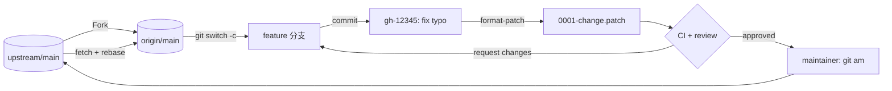
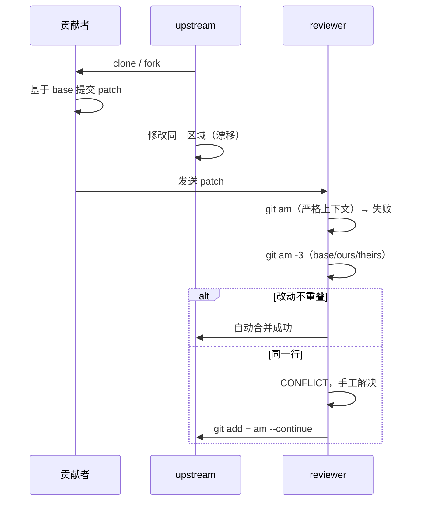

# Day 198 图解 — 开源贡献

本文件是 `README.md` 中图解部分的独立版本，方便单独阅读或打印。

## 1. fork 工作流



读图要点：

1. 你的分支永远在 fork 里，不直接写 upstream。
2. 上游接受的是 patch（或等价的 PR 合并），不是你的分支引用。
3. 同步方向只有一条：upstream → fork，且用 rebase 保持线性历史。

## 2. hunk 结构

```text
@@ -3,6 +3,6 @@ Quickstart
│  │   │    │   │
│  │   │    │   └── 新文件起始行号
│  │   │    └────── 新文件行数
│  │   └─────────── 旧文件起始行号
│  └─────────────── 旧文件行数
└────────────────── hunk 头（@@ 包围）

 上下文行（空格开头）：必须逐字节匹配，否则 am 失败
-删除行
+新增行
```

## 3. 三方合并



## 4. CPython 目录分层

```text
        ┌──────────────────────────────────────────┐
        │                Lib/ (Python)             │
        │  argparse.py  asyncio/  json/  ...       │
        └───────────────┬──────────────────────────┘
                        │ import _ssl / _sqlite3 ...
        ┌───────────────▼──────────────────────────┐
        │              Modules/ (C 扩展)            │
        │  _ssl.c  _sqlite/module.c  posixmodule.c │
        └───────────────┬──────────────────────────┘
                        │ 调用对象协议
        ┌───────────────▼──────────────────────────┐
        │   Objects/ (数据)      Python/ (执行)     │
        │   listobject.c         ceval.c           │
        │   dictobject.c         compile.c         │
        └───────────────┬──────────────────────────┘
                        │ 公共 API
        ┌───────────────▼──────────────────────────┐
        │                Include/                  │
        │   Python.h  internal/pycore_*.h          │
        └──────────────────────────────────────────┘

  旁路：Doc/（Sphinx 源文件）  Tools/（开发工具）  Misc/NEWS.d/（变更条目）
```

## 5. PR 价值公式

```text
            收益
  ─────────────────────────
   理解 + 验证 + 维护成本

  收益 ↑：修真实问题、覆盖边界、可复用
  成本 ↓：diff 小、证据全、命名清楚、提交信息完整
```
