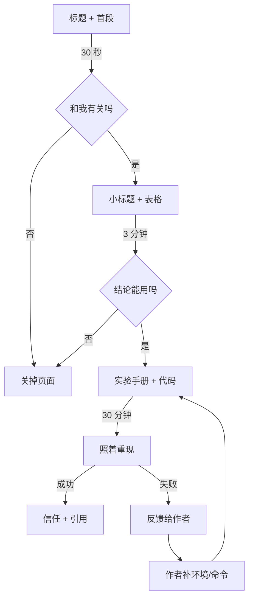
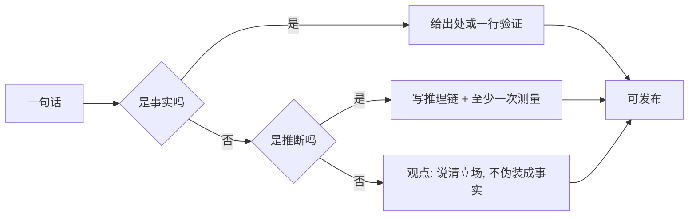
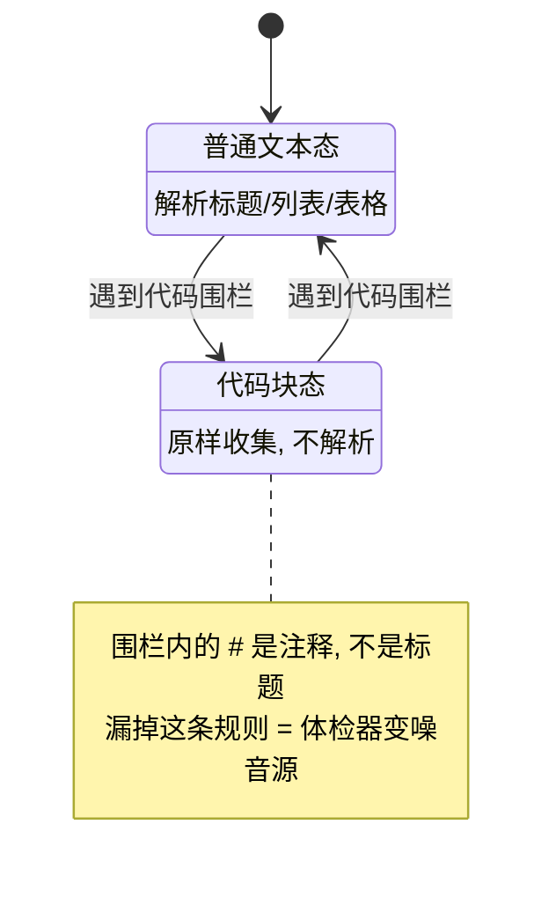
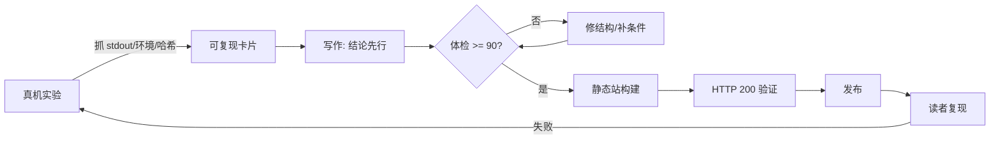

# Day 199 图解 — 技术写作

本目录只放图解，不生成图片文件。所有图都能在 GitHub / 本地 Markdown 渲染器中直接显示。

---

## 图 1：一篇文章的三个退出层



**读法**：任何一层都要自洽。只读第二层的人也应该拿走可用结论——
这就是"实验手册"必须独立成章、而不是散在叙述里的原因。

---

## 图 2：断言的三级与证据要求



"显然"之所以危险，是因为它让第三类句子（观点）冒充第一类（事实），跳过了举证。

---

## 图 3：可复现性契约的五个字段

```text
                 +-----------------------------+
                 |      一次可复现的实验        |
                 +-----------------------------+
                    |      |      |      |    |
        +-----------+      |      |      |    +-------------+
        |                  |      |      |                  |
   +---------+      +-----------+  |  +-----------+   +-------------+
   |  环境    |      |   命令     |  |  |  样本量    |   |  输出指纹    |
   | 版本/CPU |      | 可复制一行 |  |  | N 次/中位  |   |  sha256     |
   +---------+      +-----------+  |  +-----------+   +-------------+
                                   |
                            +-------------+
                            |  原始输出    |
                            | stdout/stderr|
                            +-------------+
```

缺任意一格，读者就只能"相信"，不能"验证"。

---

## 图 4：Markdown 体检器的状态机



---

## 图 5：从实验到发布的流水线



注意最后一条回边：发布不是终点，读者复现失败才是最有价值的输入。

---

## 图 6：误报是怎么被修掉的（真实数据）

```text
版本                        post.md 评分   误报
v1  逐词匹配                 79/100        7 条（front matter + 引用 + TODO 清单）
v2  剥离「」引号              85/100        2 条（ASCII 双引号没剥）
v3  剥离 ASCII 引号           100/100       0 条
v4  行内代码也剥离 + 收紧词表   100/100       0 条（README 自检 94 -> 100）
```

**结论**：规则的价值不在"抓得多"，而在"只抓该抓的"。一条会对自己开火的规则，
在真实使用中会迅速被忽略。
