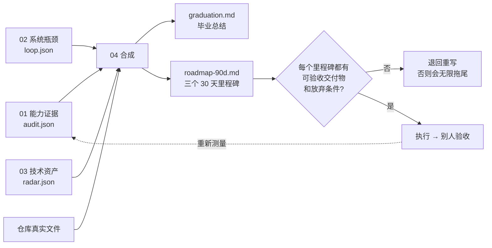
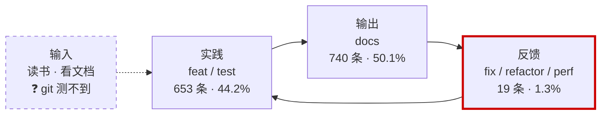
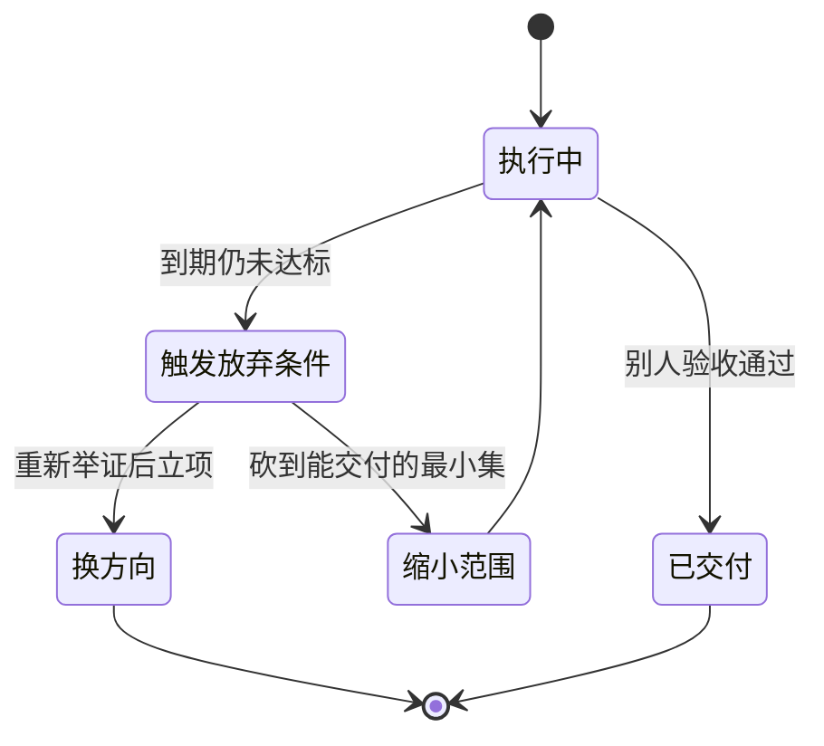

# Day 200 — 持续成长路径

> **阶段**：Phase 12 — 综合实战（总复习第 5/5 天）
> **主题**：能力模型与自评 · 学习系统 · 长期维护与技术选型 · 毕业总结与 90 天路线图
> **代码**：4 个可独立运行的脚本（全部带 `--self-test`，离线可跑）

---

## 今天在 200 天里的位置

```text
Day 196  知识体系全景复习   → 把学过的变成地图        ✅
Day 197  面试准备           → 把地图变成口头能力      ✅
Day 198  开源贡献           → 把能力放进别人的仓库    ✅
Day 199  技术写作           → 把经验变成可传抄的文字  ✅
Day 200  持续成长路径       → 把方法固化成长期系统    ← 今天
```

前 199 天，题目是别人出的：目录里写着 Day N，照着做就是了。
今天是最后一课，也是最奇怪的一课——**它不教任何新知识**。

它只回答一个问题：从明天起没有人给你出题了，你凭什么决定下一课学什么？

凭感觉是不行的。「我感觉 Python 学得挺好了」这句话有三个致命伤：
没法比较（和谁比？比什么？）、没法追踪（三个月后怎么知道有没有进步）、
也没法被反驳（谁质疑都可以回一句「你不了解我」）。感觉不是判据。

所以今天交付的不是知识，是一台**出题机**：四个脚本分别测量你的能力证据、
学习习惯、技术资产，最后合成一份带放弃条件的 90 天路线图。
明天不用再问「今天学什么」——缺口自己会说话。

---

## 概念速览

| 概念 | 一句话 | 今天的落点 |
|---|---|---|
| 证据阶梯 | 「会」的四个等级：读过 → 跑过 → 自证过 → 交付过 | 概念 1.2 · 代码 01 |
| 校准差 | 自评减证据分：正数是高估，负数是低估，修法完全不同 | 概念 1.3 |
| 学习回路 | 输入 → 实践 → 输出 → 反馈，断一环就白学 | 概念 1.4 · 代码 02 |
| 批量提交污染 | 一次改 199 课的提交，能把指标刷成满分 | 原理 2.3 |
| 技术雷达 | 用过 ≠ 敢用：Adopt / Trial / Assess / Hold 四环 | 概念 1.5 · 代码 03 |
| 依赖是负债 | 引入一个包，就签一份没有到期日的维护合同 | 概念 1.6 |
| 放弃条件 | 没有放弃条件的计划，会无限拖尾 | 概念 1.7 · 代码 04 |

---

## 一、概念解释

### 1.1 毕业改变的不是知识量，是判据

学习期的判据是外来的：题目会告诉你对错，目录会告诉你今天学什么。
这个判据非常省心，但它有一个隐藏条款——**它只在有人出题时有效**。

毕业后，判据必须换成你自己的。而自造判据最大的坑，是把它造成「感觉」：
今天读了一章，感觉有收获；这周写了三个脚本，感觉在进步。
感觉最大的问题不是不准，而是**不可反驳**——没有任何证据能推翻它，
于是你可以无限期地「感觉自己在成长」。

本课的全部内容，就是把判据从「感觉」换到「可数的证据」上。
总复习的后几天（Day 197 面试、Day 198 开源、Day 199 写作）本质上是
同一件事：**在别人面前举证**。今天是收官——把举证这件事固化成系统。

### 1.2 能力模型：把「我感觉会」换成可数的痕迹

给「会」分四个等级，每一级都对应仓库里看得见的痕迹：

| 等级 | 含义 | 仓库里的痕迹 | 权重 |
|---|---|---|---:|
| L1 | 读过 | README.md 超过 200 字符 | 1 |
| L2 | 跑过 | code/ 下有 .py 文件 | 2 |
| L3 | 自证过 | 至少一个脚本带 `--self-test` | 3 |
| L4 | 交付过 | requirements / Dockerfile / deploy 目录，或标题含「项目 / 阶段 / 实战」 | 4 |

三条规则：

1. **取最高级，不累加**。一课同时有 .py 和 `--self-test`，算 L3。
2. 证据分 = Σ权重 ÷ 满分，再折成百分制（满分按每课 4 分计），
   衡量的是「可举证的最低量」。
3. 一课可以支撑多个能力维度（比如某课既算爬虫也算安全）。维度区间
   写在脚本的 `DIMENSIONS` 常量里，跨阶段、刻意重叠。

为什么要分四级，而不是「会 / 不会」两档？因为多数人的「会」停在 L2：
代码当年跑过，但没有任何断言证明它今天还能跑。这个区别不是吹毛求疵——
本仓库 200 课里有 137 课停在 L2，而实验 5 会让你亲眼看到其中一个
后果：**有一课克隆下来根本跑不起来，而 CI 全绿**。

### 1.3 校准差：自评必须挂在证据上，而且要双向读

证据分测完，还要拿它校准你的自我认知：

```text
校准差 = 自评分 − 证据分

  |校准差| ≤ 15   基本一致（含边界）→ 别动，力气花在缺口上
  校准差 > +15    高估 → 补证据：把「以为会」变成可数的痕迹
  校准差 < −15    低估 → 去外部验证：面试、开源 PR、读者反馈
```

关键是**两个方向的错，修法完全不同**：

- **高估**（示例数据里「语言与数据模型」：自评 85，证据 52）说明你以为
  学过就会。修法是回炉：重做那几课，补出 L3 级别的自证痕迹。
- **低估**（示例数据里「安全与合规」：自评 55，证据 82）说明你缺的不是
  能力，是**见证人**。修法不是再学一遍（学完自评还是 55），而是去找
  外部裁判：面试模拟、开源 PR、文章读者，让别人的反馈校准你。

把两个方向混为一谈的典型症状：明明是低估，却回家又刷了一遍教程，
刷完自我感觉良好，下次自评还是 55。**修错方向，等于白修**。

带宽 ±15 是产品判断（写在常量里），不是统计结论；5 分制自评会先换算
再比较，两次结果应当一致。

### 1.4 学习系统：输入 → 实践 → 输出 → 反馈

一个完整的学习回路有四环：

```text
输入（读书 · 看文档）
   ↓
实践（写代码）──→ 输出（笔记 · 文章 · 提交）
   ↑                    │
   └──── 反馈（修正旧代码 · 修正旧认知）←┘
```

断在哪一环，症状不同：

| 断环 | 症状 | 为什么致命 |
|---|---|---|
| 只输入不实践 | 教程复读机：全听懂，一行写不出 | 理解从未被检验 |
| 只实践不输出 | 代码能跑，三个月后自己都检索不到 | 积累不可复用 |
| 只输出不反馈 | 错误固化成习惯，而且每天都有「努力感」 | **最隐蔽** |

第三种最值得警惕：断掉的那一环，恰恰是唯一能纠正前两环的环节。
git 历史是一份不会撒谎的行为日志，所以反馈环可以被量化——
`fix / refactor / perf` 类提交就是「回头修」的动作（映射规则与边界
见原理 2.2）。

还有一个配套指标叫**反馈延迟**：一课从第一次写出，到第一次被修正，
隔了多少天。延迟越长，「写完就翻篇」的惯性越强。

### 1.5 技术选型：把「用过」和「敢用」分开

学完 200 天，简历上可以写几十个库。但「用过」和「敢用在生产」之间
隔着大量验证。技术雷达就是划这条线的，分四环：

| 环 | 判定条件 | 对新项目的态度 |
|---|---|---|
| Adopt | ≥8 课且跨度 ≥30 天 | 反复验证过，可直接用 |
| Trial | ≥3 课 | 值得继续，但要盯变更 |
| Assess | ≤2 课 | 只碰过一两次，先评估 |
| Hold | ≤2 课且有标准库替代 | 优先不引入 |

注意判定顺序：**先问「能不能不引入」，再问「用得够不够多」**。
一个包教过两次、标准库也能覆盖，它就该待在 Hold 环里，
而不是靠「反正学过了」混进新项目。

「跨度 ≥30 天」也很关键：三个课在三天内用了一个包，和三个课分布在
三个月里，后者才是真验证过。集中突击刷出来的使用量，含金量要打折扣。

### 1.6 长期维护：依赖是负债，不是资产

每引入一个第三方包，等于签一份**没有到期日的维护合同**：它会有
破坏性变更、会有安全公告、会有停止维护的那天。选型时几乎没人算
这笔账，因为账不在当下，在两年后。

所以要看三个数：

1. **窄面包数量**：只用过一两次的包越多，未来的维护面越宽。收敛它们。
2. **requirements 钉死情况**：`==` 是可复现（还利息）；`>=` 是把破坏性
   变更的入口敞着（欠高利贷）；不写版本号等于裸奔。
3. **标准库替代的覆盖度**：注意**替代是部分覆盖，不是等价替换**——
   `bs4 → html.parser` 能解析，但 CSS 选择器和容错修复没了；
   `jwt → hmac` 能验签，但过期和声明校验要自己写。把包放进 Hold 的
   理由是「不值得为两次教学使用背一份维护合同」，不是「它没用」。

### 1.7 里程碑与放弃条件：计划要能被证伪

最后一块拼图：拿到三个测量（能力 / 系统 / 资产）之后，怎么变成
下一步的计划？两条规则：

1. **缺口驱动，不是愿望清单**。优先做证据分最低的维度、被饿死的环，
   而不是「最近很火」或「一直想学」的东西。
2. **每个里程碑必须有放弃条件**。「如果第 4 周结束时冒烟脚本还跑不全
   Phase 1–12，就缩小到 Phase 1–4」是放弃条件；「感觉不对就停」不是
   ——它不可判定，于是永远不会触发，计划就无限拖尾。

放弃条件的本质，是把「继续投入」从一个默认动作，变成一个
**需要重新举证的决策**。这和 Day 199 的断言分级是同一个道理：
观点必须有被检验的方式，否则它只是情绪。

---

## 二、原理解释

### 2.1 为什么文件痕迹比自我感觉更可信

自我评估有三种系统性失真：

- **记忆美化**：你会记得「当时差不多懂了」，不会记得哪一行没懂。
  README 不会美化——它要么写了，要么没写。
- **幸存者偏差**：感觉只统计成功跑通的那几次，卡住三小时的那些
  不会进入「我觉得挺顺」的印象。
- **无锚点**：感觉没有单位，「今天比昨天多懂了一点」无法相加。

文件痕迹没有这三类失真，但它有自己的边界：**痕迹证明你产出过，
不证明你理解**。一个笔记抄得很全的人能拿高证据分，一个只跑代码
不写笔记的人会被低估。

所以本课对证据分的定位很克制：它用来**证伪「我没学过」**，
不用来证明「我会」。能证明「会」的只有外部裁判——面试官、
开源的 reviewer、文章的读者。这就是为什么校准差要双向读。

### 2.2 git 能测出哪几环，测不到哪几环

学习回路四环里，git 只能测三环：

| 环 | 映射 | 依据 |
|---|---|---|
| 实践 | feat / test 提交 | 写了代码、写了测试 |
| 输出 | docs 提交 | 写了文档、笔记、文章 |
| 反馈 | fix / refactor / perf 提交 | 回头修了旧代码 |
| 输入 | **不可观测** | 读了什么书、看了什么文档，不产生提交 |

三条边界，每条都值得记住：

1. **「不可观测」不是 0**。把输入记成 0，四环配比会变成一个看似完整
   的假象。正确做法是明确标出来：这一环没测，而不是测了且为零。
   把盲区当成零，是本课最想拦住的错误。
2. **映射依赖 message 规范**。作者把 fix 写成 feat，那一笔就会被算进
   实践。脚本不猜：不合 Conventional Commits 的提交一律归「其他」
   并明示出来（本仓库有 43 条「更新readme文件」这类）。
3. **merge 提交不携带学习信号**，一律忽略。

### 2.3 一次批量提交如何把指标刷成满分

这是本课最重要的一个发现，值得单独讲。

2026-11-06 有一条真实提交：`97dcb44 refactor(days): 每日标题与目录名
统一中文，修正跨文档错漏`——一次性触及 **199 课、1057 个文件**。
它本身是好事（修了大量跨文档错漏），但对统计指标是一次核爆：

| 口径 | 反馈延迟样本 | 从未被回访的课 |
|---|---|---|
| A：全部反馈提交 | 227 条，中位 85 天 | **0 门**（看起来完美） |
| B：剔除批量提交（一次 ≥20 课） | 40 条，中位 55 天 | **152 门** |

口径 A 说「每门课都被回访过」，口径 B 说「76% 的课写完就没再被
针对性修过」。哪个是真的？取决于你承认不承认**一次改 199 课
不等于 199 课都被复盘过**。

教训提炼成一句话：

> 任何按「事件计数」的指标，都要先问：**一个事件能覆盖多少个对象？**
> 覆盖数一大，指标就失去分辨力。这不是造假，是粒度污染——粒度
> 污染比造假更难发现，因为每个数字都是真的。

所以 02 脚本把两个口径都算出来并排放着，而不是替你选一个。

### 2.4 语法通过 ≠ 能跑：一个活了 15 次提交的缺陷

本仓库 CI 只做一件事：`python -m compileall days site`——把源码
编译成字节码查语法。它查不出 import 的目标是否存在，因为 import
解析发生在**运行时**。于是：CI 全绿，克隆即崩。

真实的受害者是 Day 018（推导式）：它的 9 个文件开头都写着
`from tools import console`，而 `tools/` 目录在 `.gitignore` 里
（标注「本地专用（不公开）」）——**它从未进过仓库**。作者本机有
这个目录所以一切正常；任何克隆者运行时都会
`ModuleNotFoundError: No module named 'tools'`。

更扎心的是时间线：Day 018 在 02 脚本的「打磨度」榜上排第一，
前后被改过 **15 次**，这个缺陷一次都没被发现。不是没人认真，
而是这 15 次修改的所有检查都停留在「读和编译」，没有一次「真跑」。
这就是 200 课里 137 课停在 L2 的直接代价：没有自证痕迹的代码，
坏了也没人知道。

一句话结论：**compileall 是下限不是上限，import 冒烟才是及格线**。

### 2.5 import 名 ≠ 发行包名

`pip install PIL` 会失败，因为 Pillow 的 import 名是 PIL、发行名是
Pillow。这类错位在高频库里很常见：

| import 名 | 安装时的包名 |
|---|---|
| PIL | Pillow |
| sklearn | scikit-learn |
| yaml | PyYAML |
| cv2 | opencv-python |

03 脚本按 **import 名**统计（因为扫描的是源码），拿它的输出对照
pip 安装命令时要做这层换算。工具的口径必须跟它的用途一致——
这是 2.3 的同一个道理换了个场景。

### 2.6 为什么用 ast 静态扫描，而不是真的 import

03 盘点 import 时用 `ast.parse`：只解析语法树，从不执行任何被扫描
的文件。两个原因：

1. **安全**：仓库里有故意写坏的示例（教异常处理的课），真的 import
   会出事。
2. **快且稳定**：扫描 737 个文件不依赖任何环境。

代价也要明说：**它看不见动态导入**。`importlib.import_module(name)`
在语法树里只是一个函数调用，ast 不知道它导入了什么。所以「本地模块」
的识别靠「同课 code/ 下的文件名」这类线索，识别不了的明确列出来
等人工核对——比如 `myhelper`（Day 014 运行时动态创建的良性模块）
和 `tools`（Day 018 真缺失的模块）。脚本把两个都列出来但不下结论，
因为**静态扫描分不清它们，必须实跑**。

### 2.7 04 为什么缺输入时标「缺失」，绝不补零

04 合成毕业总结需要 01/02/03 的 JSON。如果缺了一份，它的选择是把
相关结论标成「缺失」，而不是用 0 或平均值填上。

因为**补 0 和编一个数在语义上是同一件事**：机器可读的诚实只有一种
形式——显式的缺失标记。下游读到「缺失」可以决定去补测量；读到 0
会以为测量过了且结果为零，错误从此无声传播。

这是 Day 199「断言分级」的延续：事实给证据，推断给依据，
不知道就写「不知道」。

---

## 三、定义与使用方法（速查）

### 3.1 流水线：四个脚本怎么串起来

```text
01-skill-audit.py      能力证据   → audit.json  ┐
02-learning-loop.py    系统瓶颈   → loop.json   ├→ 04-growth-roadmap.py
03-tech-radar.py       技术资产   → radar.json  ┘      → graduation.md
仓库真实文件（04 自己扫）                       → roadmap-90d.md
                                                 → summary.json
```

01/02/03 互相独立，可以单独跑、单独看；04 是唯一的消费者。

### 3.2 证据阶梯定级信号

见概念 1.2 的表。三个要点：取最高不累加；权重是序数，只用来排序；
维度区间硬编码在 `DIMENSIONS`，课程重排后必须同步改。

### 3.3 提交类型 → 阶段映射

| 提交类型 | 阶段 |
|---|---|
| feat / test | 实践 |
| docs | 输出 |
| fix / refactor / perf | 反馈 |
| 其他（chore、不合规范的 message） | 不计入三环，不猜 |

阈值：实践 < 20%、输出 < 15%、反馈 < 5% 判「饿死」；
一次触及 ≥20 课算批量提交，另算一套剔除口径。

### 3.4 雷达四环判定

见概念 1.5 的表。判定顺序即优先级：先 Hold（可收敛），
再按覆盖面分 Adopt / Trial / Assess。

### 3.5 校准差怎么读

见概念 1.3。±15 含边界；高估补证据，低估找外部裁判，方向别修反。

---

## 四、图解

更完整的八张图在 [diagrams/README.md](diagrams/README.md)，
这里放最核心的三张。

### 4.1 出题机：三份测量合成一个计划



**读法**：缺任何一份输入，04 标「缺失」而不是编数字。
最后那条回边才是重点——路线图不是终点，执行结果要重新变成测量。

### 4.2 学习回路，以及那个测不到的环节



**读法**：虚线是盲区——不可观测，但绝不能记成 0。
红框是实测瓶颈：反馈占比 1.3%，远低于 5% 的下限。
一个 94% 的提交都在「新增」的系统，是单向管道，不是回路。

### 4.3 放弃条件是一个状态机，不是一句丧气话



**读法**：没有「触发放弃条件」这条边，计划会永远停在「执行中」——
三个月后既没交付也没复盘。放弃条件的作用不是允许认输，
而是**强制你在某个时刻重新举证**。

---

## 五、实战代码案例

> 本节引用的输出全部来自对本仓库的真实运行（2026-11，Windows 11 ·
> Python 3.12），没有手写构造的数字；数字会随仓库演进而变化，
> 变的是数值，不变的是读法。

### 5.1 `01-skill-audit.py`：给自己打一次会被反驳的分

它扫描 200 课定证据等级，归入 8 个能力维度，再读你的自评分算校准差：

```bash
python 01-skill-audit.py --ratings self-rating.example.json
```

```text
能力维度         课数  证据分   自评  校准差  判定
--------------------------------------------------------------------
语言与数据模型     47    52.1     85   +32.9  高估：补证据
工程化与质量       21    57.1     60    +2.9  基本一致
并发与性能         13    57.7     45   -12.7  基本一致
数据与 AI          28    53.6     70   +16.4  高估：补证据
网络与爬虫         31    58.1     60    +1.9  基本一致
安全与合规         25    82.0     55   -27.0  低估：去外部验证
运维与交付         26    75.0     70    -5.0  基本一致
表达与协作          5    80.0     40   -40.0  低估：去外部验证

等级分布（全仓库）：L4 交付过 30 课 · L3 自证过 33 课 · L2 跑过 137 课
```

三个看点（自评列来自示例文件 `self-rating.example.json`，是演示用
数据，不是任何人的真实自评）：

1. **语言与数据模型 52.1，全场最低**——恰恰是第一阶段、被认为「最基础」
   的部分。基础阶段学得最早、复验最少，最容易只剩印象。
2. **安全与合规证据 82，示例自评只有 55**——典型低估。这一格的修法不是
   重学，是找面试官或 reviewer 当裁判（概念 1.3）。
3. **137 课停在 L2**——写了代码但没有断言。这句话为实验 5 埋下伏笔。

### 5.2 `02-learning-loop.py`：学习回路的体检报告

它读 git 历史，把每次提交映射到学习阶段，算配比、节奏、反馈延迟：

```bash
python 02-learning-loop.py
```

```text
提交 1478 条（已忽略 merge）· 日历跨度 170 天 · 活跃 125 天
最长连续 36 天 · 断档 20 次 · 最长断档 7 天

四阶段配比（输入不可观测，见原理 2.2）：
  输入        —  不可观测：git 里没有「我读了什么」
  实践        653     44.2%  ██████████████████
  输出        740     50.1%  ████████████████████
  反馈         19      1.3%  █
  其他         66      4.5%  ██

瓶颈判定：
  ⚠️ 反馈占比 1.3% 低于 5%：这一环被饿死了

反馈延迟：全部 227 条 · 中位 85 天｜剔除批量后 40 条 · 中位 55 天
从未被回访的课：全部口径 0 门 / 剔除批量 152 门

打磨度 Top 5（被提交次数最多的课 = 真实难点）：
  Day 018 15 次 · Day 017 15 次 · Day 020 14 次 · Day 055 14 次 · Day 161 14 次
```

怎么读这份报告：

1. **19 / 1478**：一千多次提交里只有 19 次是回头修。这不是态度问题，
   是结构问题——目录式课程（Day N 写完就翻篇）天然没有回访动作。
   所以毕业后的第一个里程碑不该是学新东西，而是把反馈环接上。
2. **0 门 vs 152 门**：两个口径的巨大差值来自一条提交（原理 2.3）。
   读指标之前，先读粒度。
3. **Day 018 榜首**：被修 15 次说明它真的难，但 15 次都没碰掉那个
   缺失的 `tools` 模块——因为检查方式一直是「读和编译」，不是「跑」。
4. 附赠一个有趣的事实：提交最多的是周日（350 条），其次周一（265 条）。
   写教程的人也是周末才有整块时间。

### 5.3 `03-tech-radar.py`：你的技术资产负债表

它用 ast 扫描全部 import，把 78 个第三方包分进四环，并审计
requirements：

```bash
python 03-tech-radar.py              # 全量
python 03-tech-radar.py --ring Hold  # 只看该收敛的
```

```text
解析 737 个 .py（失败 0 个）
import 归类：标准库 3308 · 第三方 798 · 本地 70
标准库占比：79.2%（教学以标准库为主，这是刻意的）
第三方包总数：78 · 其中窄面（≤2 课）56 个

  Adopt 5 · Trial 17 · Assess 53 · Hold 3

Adopt（≥8 课且跨度 ≥30 天）：
  numpy 29 课 · requests 16 课 · pandas 14 课 · sklearn 14 课 · matplotlib 10 课

Hold（≤2 课且有标准库替代——注意是部分覆盖，不是等价替换）：
  bs4 → html.parser（少了 CSS 选择器与容错修复）
  httpx → urllib.request（且无异步）
  jwt → hmac + hashlib（少了声明校验与过期处理）

requirements 审计：5 条依赖声明 —— 钉死 4 条 · 范围 1 条 · 未约束 0 条
```

怎么读：真正值得焦虑的不是 Adopt 那 5 个，而是 **56 个只碰过一两次
的窄面包**——每一个都是未来某个项目里要跟着升级的接口。
另外注意报告末尾的「疑似本地模块」清单：`myhelper` 是 Day 014
运行时创建的良性模块，`tools` 是 Day 018 真缺失的模块——
静态扫描分不清，所以只列出不判决（原理 2.6），判决留给实验 5。

### 5.4 `04-growth-roadmap.py`：合成毕业交付

它吃三份 JSON + 仓库真实文件，产出毕业总结和 90 天路线图：

```bash
python 04-growth-roadmap.py --out /tmp/day200/毕业交付 \
    --audit /tmp/day200/audit.json --loop /tmp/day200/loop.json --radar /tmp/day200/radar.json
```

```text
课程 200 · 四件套完整 200/200 · 代码 208,445 行 · mermaid 528 张
```

产物三个文件：`graduation.md`（毕业总结）、`roadmap-90d.md`（路线图）、
`summary.json`（机器可读）。路线图的三个里程碑全部**由缺口驱动**：

| 里程碑 | 为什么是它 | 可验收交付物 |
|---|---|---|
| 1. 修反馈回路 | 反馈 1.3%，152 门课从未被针对性回访 | 进 CI 的 import 冒烟门禁 + 真实失败清单 + 复盘文章 |
| 2. 语言与数据模型 | 证据分 52.1，全场最低 | 陷阱清单，每条带可跑验证，体检 100 分后发布 |
| 3. 数据与 AI | 证据分 53.6，第二低 | 读者能凭文章重跑的端到端分析管道 |

`graduation.md` 的最后一节叫「这份总结不能证明什么」，大意是：
200 课读完不等于 200 课都会；这些数字测不到你读没读、懂没懂；
它们只证明你有一堆没被验证过的代码和三个明确的缺口。
**毕业总结里最有价值的一节，恰恰是承认它证明不了什么的这一节。**

### 5.5 建议运行顺序

```bash
cd days/day-200-持续成长路径/code

# 0. 先离线自证（不联网、不依赖本仓库）
python 01-skill-audit.py --self-test
python 02-learning-loop.py --self-test
python 03-tech-radar.py --self-test
python 04-growth-roadmap.py --self-test

# 1-3. 三份独立测量，各自导出 JSON
python 01-skill-audit.py --ratings self-rating.example.json --json /tmp/day200/audit.json
python 02-learning-loop.py --json /tmp/day200/loop.json
python 03-tech-radar.py --json /tmp/day200/radar.json

# 4. 合成
python 04-growth-roadmap.py --out /tmp/day200/毕业交付 \
    --audit /tmp/day200/audit.json --loop /tmp/day200/loop.json --radar /tmp/day200/radar.json
```

Windows 读者用 `python`；Linux/macOS 换 `python3`。

---

## 六、实战实验手册

每个实验 5–15 分钟。除 02 需要真实 git 历史外，全部离线可完成。

### 实验 1：先让工具证明工具可信

```bash
cd days/day-200-持续成长路径/code
python 01-skill-audit.py --self-test
python 02-learning-loop.py --self-test
python 03-tech-radar.py --self-test
python 04-growth-roadmap.py --self-test
```

预期：四行 `SELF-TEST PASS`，合计 93 条断言，全部离线、不碰本仓库。

为什么第一步是它：如果测量工具自己都不可信，它测出的「你」更不可信。
这是 Day 196 立下的约定（总复习课必须能自证）在最后一课的延续。

### 实验 2：给自己打一次会被反驳的分

```bash
cp code/self-rating.example.json /tmp/my-rating.json
# 按真实感觉改掉 8 个维度的分数（先别看证据分）
python code/01-skill-audit.py --ratings /tmp/my-rating.json
```

看什么：找出**校准差绝对值最大**的那个维度，然后回答一个问题——
是我记错了，还是证据口径漏了我确实会的东西？

验收：能说出「这个维度我高估了，因为仓库里只有 L2 痕迹」这类具体
判断，而不是「差不多挺准的」。如果有低估维度，写下你打算找谁当
外部裁判。

### 实验 3：体检学习回路，解释一个 152 的差值

```bash
python code/02-learning-loop.py --top 10
```

看什么：

1. 三环配比里哪一环被饿死了？对照 20% / 15% / 5% 的阈值。
2. 「从未被回访的课」两个口径差了 152 门，找到污染源：

```bash
git show 97dcb44 --stat | tail -n 1
# 1057 files changed —— 一条提交触及 199 课
```

验收：能解释为什么一次改 199 课不等于 199 课都被复盘过，并且能说出
你自己的仓库里最可能藏着的同类「刷指标」事件（一次大重构？
一次批量改名？）。

### 实验 4：盘点你的技术负债

```bash
python code/03-tech-radar.py
python code/03-tech-radar.py --ring Hold
```

看什么：

1. 你的 Adopt 环有哪几个？它们满足「≥8 课且跨度 ≥30 天」吗？
2. Hold 环的每个包，标准库替代**覆盖到什么程度、缺什么**？
3. requirements 里有多少条没钉死版本？每条不钉死的，写下它两年后
   破坏你项目的具体方式（升 major？改 API？停维护？）。

验收：对 Hold 环每个包都能说出「替代覆盖到哪、代价是什么」，
而不是只念一遍环名。

### 实验 5：亲手抓住一个「语法绿、运行红」的缺陷

```bash
# 与 CI 完全同口径：只查语法。这一步全绿
python -W error::SyntaxWarning -m compileall -q days/day-018-推导式

# 实跑同一课的任意一个脚本
python days/day-018-推导式/code/01-comprehension-basics.py
```

预期：第一条退出码 0，第二条当场 `ModuleNotFoundError: No module
named 'tools'`。原因见原理 2.4：`tools/` 在 `.gitignore` 里，从未
进过仓库，而 compileall 不解析 import 目标。全仓库共有 9 个文件
受影响（8 个 code/ 脚本 + 1 个练习答案）。

进阶：写一个 20 行左右的冒烟脚本，遍历 `days/*/code/*.py` 逐个实跑，
收集「课号、文件、异常」清单，单文件超时 10 秒就跳过（有的课会起
服务）。然后扫一遍全仓库，数数还有多少课是「语法绿、运行红」。

注意：**只测不修**。修它是路线图里程碑 1 第 2 周的活——今天把它
测出来，毕业后的第一周你就知道该干什么了。

### 实验 6：合成你自己的毕业交付

```bash
mkdir -p /tmp/day200
python code/01-skill-audit.py --json /tmp/day200/audit.json
python code/02-learning-loop.py --json /tmp/day200/loop.json
python code/03-tech-radar.py --json /tmp/day200/radar.json
python code/04-growth-roadmap.py --out /tmp/day200/毕业交付 \
    --audit /tmp/day200/audit.json --loop /tmp/day200/loop.json --radar /tmp/day200/radar.json
```

检查三件事：

1. 产物齐全：`graduation.md`、`roadmap-90d.md`、`summary.json`。
2. 每个里程碑都有「别人能检查」的交付物和**可判定**的放弃条件。
3. 「这份总结不能证明什么」一节还在，而且没有被你顺手删掉。

再试一件事：删掉 `--radar` 参数重跑 04，观察雷达相关的结论被标成
「缺失」而不是 0——这是 04 最重要的性格（原理 2.7）。

> **Windows 提示**：直接跑仓库里旧课的脚本可能报 `UnicodeEncodeError`
> ——旧控制台默认 GBK 编不出 `✅` 这类字符，与代码对错无关，加
> `python -X utf8` 重跑即可。本课四个脚本已在入口做了 UTF-8 兜底。

---

## 翻车记录（真实踩坑）

### 翻车 1：±15 是含边界的，75 分被当成了低分

自测时夹具里「表达与协作」维度只有一课 L3，证据分是 75（权重 3 /
满分 4），结果断言把它当成了「偏低」。查规则才发现：校准带 ±15
且**含边界**，75 落在自己那档的正常区间里。
教训：读规则先读边界含不含。自测红了的第一反应应该是「我是不是
读错了规则」，第二反应才是「规则是不是错了」。

### 翻车 2：一条批量提交差点把最严重的发现掩埋

写 02 时先实现了「从未被回访」统计，跑出来 0 门，差点把「回访率
100%」写进结论当好事。加上剔除批量的口径 B 之后，才看见 152 门。
教训：按事件计数之前先问覆盖数（原理 2.3）。这次是运气好，两个
口径都算了；如果只算了一个，结论就是反的。

### 翻车 3：`bool("无（标准库没有对应能力）") == True`

Hold 环的判定条件是「有标准库替代」。`cv2` 的替代说明写的是
「无（标准库没有对应能力）」——字符串非空，`if alt:` 判成「有替代」，
cv2 差点被错标进 Hold。修法是一行：以「无」开头的说明不算替代。
教训：真值判断不要建立在「字符串非空」上，语义要写进代码。

### 翻车 4：图解里引用了一条不存在的提交说明

画批量提交那张图时，凭印象把提交说明写成「每日笔记与目录结构统一」。
用 `git log` 核对，原文是「每日标题与目录名统一中文，修正跨文档错漏」。
教训：引用原文一律先核对再落笔——**改写过的引用等于伪造**，
哪怕你的版本读起来更顺。

### 翻车 5：同一个仓库，两个脚本数出的 .py 差了 3 个

03 报 737 个 .py，04 报 740 个。第一反应是「有 bug」，查完发现
是口径：03 只扫 `code/`（因为要判断第三方依赖），04 扫全课目录
（因为要统计交付体量），多出来的 3 个是练习答案和部署脚本。
教训：两把尺子量出不同的数，先问口径，再怀疑尺子。

---

## 七、思考题

1. 证据分只统计仓库痕迹。一个在单位写了很多代码、但这个仓库是空的
   人会拿低分——这公平吗？工具该怎么声明这个边界才不会误导使用者？
   （提示：01 的文件头专门写了一段「诚实边界」。）

**参考答案**

不完全公平，但工具本就不该被当成「能力度量」。证据分只统计仓库痕迹，单位写的代码、脑子里的理解都不在仓库里，所以「仓库空但能力强」的人拿低分是工具的**测量边界**，不是对人的评判。

工具该怎么声明边界（参考 `01-skill-audit.py` 文件头的「诚实边界」）：明确写出「证据分衡量的是『仓库里的痕迹』，不是『你脑子里的能力』；它只能证伪『我没学过』，不能证明『我会』」。并提醒双向读校准差：高估（自评高、证据分低）要补证据，低估要补外部验证（面试 / 开源 / 读者）。把「这是痕迹计数，不是能力分数」写在输出最显眼处，使用者就不会误把低分当成「我不行」。

小例子：一个只跑代码不写笔记的人证据分低，但能力可能很强；一个把笔记抄得很全的人证据分高，却未必真会。所以分数只能配合外部验证一起读。

2. 「输入」在 git 里不可观测。如果让它可观测——比如要求自己每读完
   一份资料就提交一条读书笔记——你会怎么防止它退化成刷量？

**参考答案**

让「输入」可观测后，刷量的退化形式是：提交大量空洞笔记（「已读」「mark」）、抄目录、拆分凑数。防止刷量的规则：

1. **笔记要有不可复制的内容**：每条须含用自己的话写的要点 + 一个具体例子/疑问 + 与已有知识的联系，而非标题摘抄；用「最小长度 + 必含字段」做形式门槛。
2. **重质不重量、设上限与衰减**：每日/每周笔记数设上限，超出不加分；用间隔重复抽检——随机抽旧笔记让你复述，答不出倒扣，使囤积无收益。
3. **绑定输出/反馈**：笔记必须关联一个可验证产物（一段跑通的代码、一道做对的题、一篇给别人看的总结），让「输入」只有转化为「输出」才计分。
4. **外部校验**：偶尔把笔记发给他人或社区，能被指出问题/引发讨论才算有效输入。

核心：把计量单位从「提交了几条」换成「产生了多少可验证的理解/输出」，刷量就失去收益。

💡 提示：任何可观测指标都会被优化（古德哈特定律）；防刷的关键是让指标与真实目标（理解）对齐，而不是堆数量。

3. 「反馈 < 5% 判饿死」——这个 5% 是统计结论还是产品判断？
   把它改成 8%，结论会变吗？先算，再答。

**参考答案**

5% 是**产品判断**（经验阈值），不是统计结论——它没有置信区间/样本推导，只是「低于这个比例就提醒」的产品约定。改成 8% 会不会变结论，要算：

```python
feedback=19; total=1478
ratio=feedback/total*100
print(f"反馈占比 = {feedback}/{total} = {ratio:.3f}%")
for th in (5,8):
    print(f"  阈值 {th}%：{'饿死' if ratio<th else '正常'}")
r2=6.0
print(f"假设另一仓库反馈占比 {r2}%：阈值5% → {'饿死' if r2<5 else '正常'}；阈值8% → {'饿死' if r2<8 else '正常'}")
```

预期输出：

```text
反馈占比 = 19/1478 = 1.286%
  阈值 5%：饿死
  阈值 8%：饿死
假设另一仓库反馈占比 6.0%：阈值5% → 正常；阈值8% → 饿死
```

本仓库 1.286% 远低于两个阈值，改 5%→8% 结论不变（都饿死）；但 6% 的仓库会从「正常」变「饿死」。所以 5% 是产品判断而非统计结论，阈值改动是否影响结论取决于具体数据落在哪个区间。

4. Day 018 的缺陷活到今天没被 CI 拦住。如果只允许在 CI 里加一步，
   你加 import 冒烟还是 pyflakes？两者各能拦住什么、拦不住什么？

**参考答案**

只允许加一步，加 **import 冒烟**（实际 import/运行入口）更能拦住 Day 018 那类「语法对但模块/名字不存在」的缺陷。`py_compile`/语法检查只验证「能不能编译」，不解析 import 目标是否真实存在；pyflakes 查未定义名字/未用导入等静态问题，但同样不真正解析模块是否存在。import 冒烟真跑一遍，`ModuleNotFoundError` 立刻暴露。

```python
import subprocess, sys, tempfile, os
code = "from tools import console\nprint('ok')\n"   # tools 模块不存在
with tempfile.NamedTemporaryFile("w", suffix=".py", delete=False, encoding="utf-8") as f:
    f.write(code); path=f.name
c = subprocess.run([sys.executable, "-m", "py_compile", path], capture_output=True, text=True)
print("py_compile 退出码 =", c.returncode, "（语法通过，不解析 import 目标）")
r = subprocess.run([sys.executable, path], capture_output=True, text=True, timeout=10)
print("实跑退出码 =", r.returncode)
print("stderr 末行 =", r.stderr.strip().splitlines()[-1])
os.unlink(path)
```

预期输出：

```text
py_compile 退出码 = 0 （语法通过，不解析 import 目标）
实跑退出码 = 1
stderr 末行 = ModuleNotFoundError: No module named 'tools'
```

`from tools import console` 语法完全合法，py_compile 退出 0（绿）；但实跑退出 1，报 ModuleNotFoundError——import 冒烟拦住了它。各自能力：

- **import 冒烟**：能拦「模块/包不存在、导入期副作用报错、入口跑不起来」；拦不住「逻辑错误、未执行到的分支、运行时才触发的 bug」。
- **pyflakes**：能拦「未定义名字、未用导入/变量、明显静态问题」；拦不住「模块是否真实存在、运行期错误、逻辑正确性」。

针对 Day 018 的导入缺陷，选 import 冒烟。

💡 提示：两者互补，理想是都加；只允许一步时按「缺陷类型」选——导入/运行类选冒烟，静态名字类选 pyflakes。

5. 为什么放弃条件必须是可判定的（「到期仍未达标」），而「感觉不对
   就停」不行？这和 Day 199 的断言分级有什么共同点？

**参考答案**

放弃条件必须可判定（「到期仍未达标」），因为：

1. **可判定 = 有明确时间点和达标线**，到点就能用数据裁决「继续还是停」，不依赖情绪。
2. **「感觉不对就停」不可判定**——感觉会波动、会被一时挫折放大，导致要么过早放弃（难的时候都想停）、要么永不放弃（总觉得再坚持一下），无法稳定执行，也无法复盘。
3. **可判定条件能事前承诺、事后审计**：开始前写死「X 日前达到 Y，否则停」，结束后对照执行，避免自我欺骗。

与 Day 199 断言分级的共同点：都把「模糊的主观判断」换成「分维度、可机器/数据裁决的客观条件」。Day 199 把「文章好不好」拆成 stable_output（可哈希断言）与 noisy_timing（范围判定）分级；这里把「该不该放弃」拆成「到期 + 达标线」的可判定条件。共同思想：用明确、可验证、分维度的判据取代笼统感觉，才能稳定执行与复盘。

6. 毕业后你打算用什么代替「目录里的 Day N」？如果答案是「再找一门
   新课」，说明 200 天白学了——那正确的答案应该长什么样？

**参考答案**

「再找一门新课」是把「目录里的 Day N」换成「另一门课的 Day N」，本质还是被外部课表驱动、永远在「开始学」而没有「持续产出」，所以说是白学了。正确的答案是用一套自驱的「学习—产出—反馈」系统代替课表：

1. **以真实项目/问题为锚**：不再按「第几天学什么」，而是按「我要解决什么问题/做出什么东西」组织学习，缺什么补什么（just-in-time 而非 just-in-case）。
2. **固定的产出节奏**：每周/每月有可验证产物（一个能跑的工具、一篇给别人看的文章、一个开源 PR），用输出倒逼输入。
3. **闭环反馈与校准**：定期用外部验证（面试、开源 review、读者反馈、自测断言）校准「自评 vs 证据」，按 Day 196 的间隔重复维护已学知识。
4. **可判定的迭代与放弃条件**：给每个方向设「到期达标线」，达标加码、不达标按规则调整或放弃（呼应第 5 题），用技术雷达（Adopt/Trial/Assess/Hold）管理要学/要弃的技术。

一句话：毕业后用「自己定义问题 + 持续产出 + 外部反馈 + 可判定迭代」的飞轮代替「别人排好的 Day N」，从「完成课程」变成「持续成长」。

💡 提示：检验标准是「停下来课表后，你还能不能自己决定学什么、做出什么、如何验证」——能，才是真毕业。

---

## 八、验收与清理

```bash
cd days/day-200-持续成长路径/code

# 1) 四个脚本离线自证（应当四行 PASS，合计 93 条断言）
python 01-skill-audit.py --self-test
python 02-learning-loop.py --self-test
python 03-tech-radar.py --self-test
python 04-growth-roadmap.py --self-test

# 2) 与 CI 同口径的语法编译（应当退出码 0）
cd ../../..
python -W error::SyntaxWarning -m compileall -q days/day-200-持续成长路径

# 3) 清理实验现场
rm -rf /tmp/day200
```

Windows PowerShell 的清理写法：
`Remove-Item -Recurse -Force $env:TEMP\day200`。

### 毕业之后

四个脚本不是一次性作业，是长期仪表盘：

```text
每周一次   python code/02-learning-loop.py    确认反馈占比在上升（目标 ≥ 5%）
每月一次   python code/01-skill-audit.py      对比上月证据分，只认涨落不认感觉
每季度     python code/03-tech-radar.py       收敛 Assess 环，钉死版本
每 90 天   python code/04-growth-roadmap.py   用新测量重新出题
```

从明天起没有人给你出题了。代替「目录里的 Day N」的，就是这四条命令
的输出。

还有一条不在命令行里的验收，发生在明天早上：打开电脑、发现没有
Day 201 可做的那一刻，你打开的是 `roadmap-90d.md` 还是收藏夹？
做到前者，这门课才算真正结课。

---

## 九、参考资料

### 本仓库

- Day 196 知识体系全景复习 —— 总复习课必须自证的约定
- Day 197 面试准备 —— 低估维度要找的「外部裁判」
- Day 198 开源贡献 —— 把能力放进别人的仓库
- Day 199 技术写作 —— 可复现实验与断言分级
- day-018 推导式 —— 实验 5 的现场
- `.gitignore` —— `tools/` 被排除的出处

### 外部

- Conventional Commits 1.0.0 —— 提交类型映射的依据
- ThoughtWorks Technology Radar —— 四环模型的出处

### 本课产物

- `code/` 四个脚本与 `self-rating.example.json`
- `exercises/checklist.md` —— 六道练习与自测排查顺序
- `diagrams/README.md` —— 全部八张图解
