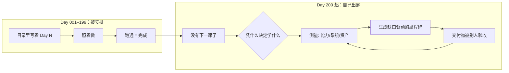
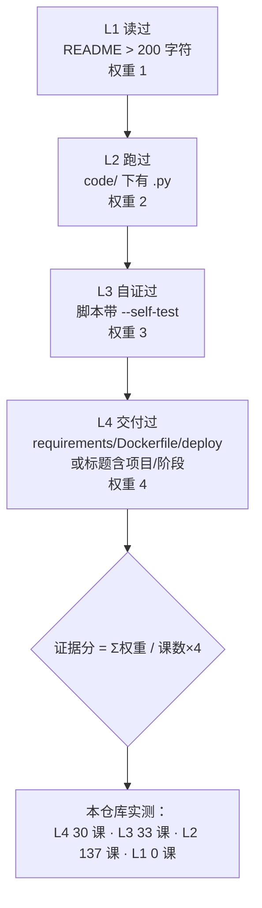
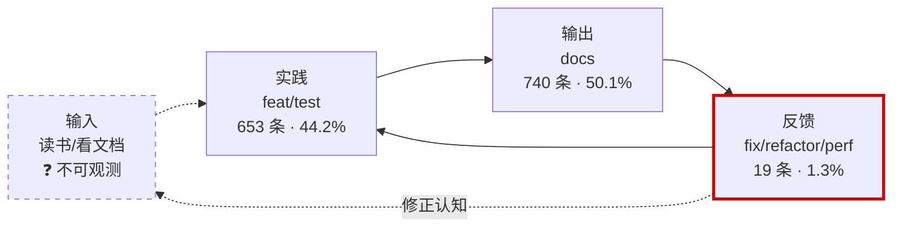
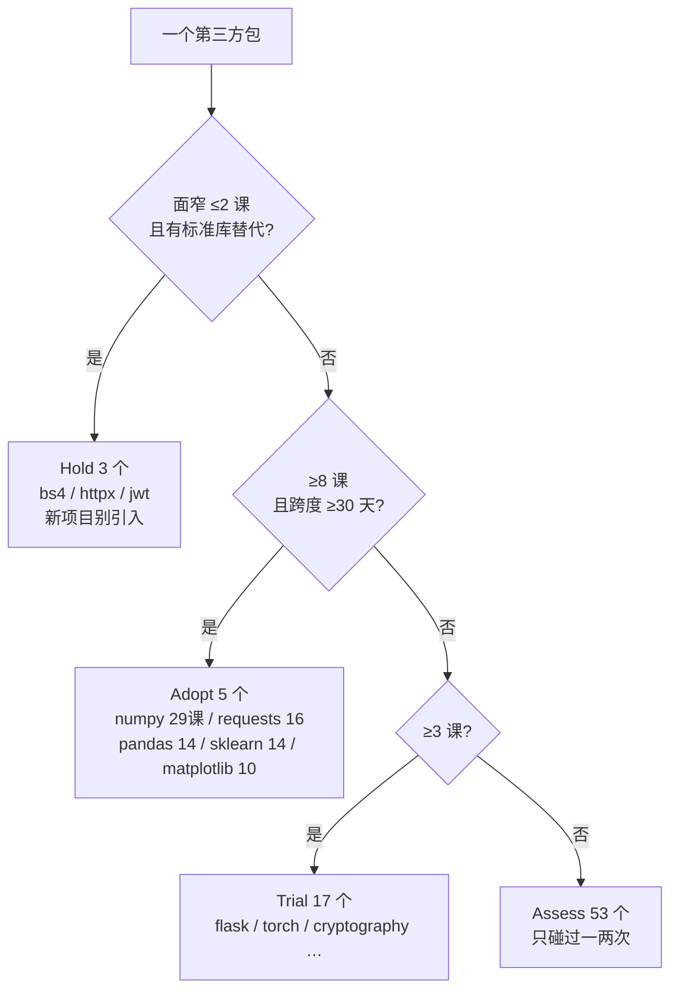
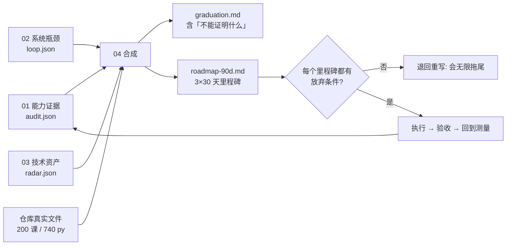
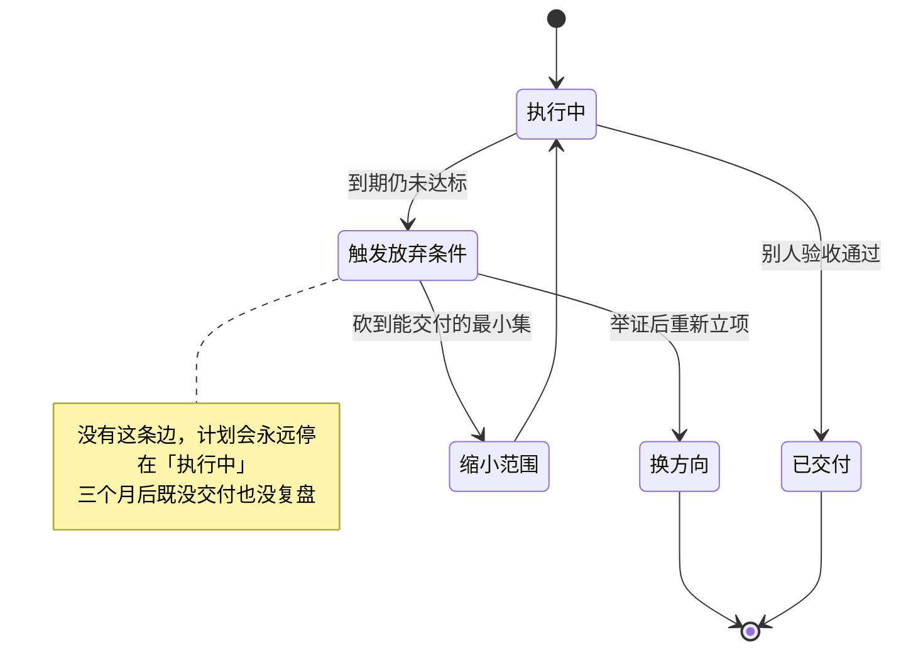

# Day 200 — 持续成长路径 图解

本目录只放图解，不生成图片文件。所有图都能在 GitHub / 本地 Markdown 渲染器中直接显示。
图里的数字全部来自四个脚本对本仓库的实测，来源命令见主 README 第五节。

---

## 图 1：毕业那天，真正改变的是什么



**读法**：前 199 天的闭环是「跑通即完成」，判据在自己手里。
毕业后的闭环多了一个外部节点——**别人能验收**。少了这个节点，计划就会退化成自我感觉。

---

## 图 2：证据阶梯——把「我感觉会」换成可数的痕迹



**读法**：等级取「能命中的最高级」，不是累加。
137 课停在 L2 意味着：代码写了，但没有一个断言能证明它今天还能跑。
这正是图 5 那个缺陷能存活 15 次提交的原因。

---

## 图 3：校准差要双向读

```text
                 自评分
                   ^
              高   |   高估区              一致区
                   |   （补证据）          （别动）
                   |
        +----------+----------+----------+--------> 证据分
                   |          |          |
              低   |   一致区 |   低估区
                   |          |  （去外部验证：
                   |          |    面试 / 开源 / 读者）

  带宽 ±15 分（产品判断，不是统计结论）

  实测样例（self-rating.example.json，示例数据非真实自评）：
    语言与数据模型   证据 52.1  自评 85  → +32.9  高估
    安全与合规       证据 82.0  自评 55  → −27.0  低估
    表达与协作       证据 80.0  自评 40  → −40.0  低估
```

**读法**：两个方向的错，修法完全不同。
高估要回去补痕迹；低估要去找一个外部裁判——你缺的不是能力，是证据的见证人。

---

## 图 4：学习系统的四阶段，以及那个测不到的阶段



**读法**：虚线是盲区——git 里没有「我读了什么」，所以输入不能算 0，只能算「未测量」。
红框是实测瓶颈：反馈占 1.3%，低于 5% 阈值。
一个 94.3% 的提交都在「新增」的系统，本质上是单向管道，不是回路。

---

## 图 5：一次批量提交如何把回访率刷成满分（真实数据）

```text
97dcb44  2026-11-06  refactor(days): 每日标题与目录名统一中文，修正跨文档错漏
            └─ 1057 files changed，一次触及 199 课

口径 A（全部反馈）        口径 B（剔除批量，阈值 ≥20 课）
  延迟样本  227 条          延迟样本   40 条
  中位延迟   85 天          中位延迟   55 天
  从未回访    0 门   ←──    从未回访  152 门
              ↑
        看起来完美                真相：76% 的课写完就没再被针对性修过

结论：指标不是被「造假」污染的，是被「粒度」污染的。
      一次改 199 课，不等于 199 课都被复盘过。
```

**读法**：这是本课最重要的一个原理。任何按「事件计数」的指标，
都要先问一句：**一个事件能覆盖多少个对象？** 覆盖数一大，指标就失去分辨力。

---

## 图 6：技术雷达四环（本仓库 78 个第三方包）



**读法**：判定顺序即优先级——先问「能不能不引入」，再问「用得够不够多」。
56 个包只出现在 ≤2 课里，它们是最该收敛的部分：教学上碰一次没问题，
但每一个都会变成你未来项目里要跟着升级的接口。

---

## 图 7：出题机——三份测量合成一个计划



**读法**：缺任何一份输入，04 会明确标「缺失」而不是编数字。
最后那条回边是关键：路线图不是终点，执行结果要重新变成测量输入。

---

## 图 8：放弃条件是一个状态机，不是一句丧气话



**读法**：放弃条件的作用不是允许你认输，而是**强制你在某个时刻重新举证**。
它把「继续投入」从一个默认动作，变成一个需要理由的决策。